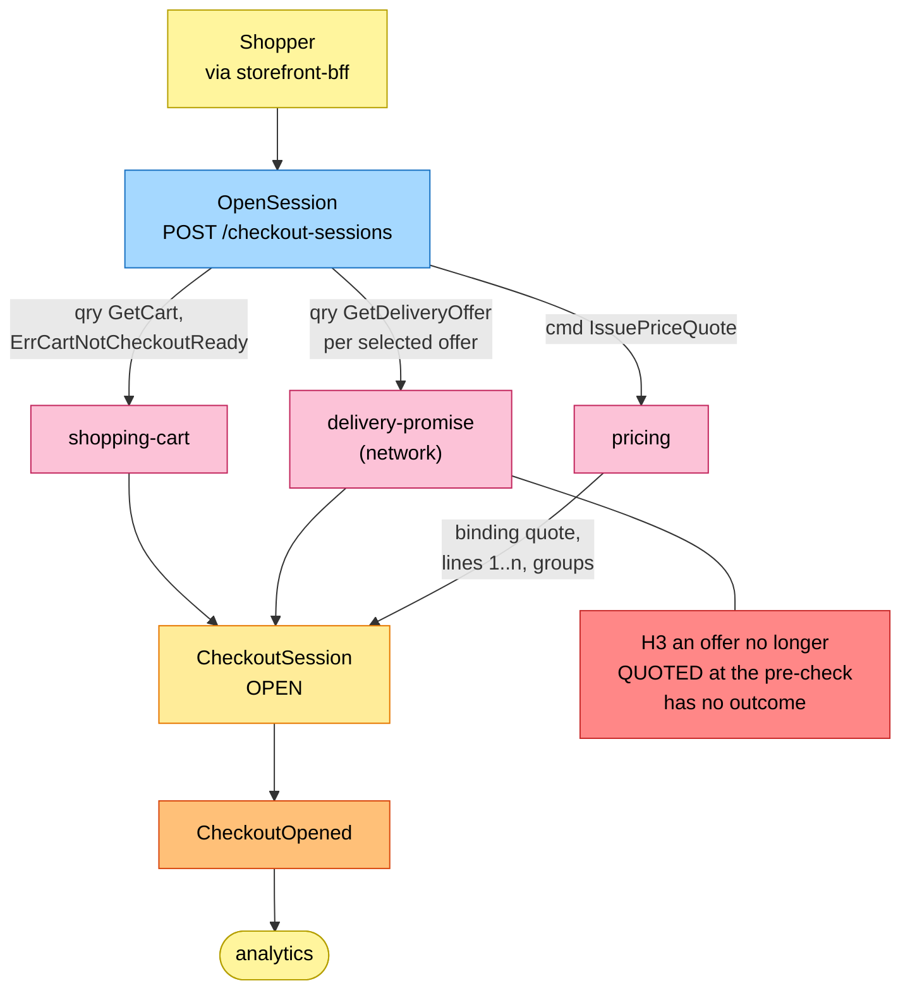
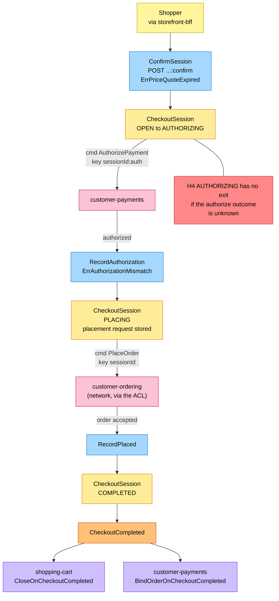
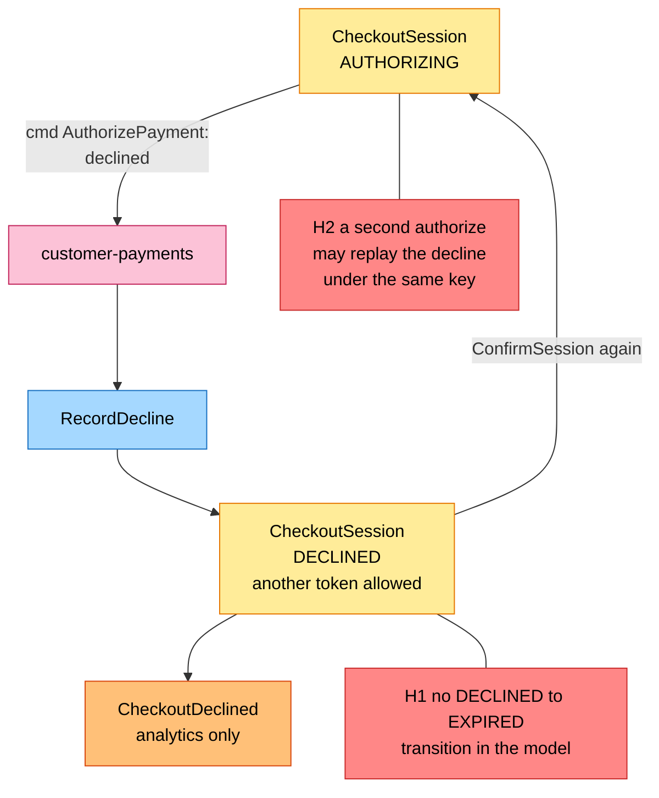
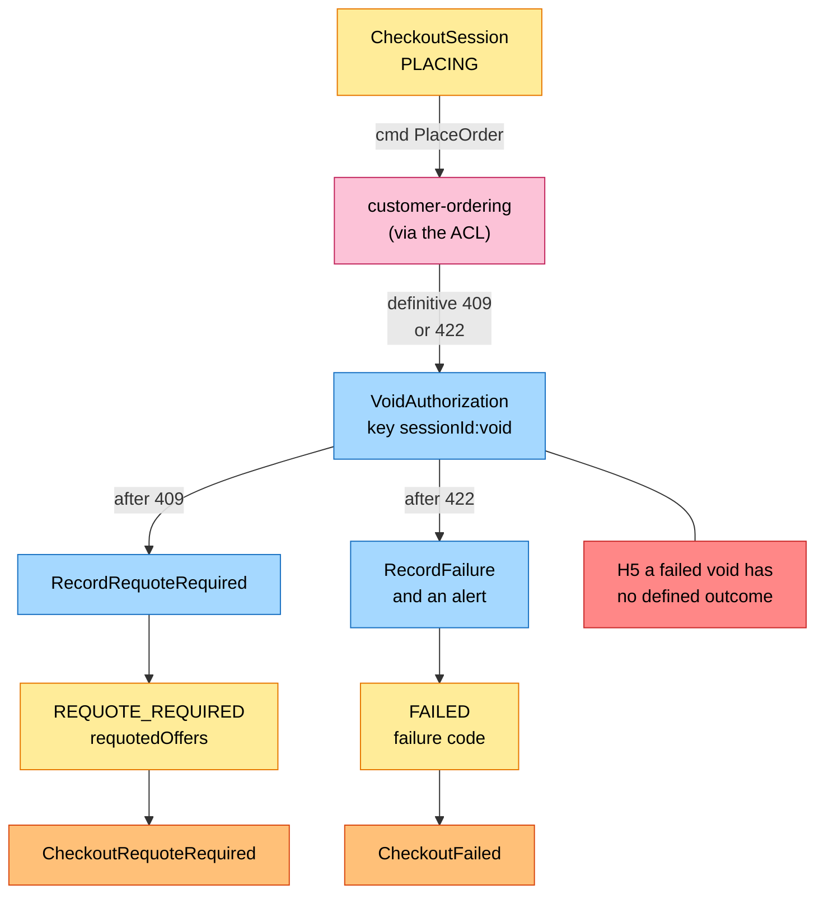
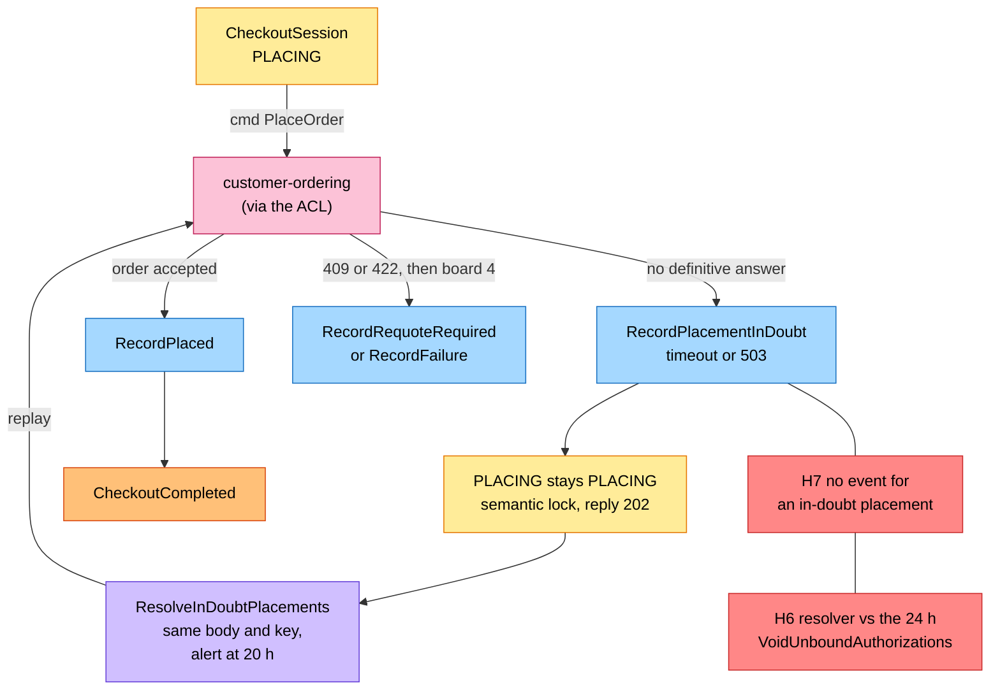
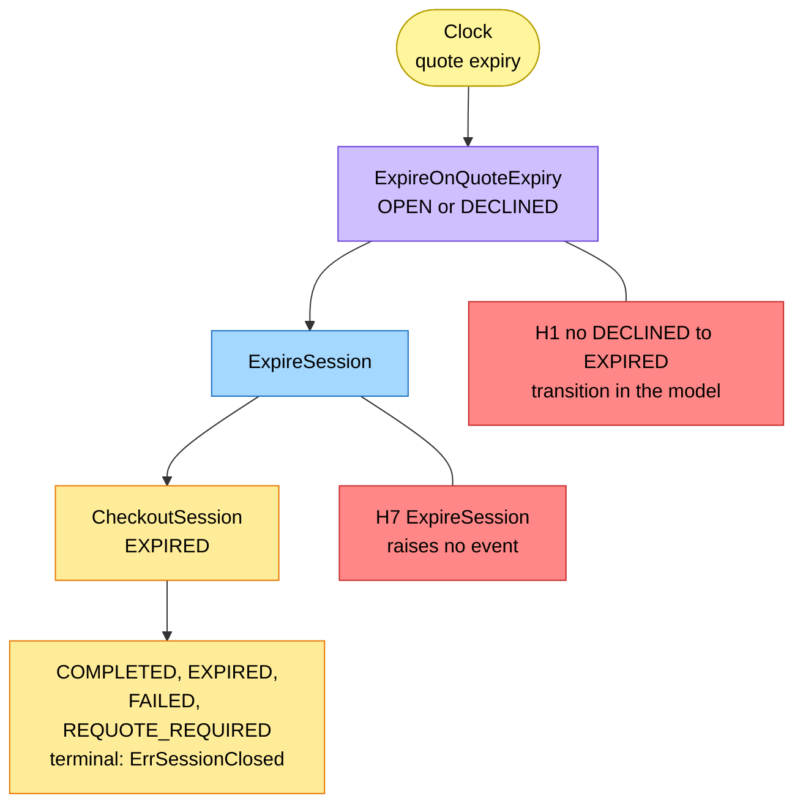

# EventStorming

:::info[Proposed design, docs only]
Derived from [`model/model.yaml`](https://github.com/IQVO/warehouse-docs/blob/main/storefront/model/model.yaml). Nothing in this context is built; the model is the canonical design, and identifiers (`Err...` names, routes, CloudEvents types) are the names a future implementation must use.
:::

Process-level boards in the ddd-crew
[EventStorming glossary & cheat sheet](https://github.com/ddd-crew/eventstorming-glossary-cheat-sheet)
notation. Every sticky comes from `model.yaml`. Events published by a
neighbour are drawn as orange stickies prefixed with the producer. Every
hotspot is a gap or a risk the model itself shows, and its source is given
in the hotspot table. Boards are drawn top to bottom; each stays within the page width.

## Legend

| Colour | Sticky | Meaning here |
| --- | --- | --- |
| Pale yellow `#fff59d` | Actor | The shopper (through the BFF), the clock |
| Blue `#a5d8ff` | Command | A command from `aggregates[CheckoutSession].commands` |
| Yellow `#ffec99` | Aggregate | The `CheckoutSession` aggregate and its state |
| Orange `#ffc078` | Domain Event | Ours (`publishes`) or a neighbour's (prefixed with the producer) |
| Lilac `#d0bfff` | Policy | `policies`, or the reaction a neighbour takes to an event |
| Pink `#fcc2d7` | External System | A sibling context or the network (`shopping-cart`, `pricing`, `customer-payments`, `delivery-promise`, `customer-ordering`, analytics) |
| Red `#ff8787` | Hotspot | A gap or risk in the model (see the table at the end) |

## 1. Opening a session

Derived from: `model.yaml → contexts[checkout].inbound` (BFF cmd row),
`.sync_calls` (`GetCart`, `GetDeliveryOffer`, `IssuePriceQuote`),
`.aggregates[CheckoutSession].invariants` (`ErrCartNotCheckoutReady`),
`.publishes[CheckoutOpened]`; gap S1 and S2 on the
[Model Gap Register](/storefront/strategic-design/model-gap-register).

Omitted: the `503` when a dependency is unreachable, and the outbox. The
price quote is binding and expiring; its expiry becomes the session's
`quoteExpiresAt`, the clock for board 6.

## 2. Authorize, then place the order

Derived from: `model.yaml → contexts[checkout].aggregates[CheckoutSession]`
(`transitions`, `invariants`, `commands`), `.sync_calls`
(`AuthorizePayment`, `PlaceOrder`), `.publishes[CheckoutCompleted]`;
`contexts[customer-payments].policies[BindOrderOnCheckoutCompleted]`;
`contexts[shopping-cart].policies[CloseOnCheckoutCompleted]`.

Omitted: the failure paths (boards 3 and 4), the in-doubt branch (board 5) and
the outbox. The money flow (D5) continues outside this context: capture on
`FulfillmentShipped`, release on `FulfillmentCancelled`, refund on
`PackageLost` or `PackageReturned` all belong to `customer-payments`.

## 3. A decline

Derived from: `model.yaml → contexts[checkout].business_decisions` (decline
bullet), `.aggregates[CheckoutSession].transitions` (`RecordDecline`,
`DECLINED → AUTHORIZING`), `.publishes[CheckoutDeclined]`;
`contexts[customer-payments].publishes[PaymentDeclined]`.

A decline voids nothing: no authorization exists. The session stays open for
as long as the price quote is valid.

## 4. Requote and contract failure

Derived from: `model.yaml → contexts[checkout].business_decisions` (409 and
422 bullets), `.aggregates[CheckoutSession].transitions`,
`.sync_calls[VoidAuthorization]` ("only after a definitive rejection"),
`.publishes` (`CheckoutRequoteRequired`, `CheckoutFailed`), `.ul[Requote]`;
`contexts[customer-payments].inbound` (`VoidAuthorization`).

Both definitive rejections void first, then record. Both events are
analytics-only. Omitted: the shopper's next attempt after `REQUOTE_REQUIRED`,
which starts from the cart with a new session (hotspot H10 on how the cart
takes the requoted offers).

## 5. In-doubt placement

Derived from: `model.yaml → contexts[checkout].policies[ResolveInDoubtPlacements]`,
`.business_decisions` (503 or timeout bullet), `.aggregates[CheckoutSession]`
(`RecordPlacementInDoubt`, `ErrPlacementInDoubt`), `.ul[In-Doubt Placement]`;
`contexts[customer-payments].policies[VoidUnboundAuthorizations]`.

The lock is a business state: a restart does not release it, and the
resolver runs from the stored request. The alert at 20 h comes before the
network's 24 h idempotency window, after which a replay could no longer be
answered with the first response.

## 6. Expiry and terminal states

Derived from: `model.yaml → contexts[checkout].policies[ExpireOnQuoteExpiry]`,
`.aggregates[CheckoutSession]` (`states`, `transitions`,
`ErrSessionClosed`).

Omitted: the same-shaped `COMPLETED`, `FAILED` and `REQUOTE_REQUIRED`
terminals, drawn on boards 2 and 4. A session in `AUTHORIZING` or `PLACING`
is not touched by this policy: only an `OPEN` or `DECLINED` session expires
with its quote.

## Hotspots

| # | Hotspot | Where it comes from in the model |
| --- | --- | --- |
| H1 | `ExpireOnQuoteExpiry` says an `OPEN` or `DECLINED` session expires, but the transition list holds only `OPEN → EXPIRED`; a `DECLINED` session has no way to `EXPIRED`, and `ErrSessionClosed` does not list `DECLINED` as terminal. | `policies[ExpireOnQuoteExpiry]` vs `aggregates[CheckoutSession].transitions` |
| H2 | `AuthorizePayment` is keyed `<sessionId>:auth`, and a decline returns the session to `AUTHORIZING` for another token. If the second attempt reuses the key, `customer-payments` replays the first, declined answer; the model does not say how the key changes per attempt. | `sync_calls[AuthorizePayment]` (note), `transitions` (`DECLINED → AUTHORIZING`), `customer-payments` `ErrDuplicateAuthorization` |
| H3 | The pre-check that every selected offer is still `QUOTED` (and the `ErrCartNotCheckoutReady` check) happens before anything is authorized, but `REQUOTE_REQUIRED` is reachable only from `PLACING`. The model has no state or error for an offer that fails the pre-check. | `sync_calls[GetDeliveryOffer]` (note) vs `transitions`, `invariants` |
| H4 | No transition leaves `AUTHORIZING` for an unknown authorize outcome (timeout); only `customer-payments`' `VoidUnboundAuthorizations` (no `CheckoutCompleted` after 24 h) covers a crash after authorize, and nothing moves the session. | `transitions`, `contexts[customer-payments].policies` |
| H5 | `REQUOTE_REQUIRED` and `FAILED` follow a successful void (REST contract), but `VoidAuthorization` is a call, not a session command, and no state, error or retry covers a void that fails (or the void an `ErrAuthorizationMismatch` would call for). | `sync_calls[VoidAuthorization]`, `storefront/apis/checkout/openapi.yaml` |
| H6 | The resolver may still be replaying near 24 h, the instant `customer-payments`' `VoidUnboundAuthorizations` voids an authorization with no `CheckoutCompleted`; the 20 h alert is the only margin. | `policies[ResolveInDoubtPlacements]` vs `contexts[customer-payments].policies[VoidUnboundAuthorizations]` |
| H7 | `ExpireSession` and `RecordPlacementInDoubt` (and `ConfirmSession`, `RecordAuthorization`) raise no event, so analytics sees opens, declines, requotes and failures but never an expiry or an in-doubt placement. | `aggregates[CheckoutSession].commands` vs `publishes` |
| H8 | `shipToAddressId` (NG1), `offer-not-quotable` and `requotedOffers` are named by the storefront model, but the network model does not yet carry them; they are "once built" prerequisites the ACL depends on. | `sync_calls[PlaceOrder]`, `business_decisions`, `meta.hard_boundary` vs `network/model/model.yaml → contexts[customer-ordering]` |
| H9 | The stored placement request is central (replay byte for byte, "retained for the idempotency window") but has no value object, field name, shape or purge in the model. | `purpose`, `aggregates[CheckoutSession].description`, `.size_estimate` |
| H10 | The REST contract says the BFF writes `requotedOffers` into the cart as a new quote, but the cart's commands quote only through `delivery-promise` (`QuoteDelivery`); none accepts an offer set from outside. | `storefront/apis/checkout/openapi.yaml` (`CheckoutSession.requotedOffers`) vs `contexts[shopping-cart].aggregates[Cart].commands` |
