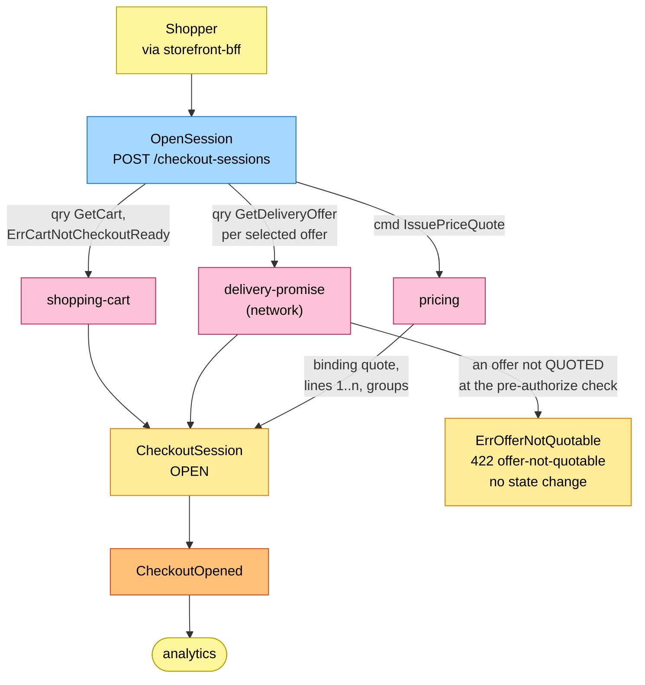
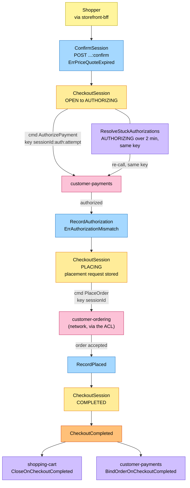
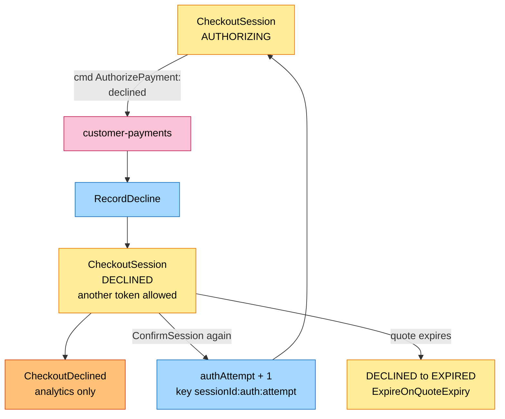
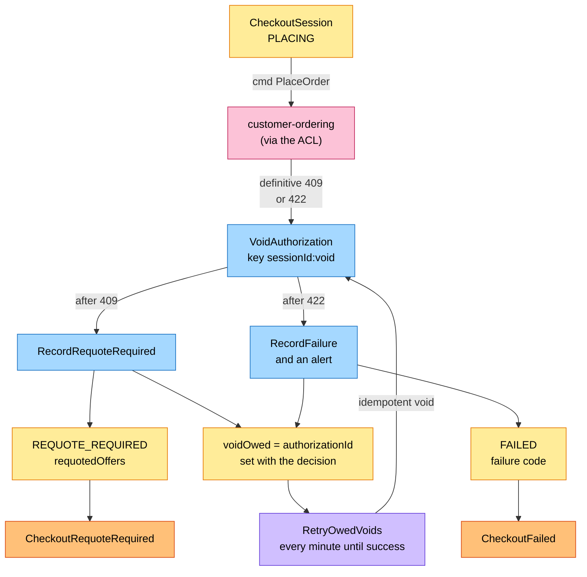
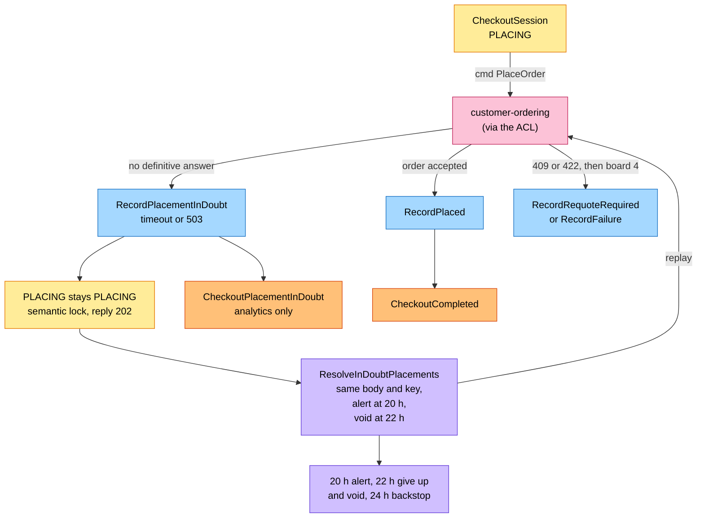
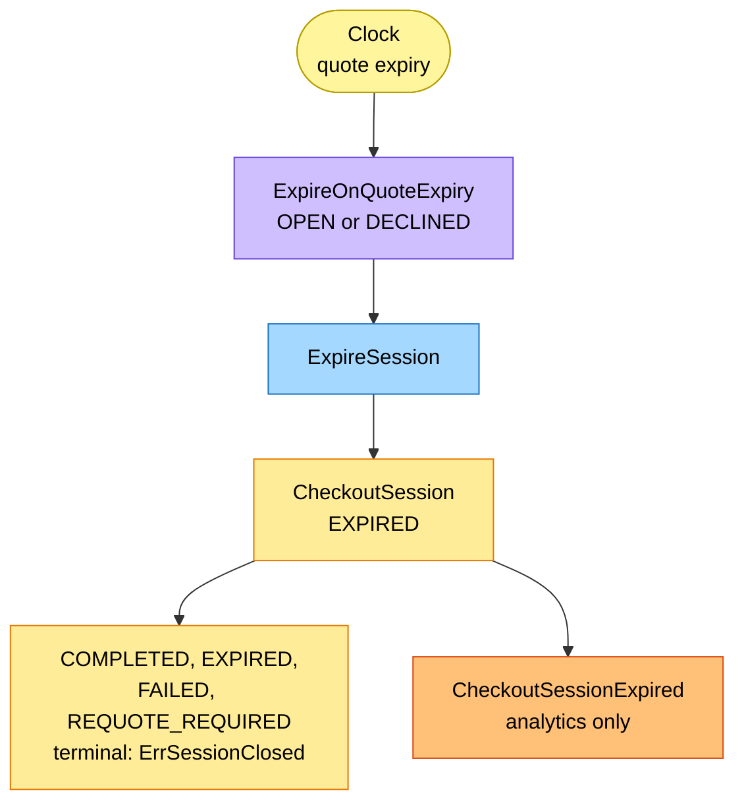

# EventStorming

:::info[Built on develop, not deployed]
Derived from [`model/model.yaml`](https://github.com/IQVO/warehouse-docs/blob/main/storefront/model/model.yaml). The `checkout` service is built on develop ([`IQVO/checkout`](https://github.com/IQVO/checkout) at `ab4f0e9`, checked 2026-10-27) and not deployed (no warehouse-infra entry). Every `Err...` name, REST route and CloudEvents type of this context named on this page exists in the service; where the built service differs from the model's design, the page says so (**As built**) or the context's [Service and operations](/storefront/contexts/checkout#service-and-operations) section lists it.
:::

Process-level boards in the ddd-crew
[EventStorming glossary & cheat sheet](https://github.com/ddd-crew/eventstorming-glossary-cheat-sheet)
notation. Every sticky comes from `model.yaml`. Events published by a
neighbour are drawn as orange stickies prefixed with the producer. Every
hotspot is a gap or a risk the model itself shows, and its source is given
in the hotspot table. Boards are drawn top to bottom; each stays within the page width.

## Legend

| Colour | Sticky | Meaning here |
| --- | --- | --- |
| Pale yellow `#fff59d` | Actor | The shopper (through the BFF), the clock |
| Blue `#a5d8ff` | Command | A command from `aggregates[CheckoutSession].commands` |
| Yellow `#ffec99` | Aggregate | The `CheckoutSession` aggregate and its state |
| Orange `#ffc078` | Domain Event | Ours (`publishes`) or a neighbour's (prefixed with the producer) |
| Lilac `#d0bfff` | Policy | `policies`, or the reaction a neighbour takes to an event |
| Pink `#fcc2d7` | External System | A sibling context or the network (`shopping-cart`, `pricing`, `customer-payments`, `delivery-promise`, `customer-ordering`, analytics) |
| Red `#ff8787` | Hotspot | A gap or risk in the model (see the table at the end) |

## 1. Opening a session

Derived from: `model.yaml → contexts[checkout].inbound` (BFF cmd row),
`.sync_calls` (`GetCart`, `GetDeliveryOffer`, `IssuePriceQuote`),
`.aggregates[CheckoutSession].invariants` (`ErrCartNotCheckoutReady`),
`.publishes[CheckoutOpened]`; gap S1 and S2 on the
[Model Gap Register](/storefront/strategic-design/model-gap-register).

The pre-authorize `GetDeliveryOffer` check is repeated at confirm; an offer
that is no longer `QUOTED` (with margin) fails with `ErrOfferNotQuotable`
(`422 offer-not-quotable`), changes no state, and the BFF refreshes the cart
quote. `REQUOTE_REQUIRED` stays a `PLACING`-time `409` only.

Omitted: the `503` when a dependency is unreachable, and the outbox. The
price quote is binding and expiring; its expiry becomes the session's
`quoteExpiresAt`, the clock for board 6.

## 2. Authorize, then place the order

Derived from: `model.yaml → contexts[checkout].aggregates[CheckoutSession]`
(`transitions`, `invariants`, `commands`), `.sync_calls`
(`AuthorizePayment`, `PlaceOrder`), `.publishes[CheckoutCompleted]`;
`contexts[customer-payments].policies[BindOrderOnCheckoutCompleted]`;
`contexts[shopping-cart].policies[CloseOnCheckoutCompleted]`;
`.policies[ResolveStuckAuthorizations]`.

`ResolveStuckAuthorizations` settles an unknown authorize outcome: a session
in `AUTHORIZING` for more than 2 minutes re-calls `AuthorizePayment` with the
same key `<sessionId>:auth:<authAttempt>`, which is idempotent and yields the
true outcome; `customer-payments`' 24 h void stays the backstop.

Omitted: the failure paths (boards 3 and 4), the in-doubt branch (board 5) and
the outbox. The money flow (D5) continues outside this context: capture on
`FulfillmentShipped`, release on `FulfillmentCancelled`, refund on
`PackageLost` or `PackageReturned` all belong to `customer-payments`.

## 3. A decline

Derived from: `model.yaml → contexts[checkout].business_decisions` (decline
bullet), `.aggregates[CheckoutSession].transitions` (`RecordDecline`,
`DECLINED → AUTHORIZING`), `.publishes[CheckoutDeclined]`;
`contexts[customer-payments].publishes[PaymentDeclined]`.

A decline voids nothing: no authorization exists. The session stays open for
as long as the price quote is valid; `DECLINED → EXPIRED` is a modelled
transition (`ExpireSession`). Each `DECLINED → AUTHORIZING` increments the
session field `authAttempt`, so a retry with another token is a new attempt
under a new key `<sessionId>:auth:<authAttempt>` and is never answered with the
first, declined response, while a stuck call replays the same key.

## 4. Requote and contract failure

Derived from: `model.yaml → contexts[checkout].business_decisions` (409 and
422 bullets), `.aggregates[CheckoutSession].transitions`,
`.sync_calls[VoidAuthorization]` ("only after a definitive rejection"),
`.publishes` (`CheckoutRequoteRequired`, `CheckoutFailed`), `.ul[Requote]`;
`.policies[RetryOwedVoids]`; `contexts[customer-payments].inbound`
(`VoidAuthorization`).

Every definitive rejection (`409`, `422`, and an `ErrAuthorizationMismatch`)
sets the session field `voidOwed` (the `authorizationId`) in the same
transaction as the decision to void, so no void is lost. The void is attempted
at once; if it fails, `RetryOwedVoids` runs every minute until it succeeds
(`Void` is idempotent, key `<sessionId>:void`). Both events are
analytics-only. Omitted: the shopper's next attempt after `REQUOTE_REQUIRED`,
which starts from the cart with a new session (hotspot H10 on how the cart
takes the requoted offers).

## 5. In-doubt placement

Derived from: `model.yaml → contexts[checkout].policies[ResolveInDoubtPlacements]`,
`.business_decisions` (503 or timeout bullet), `.aggregates[CheckoutSession]`
(`RecordPlacementInDoubt`, `ErrPlacementInDoubt`), `.ul[In-Doubt Placement]`;
`.publishes[CheckoutPlacementInDoubt]`;
`contexts[customer-payments].policies[VoidUnboundAuthorizations]`.

The lock is a business state: a restart does not release it, and the
resolver runs from the stored request (`StoredPlacement`, with `placingSince`
driving the clock). The timeline is ordered: the alert at 20 h, then
`ResolveInDoubtPlacements` gives up and voids at 22 h, then
`customer-payments`' `VoidUnboundAuthorizations` as the backstop at 24 h. All
before the network's 24 h idempotency window closes. `Void` is idempotent, so
a race between the resolver and the backstop is harmless.
`RecordPlacementInDoubt` raises the analytics-only
`CheckoutPlacementInDoubt`.

## 6. Expiry and terminal states

Derived from: `model.yaml → contexts[checkout].policies[ExpireOnQuoteExpiry]`,
`.aggregates[CheckoutSession]` (`states`, `transitions`,
`ErrSessionClosed`), `.publishes[CheckoutSessionExpired]`.

`ExpireSession` covers `OPEN → EXPIRED` and `DECLINED → EXPIRED` and raises
the analytics-only `CheckoutSessionExpired`. `ErrSessionClosed` covers
`COMPLETED`, `EXPIRED`, `FAILED` and `REQUOTE_REQUIRED`; a
`DECLINED` session is not closed (it retries with another token or expires).

Omitted: the same-shaped `COMPLETED`, `FAILED` and `REQUOTE_REQUIRED`
terminals, drawn on boards 2 and 4. A session in `AUTHORIZING` or `PLACING`
is not touched by this policy: only an `OPEN` or `DECLINED` session expires
with its quote.

## Hotspots

| # | Hotspot | Where it comes from in the model |
| --- | --- | --- |
| H1 | **Resolved in the model-fix:** `DECLINED → EXPIRED` is a transition (`ExpireSession`, policy `ExpireOnQuoteExpiry`). `DECLINED` is not closed: it retries with another token or expires. `ErrSessionClosed` lists `COMPLETED`, `EXPIRED`, `FAILED` and `REQUOTE_REQUIRED` only. | `policies[ExpireOnQuoteExpiry]` vs `aggregates[CheckoutSession].transitions` |
| H2 | **Resolved in the model-fix:** `AuthorizePayment` is keyed `<sessionId>:auth:<authAttempt>`. The session field `authAttempt` starts at 1 and is incremented on each `DECLINED → AUTHORIZING`, so a retry with another token is a new attempt while a stuck call replays the same key. | `sync_calls[AuthorizePayment]` (note), `transitions` (`DECLINED → AUTHORIZING`), `customer-payments` `ErrDuplicateAuthorization` |
| H3 | **Resolved in the model-fix:** `ErrOfferNotQuotable` (`422 offer-not-quotable`) is raised by the pre-authorize `GetDeliveryOffer` check; no state change, the BFF refreshes the cart quote. `REQUOTE_REQUIRED` stays a `PLACING`-time `409` only. | `sync_calls[GetDeliveryOffer]` (note) vs `transitions`, `invariants` |
| H4 | **Resolved in the model-fix:** the policy `ResolveStuckAuthorizations` re-calls `AuthorizePayment` with the same key for a session in `AUTHORIZING` for more than 2 minutes; `customer-payments`' 24 h void stays the backstop. | `transitions`, `contexts[customer-payments].policies` |
| H5 | **Resolved in the model-fix:** the session field `voidOwed` (`authorizationId`) is set in the same transaction as the decision to void (definitive `409`, `422`, `ErrAuthorizationMismatch`); the policy `RetryOwedVoids` retries every minute until success. `Void` is idempotent. | `sync_calls[VoidAuthorization]`, `storefront/apis/checkout/openapi.yaml` |
| H6 | **Resolved in the model-fix:** an ordered timeline: alert at 20 h, `ResolveInDoubtPlacements` gives up and voids at 22 h, `customer-payments` `VoidUnboundAuthorizations` backstop at 24 h. A race between the two voids is harmless. | `policies[ResolveInDoubtPlacements]` vs `contexts[customer-payments].policies[VoidUnboundAuthorizations]` |
| H7 | **Resolved in the model-fix:** two new analytics-only events, `CheckoutSessionExpired` (`ExpireSession`) and `CheckoutPlacementInDoubt` (`RecordPlacementInDoubt`). `ConfirmSession` and `RecordAuthorization` stay eventless: `CheckoutCompleted` already covers the outcome. | `aggregates[CheckoutSession].commands` vs `publishes` |
| H8 | `shipToAddressId` (NG1), `offer-not-quotable` and `requotedOffers` are named by the storefront model, but the network model does not yet carry them; they are "once built" prerequisites the ACL depends on. | `sync_calls[PlaceOrder]`, `business_decisions`, `meta.hard_boundary` vs `network/model/model.yaml → contexts[customer-ordering]` |
| H9 | **Resolved in the model-fix:** the value object `StoredPlacement{requestBody, requestHash, placingSince}`; the PII-free request replayed byte for byte, `placingSince` drives the 20 h alert, purged 24 h after a terminal state. | `purpose`, `aggregates[CheckoutSession].description`, `.size_estimate` |
| H10 | The REST contract says the BFF writes `requotedOffers` into the cart as a new quote, but the cart's commands quote only through `delivery-promise` (`QuoteDelivery`); none accepts an offer set from outside. | `storefront/apis/checkout/openapi.yaml` (`CheckoutSession.requotedOffers`) vs `contexts[shopping-cart].aggregates[Cart].commands` |
