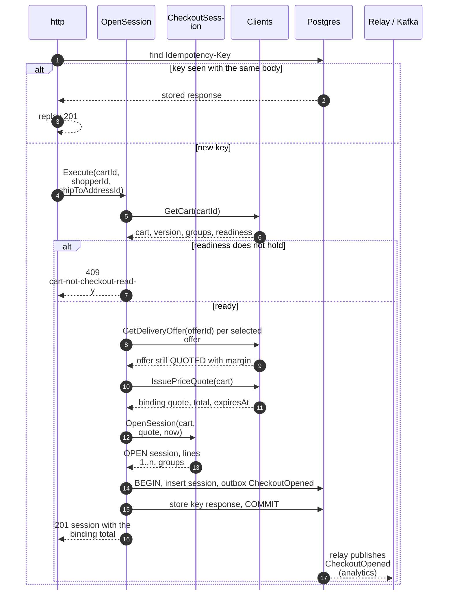
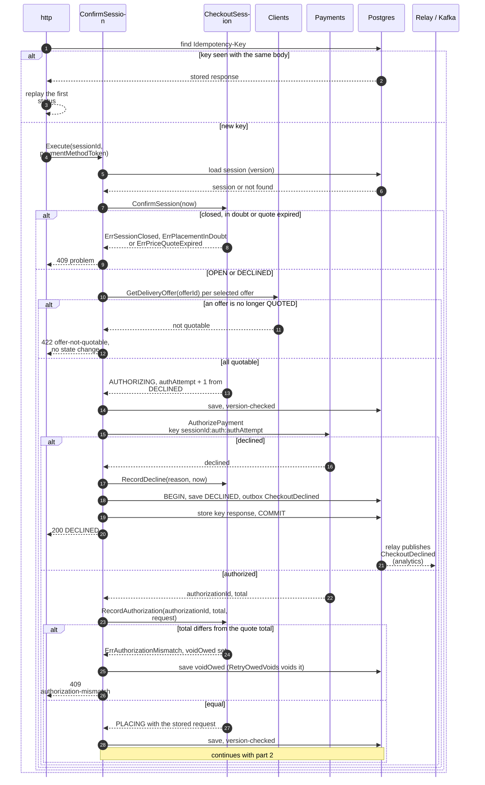
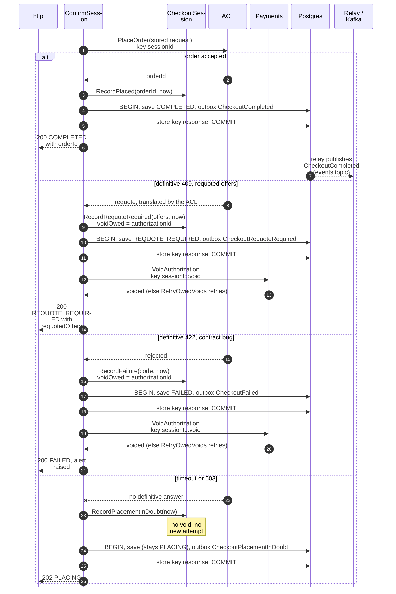
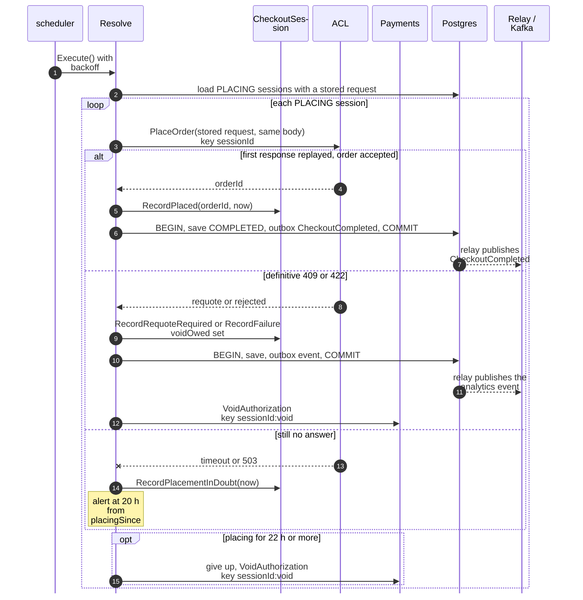
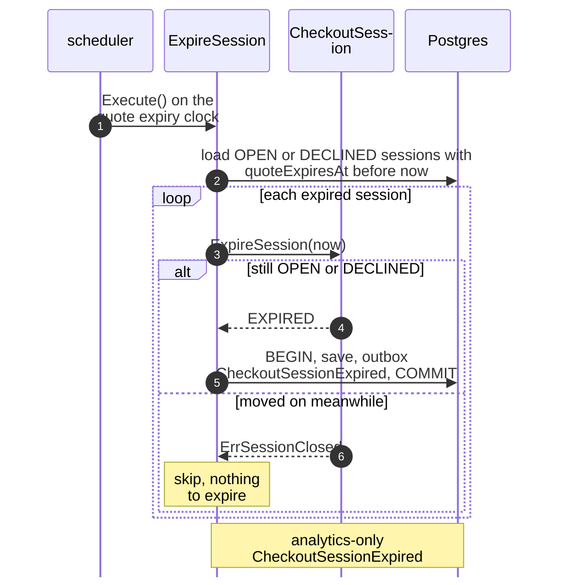

# Sequence Diagrams

:::info[Built on develop, not deployed]
Derived from [`model/model.yaml`](https://github.com/IQVO/warehouse-docs/blob/main/storefront/model/model.yaml). The `checkout` service is built on develop ([`IQVO/checkout`](https://github.com/IQVO/checkout) at `ab4f0e9`, checked 2026-10-27) and not deployed (no warehouse-infra entry). Every `Err...` name, REST route and CloudEvents type of this context named on this page exists in the service; where the built service differs from the model's design, the page says so (**As built**) or the context's [Service and operations](/storefront/contexts/checkout#service-and-operations) section lists it.
:::

One UML sequence diagram per command use case on
[Use Cases](/storefront/contexts/checkout/use-cases); the long
`ConfirmSession` is drawn in two parts (authorize, then place the order).
Participant names are the proposed packages and ports from the
[Class Diagram](/storefront/contexts/checkout/class-diagram):

- `http` and `scheduler` are the inbound adapters.
- The use case is in `internal/application/usecases`.
- `Clients` stands for the outbound REST adapters `shoppingcart`,
  `deliverypromise` and `pricing`; `Payments` for `customerpayments`.
- `ACL` is `internal/adapters/outbound/customerordering`, the
  Anti-Corruption Layer and the only participant that knows the network's wire
  names.
- `Postgres` stands for the repository, the outbox and the idempotency store.
  They share one transaction through `UnitOfWork`.
- `Relay / Kafka` is the outbox relay. It reads committed `outbox_events`
  rows and publishes `CheckoutCompleted` to `retailnetwork.checkout.events`
  and the six other events to `retailnetwork.checkout.analytics`.

Every save is conditional on the loaded `version` (optimistic concurrency).
**No outbound call sits inside a database transaction**: the use case commits
the state it acts from, calls out, then commits the outcome. Full CloudEvents
types are on [Domain Events](/storefront/contexts/checkout/domain-events).

## 1. OpenSession (REST POST /checkout-sessions)

Derived from: `model.yaml → contexts[checkout].aggregates[CheckoutSession].commands[OpenSession]`,
`.invariants[ErrCartNotCheckoutReady]`, `.sync_calls`, `.rest["POST /checkout-sessions"]`,
`.publishes[CheckoutOpened]`, `conventions.integration_rules`.

Omitted: the `503` when `Clients` cannot answer (the shopper retries with the
same `Idempotency-Key`), the `422` on invalid input, and the case where an
offer is no longer `QUOTED` at the pre-check, which fails as
`ErrOfferNotQuotable` (`422 offer-not-quotable`, no state change; hotspot H3,
resolved, on [EventStorming](/storefront/contexts/checkout/eventstorming)).

## 2. ConfirmSession, part 1: authorize (REST POST ...:confirm)

Derived from: `model.yaml → contexts[checkout].aggregates[CheckoutSession]`
(`transitions`, `invariants`), `.sync_calls[AuthorizePayment]`,
`.rest["POST /checkout-sessions/{sessionId}:confirm"]`,
`.publishes[CheckoutDeclined]`, `.policies[ResolveStuckAuthorizations, RetryOwedVoids]`.

Omitted: the `404` for an unknown session, a version conflict retried once
and then `409 concurrent-update`. A `Payments` timeout on authorize leaves
the session `AUTHORIZING`; `ResolveStuckAuthorizations` re-calls after 2
minutes with the same key (hotspot H4, resolved). A mismatching total sets
`voidOwed` (hotspot H5, resolved), and a second authorize after a decline is
a new attempt with its own key (hotspot H2, resolved).

## 3. ConfirmSession, part 2: place the order

Derived from: `model.yaml → contexts[checkout].business_decisions`,
`.aggregates[CheckoutSession]` (`transitions`, `ErrPlacementInDoubt`),
`.sync_calls` (`PlaceOrder`, `VoidAuthorization`),
`.publishes` (`CheckoutCompleted`, `CheckoutRequoteRequired`,
`CheckoutFailed`, `CheckoutPlacementInDoubt`),
`.policies[RetryOwedVoids]`.

The stored request is PII-free and carries `shipToAddressId`, never an
address; the `Idempotency-Key` towards the network is the `sessionId`. The
`REQUOTE_REQUIRED` and `FAILED` states are recorded together with
`voidOwed`, in one transaction, before the void is attempted; a failing void
is retried every minute by `RetryOwedVoids` (hotspot H5, resolved). Omitted:
the mapping of the network's wire names, which happens inside `ACL` and is
not yet in the network model (hotspot H8).

## 4. ResolveInDoubtPlacements (scheduler)

Derived from: `model.yaml → contexts[checkout].policies[ResolveInDoubtPlacements]`,
`.business_decisions`, `.aggregates[CheckoutSession].transitions`,
`.sync_calls`.

The replay is safe because the body is byte for byte the stored one and the
key is the same: `customer-ordering` replays its first response. No shopper
waits on this path; the BFF polls `GetSession`. The timeline is ordered:
alert at 20 h, give up and void at 22 h, `customer-payments`' void of an
unbound authorization at 24 h as the backstop (hotspot H6, resolved); `Void`
is idempotent, so a race is harmless. Omitted: the backoff schedule, which the
model does not give.

## 5. ExpireSession (scheduler)

Derived from: `model.yaml → contexts[checkout].policies[ExpireOnQuoteExpiry]`,
`.aggregates[CheckoutSession].transitions[OPEN, EXPIRED]` and
`[DECLINED, EXPIRED]`, `.publishes[CheckoutSessionExpired]`.

`DECLINED` sessions expire like `OPEN` ones (hotspot H1, resolved). A session that moves to
`AUTHORIZING` between the load and the call is rejected by the version check
and by the aggregate.

## Not drawn

`RecordAuthorization`, `RecordDecline`, `RecordPlacementInDoubt`,
`RecordPlaced`, `RecordRequoteRequired` and `RecordFailure` are the steps
drawn inside diagrams 2 to 4; they have no entry point of their own. `GetSession`
(REST `GET /checkout-sessions/{sessionId}`) reads the repository through its
port and changes nothing.
