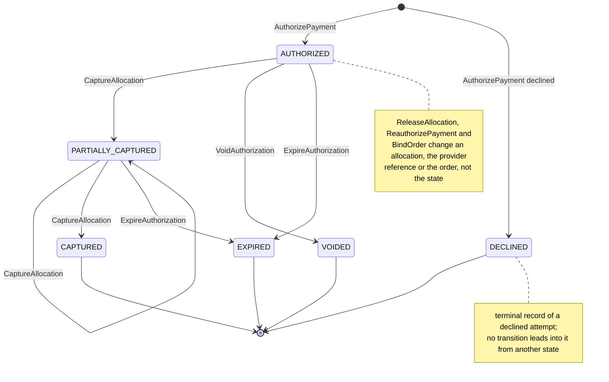
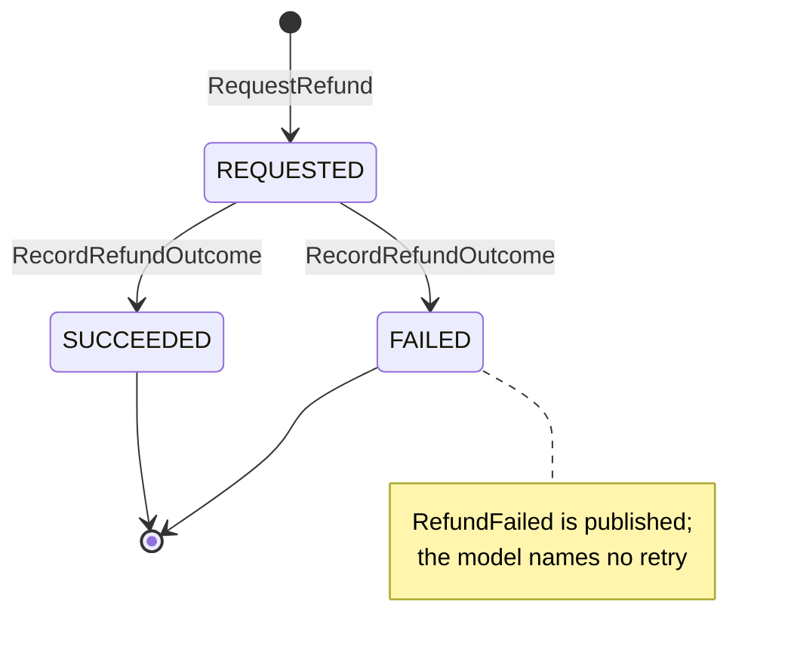

# Aggregate Design Canvas

:::info[Proposed design, docs only]
Derived from [`model/model.yaml`](https://github.com/IQVO/warehouse-docs/blob/main/storefront/model/model.yaml). Nothing in this context is built; the model is the canonical design, and identifiers (`Err...` names, routes, CloudEvents types) are the names a future implementation must use.
:::

Following the ddd-crew [Aggregate Design Canvas v1.1](https://github.com/ddd-crew/aggregate-design-canvas).
The model has two aggregate roots in this context, **PaymentAuthorization**
and **Refund**, and one read model, **ParkedFulfillmentFacts**. Proposed Go
packages: `internal/domain/authorization` and `internal/domain/refund` (the
packages the UL code identifiers name).

## PaymentAuthorization

### 1. Name

`PaymentAuthorization` (`authorization.PaymentAuthorization`), identified by
`authorizationId`.

### 2. Description

One checkout session's authorization: a unique `checkoutSessionId`, an
`orderId` (bound later, by `BindOrder`), the `allocations` (`groupNo`,
`amountMinor`, state `PENDING`, `CAPTURED` or `RELEASED`), the provider
references and `expiresAt`. Value objects:

| Value object | Fields | Note |
| --- | --- | --- |
| `Allocation` | `groupNo`, `amountMinor`, `state` (`PENDING`, `CAPTURED`, `RELEASED`) | The share of the authorization that belongs to one shipment group; the unit of capture and release. |
| `ProviderRef` | `providerAuthorizationId`, `providerCaptureIds[]` | The provider's references; the only place provider ids live in the aggregate. |

The model's description of this aggregate is cut off in the middle of
"unique checkoutSessionId" (a literal ellipsis in `model.yaml`); the field
list above restores it from the invariants, the REST contract and the
`PaymentAuthorized` payload (hotspot H11 below). The aggregate stores a PSP
token reference, never a card number.

### 3. State Transitions

Derived from: `model.yaml → contexts[customer-payments].aggregates[PaymentAuthorization].states`,
`.transitions`, `.commands`, `.notes`.

The entry arrows are the creating command `AuthorizePayment`: an accepted
authorize creates the record `AUTHORIZED`, a declined one creates it
`DECLINED`, and the checkout session stays open for another token. The three
other terminal states are entered from the live states only. Transitions the
model does not list are therefore not drawn: in particular there is no row
for `AUTHORIZED → CAPTURED`, none for `ReleaseAllocation`, and none that
moves an authorization whose every allocation is released (hotspot H3 below).

### 4. Enforced Invariants

| Invariant | Enforced by |
| --- | --- |
| One authorization per checkout session; a replay returns it | `AuthorizePayment` → `ErrDuplicateAuthorization` |
| Allocations sum to the authorized total and name the session's groups | `AuthorizePayment` → `ErrAllocationMismatch` |
| Captured per group never exceeds the allocation | `CaptureAllocation` → `ErrOverCapture` |
| No capture after `expiresAt` | `CaptureAllocation` → `ErrCaptureAfterExpiry` |
| A capture or release names an existing group | `CaptureAllocation`, `ReleaseAllocation` → `ErrUnknownGroup` |

Derived from: `model.yaml → contexts[customer-payments].aggregates[PaymentAuthorization].invariants`.
Shared problem types apply on top: `illegal-transition` (409) for a command
the state does not allow, `concurrent-update` (409) and `validation-failed`
(422).

### 5. Corrective Policies

| Policy | Owner | Rule | Effect on this aggregate |
| --- | --- | --- | --- |
| `BindOrderOnCheckoutCompleted` | this context | On `CheckoutCompleted` bind `orderId` to the session's authorization, then apply any parked fulfilment facts. | `BindOrder`; then the parked `CaptureAllocation`, `ReleaseAllocation` or refund commands run. |
| `CaptureOnShipment` | this context | On `FulfillmentShipped{orderId, groupNo, trackingNumbers}` capture that group's allocation; also store the tracking number against the group. | `CaptureAllocation`; `PaymentCaptured`. |
| `ReleaseOnCancellation` | this context | On `FulfillmentCancelled` release that group's allocation. | `ReleaseAllocation`; `PaymentReleased`. |
| `ReauthorizeBeforeExpiry` | this context | Re-authorize uncaptured allocations 24 h before `expiresAt`. | `ReauthorizePayment`; no event (hotspot H1). |
| `VoidUnboundAuthorizations` | this context | No `CheckoutCompleted` after 24 h: void. | `AUTHORIZED → VOIDED`; no event (hotspot H1). |
| Idempotent consumption | this context | Every consumed event is applied once (inbox on the CloudEvents `id`). | A repeated `FulfillmentShipped` does not capture twice; provider keys are also deterministic per (operation, `authorizationId`, `groupNo`). |

### 6. Handled Commands

| Command | Trigger | Transition |
| --- | --- | --- |
| `AuthorizePayment` | `checkout`, REST `POST /payment-authorizations` (provider `Authorize`) | `[*] → AUTHORIZED`, or `[*] → DECLINED` |
| `CaptureAllocation` | `CaptureOnShipment` policy on Kafka `FulfillmentShipped` (provider `Capture`) | `AUTHORIZED → PARTIALLY_CAPTURED`, `PARTIALLY_CAPTURED → PARTIALLY_CAPTURED`, `PARTIALLY_CAPTURED → CAPTURED` |
| `ReleaseAllocation` | `ReleaseOnCancellation` policy on Kafka `FulfillmentCancelled` | none listed (the allocation becomes `RELEASED`; hotspot H3) |
| `VoidAuthorization` | `checkout`, REST `POST /payment-authorizations/{authorizationId}:void`; `VoidUnboundAuthorizations` policy (provider `Void`) | `AUTHORIZED → VOIDED` |
| `ExpireAuthorization` | not named in the model (hotspot H2) | `AUTHORIZED → EXPIRED`, `PARTIALLY_CAPTURED → EXPIRED` |
| `ReauthorizePayment` | `ReauthorizeBeforeExpiry` policy (provider `Reauthorize`) | none (hotspot H1) |
| `BindOrder` | `BindOrderOnCheckoutCompleted` policy on Kafka `CheckoutCompleted` | none (sets `orderId`) |

### 7. Created Events

| Event | Raised when | Full CloudEvents type |
| --- | --- | --- |
| `PaymentAuthorized` | `AuthorizePayment` is accepted by the provider and saved | `com.retailnetwork.storefront.customer-payments.paymentauthorization.PaymentAuthorized` |
| `PaymentCaptured` | `CaptureAllocation` is saved | `com.retailnetwork.storefront.customer-payments.paymentauthorization.PaymentCaptured` |
| `PaymentReleased` | `ReleaseAllocation` is saved (the payload carries a `reason`) | `com.retailnetwork.storefront.customer-payments.paymentauthorization.PaymentReleased` |
| `PaymentAuthorizationExpired` | `ExpireAuthorization` is saved | `com.retailnetwork.storefront.customer-payments.paymentauthorization.PaymentAuthorizationExpired` |
| `PaymentDeclined` | `AuthorizePayment` is declined by the provider and the `DECLINED` record is saved | `com.retailnetwork.storefront.customer-payments.paymentauthorization.PaymentDeclined` |

All five are analytics-only (topic `retailnetwork.customer-payments.analytics`).
`VoidAuthorization`, `ReauthorizePayment` and `BindOrder` raise nothing in the
model (hotspot H1 on
[EventStorming](/storefront/contexts/customer-payments/eventstorming)).
Events leave through the transactional outbox in the same transaction as the
save.

### 8. Throughput

*Estimate.* The model says "one per checkout session; captures per shipment
group". One authorize per completed or abandoned session, then one capture
or release per group over the following days; contention on one
`authorizationId` is low and comes from shipment facts for several groups of
the same order landing together (the `version` column absorbs them).

### 9. Size

*Estimate.* The model says "one row per session + allocations". One root row
with a handful of allocation rows, bounded by the number of shipment groups
of the quote.

## Refund

### 1. Name

`Refund` (`refund.Refund`), identified by `refundId`.

### 2. Description

Money returned for one order or group: `refundId`, `orderId`, `amountMinor`,
`reason` and the outcome. Value object:

| Value object | Fields | Note |
| --- | --- | --- |
| `RefundReason` | `LOST`, `RETURNED_TO_SENDER`, `MANUAL` | The first two come from the policies on `PackageLost` and `PackageReturned`; `MANUAL` is the ops route. |

### 3. State Transitions

Derived from: `model.yaml → contexts[customer-payments].aggregates[Refund].states`,
`.transitions`, `.commands`.

`RequestRefund` creates the refund `REQUESTED`; the provider's answer
(`RecordRefundOutcome`) settles it as `SUCCEEDED` or `FAILED`. Both are
terminal: a failed refund is never retried inside the aggregate (hotspot H8).

### 4. Enforced Invariants

| Invariant | Enforced by |
| --- | --- |
| Refunds of an order never exceed its captured total | `RequestRefund` → `ErrOverRefund` |

Derived from: `model.yaml → contexts[customer-payments].aggregates[Refund].invariants`.

### 5. Corrective Policies

| Policy | Owner | Rule | Effect on this aggregate |
| --- | --- | --- | --- |
| `RefundOnLostPackage` | this context | On `PackageLost` refund the affected group's captured amount (reason `LOST`). | `RequestRefund`; `RefundIssued` or `RefundFailed`. |
| `RefundOnReturnToSender` | this context | On `PackageReturned` refund the affected group's captured amount (reason `RETURNED_TO_SENDER`). | `RequestRefund`; `RefundIssued` or `RefundFailed`. |
| Idempotent consumption | this context | Every consumed event is applied once (inbox on the CloudEvents `id`); the provider key is deterministic per (operation, `authorizationId`, `groupNo`). | A repeated fact does not refund twice at the provider. |

### 6. Handled Commands

| Command | Trigger | Transition |
| --- | --- | --- |
| `RequestRefund` | Storefront ops, REST `POST /refunds`; the two refund policies on Kafka `PackageLost`, `PackageReturned` (provider `Refund`) | `[*] → REQUESTED` |
| `RecordRefundOutcome` | The provider's answer to `Refund` | `REQUESTED → SUCCEEDED`, `REQUESTED → FAILED` |

### 7. Created Events

| Event | Raised when | Full CloudEvents type |
| --- | --- | --- |
| `RefundIssued` | `RecordRefundOutcome` settles the refund `SUCCEEDED` | `com.retailnetwork.storefront.customer-payments.refund.RefundIssued` |
| `RefundFailed` | `RecordRefundOutcome` settles the refund `FAILED` (the payload carries a `code`) | `com.retailnetwork.storefront.customer-payments.refund.RefundFailed` |

Both are analytics-only.

### 8. Throughput

*Estimate.* The model says "low". A refund follows a lost or returned
package, or an ops request.

### 9. Size

*Estimate.* The model says "one row per refund".

## Read models

| Read model | Source events | Serves | Why it is not an aggregate |
| --- | --- | --- | --- |
| `ParkedFulfillmentFacts` | `order-sourcing` `FulfillmentShipped`, `FulfillmentCancelled`; `shipping-and-tracking` `PackageLost`, `PackageReturned`, for orders not yet bound to an authorization | `BindOrderOnCheckoutCompleted`, which applies the parked facts after the bind | It protects no invariant: it holds facts to apply, and the commands they cause are validated by the aggregates. Rebuildable only by replaying the topics, which is why the model parks instead of dropping (gap S4). |

Derived from: `model.yaml → contexts[customer-payments].read_models`.

## Model gaps and hotspots

The model is silent or incomplete at these points. The pack records them and
does not decide them; the model is not edited by this pack. The numbering is
the one used by the hotspots on
[EventStorming](/storefront/contexts/customer-payments/eventstorming).

| # | Gap | Where it shows |
| --- | --- | --- |
| H1 | `ReauthorizePayment` and `VoidAuthorization` raise no event and `ReauthorizePayment` has no transition; how a reauthorization is recorded (new `expiresAt`, new provider reference) is not stated. | Events table, commands table |
| H2 | Nothing names what raises `ExpireAuthorization`. | Commands table |
| H3 | `transitions` has no `AUTHORIZED → CAPTURED` (a one-group authorization has no direct path to `CAPTURED`), `ReleaseAllocation` has no transition, and the state after every allocation is released, or a mix of captured and released, is undefined. | State diagram |
| H4 | The provider port has no partial release verb, so releasing one allocation of a multi-group authorization has no provider call. | Commands table |
| H5 | `ReleaseOnCancellation` says `FulfillmentCancelled` covers an unsourceable group; the network publishes `FulfillmentUnsourceable` separately. | Policies table |
| H6 | `PackageLost` and `PackageReturned` carry a tracking number; the model says it is stored against the group on capture, but `Allocation` and `ProviderRef` have no field for it. | Value objects |
| H8 | A `FAILED` refund has no retry or follow-up, and the model does not say whether `REQUESTED` or `FAILED` refunds count toward `ErrOverRefund`. | Refund state diagram |
| H11 | The `PaymentAuthorization.description` text is truncated in the middle of "unique checkoutSessionId". | Section 2 of this aggregate |
| H12 | `Refund` and `RefundIssued` carry `orderId` only: no `groupNo` or `authorizationId`, although the policies refund "the affected group's captured amount" and the provider key is per group. | Refund description |

H7 (`PaymentDeclined` has no `authorizationId`), H9 (the `.events` topic
carries nothing) and H10 (parked facts for an order that never binds) sit
outside these two aggregates' invariants and are described on EventStorming.
