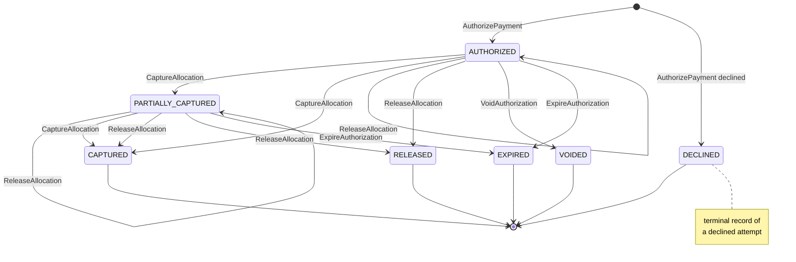
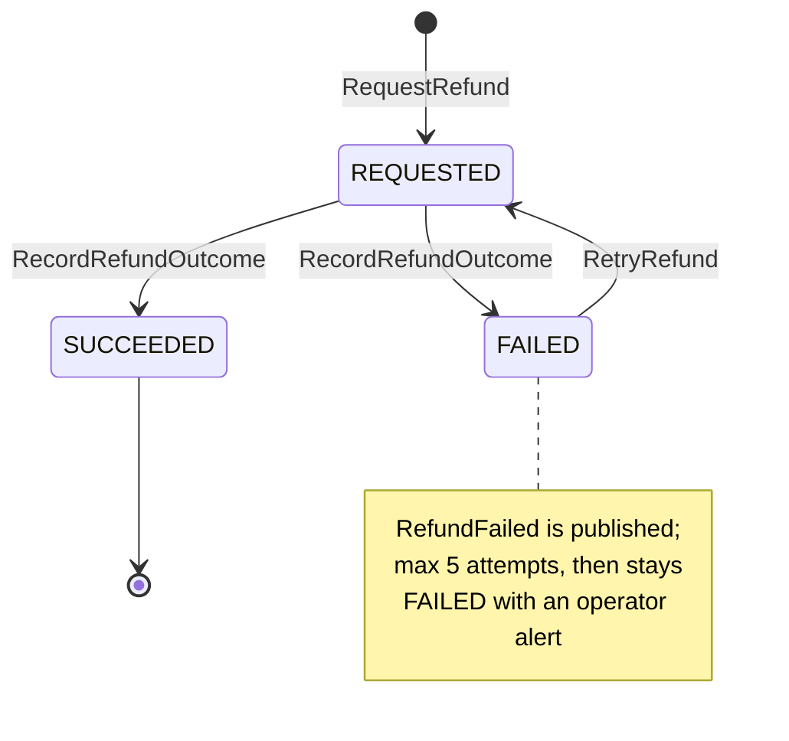

# Aggregate Design Canvas

:::info[Built on develop, not deployed]
Derived from [`model/model.yaml`](https://github.com/IQVO/warehouse-docs/blob/main/storefront/model/model.yaml). The `customer-payments` service is built on develop ([`IQVO/customer-payments`](https://github.com/IQVO/customer-payments) at `530c7cb`, checked 2026-10-27) and not deployed (no warehouse-infra entry). Every `Err...` name, REST route and CloudEvents type of this context named on this page exists in the service; where the built service differs from the model's design, the page says so (**As built**) or the context's [Service and operations](/storefront/contexts/customer-payments#service-and-operations) section lists it.
:::

Following the ddd-crew [Aggregate Design Canvas v1.1](https://github.com/ddd-crew/aggregate-design-canvas).
The model has two aggregate roots in this context, **PaymentAuthorization**
and **Refund**, and one read model, **ParkedFulfillmentFacts**. Proposed Go
packages: `internal/domain/authorization` and `internal/domain/refund` (the
packages the UL code identifiers name).

## PaymentAuthorization

### 1. Name

`PaymentAuthorization` (`paymentauthorization.PaymentAuthorization`), identified by
`authorizationId`.

### 2. Description

One checkout session's authorization: a unique `checkoutSessionId`, an
`orderId` (bound later, by `BindOrder`), the `allocations` (`groupNo`,
`amountMinor`, state `PENDING`, `CAPTURED` or `RELEASED`, and a nullable
`trackingNumber`), the provider references and `expiresAt`. The aggregate
state is derived from the allocations. Value objects:

| Value object | Fields | Note |
| --- | --- | --- |
| `Allocation` | `groupNo`, `amountMinor`, `state` (`PENDING`, `CAPTURED`, `RELEASED`), `trackingNumber?` | The share of the authorization that belongs to one shipment group; the unit of capture and release. The nullable `trackingNumber` is set at capture; `PackageLost` and `PackageReturned` map to a group by it. |
| `ProviderRef` | `providerAuthorizationId`, `providerCaptureIds[]` | The provider's references; the only place provider ids live in the aggregate. |

The aggregate holds no card data; the PSP token is an argument of the
provider port.

### 3. State Transitions

Derived from: `model.yaml → contexts[customer-payments].aggregates[PaymentAuthorization].states`,
`.transitions`, `.commands`, `.notes`.

The entry arrows are the creating command `AuthorizePayment`: an accepted
authorize creates the record `AUTHORIZED`, a declined one creates it
`DECLINED`, and the checkout session stays open for another token. The state
is derived from the allocations: `PARTIALLY_CAPTURED` while some are captured
and some pending; `CAPTURED` when every allocation is captured or released
with at least one captured; `RELEASED` when every allocation is released
(H3). `ReauthorizePayment` keeps the state `AUTHORIZED` and replaces
`expiresAt` and the provider reference. `BindOrder` sets the order and changes
no state. A provider decline on re-authorization moves the authorization to
`EXPIRED` and raises `PaymentDeclined{reason: REAUTH_DECLINED}`.

### 4. Enforced Invariants

| Invariant | Enforced by |
| --- | --- |
| One authorization per checkout session; a replay returns it | `AuthorizePayment` → `ErrDuplicateAuthorization` |
| Allocations sum to the authorized total and name the session's groups | `AuthorizePayment` → `ErrAllocationMismatch` |
| Captured per group never exceeds the allocation | `CaptureAllocation` → `ErrOverCapture` |
| No capture after `expiresAt` | `CaptureAllocation` → `ErrCaptureAfterExpiry` |
| A capture or release names an existing group | `CaptureAllocation`, `ReleaseAllocation` → `ErrUnknownGroup` |

Derived from: `model.yaml → contexts[customer-payments].aggregates[PaymentAuthorization].invariants`.
Shared problem types apply on top: `illegal-transition` (409) for a command
the state does not allow, `concurrent-update` (409) and `validation-failed`
(422).

### 5. Corrective Policies

| Policy | Owner | Rule | Effect on this aggregate |
| --- | --- | --- | --- |
| `BindOrderOnCheckoutCompleted` | this context | On `CheckoutCompleted` bind `orderId` to the session's authorization, then apply any parked fulfilment facts. | `BindOrder`; then the parked `CaptureAllocation`, `ReleaseAllocation` or refund commands run. |
| `CaptureOnShipment` | this context | On `FulfillmentShipped{orderId, groupNo, trackingNumbers}` capture that group's allocation; also store the tracking number against the group's allocation. | `CaptureAllocation`; `PaymentCaptured`. |
| `ReleaseOnCancellation` | this context | On `FulfillmentCancelled` release that group's allocation. | `ReleaseAllocation`; `PaymentReleased` (reason `CANCELLED`). |
| `ReleaseOnUnsourceable` | this context | On `FulfillmentUnsourceable` release that group's allocation. | `ReleaseAllocation`; `PaymentReleased` (reason `UNSOURCEABLE`). |
| `ReauthorizeBeforeExpiry` | this context | At `expiresAt` minus 24 h re-authorize the uncaptured allocations; a provider decline moves the authorization to `EXPIRED`. | `ReauthorizePayment`; `PaymentReauthorized`, or `ExpireAuthorization` and `PaymentDeclined` (reason `REAUTH_DECLINED`). |
| `VoidUnboundAuthorizations` | this context | No `CheckoutCompleted` after 24 h: void. | `AUTHORIZED → VOIDED`; `PaymentReleased` (reason `VOIDED`). |
| Idempotent consumption | this context | Every consumed event is applied once (inbox on the CloudEvents `id`). | A repeated `FulfillmentShipped` does not capture twice; provider keys are also deterministic per (operation, `authorizationId`, `groupNo`). |

### 6. Handled Commands

| Command | Trigger | Transition |
| --- | --- | --- |
| `AuthorizePayment` | `checkout`, REST `POST /payment-authorizations` (provider `Authorize`) | `[*] → AUTHORIZED`, or `[*] → DECLINED` |
| `CaptureAllocation` | `CaptureOnShipment` policy on Kafka `FulfillmentShipped` (provider `Capture`) | `AUTHORIZED → PARTIALLY_CAPTURED`, `AUTHORIZED → CAPTURED`, `PARTIALLY_CAPTURED → PARTIALLY_CAPTURED`, `PARTIALLY_CAPTURED → CAPTURED`; sets the allocation's `trackingNumber` |
| `ReleaseAllocation` | `ReleaseOnCancellation` policy on Kafka `FulfillmentCancelled`; `ReleaseOnUnsourceable` policy on Kafka `FulfillmentUnsourceable` (provider `ReduceAuthorization(amount)` for a partial release) | the allocation becomes `RELEASED`; `AUTHORIZED → AUTHORIZED`, `AUTHORIZED → RELEASED`, `PARTIALLY_CAPTURED → PARTIALLY_CAPTURED`, `PARTIALLY_CAPTURED → CAPTURED`, `PARTIALLY_CAPTURED → RELEASED` |
| `VoidAuthorization` | `checkout`, REST `POST /payment-authorizations/{authorizationId}:void`; `VoidUnboundAuthorizations` policy (provider `Void`) | `AUTHORIZED → VOIDED` |
| `ExpireAuthorization` | a provider decline on re-authorization (`ReauthorizeBeforeExpiry`) | `AUTHORIZED → EXPIRED`, `PARTIALLY_CAPTURED → EXPIRED` |
| `ReauthorizePayment` | `ReauthorizeBeforeExpiry` policy (provider `Reauthorize`) | `AUTHORIZED → AUTHORIZED` (new `expiresAt`, new provider reference) |
| `BindOrder` | `BindOrderOnCheckoutCompleted` policy on Kafka `CheckoutCompleted` | none (sets `orderId`) |

### 7. Created Events

| Event | Raised when | Full CloudEvents type |
| --- | --- | --- |
| `PaymentAuthorized` | `AuthorizePayment` is accepted by the provider and saved | `com.retailnetwork.storefront.customer-payments.paymentauthorization.PaymentAuthorized` |
| `PaymentReauthorized` | `ReauthorizePayment` is saved (new `expiresAt`, `providerRef`) | `com.retailnetwork.storefront.customer-payments.paymentauthorization.PaymentReauthorized` |
| `PaymentCaptured` | `CaptureAllocation` is saved | `com.retailnetwork.storefront.customer-payments.paymentauthorization.PaymentCaptured` |
| `PaymentReleased` | `ReleaseAllocation` or `VoidAuthorization` is saved (`reason` is `CANCELLED`, `UNSOURCEABLE`, `VOIDED` or `EXPIRED`) | `com.retailnetwork.storefront.customer-payments.paymentauthorization.PaymentReleased` |
| `PaymentAuthorizationExpired` | `ExpireAuthorization` is saved | `com.retailnetwork.storefront.customer-payments.paymentauthorization.PaymentAuthorizationExpired` |
| `PaymentDeclined` | `AuthorizePayment` is declined by the provider and the `DECLINED` record is saved, or a re-authorization is declined (reason `REAUTH_DECLINED`); carries `authorizationId` | `com.retailnetwork.storefront.customer-payments.paymentauthorization.PaymentDeclined` |

All six are analytics-only by design (topic `retailnetwork.customer-payments.analytics`;
no network consumer exists yet). `BindOrder` raises nothing. Events leave through the transactional outbox in the same transaction as the
save.

### 8. Throughput

*Estimate.* The model says "one per checkout session; captures per shipment
group". One authorize per completed or abandoned session, then one capture
or release per group over the following days; contention on one
`authorizationId` is low and comes from shipment facts for several groups of
the same order landing together (the `version` column absorbs them).

### 9. Size

*Estimate.* The model says "one row per session + allocations". One root row
with a handful of allocation rows, bounded by the number of shipment groups
of the quote.

## Refund

### 1. Name

`Refund` (`refund.Refund`), identified by `refundId`.

### 2. Description

Money returned for one order or group: `refundId`, `orderId`, `groupNo`,
`authorizationId`, `amountMinor`, `reason` and the outcome. Value object:

| Value object | Fields | Note |
| --- | --- | --- |
| `RefundReason` | `LOST`, `RETURNED_TO_SENDER`, `MANUAL` | The first two come from the policies on `PackageLost` and `PackageReturned`; `MANUAL` is the ops route. |

### 3. State Transitions

Derived from: `model.yaml → contexts[customer-payments].aggregates[Refund].states`,
`.transitions`, `.commands`, `.notes`.

`RequestRefund` creates the refund `REQUESTED`; the provider's answer
(`RecordRefundOutcome`) settles it as `SUCCEEDED` or `FAILED`. `SUCCEEDED` is
terminal. A `FAILED` refund is retryable: `RetryRefund` moves it back to
`REQUESTED`, at most 5 attempts, after which it stays `FAILED` and an
operator alert fires (H8).

### 4. Enforced Invariants

| Invariant | Enforced by |
| --- | --- |
| Refunds of an order never exceed its captured total; `REQUESTED` and issued refunds count, `FAILED` never does | `RequestRefund`, `RetryRefund` → `ErrOverRefund` |

Derived from: `model.yaml → contexts[customer-payments].aggregates[Refund].invariants`.

### 5. Corrective Policies

| Policy | Owner | Rule | Effect on this aggregate |
| --- | --- | --- | --- |
| `RefundOnLostPackage` | this context | On `PackageLost` refund the affected group's captured amount (reason `LOST`). | `RequestRefund`; `RefundIssued` or `RefundFailed`. |
| `RefundOnReturnToSender` | this context | On `PackageReturned` refund the affected group's captured amount (reason `RETURNED_TO_SENDER`). | `RequestRefund`; `RefundIssued` or `RefundFailed`. |
| Idempotent consumption | this context | Every consumed event is applied once (inbox on the CloudEvents `id`); the provider key is deterministic per (operation, `authorizationId`, `groupNo`). | A repeated fact does not refund twice at the provider. |

### 6. Handled Commands

| Command | Trigger | Transition |
| --- | --- | --- |
| `RequestRefund` | Storefront ops, REST `POST /refunds`; the two refund policies on Kafka `PackageLost`, `PackageReturned` (provider `Refund`) | `[*] → REQUESTED` |
| `RecordRefundOutcome` | The provider's answer to `Refund` | `REQUESTED → SUCCEEDED`, `REQUESTED → FAILED` |
| `RetryRefund` | Storefront ops or an automatic retry, up to 5 attempts (the model's `rest` list has no route for it) | `FAILED → REQUESTED` |

### 7. Created Events

| Event | Raised when | Full CloudEvents type |
| --- | --- | --- |
| `RefundIssued` | `RecordRefundOutcome` settles the refund `SUCCEEDED` | `com.retailnetwork.storefront.customer-payments.refund.RefundIssued` |
| `RefundFailed` | `RecordRefundOutcome` settles the refund `FAILED` (the payload carries a `code`) | `com.retailnetwork.storefront.customer-payments.refund.RefundFailed` |

Both are analytics-only.

### 8. Throughput

*Estimate.* The model says "low". A refund follows a lost or returned
package, or an ops request.

### 9. Size

*Estimate.* The model says "one row per refund".

## Read models

| Read model | Source events | Serves | Why it is not an aggregate |
| --- | --- | --- | --- |
| `ParkedFulfillmentFacts` | `order-sourcing` `FulfillmentShipped`, `FulfillmentCancelled`, `FulfillmentUnsourceable`; `shipping-and-tracking` `PackageLost`, `PackageReturned`, for orders not yet bound to an authorization | `BindOrderOnCheckoutCompleted`, which applies the parked facts after the bind | It protects no invariant: it holds facts to apply, and the commands they cause are validated by the aggregates. Rebuildable only by replaying the topics, which is why the model parks instead of dropping (gap S4). Retained 30 days, then purged; a gauge reports the parked count (H10). |

Derived from: `model.yaml → contexts[customer-payments].read_models`.

## Model gaps and hotspots

Every hotspot raised on
[EventStorming](/storefront/contexts/customer-payments/eventstorming) is
resolved in the model-fix (H1 to H12). The resolutions that land on these
aggregates:

| # | Resolution | Where it shows |
| --- | --- | --- |
| H1 | `VoidAuthorization` raises `PaymentReleased{reason: VOIDED}`; `ReauthorizePayment` has the transition `AUTHORIZED → AUTHORIZED` and raises `PaymentReauthorized`. | Events table, state diagram |
| H2 | `ReauthorizeBeforeExpiry` (at `expiresAt` minus 24 h); a provider decline moves the authorization to `EXPIRED` and raises `PaymentDeclined{reason: REAUTH_DECLINED}`. | Policies table |
| H3 | State derived from the allocations; `AUTHORIZED → CAPTURED` and the `ReleaseAllocation` transitions exist. | State diagram |
| H4 | Provider port verb `ReduceAuthorization(amount)` for a partial release. | Commands table |
| H5 | `FulfillmentUnsourceable` is consumed (`ReleaseOnUnsourceable`); `PaymentReleased.reason` is `CANCELLED`, `UNSOURCEABLE`, `VOIDED` or `EXPIRED`. | Policies table |
| H6 | Nullable `Allocation.trackingNumber`, set at capture. | Value objects |
| H7 | `PaymentDeclined` carries `authorizationId`. | Events table |
| H8 | `RetryRefund` (`FAILED → REQUESTED`, max 5 attempts); `ErrOverRefund` counts `REQUESTED` and issued refunds, never `FAILED`. | Refund state diagram |
| H9 | All events are analytics-only by design. | Events table |
| H10 | Parked facts retained 30 days, then purged; gauge on the parked count. | Read models |
| H11 | The description is complete. | Section 2 of this aggregate |
| H12 | `Refund` and `RefundIssued` carry `groupNo` and `authorizationId`. | Refund description |
