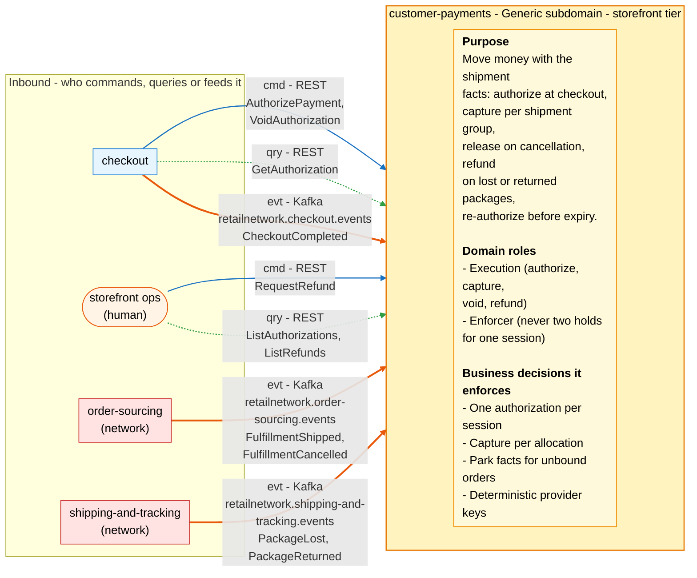
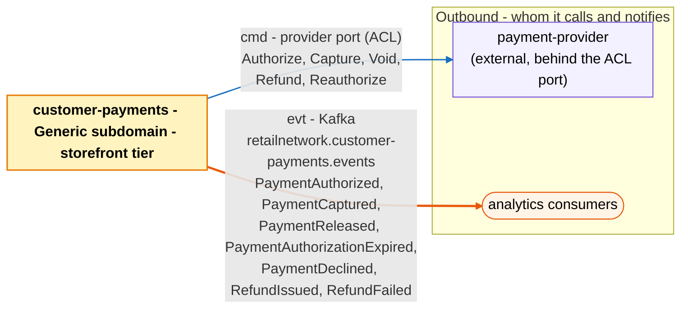

# Bounded Context Canvas

:::info[Built on develop, not deployed]
Derived from [`model/model.yaml`](https://github.com/IQVO/warehouse-docs/blob/main/storefront/model/model.yaml). The `customer-payments` service is built on develop ([`IQVO/customer-payments`](https://github.com/IQVO/customer-payments) at `530c7cb`, checked 2026-10-27) and not deployed (no warehouse-infra entry). Every `Err...` name, REST route and CloudEvents type of this context named on this page exists in the service; where the built service differs from the model's design, the page says so (**As built**) or the context's [Service and operations](/storefront/contexts/customer-payments#service-and-operations) section lists it.
:::

Following the ddd-crew [Bounded Context Canvas v5](https://github.com/ddd-crew/bounded-context-canvas).
Every message row comes from `contexts[customer-payments]` (`inbound`,
`consumes`, `publishes`, `rest`, `sync_calls`) or from a neighbour's entry that
names this context.

## Canvas at a glance

Two pictures of the sections below, laid out like the ddd-crew canvas:
first the inbound collaborators feeding this context (purpose, domain roles
and the business decisions it enforces), then the outbound collaborators it
calls and notifies. Arrows follow the message type: **solid blue**
commands (`cmd`), **dotted green** queries (`qry`), **thick orange** events
(`evt`); each arrow names its channel and the messages it carries. Box
shapes mark the collaborator kind: rounded = people, UI or any client;
blue = sibling bounded context; red = network context. Channel names on
the arrows are abbreviated; the Inbound and Outbound Communication tables
carry the exact route, topic and CloudEvents type for every message.

### Inbound

### Outbound

Derived from: `model.yaml → contexts[customer-payments].inbound`, `.publishes`,
`.consumes`, `.sync_calls`, `.purpose`, `.roles`, `.business_decisions`;
`contexts[checkout].sync_calls` (`AuthorizePayment`, `VoidAuthorization`) and
`.publishes` (`CheckoutCompleted` consumer row); `external[payment-provider]`.

The diagrams omit assumptions, verification metrics, open questions and the
ubiquitous language (sections below) and the relationship pattern per
message (see the tables). The synchronous replies to checkout and storefront
ops, and the provider's answers, are the only synchronous traffic.

## Name

**Customer Payments** (`customer-payments`, code `CP`, CloudEvents tier `storefront`).

## Purpose

To move money with the shipment facts. The context:

- authorizes the quote total once per checkout session, split into one
  allocation per shipment group, with a PSP token and never a card number;
- captures a group's allocation when the group ships (`CaptureOnShipment`),
  and stores the tracking number against the group;
- releases a group's allocation when the group is cancelled
  (`ReleaseOnCancellation`) and voids an authorization before any capture;
- refunds the captured amount of a group whose package is lost or returned
  (`RefundOnLostPackage`, `RefundOnReturnToSender`), or on a manual ops
  request;
- re-authorizes uncaptured allocations 24 h before `expiresAt`
  (`ReauthorizeBeforeExpiry`) and voids an authorization that no
  `CheckoutCompleted` bound within 24 h (`VoidUnboundAuthorizations`);
- parks fulfilment facts for orders not yet bound to an authorization and
  applies them on `BindOrderOnCheckoutCompleted` (gap S4).

## Strategic Classification

| Axis | Verdict |
| --- | --- |
| **Domain** | **Generic** subdomain. See the [Core Domain Chart](/storefront/contexts/customer-payments/core-domain-chart). |
| **Business Model** | Revenue collection (buy a PSP). |
| **Evolution** | Commodity. |

## Domain Roles

| Role | Applies? | Evidence in the model |
| --- | --- | --- |
| **Execution (authorize, capture, void, refund)** | **Yes, primary** | The `PaymentAuthorization` and `Refund` aggregates and the five provider verbs; `ErrOverCapture` and `ErrOverRefund` guard the money moving. |
| **Enforcer (never two holds for one session)** | **Yes** | `ErrDuplicateAuthorization`: one authorization per checkout session, a replay returns it. |
| Analysis | No | The only read model, `ParkedFulfillmentFacts`, holds facts to apply, not a verdict others consume. |
| Specification | No | The amounts are decided by [pricing](/storefront/contexts/pricing) and carried by `checkout`; this context never computes a price. |

## Inbound Communication

| Collaborator | Message | Type | Channel | Relationship |
| --- | --- | --- | --- | --- |
| `checkout` | `AuthorizePayment` | Command | REST `POST /payment-authorizations` | Customer/Supplier (we are the Supplier) |
| `checkout` | `VoidAuthorization` | Command | REST `POST /payment-authorizations/{authorizationId}:void` | Customer/Supplier (we are the Supplier) |
| `checkout` | `GetAuthorization` | Query | REST `GET /payment-authorizations/{authorizationId}` | Customer/Supplier (we are the Supplier) |
| Storefront ops (human) | `RequestRefund` | Command | REST `POST /refunds` | UI |
| Storefront ops (human) | `ListAuthorizations` | Query | REST `GET /payment-authorizations?orderId=\|checkoutSessionId=` | UI |
| Storefront ops (human) | `ListRefunds` | Query | REST `GET /refunds?orderId=` | UI |
| `checkout` | `CheckoutCompleted` | Event | Kafka `retailnetwork.checkout.events`, `com.retailnetwork.storefront.checkout.checkoutsession.CheckoutCompleted` | Customer/Supplier (we are the Customer) |
| `order-sourcing` (network) | `FulfillmentShipped` | Event | Kafka `retailnetwork.order-sourcing.events`, `com.retailnetwork.commerce.order-sourcing.assignment.FulfillmentShipped` | Conformist |
| `order-sourcing` (network) | `FulfillmentCancelled` | Event | Kafka `retailnetwork.order-sourcing.events`, `com.retailnetwork.commerce.order-sourcing.assignment.FulfillmentCancelled` | Conformist |
| `shipping-and-tracking` (network) | `PackageLost` | Event | Kafka `retailnetwork.shipping-and-tracking.events`, `com.retailnetwork.logistics.shipping-and-tracking.journey.PackageLost` | Conformist |
| `shipping-and-tracking` (network) | `PackageReturned` | Event | Kafka `retailnetwork.shipping-and-tracking.events`, `com.retailnetwork.logistics.shipping-and-tracking.journey.PackageReturned` | Conformist |

Route-to-command note: the six `rest` routes map onto the commands and
queries above, with two exceptions that are by design. `CaptureAllocation`,
`ReleaseAllocation`, `ExpireAuthorization`, `ReauthorizePayment`, `BindOrder`
and `RecordRefundOutcome` have no route: they arrive through events, policies
and provider answers, never as REST writes. `RequestRefund` is both the ops
route and the command the two refund policies issue.

## Outbound Communication

| Collaborator | Message | Type | Channel | Relationship |
| --- | --- | --- | --- | --- |
| `payment-provider` (external) | `Authorize`, `Capture`, `Void`, `Refund`, `Reauthorize` | Command | Provider port (ACL); the adapter calls the payment-provider simulator | Anti-Corruption Layer; we are the Customer of an external system |
| analytics only | `PaymentAuthorized` | Event | Kafka `retailnetwork.customer-payments.events`, `com.retailnetwork.storefront.customer-payments.paymentauthorization.PaymentAuthorized` | analytics stream |
| analytics only | `PaymentCaptured` | Event | Kafka `retailnetwork.customer-payments.events`, `com.retailnetwork.storefront.customer-payments.paymentauthorization.PaymentCaptured` | analytics stream |
| analytics only | `PaymentReleased` | Event | Kafka `retailnetwork.customer-payments.events`, `com.retailnetwork.storefront.customer-payments.paymentauthorization.PaymentReleased` | analytics stream |
| analytics only | `PaymentAuthorizationExpired` | Event | Kafka `retailnetwork.customer-payments.events`, `com.retailnetwork.storefront.customer-payments.paymentauthorization.PaymentAuthorizationExpired` | analytics stream |
| analytics only | `PaymentDeclined` | Event | Kafka `retailnetwork.customer-payments.events`, `com.retailnetwork.storefront.customer-payments.paymentauthorization.PaymentDeclined` | analytics stream |
| analytics only | `RefundIssued` | Event | Kafka `retailnetwork.customer-payments.events`, `com.retailnetwork.storefront.customer-payments.refund.RefundIssued` | analytics stream |
| analytics only | `RefundFailed` | Event | Kafka `retailnetwork.customer-payments.events`, `com.retailnetwork.storefront.customer-payments.refund.RefundFailed` | analytics stream |

What the neighbours do with them: nobody in the storefront or the network
consumes a payment event. All seven are analytics-only, so
`retailnetwork.customer-payments.events` carries nothing (open question
below). `checkout` learns the outcome of an authorize from the synchronous
reply (`AUTHORIZED` or `DECLINED`) and the order reaches the authorization
through `CheckoutCompleted`. The model names the future
`customer-notifications` context as the first consumer of `PaymentCaptured`,
`PaymentReleased` and `RefundIssued`. Relationship evidence:
[Context Map](/storefront/contexts/customer-payments/context-map).

## Ubiquitous Language

Full glossary: [Ubiquitous Language](/storefront/contexts/customer-payments/ubiquitous-language).
Top terms: **Payment Authorization**, **Capture** (not the authorize hold),
**Release** (one allocation; not **Void**, the whole authorization),
**Refund** (captured money back), **Reauthorization**, **Payment Method
Token** (never a card number).

## Business Decisions

1. **One authorization per checkout session; a replayed authorize returns
   the existing one** (`ErrDuplicateAuthorization`).
2. **Allocations sum to the authorized total and name the session's groups**
   (`ErrAllocationMismatch`); a capture or release names an existing group
   (`ErrUnknownGroup`).
3. **Capture is per allocation (shipment group)**: captured per group never
   exceeds the allocation (`ErrOverCapture`), and no capture follows
   `expiresAt` (`ErrCaptureAfterExpiry`). Targets: zero captures without
   `FulfillmentShipped`, zero expired authorizations on shipped groups.
4. **Refunds of an order never exceed its captured total** (`ErrOverRefund`).
5. **Fulfilment facts for a not-yet-bound order are parked** and applied on
   `BindOrderOnCheckoutCompleted` (gap S4).
6. **Provider idempotency keys are deterministic per (operation,
   `authorizationId`, `groupNo`).**
7. **A declined authorize is a terminal record**; the checkout session stays
   open for another token (`DECLINED` has no transition into it).

## Assumptions

- `checkout` mints `<sessionId>:auth` and `<sessionId>:void` as the
  `Idempotency-Key` of its two writes (checkout's `sync_calls` notes); a
  replay of the same key returns the stored response of the first call.
- `checkout` calls `VoidAuthorization` only after a definitive rejection of
  the place-order step, never while the outcome is in doubt.
- The PSP token arrives in the authorize request (`paymentMethodToken` in
  the REST contract); the context never receives card data.
- The provider honours the idempotency key it is given, which is what makes a
  retried capture or refund safe.
- Every consumed event is applied once (inbox on the CloudEvents `id`), and
  consumers dispatch on the full type string.
- One configured currency everywhere; money is `{amountMinor, currency}`.
- The simulator's deterministic outcomes per test token (approve, decline,
  timeout, expire-early) are the only provider behaviour the study exercises.

## Verification Metrics

| Metric | Target (proposed) | Source |
| --- | --- | --- |
| Captures without a matching `FulfillmentShipped` | 0 (model correctness target) | `PaymentCaptured` joined to consumed shipment facts |
| Shipped groups whose authorization expired uncaptured | 0 (model correctness target) | `PaymentAuthorizationExpired` against shipped groups |
| Authorize decline rate | tracked; separates declines from provider outages | `PaymentDeclined` / `PaymentAuthorized` |
| Provider call latency (p95) and timeout rate per verb | tracked; alert on a drop in success | adapter metrics |
| Authorizations `AUTHORIZED` within 24 h of `expiresAt` and not yet re-authorized | 0 | `payment_authorizations.expires_at` vs `ReauthorizeBeforeExpiry` run |
| Authorizations with no `orderId` older than 24 h | 0 after `VoidUnboundAuthorizations` | `payment_authorizations.order_id` |
| Parked facts waiting for a bind | tracked; the age of the oldest parked fact | `parked_facts.received_at` |
| Refunds `REQUESTED` and not settled | tracked; oldest age | `refunds.state` |
| Outbox age of the oldest unpublished payment event | below 5 s | `outbox_events.created_at` |

## Open Questions

- **`ReauthorizePayment` and `VoidAuthorization` publish nothing.** Both
  are commands of `PaymentAuthorization`, but no event names them, and the
  model does not say how a reauthorization is recorded (`expiresAt`,
  provider reference, the new hold's validity). Hotspot H1 on
  [EventStorming](/storefront/contexts/customer-payments/eventstorming).
- **Nothing triggers `ExpireAuthorization`.** The command and its two
  transitions exist, but no policy, inbound row or provider callback says
  what raises it (hotspot H2).
- **What is the state after every allocation is released?** `ReleaseAllocation`
  has no row in `transitions`, `AUTHORIZED → CAPTURED` is missing for a
  one-group authorization, and `CAPTURED` is not defined for a mix of
  captured and released groups (hotspot H3).
- **The provider port has no partial release.** The five verbs are
  Authorize, Capture, Void, Refund, Reauthorize; releasing one allocation of
  a multi-group authorization has no provider verb (hotspot H4).
- **`FulfillmentCancelled` and an unsourceable group.** The policy
  `ReleaseOnCancellation` says the event covers a customer cancellation or an
  unsourceable group; the network publishes a separate
  `FulfillmentUnsourceable` event that this context does not consume; the
  `reason` field of `PaymentReleased` has no named values either
  (hotspot H5).
- **Lost and returned packages name a tracking number, not a group.** The
  model says the tracking number is stored against the group on capture, but
  no value object holds it (hotspot H6).
- **`retailnetwork.customer-payments.events` carries nothing.** All seven
  events are analytics-only; the future `customer-notifications` context would
  be the first consumer (hotspot H9).
