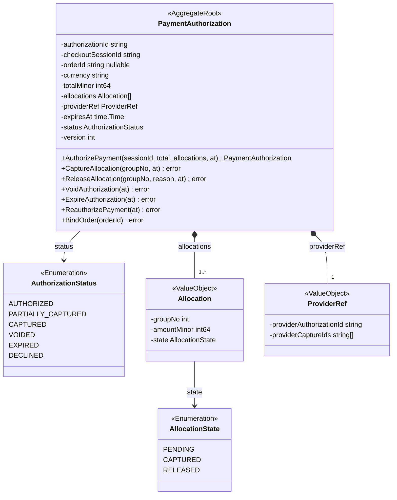
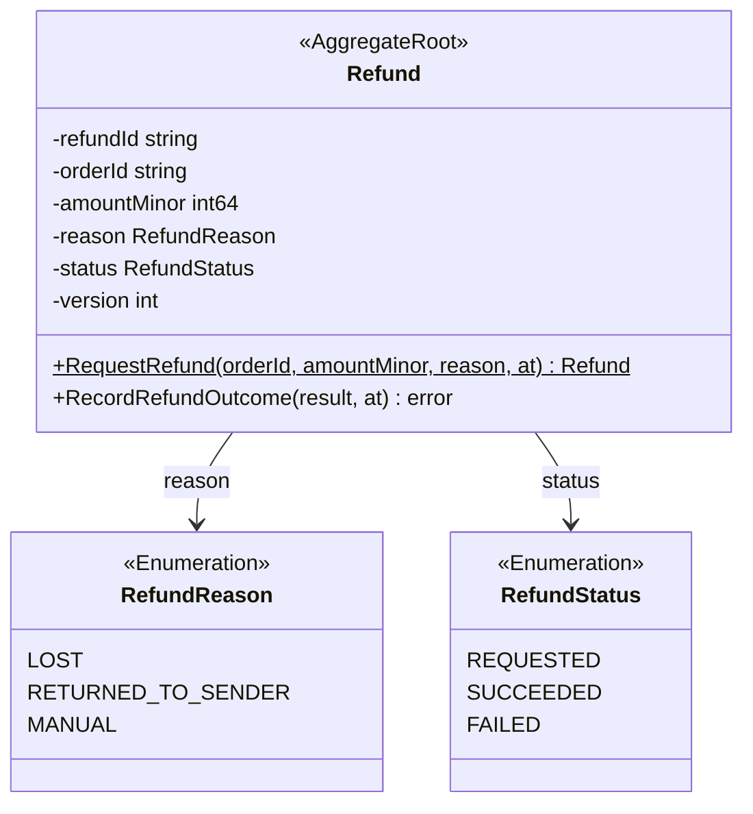
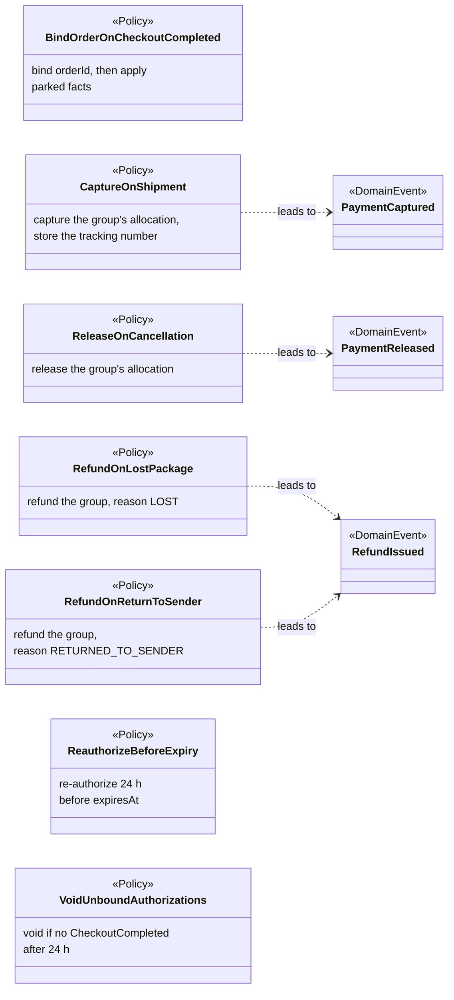
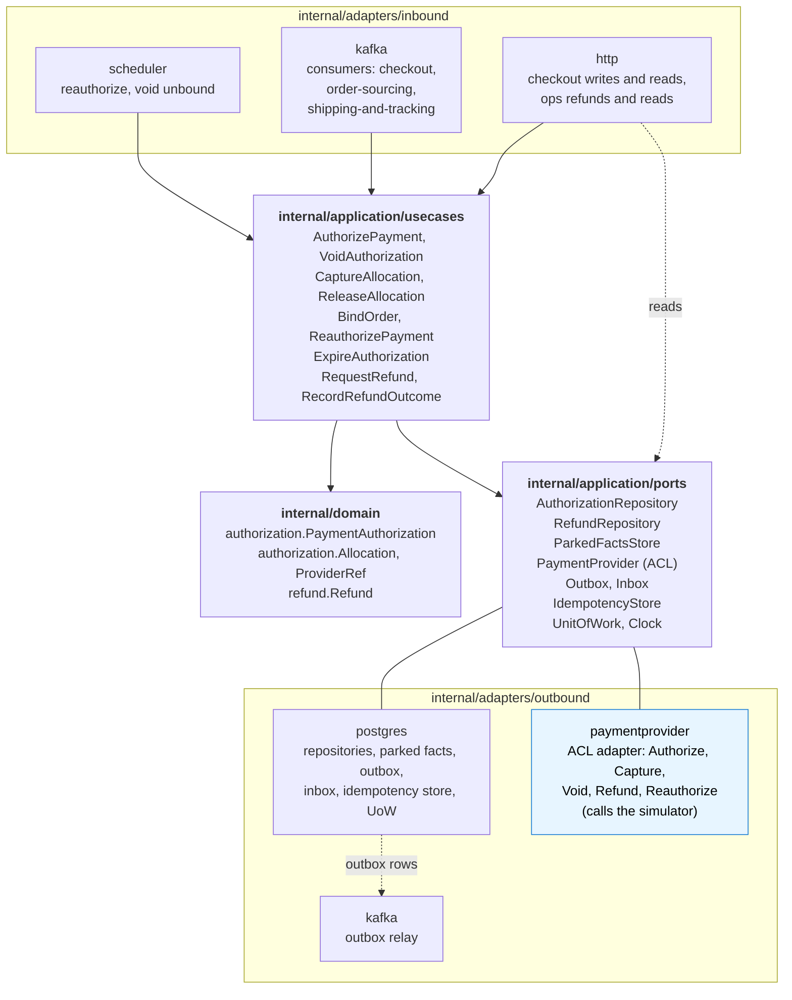

# Class Diagram

:::info[Proposed design, docs only]
Derived from [`model/model.yaml`](https://github.com/IQVO/warehouse-docs/blob/main/storefront/model/model.yaml). Nothing in this context is built; the model is the canonical design, and identifiers (`Err...` names, routes, CloudEvents types) are the names a future implementation must use.
:::

UML class diagrams of the **proposed** `internal/domain/**` packages, plus
the hexagonal ports and adapters. Type names come from the model's code
identifiers (`authorization.PaymentAuthorization`,
`authorization.Allocation`, `refund.Refund`) and value objects. Fields are
unexported in Go and shown with `-`; methods are shown with `+`.

## 1. The PaymentAuthorization aggregate and its allocations

Derived from: `model.yaml → contexts[customer-payments].aggregates[PaymentAuthorization]`
(`description`, `states`, `transitions`, `value_objects`, `commands`,
`invariants`, `notes`).

Omitted: the `Err...` variables (`ErrDuplicateAuthorization`,
`ErrAllocationMismatch`, `ErrOverCapture`, `ErrCaptureAfterExpiry`,
`ErrUnknownGroup`; listed on the
[Aggregate Design Canvas](/storefront/contexts/customer-payments/aggregate-design-canvas))
and the tracking numbers the model says `CaptureOnShipment` stores against
the group, which have no field in the model's value objects (hotspot H6).
`ErrDuplicateAuthorization` is enforced by a unique key on
`checkoutSessionId` in the repository, not by a method of the aggregate. The
PSP token is an argument of the provider port; no field of the aggregate
holds card data.

## 2. The Refund aggregate

Derived from: `model.yaml → contexts[customer-payments].aggregates[Refund]`
(`description`, `states`, `transitions`, `value_objects`, `commands`,
`invariants`).

Omitted: `ErrOverRefund`, enforced against the order's captured total, which
spans the authorization's allocations and the order's earlier refunds; the
model does not say which aggregate or domain service holds that sum
(hotspot H12).

## 3. Read model, events and policies

```mermaid
classDiagram
    direction TB
    class ParkedFulfillmentFacts {
        <<ReadModel>>
        -facts map orderId to fact[]
        +Park(orderId, fact)
        +Take(orderId) fact[]
    }
    class PaymentAuthorized {
        <<DomainEvent>>
        +authorizationId string
        +checkoutSessionId string
        +currency string
        +totalMinor int64
        +allocations groupNo, amountMinor
        +expiresAt time.Time
    }
    class PaymentCaptured {
        <<DomainEvent>>
        +authorizationId string
        +orderId string
        +groupNo int
        +amountMinor int64
    }
    class PaymentReleased {
        <<DomainEvent>>
        +authorizationId string
        +orderId string
        +groupNo int
        +amountMinor int64
        +reason string
    }
    class PaymentAuthorizationExpired {
        <<DomainEvent>>
        +authorizationId string
        +orderId string
        +expiredAt time.Time
    }
    class PaymentDeclined {
        <<DomainEvent>>
        +checkoutSessionId string
        +reason string
        +at time.Time
    }
    class RefundIssued {
        <<DomainEvent>>
        +refundId string
        +orderId string
        +amountMinor int64
        +reason string
    }
    class RefundFailed {
        <<DomainEvent>>
        +refundId string
        +orderId string
        +code string
    }
```

Derived from: `model.yaml → contexts[customer-payments].read_models`,
`.publishes`, `.policies`, `.ul`.

Omitted: the CloudEvents envelope (built in the Kafka adapter); the
`RefundFailed`, `PaymentAuthorized`, `PaymentDeclined` and
`PaymentAuthorizationExpired` links, which come from commands rather than
policies; and the two policies that end in a command without an event
(`BindOrderOnCheckoutCompleted`, `ReauthorizeBeforeExpiry`,
`VoidUnboundAuthorizations`, hotspot H1). The fact shape inside
`ParkedFulfillmentFacts` is the consumed event's fields.

## 4. Hexagonal ports and adapters

Derived from: `model.yaml → contexts[customer-payments].aggregates`,
`.inbound`, `.sync_calls`, `.read_models`, `.policies`;
`conventions.integration_rules` (outbox, inbox, Idempotency-Key); the
fleet's Go hexagonal layout. `sync_calls` holds exactly one row, so the
**only outbound client** is the `paymentprovider` adapter behind the
`PaymentProvider` port.

**The Anti-Corruption Layer.** The `PaymentProvider` port is the five verbs
of the model: `Authorize`, `Capture`, `Void`, `Refund`, `Reauthorize`. It
speaks the domain's language (a PSP token, an `Allocation`, an amount in
minor units, a key deterministic per (operation, `authorizationId`,
`groupNo`)) and returns domain results (an approval with a `ProviderRef`
and `expiresAt`, a decline `reason`, a failure `code`). Everything the
provider names differently stays in the adapter; the payment-provider
simulator is its stand-in, and a real provider replaces only this package.
The port never receives a card number.

Omitted: the composition root (`cmd/customer-payments`), metrics and
tracing. The scheduler is an inbound adapter: time triggers
`ReauthorizePayment` and `VoidAuthorization`. The read routes
(`GetAuthorization`, `ListAuthorizations`, `ListRefunds`) read the
repositories through their ports without a use case.
