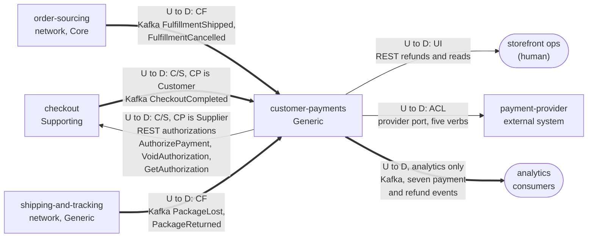

# Context Map

:::info[Built on develop, not deployed]
Derived from [`model/model.yaml`](https://github.com/IQVO/warehouse-docs/blob/main/storefront/model/model.yaml). The `customer-payments` service is built on develop ([`IQVO/customer-payments`](https://github.com/IQVO/customer-payments) at `530c7cb`, checked 2026-10-27) and not deployed (no warehouse-infra entry). Every `Err...` name, REST route and CloudEvents type of this context named on this page exists in the service; where the built service differs from the model's design, the page says so (**As built**) or the context's [Service and operations](/storefront/contexts/customer-payments#service-and-operations) section lists it.
:::

Following ddd-crew [Context Mapping](https://github.com/ddd-crew/context-mapping).
This is **customer-payments' slice** of the
[storefront-wide context map](/storefront/strategic-design/context-map):
every relationship this context has, with the upstream (U) and downstream
(D) side, the pattern and the channel.

Derived from: `model.yaml → contexts[customer-payments].inbound`,
`.publishes`, `.consumes`, `.rest`, `.sync_calls`;
`contexts[checkout].sync_calls` (`AuthorizePayment`, `VoidAuthorization`) and
`.publishes` (`CheckoutCompleted` consumers); `external[payment-provider]`;
`network/model/model.yaml → contexts[order-sourcing].publishes`,
`contexts[shipping-and-tracking].publishes` (consumer rows).

Legend: arrows point from upstream to downstream, except the Kafka arrow
from `checkout`, whose label gives the true direction. The routes and the
seven event names are listed in the Relationships table below. A solid arrow is a
synchronous relationship (REST or the provider port) and a thick arrow is a
Kafka event relationship.

Omitted, because they have no edge with this context (**Separate Ways**):
`pricing` (Core; the totals reach this context only inside checkout's
`AuthorizePayment`), `shopping-cart` (Supporting; it also consumes
`CheckoutCompleted` but shares nothing else), `product-content` and
`product-discovery`, and every other network context. In particular this
context never calls `customer-ordering`: the order record, ship-to address
and PII live there, and the storefront reaches them only through checkout's
ACL. It never touches a `warehouse.*` topic (`meta.hard_boundary`).

## Relationships

| Neighbour | Direction | Pattern | Channel | Messages | Why this pattern |
| --- | --- | --- | --- | --- | --- |
| `checkout` (Supporting) | CP upstream, checkout downstream | **Customer/Supplier** (checkout is the Customer) | REST `POST /payment-authorizations`, `POST /payment-authorizations/{authorizationId}:void`, `GET /payment-authorizations/{authorizationId}` | `AuthorizePayment`, `VoidAuthorization`; `GetAuthorization` | The saga needs an answer before it places the order (authorized or declined) and a compensation after a definitive rejection; the contract is negotiated for the saga, with deterministic `Idempotency-Key` values (`<sessionId>:auth`, `<sessionId>:void`). |
| `checkout` (Supporting) | checkout upstream, CP downstream | **Customer/Supplier** (CP is the Customer) | Kafka `retailnetwork.checkout.events` | `CheckoutCompleted` | The context binds `orderId` to the session's authorization on the fact, instead of checkout calling back synchronously. |
| Storefront ops (human) | CP upstream, ops downstream | **UI** (inbound rows `relationship: UI`) | REST `POST /refunds`, `GET /payment-authorizations?orderId=\|checkoutSessionId=`, `GET /refunds?orderId=` | `RequestRefund`; `ListAuthorizations`, `ListRefunds` | The only human surface: a manual refund and the reads that explain a payment. No shopper-facing route exists. |
| `order-sourcing` (network, Core) | OS upstream, CP downstream | **Conformist** | Kafka `retailnetwork.order-sourcing.events` | `FulfillmentShipped`, `FulfillmentCancelled` | The shipment and cancellation facts are taken as published and drive capture and release; the context redefines nothing. |
| `shipping-and-tracking` (network, Generic) | ST upstream, CP downstream | **Conformist** | Kafka `retailnetwork.shipping-and-tracking.events` | `PackageLost`, `PackageReturned` | The lost and returned facts are taken as published and drive refunds. |
| `payment-provider` (external) | CP upstream, provider downstream (the provider answers) | **Anti-Corruption Layer** | Provider port: `Authorize`, `Capture`, `Void`, `Refund`, `Reauthorize`; the adapter calls the payment-provider simulator | the five provider verbs | The provider's vocabulary, errors and token handling stay in one adapter; swapping the simulator for a real provider changes nothing else. |
| analytics consumers | CP upstream, analytics downstream | analytics stream | Kafka `retailnetwork.customer-payments.events` | `PaymentAuthorized`, `PaymentCaptured`, `PaymentReleased`, `PaymentAuthorizationExpired`, `PaymentDeclined`, `RefundIssued`, `RefundFailed` | Money facts for analytics only; no storefront or network context consumes a payment event (see notes). |

## Notes on the patterns

- **One ACL, and it is outbound.** The Anti-Corruption Layer sits between the
  domain and the payment provider. The domain sees five verbs, a PSP token
  and deterministic idempotency keys; everything provider-specific (wire
  names, error codes, the shape of an authorization reference) is translated
  inside the adapter. The same discipline keeps the card number out of the
  storefront: the port accepts a token and nothing else.
- **Two Conformist edges from the network.** The shipment, cancellation,
  lost and returned facts are published by the network on its own terms. This
  context follows them and never asks the network to change a payload; if a
  fact is missing, it is a model gap (see the
  [Bounded Context Canvas](/storefront/contexts/customer-payments/bounded-context-canvas)
  open questions).
- **Cross-topic order is the price of event-driven money.** The edges from
  `checkout`, `order-sourcing` and `shipping-and-tracking` travel on three
  topics with no ordering between them, so a shipment fact can precede the
  `CheckoutCompleted` that binds its order (gap S4). The context answers it
  with a read model (`ParkedFulfillmentFacts`) and a policy, not with a
  synchronous call to any of the three.
- **The provider is the only synchronous call out.** `sync_calls` holds
  exactly the provider port. Every other flow is a Kafka event or an inbound
  REST call.
- **This context is a dead end for events.** All seven published events are
  analytics-only; checkout learns the outcome of an authorize from the
  synchronous reply, and nobody downstream needs a payment event yet. The
  future `customer-notifications` context would be the first consumer of
  `PaymentCaptured`, `PaymentReleased` and `RefundIssued`.
- **No Shared Kernel.** `orderId`, `groupNo` and `trackingNumber` are values
  copied from messages, never shared code.
- **No warehouse-systems edge.** The context never produces or consumes a
  `warehouse.*` topic (`meta.hard_boundary`).
