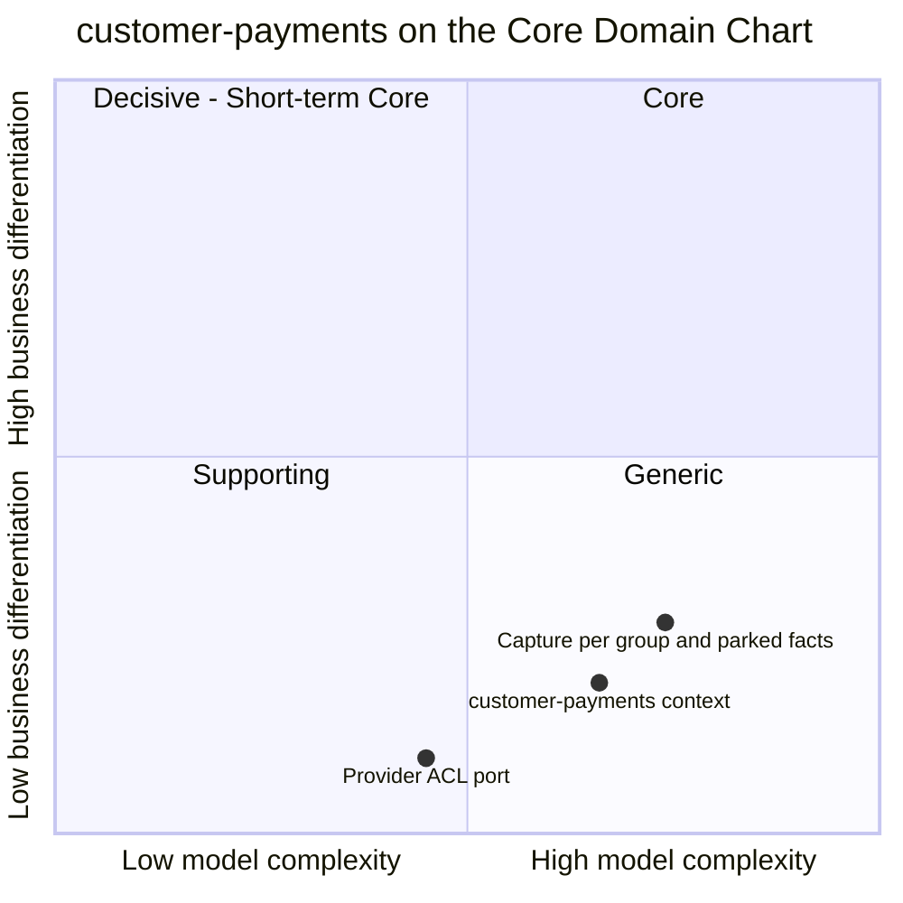

# Core Domain Chart

:::info[Built on develop, not deployed]
Derived from [`model/model.yaml`](https://github.com/IQVO/warehouse-docs/blob/main/storefront/model/model.yaml). The `customer-payments` service is built on develop ([`IQVO/customer-payments`](https://github.com/IQVO/customer-payments) at `530c7cb`, checked 2026-10-27) and not deployed (no warehouse-infra entry). Every `Err...` name, REST route and CloudEvents type of this context named on this page exists in the service; where the built service differs from the model's design, the page says so (**As built**) or the context's [Service and operations](/storefront/contexts/customer-payments#service-and-operations) section lists it.
:::

Following the ddd-crew [Core Domain Charts](https://github.com/ddd-crew/core-domain-charts):
business differentiation (y) against model complexity (x). The
storefront-wide classification is on
[Subdomain Classification](/storefront/strategic-design/subdomain-classification).

Derived from: `model.yaml → contexts[customer-payments].chart`
(`complexity: 0.66`, `differentiation: 0.2`, `evolution: Commodity`),
`.classification`, `.business_model`, `.aggregates[PaymentAuthorization]`
and `.aggregates[Refund]`.

The two slices are placed by judgement, not by the model; the model gives
only the context's point. Omitted: the other five storefront contexts (their
positions follow from their own model entries) and the
`ParkedFulfillmentFacts` read model, which is a derivation of the fulfilment
facts, not a separate capability.

## Classification: Generic

The context point sits in **quadrant 4 (Generic)**, the far right of it: the
model classifies the context as `Generic` with the business model "Revenue
collection (buy a PSP)". A shopper does not choose this storefront because
of how it authorizes a card; the right answer is to buy that capability from
a provider and keep the domain code thin. The model says exactly that:
**the provider is swappable** (the simulator is the stand-in adapter, and
swapping it for a real provider changes nothing else).

**Differentiation is low (y = 0.2).** Collecting revenue is a necessity of
the business, not a strength of this one. The only part with any shape of its
own is the pairing of the money lifecycle with the network's shipment
groups, and even that is a rule (capture what ships) rather than a
competitive edge.

**Complexity is high for a Generic context (x = 0.66).** This is the honest
surprise on the chart. The reasons are in the model:

- **Foreign clocks.** Authorizations expire at the provider's clock
  (`expiresAt`), so a policy has to re-authorize uncaptured allocations 24 h
  before it, and `ErrCaptureAfterExpiry` forbids a capture after it.
- **Cross-topic event order (gap S4).** `FulfillmentShipped` can arrive
  before `CheckoutCompleted`. The context parks the fact and applies it on
  bind, which adds a read model and a policy to an otherwise small domain.
- **Money invariants across two aggregates.** Captured per group never
  exceeds the allocation (`ErrOverCapture`); refunds of an order never exceed
  its captured total (`ErrOverRefund`); allocations sum to the authorized
  total (`ErrAllocationMismatch`).
- **A port that must be idempotent by construction.** Every provider call
  carries a key deterministic per (operation, `authorizationId`, `groupNo`).

The **provider ACL port** slice is plotted lowest and leftmost: five verbs
and a translation layer are the commodity part, the one place where buying
beats building.

## Business model

**Revenue collection (buy a PSP).** The model's phrase. The context earns by
never losing money in either direction: no capture without a shipment, no
shipped group left uncaptured because its hold expired, no refund beyond what
was collected. The model states those as correctness targets, not as
features.

## Evolution

| Part | Evolution stage | Why |
| --- | --- | --- |
| Payment authorization and refund aggregates | **Commodity** | `chart.evolution: Commodity`. The lifecycle (authorize, capture, void, refund) is the standard shape of card payments. |
| Provider adapter | **Commodity (bought)** | The real provider is an external system; the simulator is a stand-in with deterministic outcomes per test token. |
| Capture-per-group, parking and re-authorization policies | **Custom-built** | They bind the standard lifecycle to this network's shipment groups and event order. The model gives them no separate stage; the placement is judgement. |
| Plumbing (outbox, inbox, CloudEvents) | **Commodity** | Domain-wide building blocks ([CloudEvents standard](/storefront/strategic-design/event-standard-cloudevents)). |

**Movement to watch.** A real provider replacing the simulator should change
only the adapter, which is the test of the ACL. The future
`customer-notifications` context would consume `PaymentCaptured`,
`PaymentReleased` and `RefundIssued`, which today are analytics-only: that
promotes them from analytics to integration events. The interfaces to keep
stable are the REST surface under `/payment-authorizations` and `/refunds`,
the seven events, and the provider port's five verbs.
