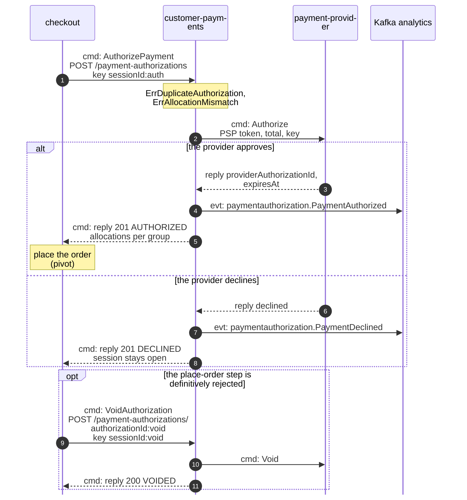
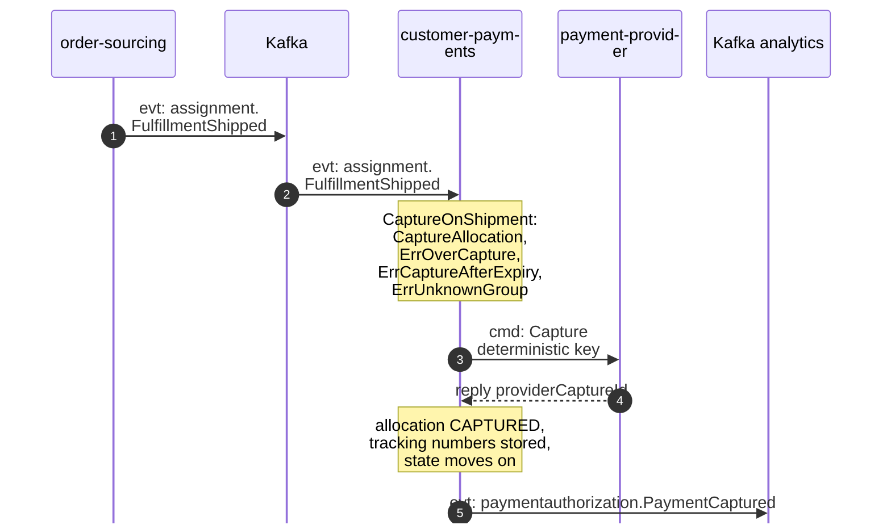
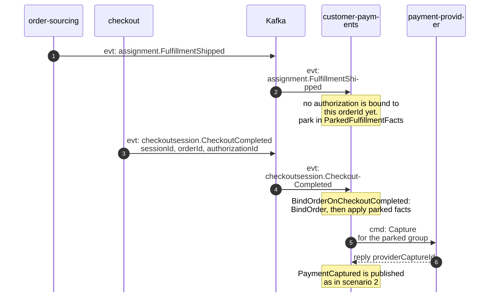
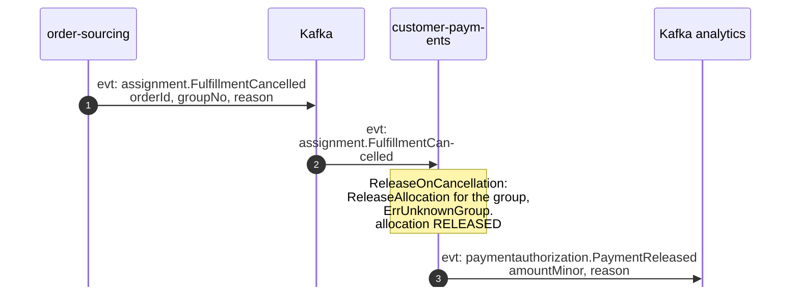
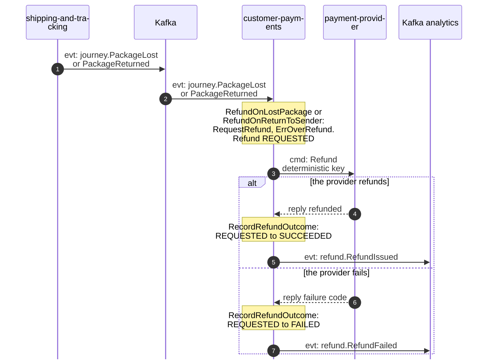
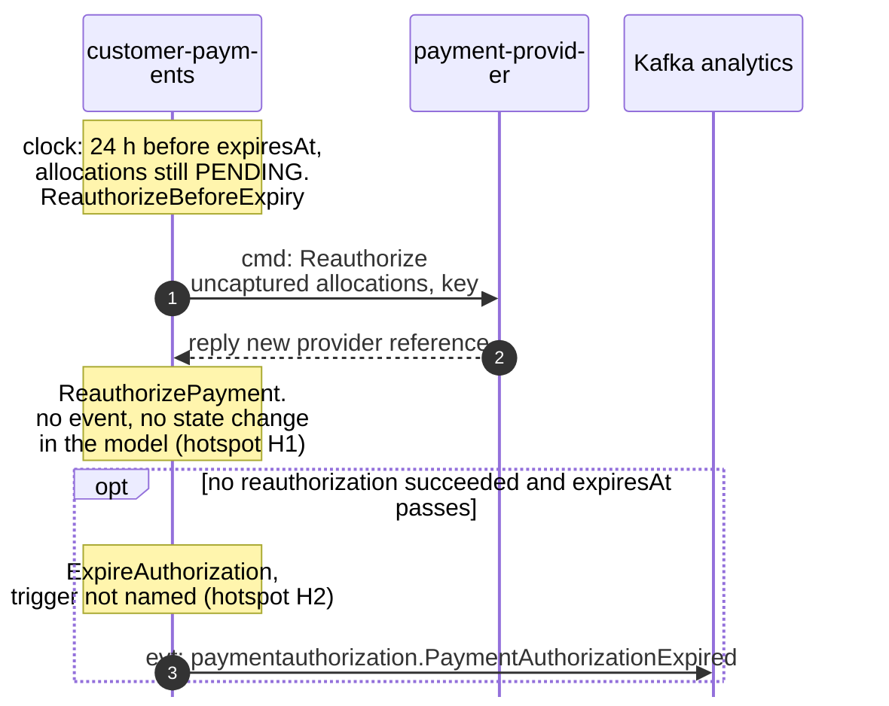

# Domain Message Flow

:::info[Proposed design, docs only]
Derived from [`model/model.yaml`](https://github.com/IQVO/warehouse-docs/blob/main/storefront/model/model.yaml). Nothing in this context is built; the model is the canonical design, and identifiers (`Err...` names, routes, CloudEvents types) are the names a future implementation must use.
:::

Following ddd-crew [Domain Message Flow Modelling](https://github.com/ddd-crew/domain-message-flow-modelling).
Six scenarios. Participants are contexts, actors and the external provider.
Every arrow is a message from the model, prefixed `cmd:` (command), `qry:`
(query) or `evt:` (event). A `Note` names a command a context runs on itself.
Kafka is drawn as one participant. Event names are written
`entity.EventName`; the full type is
`com.retailnetwork.<tier>.<producer>.<entity>.<EventName>` (see
[Domain Events](/storefront/contexts/customer-payments/domain-events)). REST
path parameters are written without braces. The storefront-wide flows follow
from the [Context Map](/storefront/strategic-design/context-map).

## 1. Checkout authorizes the payment, or voids it

Derived from: `model.yaml → contexts[customer-payments].inbound` (checkout
cmd rows), `.aggregates[PaymentAuthorization]` (`commands`, `invariants`,
`notes`), `.sync_calls`, `.publishes[PaymentAuthorized, PaymentDeclined]`;
`contexts[checkout].sync_calls` (`AuthorizePayment`, `VoidAuthorization`).

Omitted: the saga around it (the binding `PriceQuote`, the offer pre-check,
the place-order step, the requote path, gap S3: checkout's own pages), the
outbox write and relay (see
[Sequence Diagrams](/storefront/contexts/customer-payments/sequence-diagrams)),
and the provider timeout, which the proposed REST contract answers with a
503 to retry under the same `Idempotency-Key`.

## 2. A shipped group is captured

Derived from: `model.yaml → contexts[customer-payments].consumes`
(`FulfillmentShipped`), `.policies[CaptureOnShipment]`,
`.aggregates[PaymentAuthorization]`, `.sync_calls`,
`.publishes[PaymentCaptured]`; `network/model/model.yaml →
contexts[order-sourcing].publishes[FulfillmentShipped]`.

Omitted: the inbox check on the CloudEvents `id`; the case where the order
is not bound yet (scenario 3); the `AUTHORIZED → CAPTURED` path of a
one-group order, which the model's `transitions` do not list (hotspot H3).

## 3. A fulfilment fact arrives before the order is bound

Derived from: `model.yaml → contexts[customer-payments].read_models[ParkedFulfillmentFacts]`,
`.policies[BindOrderOnCheckoutCompleted]`, `.business_decisions`,
`.consumes`; `contexts[checkout].publishes[CheckoutCompleted]`; gap S4 on
the [Model Gap Register](/storefront/strategic-design/model-gap-register).

Omitted: the other three parked fact kinds (`FulfillmentCancelled`,
`PackageLost`, `PackageReturned`), which are parked and applied the same way;
and a fact for an order that never binds, which the model leaves without an
expiry (hotspot H10).

## 4. A cancelled group is released

Derived from: `model.yaml → contexts[customer-payments].consumes`
(`FulfillmentCancelled`), `.policies[ReleaseOnCancellation]`,
`.publishes[PaymentReleased]`.

Omitted: the provider call. The provider port has no partial release verb,
so the model names no provider message for this flow (hotspot H4). Also
omitted: the order becoming `CANCELLED` in the network, and a refused cancel
(`FulfillmentCancelRefused`), which this context does not consume: the group
then ships and is captured through scenario 2.

## 5. A lost or returned package is refunded

Derived from: `model.yaml → contexts[customer-payments].consumes`
(`PackageLost`, `PackageReturned`), `.policies[RefundOnLostPackage,
RefundOnReturnToSender]`, `.aggregates[Refund]`, `.sync_calls`,
`.publishes[RefundIssued, RefundFailed]`.

Omitted: the manual route (`POST /refunds` by storefront ops, reason
`MANUAL`), which runs the same refund steps; and how the tracking number
maps back to the group (stored on capture, hotspot H6).

## 6. An authorization is re-authorized before it expires

Derived from: `model.yaml → contexts[customer-payments].policies[ReauthorizeBeforeExpiry]`,
`.aggregates[PaymentAuthorization]` (`commands`, `transitions`),
`.sync_calls`, `.publishes[PaymentAuthorizationExpired]`.

Omitted: `VoidUnboundAuthorizations`, the other clock policy (no
`CheckoutCompleted` after 24 h: void). The `opt` block shows where the model
allows an expiry; it does not say what runs `ExpireAuthorization` or what
happens when the provider declines the reauthorization.
