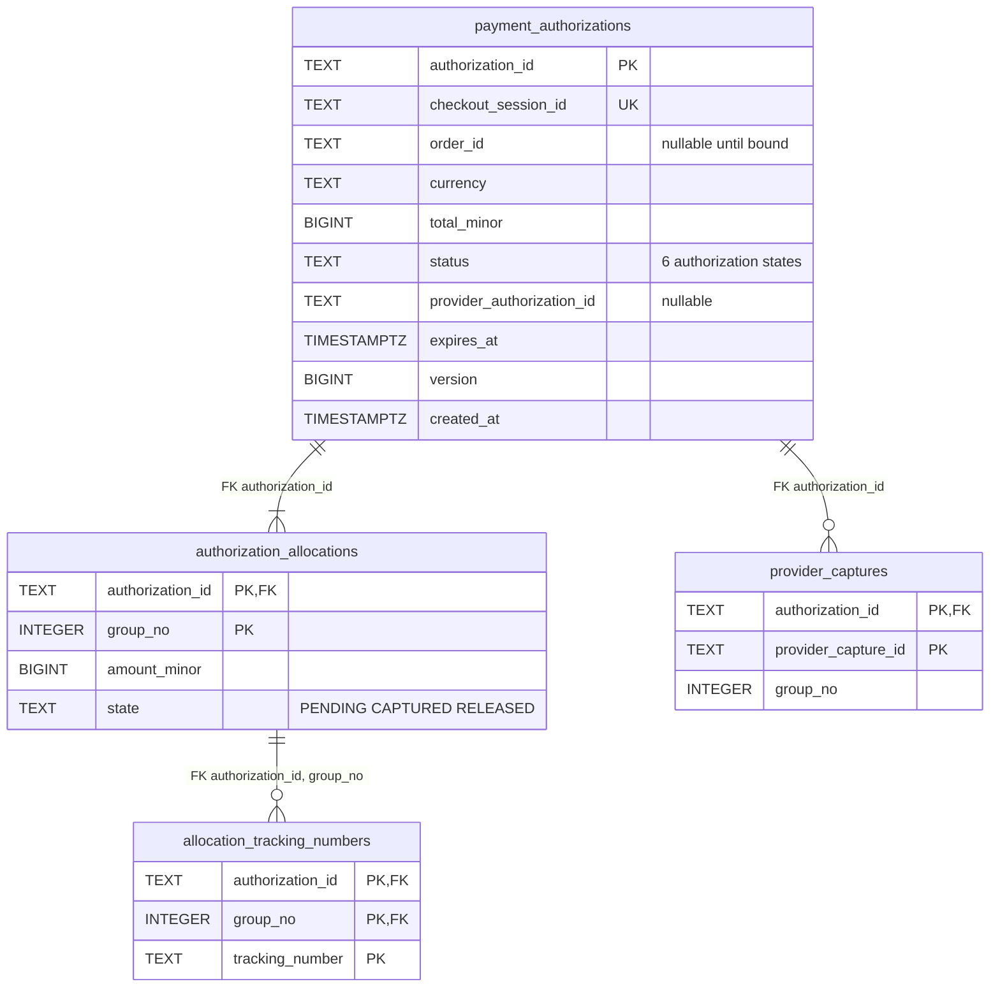
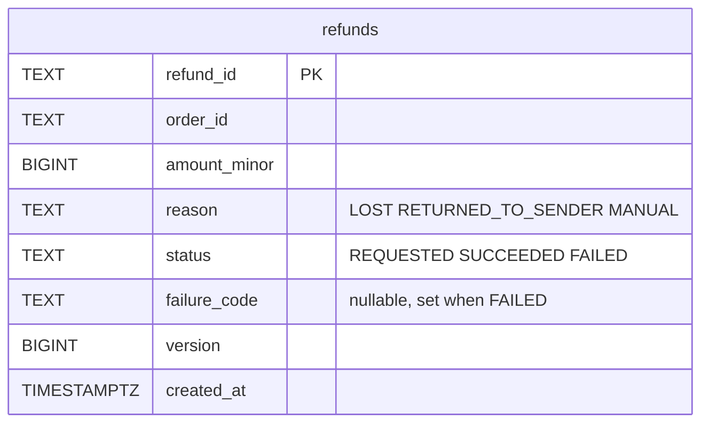
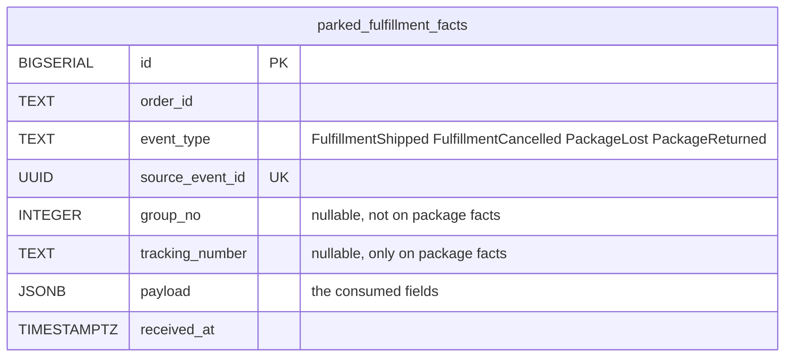
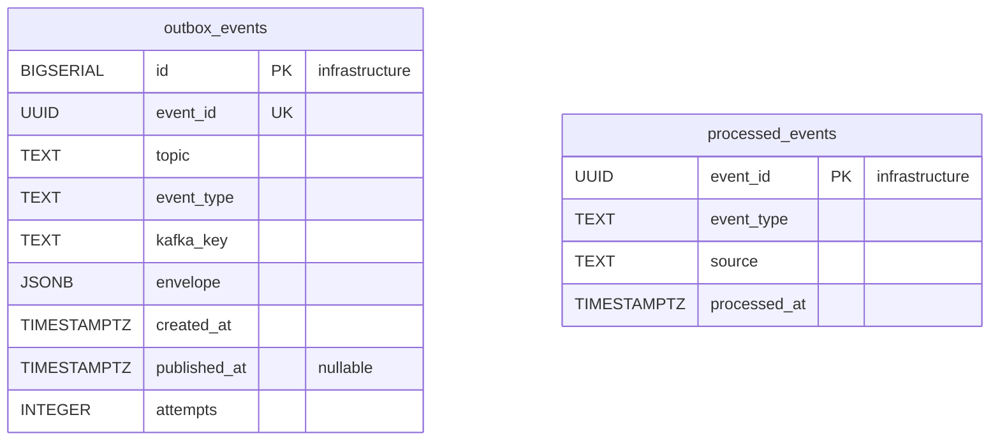
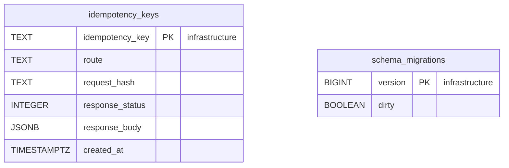

# Entity Relationship

:::info[Proposed design, docs only]
Derived from [`model/model.yaml`](https://github.com/IQVO/warehouse-docs/blob/main/storefront/model/model.yaml). Nothing in this context is built; the model is the canonical design, and identifiers (`Err...` names, routes, CloudEvents types) are the names a future implementation must use.
:::

The **proposed** Postgres schema. Customer Payments owns its database and
shares no table with any other context, nor with the payment-provider
simulator's own database (`conventions.integration_rules`). Column names are
the model's field names in `snake_case`. A relationship line is drawn
**only** inside the one aggregate. No column here holds PII or card data:
ids, amounts in minor units, states, reasons and provider references only —
there is no card number, no PSP token and no name or e-mail column.

## Aggregate tables

### PaymentAuthorization

Derived from: `model.yaml → contexts[customer-payments].aggregates[PaymentAuthorization]`
(`description`, `value_objects`, `states`, `invariants`); `.publishes[*].data`
(`expiresAt`, `totalMinor`, `allocations`); `.aggregates[PaymentAuthorization].size_estimate`.

Column notes: `checkout_session_id` is unique, which backs
`ErrDuplicateAuthorization` (one authorization per checkout session);
`order_id` stays null until `BindOrder` runs on `CheckoutCompleted`, and a
row with a null `order_id` older than 24 h is what `VoidUnboundAuthorizations`
looks for; `expires_at` is the fact `ReauthorizeBeforeExpiry` (24 h before)
and `ErrCaptureAfterExpiry` read; `version` is the optimistic-concurrency
counter. `authorization_allocations` holds the `Allocation` value objects, and
`provider_captures` the `ProviderRef.providerCaptureIds[]` list next to
`provider_authorization_id`. A `DECLINED` row is the terminal record of a
declined attempt and carries no provider reference. The sum of
`amount_minor` per authorization equals `total_minor` (`ErrAllocationMismatch`,
enforced by the aggregate).

`allocation_tracking_numbers` realises the model's statement that
`CaptureOnShipment` "also stores trackingNumber to group": the model's value
objects have no field for it (hotspot H6), so this table is a proposal to be
confirmed, and it is what lets `PackageLost` and `PackageReturned`, which
name a tracking number, find the group to refund.

Omitted: indexes (`payment_authorizations.order_id` for `ListAuthorizations`
and every fulfilment fact, `expires_at` for the reauthorization sweep, a
partial index on `status in ('AUTHORIZED', 'PARTIALLY_CAPTURED')`,
`allocation_tracking_numbers.tracking_number` for the refund lookup) and
`CHECK` constraints (`amount_minor` not negative; captured per group never
over the allocation is enforced by the aggregate, `ErrOverCapture`).

### Refund

Derived from: `model.yaml → contexts[customer-payments].aggregates[Refund]`
(`description`, `value_objects`, `states`); `.publishes[RefundIssued,
RefundFailed].data` (`orderId`, `amountMinor`, `reason`, `code`).

Column notes: `order_id` is the only link back to the money: the model's
`ErrOverRefund` sums refunds of an order against its captured total, which is
computed across `refunds` and `authorization_allocations` by `order_id` in
the application, never by a foreign key. The row carries no `group_no` and
no `authorization_id`, as the model's `Refund` fields do not (hotspot H12).
`failure_code` is the `code` of `RefundFailed`.

## Read model tables

Derived from: `model.yaml → contexts[customer-payments].read_models`
(`ParkedFulfillmentFacts`) and the consumed events' declared fields
(`orderId`, `groupNo`, `trackingNumbers`, `reason`, `trackingNumber`).

The table is not disposable like a projection: it is the only copy of facts
that arrived before their order was bound, so `BindOrder` reads it, applies
the rows in `received_at` order and deletes them in the same transaction.
The model gives it no retention or size bound for an order that never binds
(hotspot H10).

## Infrastructure tables

Derived from: `model.yaml → conventions.integration_rules` (transactional
outbox, idempotent consumers, Idempotency-Key on every write route);
`conventions.cloudevents` (topic, type, key).

**All four tables are infrastructure, not domain tables.**
`outbox_events` is the transactional outbox, drained by the relay to
`retailnetwork.customer-payments.analytics` — the only topic the context
publishes to, because all seven events are analytics-only (hotspot H9);
`event_id` is the CloudEvents `id`, `event_type` the full type, `kafka_key`
the `authorizationId` or `refundId`. `processed_events` is the inbox, one row
per consumed CloudEvents `id` across all three consumer groups.
`idempotency_keys` stores the response of every state-changing `POST` for
replay (`<sessionId>:auth` and `<sessionId>:void` from `checkout`, the ops
key for `POST /refunds`). `schema_migrations` is the migration tool's
bookkeeping.

The deterministic provider idempotency keys per (operation,
`authorizationId`, `groupNo`) are **derived**, not stored: the ACL adapter
recomputes the same key for the same call, so a retried capture or refund
carries the key the first attempt used.

## Why there are no foreign keys across aggregates or contexts

- `refunds.order_id` and `payment_authorizations.order_id` are the same
  value, but the two aggregates are separate: a refund is created by its own
  command and settled by the provider's answer, so no foreign key joins them.
- `payment_authorizations.checkout_session_id` points into `checkout`: a
  reference by value, copied from the authorize request. Nothing joins to
  `checkout`'s database, and `checkout` reads the authorization through
  `GET /payment-authorizations/{authorizationId}`, not through a shared
  table.
- `payment_authorizations.order_id` and `parked_fulfillment_facts.order_id`
  reference the network's `customer-ordering` order by value; the order, its
  ship-to address and its shopper live only there (`conventions.no_auth`).
- `allocation_tracking_numbers.tracking_number` references the network's
  `shipping-and-tracking` package by value.
- `parked_fulfillment_facts` has no FK to `payment_authorizations`: its whole
  purpose is to hold facts whose authorization is not bound to their order
  yet.
- `provider_authorization_id` and `provider_capture_id` are the provider's
  ids, never joined.

## Table ≠ aggregate

| Table | Aggregate / role | Notes |
| --- | --- | --- |
| `payment_authorizations` | **PaymentAuthorization** (root) | One row per checkout session; `version`, unique `checkout_session_id`, the terminal `status`. |
| `authorization_allocations` | **PaymentAuthorization** (`Allocation` value objects) | One row per shipment group; the unit of capture and release. |
| `allocation_tracking_numbers` | **PaymentAuthorization** (proposal, hotspot H6) | Stored by `CaptureOnShipment`; read by the refund policies. |
| `provider_captures` | **PaymentAuthorization** (`ProviderRef.providerCaptureIds[]`) | The provider's capture ids. |
| `refunds` | **Refund** (root) | One row per refund; low volume. |
| `parked_fulfillment_facts` | none (read model `ParkedFulfillmentFacts`) | Facts waiting for a bind; deleted when applied. |
| `outbox_events` | none (infrastructure) | Transactional outbox, `.analytics` topic only. |
| `processed_events` | none (infrastructure) | Inbox for idempotent consumers. |
| `idempotency_keys` | none (infrastructure) | `Idempotency-Key` replay store. |
| `schema_migrations` | none (infrastructure) | Migration bookkeeping. |
