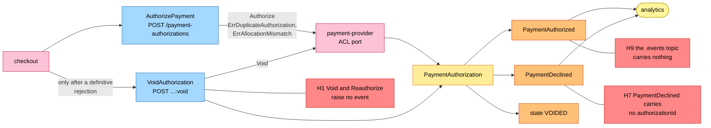
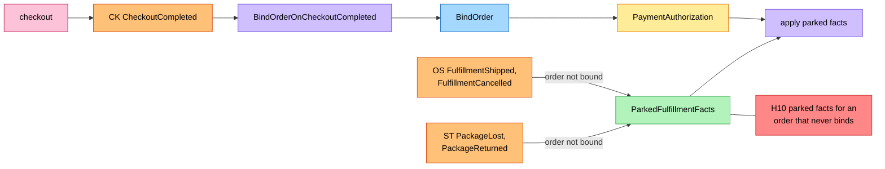
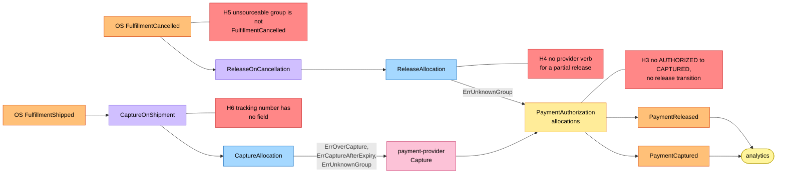
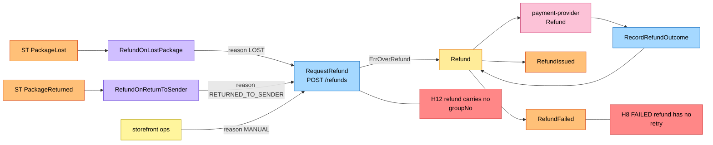
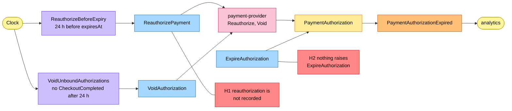

# EventStorming

:::info[Proposed design, docs only]
Derived from [`model/model.yaml`](https://github.com/IQVO/warehouse-docs/blob/main/storefront/model/model.yaml). Nothing in this context is built; the model is the canonical design, and identifiers (`Err...` names, routes, CloudEvents types) are the names a future implementation must use.
:::

Process-level boards in the ddd-crew
[EventStorming glossary & cheat sheet](https://github.com/ddd-crew/eventstorming-glossary-cheat-sheet)
notation. Every sticky comes from `model.yaml`. Events published by a
neighbour are drawn as orange stickies prefixed with the producer. Every
hotspot is a gap or a risk the model itself shows, and its source is given
in the hotspot table. Boards are drawn left to right; each stays within the
page width.

## Legend

| Colour | Sticky | Meaning here |
| --- | --- | --- |
| Pale yellow `#fff59d` | Actor | Checkout, storefront ops, the clock |
| Blue `#a5d8ff` | Command | A command from `aggregates[PaymentAuthorization].commands` or `aggregates[Refund].commands` |
| Yellow `#ffec99` | Aggregate | `PaymentAuthorization` or `Refund` |
| Orange `#ffc078` | Domain Event | Ours (`publishes`) or a neighbour's (`consumes`, prefixed with the producer) |
| Lilac `#d0bfff` | Policy | `policies`, or the reaction a command takes to an event |
| Green `#b2f2bb` | Read Model | `ParkedFulfillmentFacts`, a read route |
| Pink `#fcc2d7` | External System | A sibling context, the network, the payment provider, analytics |
| Red `#ff8787` | Hotspot | A gap or risk in the model (see the table at the end) |

## 1. Authorize at checkout

Derived from: `model.yaml → contexts[customer-payments].inbound` (checkout cmd
rows), `.aggregates[PaymentAuthorization]` (`commands`, `invariants`,
`events`, `notes`), `.sync_calls`, `.publishes`; `contexts[checkout].sync_calls`.

Omitted: the saga around the call, the requote path (gap S3), the provider
timeout and the outbox. A declined authorize is saved as a terminal
`DECLINED` record and the checkout session stays open for another token. The
voided state is drawn as a sticky because the model names no void event
(H1).

## 2. Bind the order and apply parked facts

Derived from: `model.yaml → contexts[customer-payments].read_models`,
`.policies[BindOrderOnCheckoutCompleted]`, `.business_decisions`,
`.consumes`; `contexts[checkout].publishes[CheckoutCompleted]`.

Omitted: the commands the applied facts cause (boards 3 and 4) and the inbox.
`BindOrder` raises no event of its own; gap S4 is the reason the board exists
at all.

## 3. Capture and release

Derived from: `model.yaml → contexts[customer-payments].policies[CaptureOnShipment,
ReleaseOnCancellation]`, `.consumes`, `.aggregates[PaymentAuthorization]`
(`commands`, `transitions`, `invariants`), `.sync_calls`, `.publishes`;
`network/model/model.yaml → contexts[order-sourcing].publishes`.

Omitted: the bind and parking (board 2), the provider call on release (the
model names none) and the inbox. Capture and release both act on one
allocation; the aggregate state follows only the capture transitions.

## 4. Refunds

Derived from: `model.yaml → contexts[customer-payments].aggregates[Refund]`,
`.policies[RefundOnLostPackage, RefundOnReturnToSender]`, `.inbound` (ops
rows), `.consumes`, `.sync_calls`, `.publishes[RefundIssued, RefundFailed]`;
`network/model/model.yaml → contexts[shipping-and-tracking].publishes`.

Omitted: the parking of a fact for an unbound order (board 2) and the read
routes `GET /refunds?orderId=`. `RefundIssued` and `RefundFailed` are
analytics-only.

## 5. Clock policies

Derived from: `model.yaml → contexts[customer-payments].policies[ReauthorizeBeforeExpiry,
VoidUnboundAuthorizations]`, `.aggregates[PaymentAuthorization]` (`commands`,
`transitions`), `.sync_calls`, `.publishes[PaymentAuthorizationExpired]`.

Omitted: the capture-after-expiry guard (`ErrCaptureAfterExpiry`, board 3).
The two policies are the model's only clock-driven rules; the expiry itself
has no named cause.

## Hotspots

| # | Hotspot | Where it comes from in the model |
| --- | --- | --- |
| H1 | `VoidAuthorization` and `ReauthorizePayment` raise no event, and `ReauthorizePayment` has no transition; how a reauthorization is recorded (new `expiresAt`, new provider reference) is not stated, and analytics never sees a void. | `aggregates[PaymentAuthorization].commands` vs `.events` and `.transitions` |
| H2 | Nothing names what raises `ExpireAuthorization`: no policy, inbound row or provider callback. It also does not say what happens when a reauthorization is declined. | `aggregates[PaymentAuthorization].commands`, `policies` |
| H3 | `transitions` has no `AUTHORIZED → CAPTURED` (a one-group authorization), `ReleaseAllocation` has no transition, and the state after every allocation is released, or a mix of captured and released, is undefined. | `aggregates[PaymentAuthorization].transitions` vs `.states` and `.commands` |
| H4 | The provider port is Authorize, Capture, Void, Refund, Reauthorize; releasing one allocation of a multi-group authorization has no verb. | `sync_calls`, `policies[ReleaseOnCancellation]` |
| H5 | `ReleaseOnCancellation` says `FulfillmentCancelled` covers "an unsourceable group"; the network publishes `FulfillmentUnsourceable` separately and this context does not consume it. The `reason` field of `PaymentReleased` has no named values. | `policies[ReleaseOnCancellation]`, `consumes`; `network/model/model.yaml → contexts[order-sourcing].publishes` |
| H6 | `PackageLost` and `PackageReturned` carry `trackingNumber`; `CaptureOnShipment` "also stores trackingNumber to group", but `Allocation` and `ProviderRef` have no such field. | `policies[CaptureOnShipment]`, `aggregates[PaymentAuthorization].value_objects` |
| H7 | `PaymentDeclined` carries `checkoutSessionId`, `reason` and `at` but no `authorizationId`, although it is published by the aggregate whose root id is the subject and partition key. | `publishes[PaymentDeclined]` vs `aggregates[PaymentAuthorization].root_id` |
| H8 | A `FAILED` refund is terminal with no retry or follow-up, and the model does not say whether `REQUESTED` or `FAILED` refunds count toward `ErrOverRefund`. | `aggregates[Refund].transitions`, `.invariants` |
| H9 | All seven events are analytics-only, so `retailnetwork.customer-payments.events` carries nothing; the future `customer-notifications` context would be the first consumer. | `publishes` rows ("analytics only"); `future_contexts[customer-notifications]` |
| H10 | `ParkedFulfillmentFacts` has no expiry, size bound or alarm for an order that never binds (a `CheckoutCompleted` that never comes). | `read_models[ParkedFulfillmentFacts]`, `policies[VoidUnboundAuthorizations]` |
| H11 | The `PaymentAuthorization` description in the model is cut off in the middle of "unique checkoutSessionId" (a literal ellipsis). | `aggregates[PaymentAuthorization].description` |
| H12 | `Refund` and `RefundIssued` carry `orderId` only, no `groupNo` or `authorizationId`, although the policies refund "the affected group's captured amount" and the provider key is per group. | `aggregates[Refund]`, `publishes[RefundIssued]`, `policies[RefundOnLostPackage]` |
