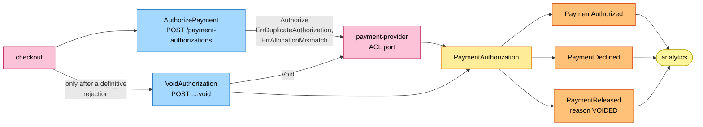
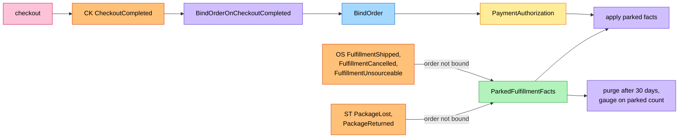
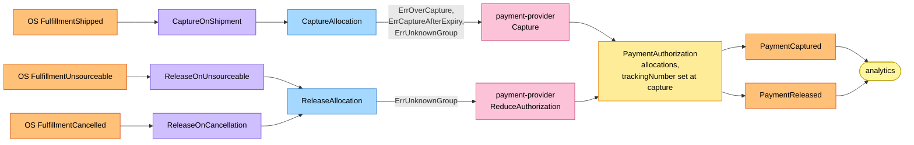
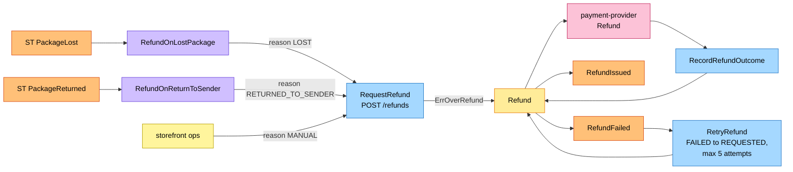
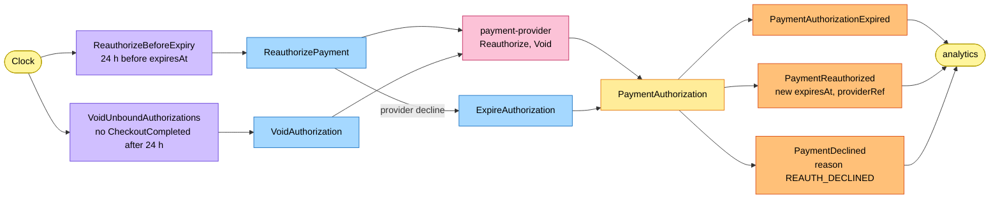

# EventStorming

:::info[Proposed design, docs only]
Derived from [`model/model.yaml`](https://github.com/IQVO/warehouse-docs/blob/main/storefront/model/model.yaml). Nothing in this context is built; the model is the canonical design, and identifiers (`Err...` names, routes, CloudEvents types) are the names a future implementation must use.
:::

Process-level boards in the ddd-crew
[EventStorming glossary & cheat sheet](https://github.com/ddd-crew/eventstorming-glossary-cheat-sheet)
notation. Every sticky comes from `model.yaml`. Events published by a
neighbour are drawn as orange stickies prefixed with the producer. Every
hotspot is a gap or a risk the model itself shows, and its source is given
in the hotspot table. Boards are drawn left to right; each stays within the
page width.

## Legend

| Colour | Sticky | Meaning here |
| --- | --- | --- |
| Pale yellow `#fff59d` | Actor | Checkout, storefront ops, the clock |
| Blue `#a5d8ff` | Command | A command from `aggregates[PaymentAuthorization].commands` or `aggregates[Refund].commands` |
| Yellow `#ffec99` | Aggregate | `PaymentAuthorization` or `Refund` |
| Orange `#ffc078` | Domain Event | Ours (`publishes`) or a neighbour's (`consumes`, prefixed with the producer) |
| Lilac `#d0bfff` | Policy | `policies`, or the reaction a command takes to an event |
| Green `#b2f2bb` | Read Model | `ParkedFulfillmentFacts`, a read route |
| Pink `#fcc2d7` | External System | A sibling context, the network, the payment provider, analytics |
| Red `#ff8787` | Hotspot | A gap or risk in the model (see the table at the end) |

## 1. Authorize at checkout

Derived from: `model.yaml → contexts[customer-payments].inbound` (checkout cmd
rows), `.aggregates[PaymentAuthorization]` (`commands`, `invariants`,
`events`, `notes`), `.sync_calls`, `.publishes`; `contexts[checkout].sync_calls`.

Omitted: the saga around the call, the requote path (gap S3), the provider
timeout and the outbox. A declined authorize is saved as a terminal
`DECLINED` record, which is why `PaymentDeclined` carries `authorizationId`
(H7), and the checkout session stays open for another token. A void raises
`PaymentReleased{reason: VOIDED}` (H1). Every event on this page is
analytics-only by design (H9).

## 2. Bind the order and apply parked facts

Derived from: `model.yaml → contexts[customer-payments].read_models`,
`.policies[BindOrderOnCheckoutCompleted]`, `.business_decisions`,
`.consumes`; `contexts[checkout].publishes[CheckoutCompleted]`.

Omitted: the commands the applied facts cause (boards 3 and 4) and the inbox.
`BindOrder` raises no event of its own; gap S4 is the reason the board exists
at all. Parked facts are retained 30 days and then purged, and a gauge reports
the parked count (H10); the 24 h `VoidUnboundAuthorizations` backstop still
voids the authorization itself.

## 3. Capture and release

Derived from: `model.yaml → contexts[customer-payments].policies[CaptureOnShipment,
ReleaseOnCancellation, ReleaseOnUnsourceable]`, `.consumes`, `.aggregates[PaymentAuthorization]`
(`commands`, `transitions`, `invariants`), `.sync_calls`, `.publishes`;
`network/model/model.yaml → contexts[order-sourcing].publishes`.

Omitted: the bind and parking (board 2) and the inbox. Capture and release
both act on one allocation, and the aggregate state is derived from the
allocations: `PARTIALLY_CAPTURED` while some are captured and some pending,
`CAPTURED` when all are captured or released with at least one captured,
`RELEASED` when all are released (H3). A partial release calls the provider
port's `ReduceAuthorization(amount)` (H4). `FulfillmentUnsourceable` is
consumed separately from `FulfillmentCancelled`; `PaymentReleased.reason` is
`CANCELLED`, `UNSOURCEABLE`, `VOIDED` or `EXPIRED` (H5). The allocation stores
the nullable `trackingNumber` at capture, and `PackageLost` and
`PackageReturned` map to a group by it (H6).

## 4. Refunds

Derived from: `model.yaml → contexts[customer-payments].aggregates[Refund]`,
`.policies[RefundOnLostPackage, RefundOnReturnToSender]`, `.inbound` (ops
rows), `.consumes`, `.sync_calls`, `.publishes[RefundIssued, RefundFailed]`;
`network/model/model.yaml → contexts[shipping-and-tracking].publishes`.

Omitted: the parking of a fact for an unbound order (board 2) and the read
routes `GET /refunds?orderId=`. `RefundIssued` and `RefundFailed` are
analytics-only. A `FAILED` refund is retryable through `RetryRefund`, at most
5 attempts, after which it stays `FAILED` with an operator alert; `ErrOverRefund`
counts `REQUESTED` and issued refunds, never `FAILED` (H8). `Refund` and
`RefundIssued` carry `groupNo` and `authorizationId` (H12).

## 5. Clock policies

Derived from: `model.yaml → contexts[customer-payments].policies[ReauthorizeBeforeExpiry,
VoidUnboundAuthorizations]`, `.aggregates[PaymentAuthorization]` (`commands`,
`transitions`), `.sync_calls`, `.publishes[PaymentAuthorizationExpired, PaymentReauthorized, PaymentDeclined]`.

Omitted: the capture-after-expiry guard (`ErrCaptureAfterExpiry`, board 3).
The two policies are the model's only clock-driven rules. A successful
reauthorization keeps the state `AUTHORIZED` and raises `PaymentReauthorized`
with the new `expiresAt` and `providerRef` (H1). A provider decline moves the
authorization to `EXPIRED` and raises `PaymentDeclined{reason:
REAUTH_DECLINED}`, which is what raises `ExpireAuthorization` (H2).

## Hotspots

| # | Hotspot | Where it comes from in the model |
| --- | --- | --- |
| H1 | **Resolved in the model-fix:** `VoidAuthorization` raises `PaymentReleased{reason: VOIDED}`. `ReauthorizePayment` has the transition `AUTHORIZED → AUTHORIZED` and raises `PaymentReauthorized` (new `expiresAt`, `providerRef`). | `aggregates[PaymentAuthorization].transitions`, `.events`, `publishes[PaymentReauthorized]` |
| H2 | **Resolved in the model-fix:** policy `ReauthorizeBeforeExpiry` (at `expiresAt` minus 24 h) calls Reauthorize for the uncaptured allocations; a provider decline moves the authorization to `EXPIRED` and raises `PaymentDeclined{reason: REAUTH_DECLINED}`. That is the cause of `ExpireAuthorization`. | `policies[ReauthorizeBeforeExpiry]`, `aggregates[PaymentAuthorization].notes` |
| H3 | **Resolved in the model-fix:** the aggregate state is derived from the allocations (`PARTIALLY_CAPTURED`, `CAPTURED`, `RELEASED`), with `AUTHORIZED → CAPTURED` and `ReleaseAllocation` transitions. | `aggregates[PaymentAuthorization].transitions`, `.notes` |
| H4 | **Resolved in the model-fix:** the provider port gains `ReduceAuthorization(amount)` for a partial release; the simulator implements it. | `sync_calls`, `aggregates[PaymentAuthorization].notes` |
| H5 | **Resolved in the model-fix:** `FulfillmentUnsourceable` is consumed; policy `ReleaseOnUnsourceable` releases that group. `PaymentReleased.reason` is `CANCELLED`, `UNSOURCEABLE`, `VOIDED` or `EXPIRED`. | `consumes`, `policies[ReleaseOnUnsourceable]`, `publishes[PaymentReleased]` |
| H6 | **Resolved in the model-fix:** `Allocation` has a nullable `trackingNumber`, set at capture from `FulfillmentShipped.trackingNumbers`; `PackageLost` and `PackageReturned` map to a group by it. | `aggregates[PaymentAuthorization].value_objects`, `policies[CaptureOnShipment]` |
| H7 | **Resolved in the model-fix:** `PaymentDeclined` carries `authorizationId` (a declined attempt still has a terminal `DECLINED` row). | `publishes[PaymentDeclined]`, `aggregates[PaymentAuthorization].notes` |
| H8 | **Resolved in the model-fix:** `RetryRefund` moves `FAILED → REQUESTED`, at most 5 attempts, then the refund stays `FAILED` and an operator alert fires. `ErrOverRefund` counts `REQUESTED` and issued refunds, never `FAILED`. The model's `rest` list has no `RetryRefund` route, so the OpenAPI carries none. | `aggregates[Refund].transitions`, `.invariants`, `.notes` |
| H9 | **Resolved in the model-fix:** all eight events are analytics-only by design: the `.events` topic carries them but no network consumer exists yet; the future `customer-notifications` context would be the first. | `business_decisions`, `publishes`, `future_contexts[customer-notifications]` |
| H10 | **Resolved in the model-fix:** `ParkedFulfillmentFacts` are retained 30 days and then purged; a gauge reports the parked count. | `read_models[ParkedFulfillmentFacts]` |
| H11 | **Resolved in the model-fix:** the `PaymentAuthorization` description is complete (unique `checkoutSessionId`, `orderId` bound later, allocations, provider refs, `expiresAt`). | `aggregates[PaymentAuthorization].description` |
| H12 | **Resolved in the model-fix:** `Refund` and `RefundIssued` carry `groupNo` and `authorizationId`. | `aggregates[Refund].description`, `publishes[RefundIssued]` |
