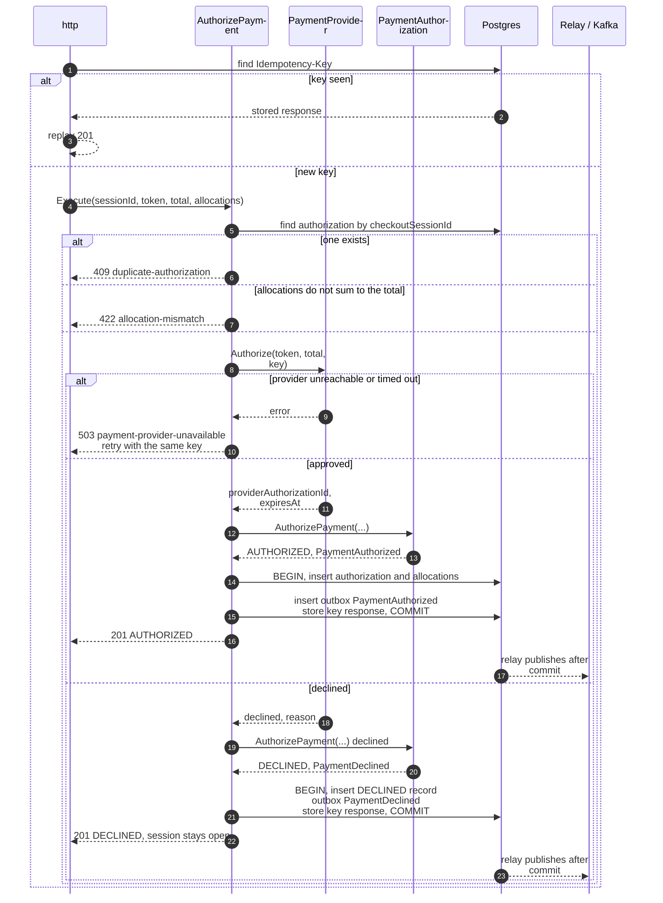
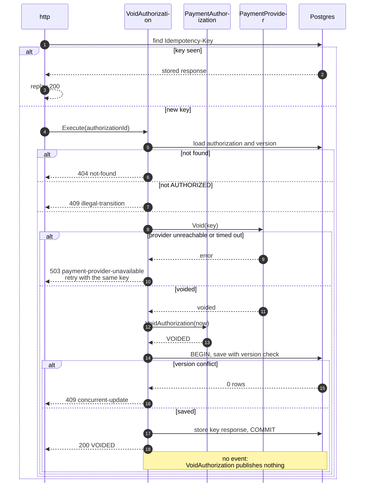
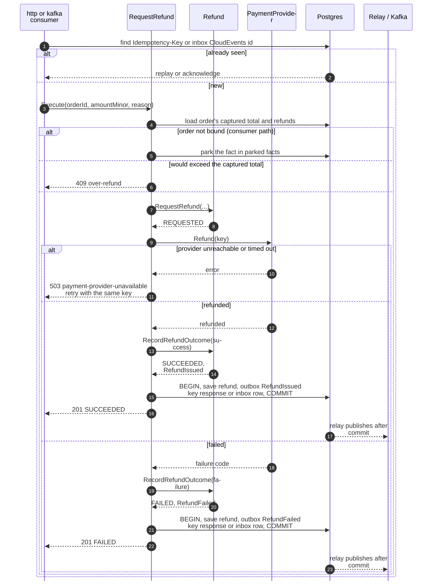
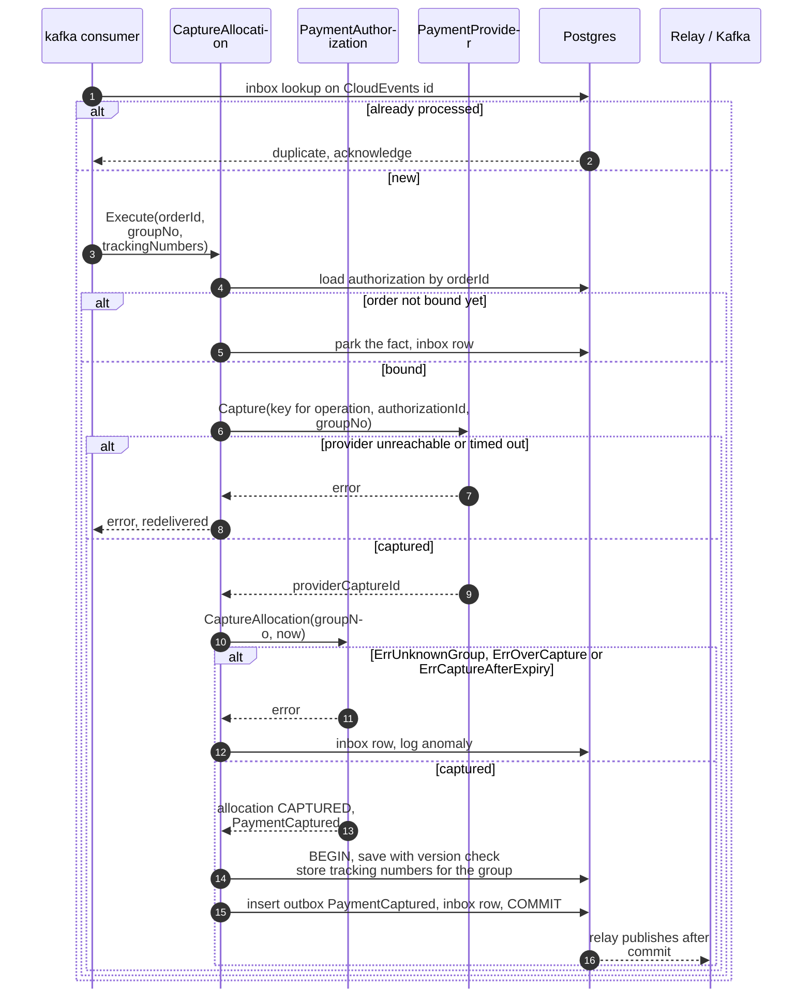
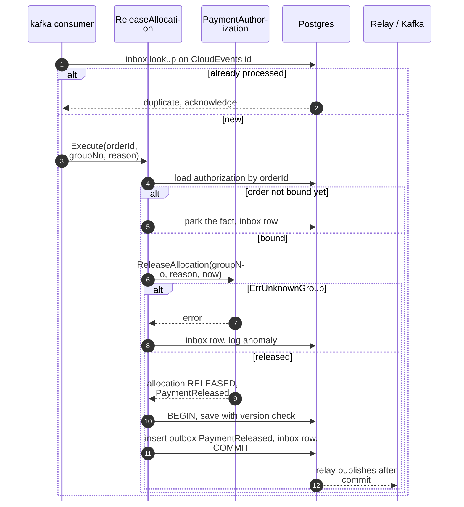
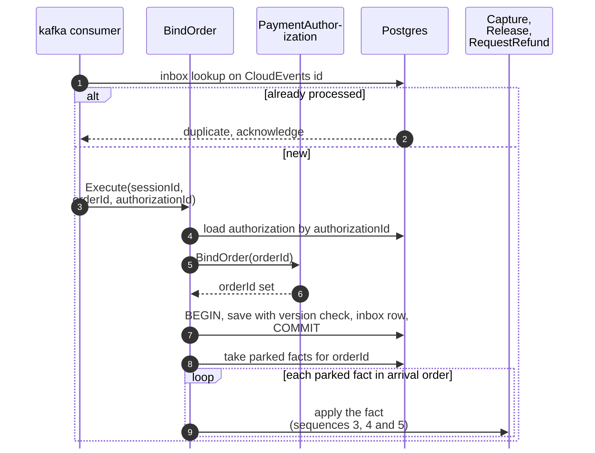
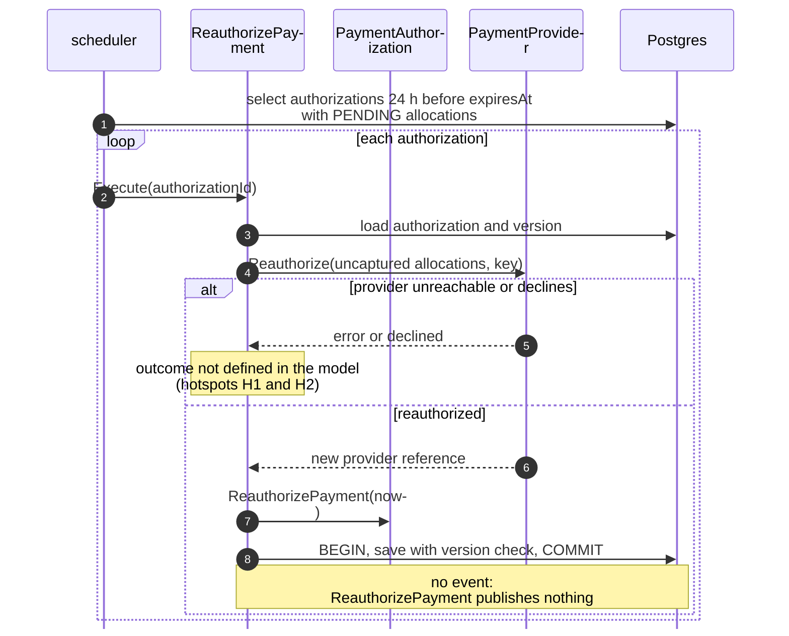
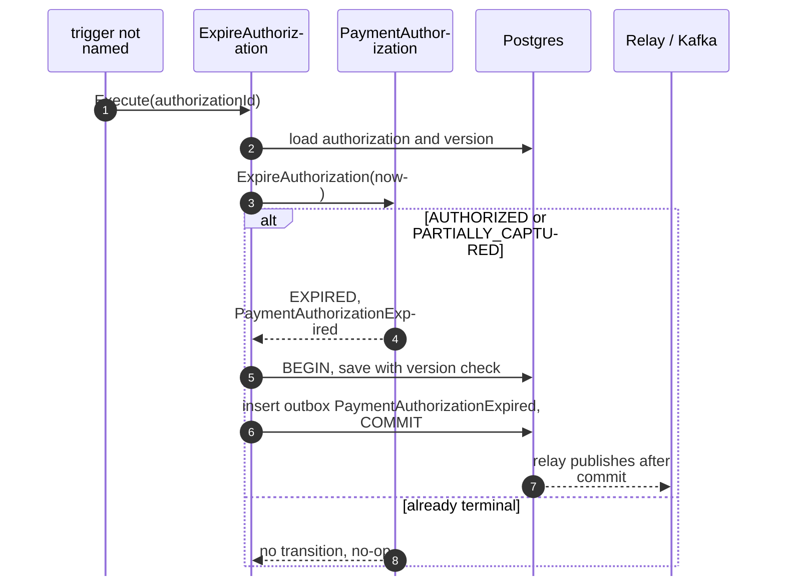

# Sequence Diagrams

:::info[Proposed design, docs only]
Derived from [`model/model.yaml`](https://github.com/IQVO/warehouse-docs/blob/main/storefront/model/model.yaml). Nothing in this context is built; the model is the canonical design, and identifiers (`Err...` names, routes, CloudEvents types) are the names a future implementation must use.
:::

One UML sequence diagram per command use case on
[Use Cases](/storefront/contexts/customer-payments/use-cases). Participant
names are the proposed packages and ports from the
[Class Diagram](/storefront/contexts/customer-payments/class-diagram):

- `http`, `kafka consumer` and `scheduler` are the inbound adapters.
- The use case is in `internal/application/usecases`.
- `PaymentProvider` is the outbound adapter behind the Anti-Corruption Layer
  port (`Authorize`, `Capture`, `Void`, `Refund`, `Reauthorize`); the
  payment-provider simulator answers behind it. It is the context's only
  synchronous dependency.
- `Postgres` stands for the repositories, the parked facts, the outbox, the
  inbox and the idempotency store. They share one transaction through
  `UnitOfWork`.
- `Relay / Kafka` is the outbox relay. It reads committed `outbox_events`
  rows and publishes them to `retailnetwork.customer-payments.analytics` —
  the only topic the context writes to (all seven events are analytics-only).

The provider call is made **before** the transaction opens and carries the
deterministic key per (operation, `authorizationId`, `groupNo`); a crash
between the call and the commit repeats the call with the same key. Every
save is conditional on the loaded `version` (optimistic concurrency). Full
CloudEvents types are on [Domain Events](/storefront/contexts/customer-payments/domain-events).

## 1. AuthorizePayment (REST POST /payment-authorizations)

Derived from: `model.yaml → contexts[customer-payments].aggregates[PaymentAuthorization].commands[AuthorizePayment]`,
`.invariants`, `.notes`, `.rest["POST /payment-authorizations"]`,
`.sync_calls`, `.publishes[PaymentAuthorized, PaymentDeclined]`.

Omitted: the optimistic-concurrency branch (a new row has none). A unique
key on `checkout_session_id` also catches two concurrent first calls under
different keys, answered `409 duplicate-authorization`.

## 2. VoidAuthorization (REST POST /payment-authorizations/authorizationId:void)

Derived from: `model.yaml → contexts[customer-payments].aggregates[PaymentAuthorization].commands[VoidAuthorization]`,
`.transitions`, `.rest`, `.sync_calls`; `contexts[checkout].sync_calls[VoidAuthorization]`.

Omitted: the scheduler trigger of `VoidUnboundAuthorizations`, which runs the
same use case without the HTTP branches (no `Idempotency-Key`; the
authorization is selected as unbound for 24 h).

## 3. RequestRefund and RecordRefundOutcome (REST POST /refunds, Kafka PackageLost, PackageReturned)

Derived from: `model.yaml → contexts[customer-payments].aggregates[Refund]`
(`commands`, `transitions`, `invariants`), `.policies[RefundOnLostPackage,
RefundOnReturnToSender]`, `.rest["POST /refunds"]`, `.sync_calls`,
`.publishes[RefundIssued, RefundFailed]`.

Omitted: the lookup of the group behind a tracking number (hotspot H6), the
optimistic-concurrency branch and the retry of a `FAILED` refund, which the
model does not define (hotspot H8). The REST route answers `201` with the
refund in its final state when the provider replies in the same request; a
slower outcome would leave `REQUESTED` visible through `GET /refunds`, a
detail the model does not specify.

## 4. CaptureAllocation (Kafka FulfillmentShipped)

Derived from: `model.yaml → contexts[customer-payments].consumes[FulfillmentShipped]`,
`.policies[CaptureOnShipment]`, `.aggregates[PaymentAuthorization]`
(`commands`, `transitions`, `invariants`), `.read_models`, `.sync_calls`,
`.publishes[PaymentCaptured]`.

Omitted: the version-conflict retry. An unexpected error is not
acknowledged, so the event is redelivered and the deterministic provider key
makes the repeated `Capture` safe. The capture happens before the guards in
this drawing; an implementation may run the aggregate guards first, so a
capture the aggregate would refuse never reaches the provider (the model does
not fix the order).

## 5. ReleaseAllocation (Kafka FulfillmentCancelled)

Derived from: `model.yaml → contexts[customer-payments].consumes[FulfillmentCancelled]`,
`.policies[ReleaseOnCancellation]`, `.aggregates[PaymentAuthorization]`
(`commands`, `invariants`), `.publishes[PaymentReleased]`.

Omitted: a provider call. The port has no partial release verb, so the model
names none (hotspot H4); the state of an authorization whose last allocation
is released is also undefined (hotspot H3).

## 6. BindOrder and apply parked facts (Kafka CheckoutCompleted)

Derived from: `model.yaml → contexts[customer-payments].consumes[CheckoutCompleted]`,
`.policies[BindOrderOnCheckoutCompleted]`, `.read_models[ParkedFulfillmentFacts]`,
`.aggregates[PaymentAuthorization].commands[BindOrder]`.

Omitted: the transactional detail of each applied fact (see sequences 3 to
5). The bind commits first, so a fact arriving while the parked ones are
applied already finds a bound order; the model does not fix whether the bind
and the replay share one transaction.

## 7. ReauthorizePayment (scheduler)

Derived from: `model.yaml → contexts[customer-payments].policies[ReauthorizeBeforeExpiry]`,
`.aggregates[PaymentAuthorization].commands[ReauthorizePayment]`,
`.sync_calls`.

Omitted: the idempotency detail — the scan selects only authorizations close
to expiry and the provider key is deterministic, so a second sweep repeats
the same call. What a successful reauthorization writes (a new `expiresAt`,
a new provider reference) is not defined in the model (hotspot H1).

## 8. ExpireAuthorization (trigger not named)

Derived from: `model.yaml → contexts[customer-payments].aggregates[PaymentAuthorization]`
(`commands[ExpireAuthorization]`, `transitions`, `events`),
`.publishes[PaymentAuthorizationExpired]`.

Omitted: the trigger itself, which the model does not name (hotspot H2).
The diagram draws only what the model fixes: the two transitions into
`EXPIRED` and the event they raise.
