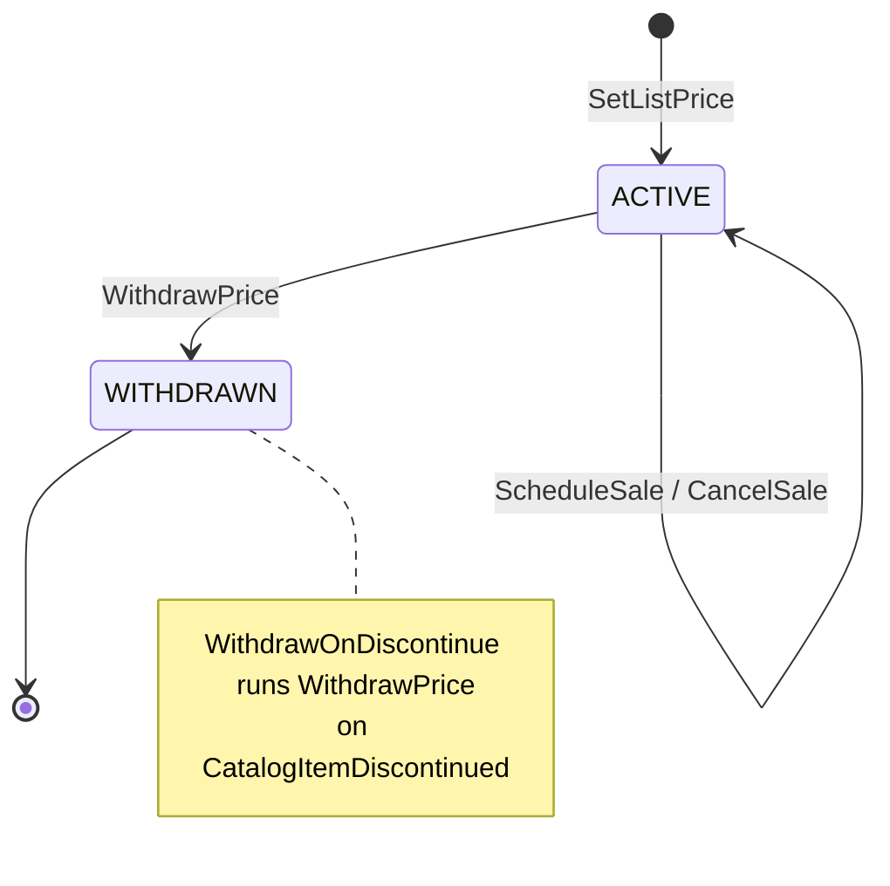
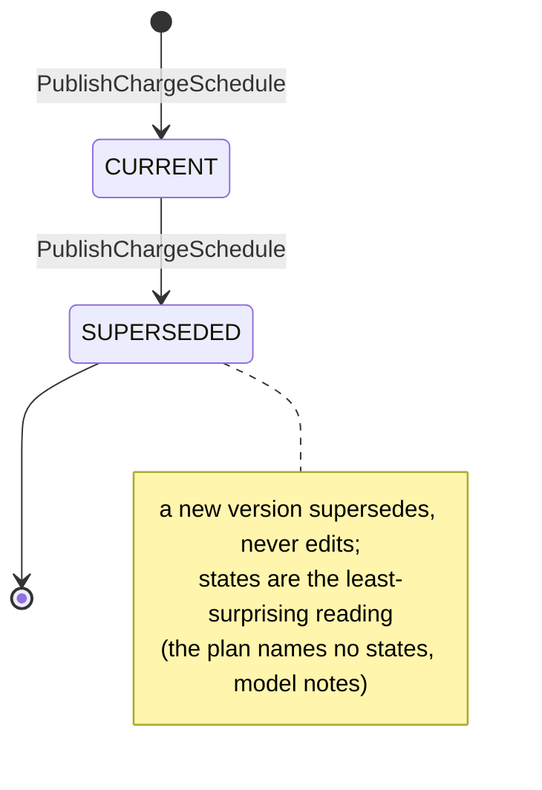
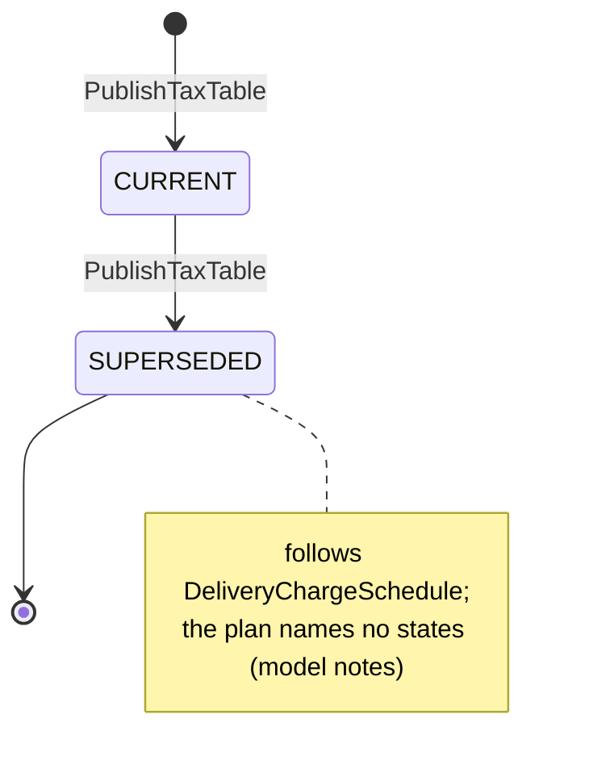
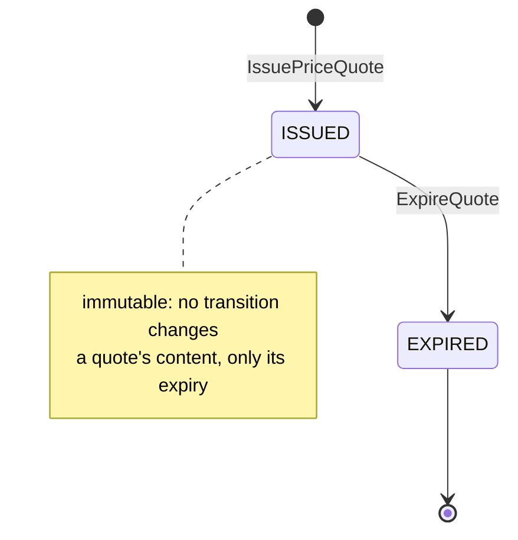

# Aggregate Design Canvas

:::info[Proposed design, docs only]
Derived from [`model/model.yaml`](https://github.com/IQVO/warehouse-docs/blob/main/storefront/model/model.yaml). Nothing in this context is built; the model is the canonical design, and identifiers (`Err...` names, routes, CloudEvents types) are the names a future implementation must use.
:::

Following the ddd-crew [Aggregate Design Canvas v1.1](https://github.com/ddd-crew/aggregate-design-canvas).
The model has four aggregate roots in this context, **ItemPrice**,
**DeliveryChargeSchedule**, **TaxTable** and **PriceQuote**, and one read
model, **CatalogItemView**. Proposed Go packages: `internal/domain/itemprice`,
`internal/domain/schedule`, `internal/domain/tax` and `internal/domain/quote`
(the packages the UL code identifiers name).

## ItemPrice

### 1. Name

`ItemPrice` (`itemprice.ItemPrice`), identified by `catalogItemId`.

### 2. Description

List price and sale windows of one catalogue item, versioned. The effective
price is the lowest active sale price, else the list price. Value objects:

| Value object | Fields | Note |
| --- | --- | --- |
| `Money` | `amountMinor`, `currency` | Integer minor units of the one configured currency. |
| `SaleWindow` | `saleId`, `price`, `from`, `to` | A time-bounded sale price; windows of one item never overlap. |

### 3. State Transitions

Derived from: `model.yaml → contexts[pricing].aggregates[ItemPrice].states`,
`.transitions`, `.commands`, `.policies`.

The entry arrow `[*] --> ACTIVE` is the creating command `SetListPrice`;
the model lists transitions between states only, so the creation and the
self-transition for sale management are this page's reading. The model
names no transition out of `WITHDRAWN`: a withdrawn price is not revived;
selling the item again needs a new price decision (open question on the
[canvas](/storefront/contexts/pricing/bounded-context-canvas)).

### 4. Enforced Invariants

| Invariant | Enforced by |
| --- | --- |
| Every amount is non-negative | all commands → `ErrNegativeAmount` |
| All prices of an item use the configured currency | all commands → `ErrCurrencyMismatch` |
| A sale price is below the list price | `ScheduleSale` → `ErrSaleNotBelowList` |
| Sale windows of one item never overlap | `ScheduleSale` → `ErrOverlappingSaleWindow` |
| The item exists in the local `CatalogItemView` and is not `DISCONTINUED` | `SetListPrice`, `ScheduleSale` → `ErrUnknownCatalogItem` |

Derived from: `model.yaml → contexts[pricing].aggregates[ItemPrice].invariants`.

### 5. Corrective Policies

| Policy | Owner | Rule | Effect on this aggregate |
| --- | --- | --- | --- |
| `PublishEffectivePriceOnWindowBoundary` | this context | Emit `ItemPriceChanged` when a sale starts or ends, idempotent per item and boundary. | No state change; republishes the effective price as the windows dictate. |
| `WithdrawOnDiscontinue` | this context | On `CatalogItemDiscontinued` withdraw the item's price. | `ACTIVE → WITHDRAWN`, `ItemPriceWithdrawn`. |
| Idempotent consumption | this context | Every consumed event is applied once (inbox on the CloudEvents `id`). | A repeated `CatalogItemDiscontinued` is acknowledged without effect. |

### 6. Handled Commands

| Command | Trigger | Transition |
| --- | --- | --- |
| `SetListPrice` | Merchandiser, REST `POST /item-prices` / `POST /item-prices/{catalogItemId}:set-list-price` | `[*] → ACTIVE`, then list-price updates in `ACTIVE` |
| `ScheduleSale` | Merchandiser, REST `POST /item-prices/{catalogItemId}/sales` | none (adds a window) |
| `CancelSale` | Merchandiser, REST `POST /item-prices/{catalogItemId}/sales/{saleId}:cancel` | none (removes a window) |
| `WithdrawPrice` | Merchandiser (REST, route not named) or `WithdrawOnDiscontinue` on Kafka `CatalogItemDiscontinued` | `ACTIVE → WITHDRAWN` |

### 7. Created Events

| Event | Raised when | Full CloudEvents type |
| --- | --- | --- |
| `ItemPriceChanged` | `SetListPrice`, `ScheduleSale`, `CancelSale` are saved, and on a sale window boundary (`PublishEffectivePriceOnWindowBoundary`) | `com.retailnetwork.storefront.pricing.itemprice.ItemPriceChanged` |
| `ItemPriceWithdrawn` | `WithdrawPrice` is saved | `com.retailnetwork.storefront.pricing.itemprice.ItemPriceWithdrawn` |

`CancelSale` raising `ItemPriceChanged` (with the effective price back at
list) is this pack's reading; the model names no distinct event. Both
events leave through the transactional outbox in the same transaction as
the save.

### 8. Throughput

*Estimate.* The model says "low: merchandising writes; bursts on sale
boundaries". One row per catalogue item, so contention on a single
`catalogItemId` is negligible; the burst is the boundary scheduler
republishing many items at once when a large sale starts or ends.

### 9. Size

*Estimate.* The model says "one row per ACTIVE catalogue item; ~10^6". A
root row with the list price, a handful of sale windows, and the `version`
every event carries.

## DeliveryChargeSchedule

### 1. Name

`DeliveryChargeSchedule` (`schedule.DeliveryChargeSchedule`), identified by
`scheduleId`.

### 2. Description

The delivery charge per service tier (`SAME_DAY`, `NEXT_DAY`, `TWO_DAY`,
`STANDARD`), with an optional free-over threshold per tier. Exactly one
schedule is current; versions strictly increase.

| Value object | Fields | Note |
| --- | --- | --- |
| `TierCharge` | `tier`, `charge`, `freeOver?` | `charge` is a `Money`; `freeOver` is the optional free-delivery threshold. |

### 3. State Transitions

Derived from: `model.yaml → contexts[pricing].aggregates[DeliveryChargeSchedule].states`,
`.transitions`, `.notes`.

Publishing a new schedule creates it `CURRENT` and moves the previous
current one to `SUPERSEDED` in the same decision.

### 4. Enforced Invariants

| Invariant | Enforced by |
| --- | --- |
| A schedule names a charge for every tier | `PublishChargeSchedule` → `ErrIncompleteChargeSchedule` |
| A new schedule's version strictly increases | `PublishChargeSchedule` → `ErrNonIncreasingVersion` |

### 5. Corrective Policies

None in the model. A wrong schedule is corrected by publishing a higher
version, never by editing.

### 6. Handled Commands

| Command | Trigger | Transition |
| --- | --- | --- |
| `PublishChargeSchedule` | Merchandiser, REST `POST /delivery-charge-schedules` | `[*] → CURRENT`; previous `CURRENT → SUPERSEDED` |

### 7. Created Events

| Event | Raised when | Full CloudEvents type |
| --- | --- | --- |
| `DeliveryChargeScheduleChanged` | `PublishChargeSchedule` is saved | `com.retailnetwork.storefront.pricing.deliverychargeschedule.DeliveryChargeScheduleChanged` |

### 8. Throughput

*Estimate.* The model says "rare".

### 9. Size

*Estimate.* The model says "one current + history": one row per published
version, plus its four tier rows.

## TaxTable

### 1. Name

`TaxTable` (`tax.TaxTable`), identified by `taxTableId`.

### 2. Description

A synthetic tax table (D10): basis-point rates by destination postal-prefix
band. Exactly one table is current; versions strictly increase.

| Value object | Fields | Note |
| --- | --- | --- |
| `TaxBand` | `postalPrefixFrom`, `postalPrefixTo`, `rateBasisPoints` | Bands never overlap; the rate is within the configured range. |

### 3. State Transitions

Derived from: `model.yaml → contexts[pricing].aggregates[TaxTable].states`,
`.transitions`, `.notes`.

### 4. Enforced Invariants

| Invariant | Enforced by |
| --- | --- |
| Bands never overlap | `PublishTaxTable` → `ErrOverlappingTaxBand` |
| A rate is within the configured range | `PublishTaxTable` → `ErrRateOutOfRange` |

### 5. Corrective Policies

None in the model; supersede with a higher version.

### 6. Handled Commands

| Command | Trigger | Transition |
| --- | --- | --- |
| `PublishTaxTable` | Merchandiser, REST `POST /tax-tables` | `[*] → CURRENT`; previous `CURRENT → SUPERSEDED` |

### 7. Created Events

| Event | Raised when | Full CloudEvents type |
| --- | --- | --- |
| `TaxTableChanged` | `PublishTaxTable` is saved | `com.retailnetwork.storefront.pricing.taxtable.TaxTableChanged` |

### 8. Throughput

*Estimate.* The model says "rare".

### 9. Size

*Estimate.* The model says "one current + history": one row per version,
plus its bands.

## PriceQuote

### 1. Name

`PriceQuote` (`quote.PriceQuote`), identified by `quoteId`.

### 2. Description

A binding, immutable, expiring price snapshot for one checkout: lines with
unit and line totals, groups with tier and delivery charge, tax, total, the
versions of price, schedule and tax table used, `issuedAt` and `expiresAt`.

| Value object | Fields | Note |
| --- | --- | --- |
| `QuoteLine` | `catalogItemId`, `quantity`, `unitPrice`, `lineTotal` | `unitPrice` is the item's effective price at issue. |
| `QuoteGroup` | `groupNo`, `tier`, `deliveryCharge` | The price of the tier the shopper selected for that shipment group. |

### 3. State Transitions

Derived from: `model.yaml → contexts[pricing].aggregates[PriceQuote].states`,
`.transitions`, `.commands`.

### 4. Enforced Invariants

| Invariant | Enforced by |
| --- | --- |
| Every line names an `ACTIVE` price | `IssuePriceQuote` → `ErrItemNotPriced` |
| A quote has at least one line | `IssuePriceQuote` → `ErrEmptyQuote` |
| All amounts use the configured currency | `IssuePriceQuote` → `ErrCurrencyMismatch` |

### 5. Corrective Policies

| Policy | Owner | Rule | Effect on this aggregate |
| --- | --- | --- | --- |
| `QuoteTtl` | this context | A PriceQuote expires 15 minutes (default) after issue; expiry is by time, immutable otherwise. | `ISSUED → EXPIRED` through `ExpireQuote`. |
| `ExpireOnQuoteExpiry` | `checkout` | An `OPEN` or `DECLINED` session expires with its price quote. | None here; checkout mirrors the TTL because pricing publishes no expiry event (open question). |

### 6. Handled Commands

| Command | Trigger | Transition |
| --- | --- | --- |
| `IssuePriceQuote` | `checkout`, REST `POST /price-quotes` | `[*] → ISSUED` |
| `ExpireQuote` | the clock (`QuoteTtl`), a scheduler | `ISSUED → EXPIRED` |

### 7. Created Events

| Event | Raised when | Full CloudEvents type |
| --- | --- | --- |
| `PriceQuoteIssued` | `IssuePriceQuote` is saved | `com.retailnetwork.storefront.pricing.pricequote.PriceQuoteIssued` |

`PriceQuoteIssued` is analytics-only (topic
`retailnetwork.pricing.analytics`). `ExpireQuote` publishes nothing in the
model: expiry is observable from `expiresAt`, and `checkout` enforces it at
confirm (`ErrPriceQuoteExpired`).

### 8. Throughput

*Estimate.* The model says "one per checkout session opened". Reads outnumber
writes: `checkout` reads the quote back at confirm.

### 9. Size

*Estimate.* The model says "TTL minutes; retained for the order's lifetime
via the checkout session reference". Lines and groups are a handful per
quote; the rows outlive the TTL because the placed order's totals must stay
explainable.

## Read models

| Read model | Source events | Serves | Why it is not an aggregate |
| --- | --- | --- | --- |
| `CatalogItemView` | `offer-availability` `CatalogItemCreated`, `CatalogItemDiscontinued` | `ErrUnknownCatalogItem` enforcement inside `SetListPrice` / `ScheduleSale` | It protects no invariant of its own and takes no command; it is a projection of facts `offer-availability` owns, rebuildable by replaying the topic. |

Derived from: `model.yaml → contexts[pricing].read_models`. The view keeps
exactly what the invariant needs: that the item exists and whether it is
discontinued. The consumed events carry only `catalogItemId` in the fields
this context declares, so the view stores id and state, not the item's
attributes.
