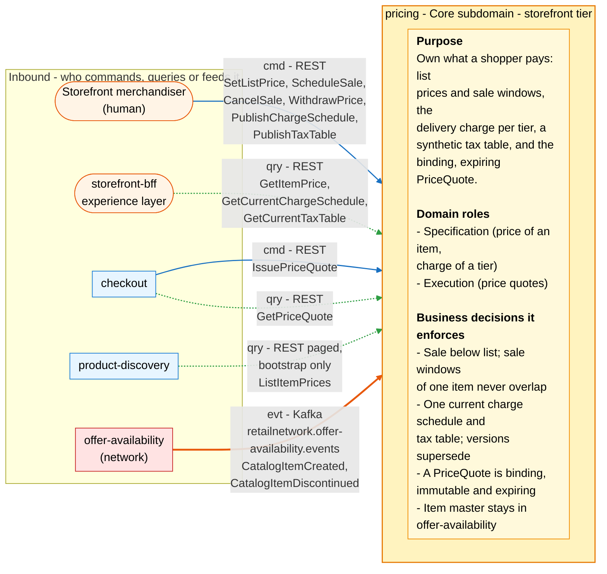
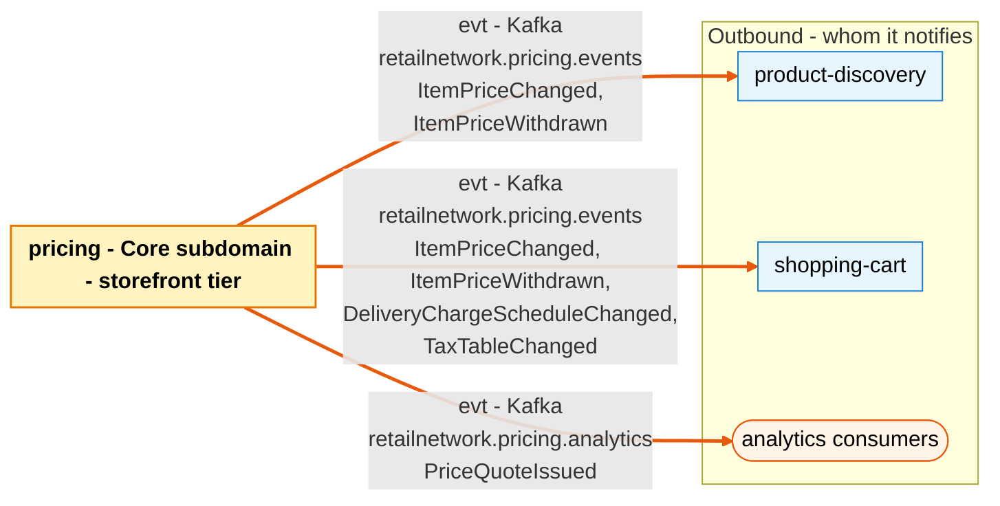

# Bounded Context Canvas

:::info[Proposed design, docs only]
Derived from [`model/model.yaml`](https://github.com/IQVO/warehouse-docs/blob/main/storefront/model/model.yaml). Nothing in this context is built; the model is the canonical design, and identifiers (`Err...` names, routes, CloudEvents types) are the names a future implementation must use.
:::

Following the ddd-crew [Bounded Context Canvas v5](https://github.com/ddd-crew/bounded-context-canvas).
Every message row comes from `contexts[pricing]` (`inbound`, `consumes`,
`publishes`, `rest`) or from a neighbour's entry that names this context.
`sync_calls` is empty: pricing calls nobody.

## Canvas at a glance

Two pictures of the sections below, laid out like the ddd-crew canvas:
first the inbound collaborators feeding this context (purpose, domain roles
and the business decisions it enforces), then the outbound collaborators it
notifies. Arrows follow the message type: **solid blue** commands (`cmd`),
**dotted green** queries (`qry`), **thick orange** events (`evt`); each
arrow names its channel and the messages it carries. Box shapes mark the
collaborator kind: rounded = people, UI or any client; blue = sibling
bounded context. Channel names on the arrows are abbreviated; the Inbound
and Outbound Communication tables carry the exact route, topic and
CloudEvents type for every message.

### Inbound

### Outbound

Derived from: `model.yaml → contexts[pricing].inbound`, `.publishes`,
`.purpose`, `.roles`, `.business_decisions`;
`contexts[product-discovery].inbound`, `contexts[shopping-cart].inbound`
(rows from `pricing`).

The diagrams omit assumptions, verification metrics, open questions and the
ubiquitous language (sections below), the relationship pattern per message
(see the tables), and the synchronous replies. Pricing has no outbound
synchronous call: `sync_calls` is empty.

## Name

**Pricing** (`pricing`, code `PR`, CloudEvents tier `storefront`).

## Purpose

To own what a shopper pays. The context:

- keeps the list price and sale windows of every catalogue item, versioned,
  with the effective price derived (lowest active sale, else list);
- prices each delivery service tier (`SAME_DAY`, `NEXT_DAY`, `TWO_DAY`,
  `STANDARD`) with an optional free-over threshold;
- holds the synthetic tax table by postal-prefix band;
- issues the binding, immutable, expiring `PriceQuote` a checkout session
  is confirmed against, pinning the price, schedule and tax-table versions
  it was computed from.

## Strategic Classification

| Axis | Verdict |
| --- | --- |
| **Domain** | **Core** subdomain. See the [Core Domain Chart](/storefront/contexts/pricing/core-domain-chart). |
| **Business Model** | Revenue (the price of speed per tier is where the network's promise becomes revenue). |
| **Evolution** | Custom-built. |

## Domain Roles

| Role | Applies? | Evidence in the model |
| --- | --- | --- |
| **Specification (price of an item, charge of a tier)** | **Yes, primary** | `ItemPrice`, `DeliveryChargeSchedule`, `TaxTable` with their invariants; the read routes every other surface renders from. |
| **Execution (price quotes)** | **Yes** | `IssuePriceQuote`, `ExpireQuote`, the `PriceQuote` aggregate and `QuoteTtl`. |
| Analysis | No | No read model here is a decision input for another context; `CatalogItemView` is an enforcement input. |
| Gateway | No | The storefront edge is `storefront-bff`, the experience layer; pricing is one of the contexts behind it. |

## Inbound Communication

| Collaborator | Message | Type | Channel | Relationship |
| --- | --- | --- | --- | --- |
| Storefront merchandiser (human) | `SetListPrice` | Command | REST `POST /item-prices`, `POST /item-prices/{catalogItemId}:set-list-price` | UI |
| Storefront merchandiser (human) | `ScheduleSale`, `CancelSale` | Command | REST `POST /item-prices/{catalogItemId}/sales`, `POST /item-prices/{catalogItemId}/sales/{saleId}:cancel` | UI |
| Storefront merchandiser (human) | `WithdrawPrice` | Command | REST (route in the `/item-prices` group; the model names no path) | UI |
| Storefront merchandiser (human) | `PublishChargeSchedule` | Command | REST `POST /delivery-charge-schedules` | UI |
| Storefront merchandiser (human) | `PublishTaxTable` | Command | REST `POST /tax-tables` | UI |
| `storefront-bff` (experience layer) | `GetItemPrice` | Query | REST `GET /item-prices/{catalogItemId}` | UI |
| `storefront-bff` (experience layer) | `GetCurrentChargeSchedule` | Query | REST `GET /delivery-charge-schedules/current` | UI |
| `storefront-bff` (experience layer) | `GetCurrentTaxTable` | Query | REST `GET /tax-tables/current` | UI |
| `checkout` | `IssuePriceQuote` | Command | REST `POST /price-quotes` | Customer/Supplier (we are the Supplier) |
| `checkout` | `GetPriceQuote` | Query | REST `GET /price-quotes/{quoteId}` | Customer/Supplier (we are the Supplier) |
| `product-discovery` | `ListItemPrices` | Query | REST `GET /item-prices` (bootstrap, paged) | Customer/Supplier (we are the Supplier) |
| `offer-availability` (network) | `CatalogItemCreated` | Event | Kafka `retailnetwork.offer-availability.events`, `com.retailnetwork.commerce.offer-availability.catalogitem.CatalogItemCreated` | Conformist |
| `offer-availability` (network) | `CatalogItemDiscontinued` | Event | Kafka `retailnetwork.offer-availability.events`, `com.retailnetwork.commerce.offer-availability.catalogitem.CatalogItemDiscontinued` | Conformist |

Route-to-command note: the model's `inbound` row for the merchandiser names
the route groups, not one route per command; the mapping above is this
pack's reading of `rest` against `commands` (see Open Questions).

## Outbound Communication

| Collaborator | Message | Type | Channel | Relationship |
| --- | --- | --- | --- | --- |
| `product-discovery`, `shopping-cart` | `ItemPriceChanged` | Event | Kafka `retailnetwork.pricing.events`, `com.retailnetwork.storefront.pricing.itemprice.ItemPriceChanged` | Conformist (product-discovery) / Customer/Supplier (shopping-cart) |
| `product-discovery`, `shopping-cart` | `ItemPriceWithdrawn` | Event | Kafka `retailnetwork.pricing.events`, `com.retailnetwork.storefront.pricing.itemprice.ItemPriceWithdrawn` | Conformist (product-discovery) / Customer/Supplier (shopping-cart) |
| `shopping-cart` | `DeliveryChargeScheduleChanged` | Event | Kafka `retailnetwork.pricing.events`, `com.retailnetwork.storefront.pricing.deliverychargeschedule.DeliveryChargeScheduleChanged` | Customer/Supplier (we are the Supplier) |
| `shopping-cart` | `TaxTableChanged` | Event | Kafka `retailnetwork.pricing.events`, `com.retailnetwork.storefront.pricing.taxtable.TaxTableChanged` | Customer/Supplier (we are the Supplier) |
| analytics only | `PriceQuoteIssued` | Event | Kafka `retailnetwork.pricing.analytics`, `com.retailnetwork.storefront.pricing.pricequote.PriceQuoteIssued` | analytics stream |

What the consumers do with them (from their own model entries):
`product-discovery` refreshes the price fields of `ProductView` (monotonic
guard on the price `version`) and its `purchasable` flag;
`shopping-cart` refreshes `PurchasabilityView` and recomputes the labelled,
non-binding `EstimateView`. Relationship evidence:
[Context Map](/storefront/contexts/pricing/context-map).

## Ubiquitous Language

Full glossary: [Ubiquitous Language](/storefront/contexts/pricing/ubiquitous-language).
Top terms: **List Price**, **Sale Window**, **Effective Price**,
**Delivery Charge**, **Tax Band**, **Price Quote** (binding; not the cart
**Estimate**).

## Business Decisions

1. **A sale price is always below the list price** (`ErrSaleNotBelowList`)
   **and sale windows of one item never overlap**
   (`ErrOverlappingSaleWindow`). The effective price needs no tie-break.
2. **Exactly one charge schedule and one tax table are current; a new
   version supersedes, never edits** (`ErrNonIncreasingVersion`). A quote
   can always name the versions it used.
3. **A PriceQuote is binding, immutable and expiring** (`QuoteTtl`, default
   15 minutes). The review page shows the binding total; a changed total is
   visible before confirm (gap S2).
4. **The item master stays in offer-availability.** A price exists only for
   a known, not discontinued item (`ErrUnknownCatalogItem`), enforced
   against the local `CatalogItemView`.
5. **Money is integer minor units of one configured currency**; every
   amount is non-negative (`ErrNegativeAmount`) and single-currency
   (`ErrCurrencyMismatch`).
6. **A discontinued item's price is withdrawn** (`WithdrawOnDiscontinue`),
   so no surface keeps selling what the network retired.

## Assumptions

- `offer-availability` publishes `CatalogItemCreated` before pricing can be
  asked to price the item; an earlier `SetListPrice` fails
  `ErrUnknownCatalogItem` and the merchandiser retries.
- The merchandiser's UI and the consumers tolerate the outbox lag between a
  price decision and `ItemPriceChanged`; sale boundaries are published by
  `PublishEffectivePriceOnWindowBoundary`, idempotent per item and boundary.
- `checkout` opens the quote, shows it and confirms within `QuoteTtl`; its
  own `ExpireOnQuoteExpiry` policy mirrors the TTL, because pricing
  publishes no expiry event (see Open Questions).
- Every consumed event is applied once (inbox on the CloudEvents `id`).
- One configured currency everywhere (`conventions.integration_rules`).

## Verification Metrics

| Metric | Target (proposed) | Source |
| --- | --- | --- |
| `POST /price-quotes` success rate | tracked; alert on a drop | REST access log |
| Share of `IssuePriceQuote` rejected `ErrItemNotPriced` | about 0 once checkout checks purchasability | REST access log |
| Quotes confirmed after `expiresAt` (checkout's `ErrPriceQuoteExpired`) | tracked; drives the `QuoteTtl` value | `checkout` metrics |
| Sale-boundary `ItemPriceChanged` emitted at the boundary minute | 100% (idempotent per item and boundary) | scheduler log vs outbox |
| `CatalogItemView` lag behind `retailnetwork.offer-availability.events` | below 30 s | Kafka consumer metrics |
| Outbox age of the oldest unpublished pricing event | below 5 s | `outbox_events.created_at` |
| Prices on items the view has discontinued but not yet withdrawn | 0 after `WithdrawOnDiscontinue` lag | join of `CatalogItemView` and `ItemPrice` |

## Open Questions

- **Which route withdraws a price?** `rest` lists no obvious
  `WithdrawPrice` route (no `POST /item-prices/{catalogItemId}:withdraw`).
  The command exists; the route mapping is a model gap.
- **`CancelSale` raises no event of its own.** `publishes` lists only
  `ItemPriceChanged` and `ItemPriceWithdrawn` for `ItemPrice`. These pages
  read a cancelled sale as republishing `ItemPriceChanged` with the
  effective price back at list.
- **Expiry is silent.** `ExpireQuote` transitions `ISSUED → EXPIRED`, but
  the model publishes no `PriceQuoteExpired`. `checkout` mirrors the TTL
  with its own `ExpireOnQuoteExpiry` policy instead of consuming an event.
- **States of the schedule and the tax table are a least-surprising
  reading.** The model's own `notes` say the plan names no states;
  `CURRENT`/`SUPERSEDED` follow from "one current, versioned".
- **What `IssuePriceQuote` takes as input.** `PriceQuoteIssued` carries
  `cartId`, and `checkout` names the call `IssuePriceQuote`, but the model
  lists no request fields (lines, groups, destination postal prefix are the
  obvious reading).
- **Who calls `GET /item-prices` besides the bootstrap?** The `inbound`
  row marks `ListItemPrices` as bootstrap-only for `product-discovery`; the
  route is listed with the BFF's reads too, unpaged.
