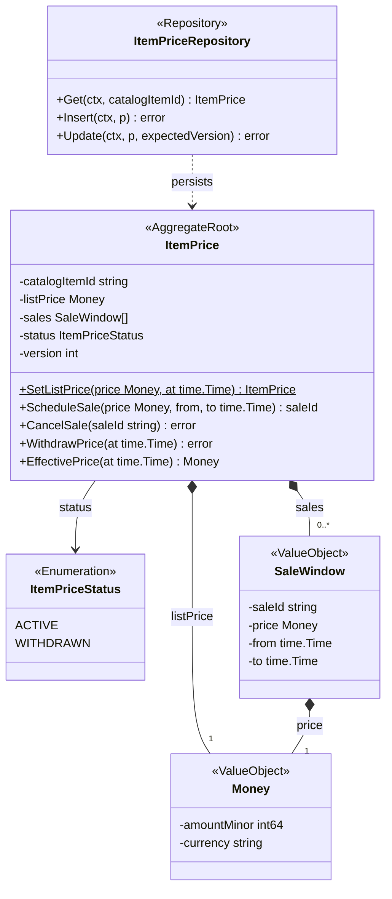
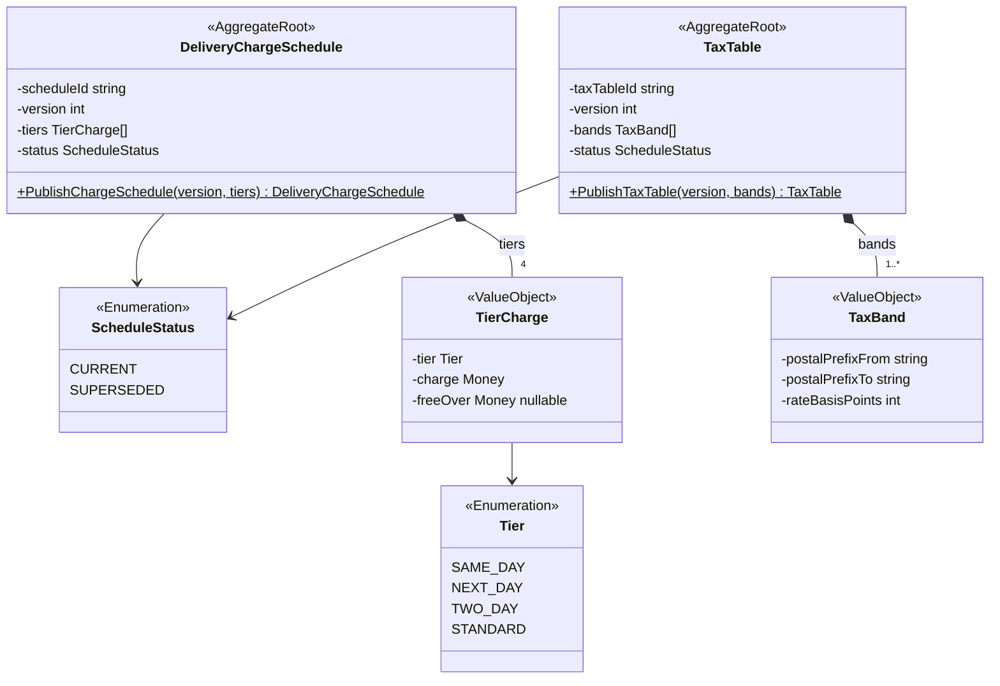
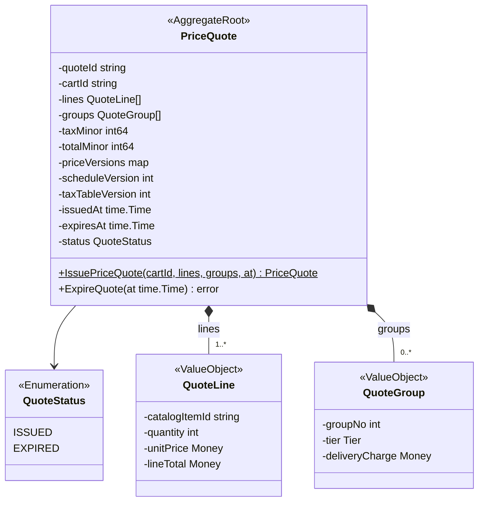
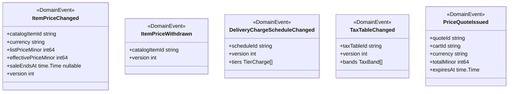
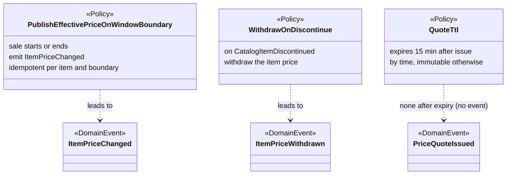
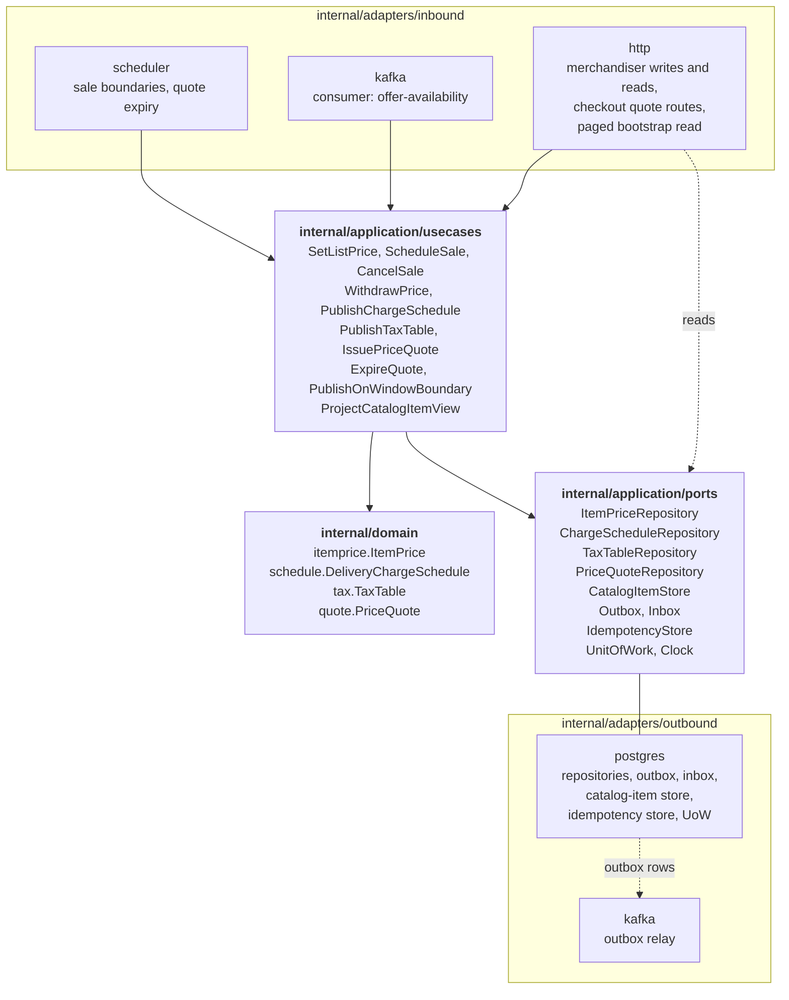

# Class Diagram

:::info[Built on develop, not deployed]
Derived from [`model/model.yaml`](https://github.com/IQVO/warehouse-docs/blob/main/storefront/model/model.yaml). The `pricing` service is built on develop ([`IQVO/pricing`](https://github.com/IQVO/pricing) at `5a18326`, checked 2026-10-27) and not deployed (no warehouse-infra entry). Every `Err...` name, REST route and CloudEvents type of this context named on this page exists in the service; where the built service differs from the model's design, the page says so (**As built**) or the context's [Service and operations](/storefront/contexts/pricing#service-and-operations) section lists it.
:::

UML class diagrams of the `internal/domain/**` packages as the model designs them, plus
the hexagonal ports and adapters. Type names come from the model's code
identifiers (`itemprice.ItemPrice`, `schedule.TierCharge`, `tax.TaxBand`,
`quote.PriceQuote`) and value objects. Fields are unexported in Go and shown
with `-`; methods are shown with `+`.

**As built** (`IQVO/pricing` develop `5a18326`): the domain packages are `internal/domain/itemprice`, `internal/domain/quote`, `internal/domain/schedule`, `internal/domain/tax`. Exported types per package: `itemprice`: `ItemPriceChanged`, `ItemPriceWithdrawn`, `ID`, `State`, `CatalogState`, `Inputs`, `SaleWindow`, `View`, `ItemPrice`, `Snapshot`; `quote`: `ID`, `State`, `LineInput`, `GroupInput`, `IssueInput`, `Line`, `Group`, `PriceQuote`, `PriceQuoteIssued`, `Snapshot`; `schedule`: `ID`, `State`, `TierCharge`, `DeliveryChargeSchedule`, `Snapshot`, `DeliveryChargeScheduleChanged`; `tax`: `ID`, `State`, `TaxBand`, `TaxTable`, `Snapshot`, `TaxTableChanged`. Application packages: `internal/application/idempotency`, `internal/application/outbox`, `internal/application/ports`, `internal/application/usecases`, `internal/application/views`; adapters: `internal/adapters/inbound/http`, `internal/adapters/inbound/kafka`, `internal/adapters/inbound/requestlog`, `internal/adapters/outbound/clock`, `internal/adapters/outbound/ids`, `internal/adapters/outbound/kafka`, `internal/adapters/outbound/memory`, `internal/adapters/outbound/outbox`, `internal/adapters/outbound/postgres`, `internal/adapters/outbound/repocontract`, `internal/adapters/outbound/telemetry`. Where a type name below differs (the UML keeps the design names), the [Ubiquitous Language](/storefront/contexts/pricing/ubiquitous-language) page carries the built identifier.

## 1. ItemPrice aggregate

Derived from: `model.yaml → contexts[pricing].aggregates[ItemPrice]`
(`states`, `value_objects`, `commands`, `invariants`).

Omitted: read accessors and the `Err...` variables (`ErrNegativeAmount`,
`ErrCurrencyMismatch`, `ErrSaleNotBelowList`, `ErrOverlappingSaleWindow`,
`ErrUnknownCatalogItem`; listed on the
[Aggregate Design Canvas](/storefront/contexts/pricing/aggregate-design-canvas)).
`EffectivePrice` is derived, never stored: the lowest active sale price,
else the list price.

## 2. DeliveryChargeSchedule and TaxTable aggregates

Derived from: `model.yaml → contexts[pricing].aggregates[DeliveryChargeSchedule]`,
`.aggregates[TaxTable]`; `conventions.integration_rules` (money shape).

Omitted: the two repositories (same shape as `ItemPriceRepository`) and the
`Err...` variables (`ErrIncompleteChargeSchedule`,
`ErrNonIncreasingVersion`, `ErrOverlappingTaxBand`, `ErrRateOutOfRange`).
`Tier` is the network's delivery-promise vocabulary, re-declared locally:
there is no shared kernel. Both aggregates share `ScheduleStatus`
(`CURRENT`/`SUPERSEDED`): publishing a new version supersedes the
previous one in the same transaction.

## 3. PriceQuote aggregate, events and policies

Derived from: `model.yaml → contexts[pricing].aggregates[PriceQuote]`,
`.publishes`, `.policies`.

Omitted: the CloudEvents envelope (built in the Kafka adapter). The
`QuoteTtl` edge is drawn to `PriceQuoteIssued` only to show the asymmetry:
issue publishes, expiry does not, by decision: expiry is checkout-internal
TTL state (see [EventStorming](/storefront/contexts/pricing/eventstorming)).

## 4. Hexagonal ports and adapters

Derived from: `model.yaml → contexts[pricing].aggregates`, `.inbound`,
`.read_models`, `.policies`; `conventions.integration_rules` (outbox,
inbox); the fleet's Go hexagonal layout. `sync_calls` is empty, so there is
**no outbound REST client** in this context.

Omitted: the composition root (`cmd/pricing`), metrics and tracing. The
scheduler is an inbound adapter: time triggers
`PublishEffectivePriceOnWindowBoundary` and `ExpireQuote`. The read routes
(`GetItemPrice`, `ListItemPrices`, `GetCurrentChargeSchedule`,
`GetCurrentTaxTable`, `GetPriceQuote`) read the stores through their ports
without a use case.
