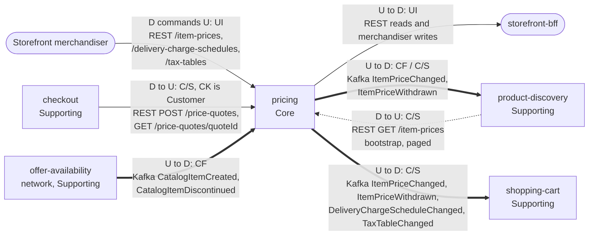

# Context Map

:::info[Proposed design, docs only]
Derived from [`model/model.yaml`](https://github.com/IQVO/warehouse-docs/blob/main/storefront/model/model.yaml). Nothing in this context is built; the model is the canonical design, and identifiers (`Err...` names, routes, CloudEvents types) are the names a future implementation must use.
:::

Following ddd-crew [Context Mapping](https://github.com/ddd-crew/context-mapping).
This is **pricing's slice** of the
[storefront-wide context map](/storefront/strategic-design/context-map):
every relationship this context has, with the upstream (U) and downstream
(D) side, the pattern and the channel.

Derived from: `model.yaml → contexts[pricing].inbound`, `.publishes`,
`.consumes`, `.rest`; `contexts[checkout].sync_calls`,
`contexts[product-discovery].inbound` + `.sync_calls`,
`contexts[shopping-cart].inbound`; `network/model/model.yaml →
contexts[offer-availability].publishes`.

Legend: arrows point from upstream to downstream, except the two REST
reads drawn with the caller on the left (labelled with the true direction).
A solid arrow is a synchronous REST relationship; a thick arrow is a Kafka
event relationship. The path parameter `{quoteId}` is written `quoteId`
inside the diagram.

Omitted, because they have no edge with this context (**Separate Ways**):
`product-content` (Generic; `product-discovery` joins content and price,
pricing never sees content), `customer-payments` (Generic; it learns totals
from `checkout` events, never from pricing), and the whole network except
`offer-availability`: pricing never calls `delivery-promise` and never sees
a promise, only the tier enum it prices. Also omitted: the
`retailnetwork.pricing.analytics` topic, which carries `PriceQuoteIssued`
to analytics consumers only.

## Relationships

| Neighbour | Direction | Pattern | Channel | Messages | Why this pattern |
| --- | --- | --- | --- | --- | --- |
| Storefront merchandiser (human) | merchandiser downstream, pricing upstream | **UI** (inbound row `relationship: UI`) | REST `/item-prices`, `/delivery-charge-schedules`, `/tax-tables` writes | `SetListPrice`, `ScheduleSale`, `CancelSale`, `WithdrawPrice`, `PublishChargeSchedule`, `PublishTaxTable` | Pricing is the specification the merchandiser maintains; one writer keeps every derived view consistent. |
| `storefront-bff` (experience layer) | pricing upstream, BFF downstream | **UI** | REST `GET /item-prices/{catalogItemId}`, `GET /delivery-charge-schedules/current`, `GET /tax-tables/current` | `GetItemPrice`, `GetCurrentChargeSchedule`, `GetCurrentTaxTable` | Page rendering reads current state straight from the owner; no projection is duplicated into the BFF. |
| `checkout` (Supporting) | pricing upstream, checkout downstream | **Customer/Supplier** (checkout is the Customer) | REST `POST /price-quotes`, `GET /price-quotes/{quoteId}` | `IssuePriceQuote`, `GetPriceQuote` | The quote must be issued and read back inside the shopper's request, and its shape (lines, groups, versions, TTL) is negotiated for checkout's saga. |
| `product-discovery` (Supporting) | pricing upstream, PD downstream | **Conformist** (events) | Kafka `retailnetwork.pricing.events` | `ItemPriceChanged`, `ItemPriceWithdrawn` | PD projects the events as published into `ProductView`, with its own monotonic guard on the price `version`. |
| `product-discovery` (Supporting) | pricing upstream, PD downstream | **Customer/Supplier** (query) | REST `GET /item-prices` (bootstrap, paged) | `ListItemPrices` | Snapshot + catch-up rebuild: a deliberate paged read, never on a user request. |
| `shopping-cart` (Supporting) | pricing upstream, SC downstream | **Customer/Supplier** (SC is the Customer) | Kafka `retailnetwork.pricing.events` | `ItemPriceChanged`, `ItemPriceWithdrawn`, `DeliveryChargeScheduleChanged`, `TaxTableChanged` | The cart's labelled estimate is computed from pricing's data; the estimate's shape is negotiated so the cart never has to call pricing synchronously. |
| `offer-availability` (network, Supporting) | OA upstream, pricing downstream | **Conformist** | Kafka `retailnetwork.offer-availability.events` | `CatalogItemCreated`, `CatalogItemDiscontinued` | The item master is taken as published into `CatalogItemView`; pricing never redefines the item (business decision 4). |

## Notes on the patterns

- **No Anti-Corruption Layer.** The one network edge is an event feed in
  the organisation's own CloudEvents standard, consumed as published. The
  only ACL in the storefront design is checkout's outbound adapter toward
  the network's `customer-ordering`, not pricing.
- **No Shared Kernel.** The service-tier enum is re-declared inside
  `TierCharge`; `catalogItemId` is a value copied from events, not shared
  code.
- **No synchronous call out.** `sync_calls` is empty: every surface that
  needs a price either reads it here (OHS-style reads, UI) or follows the
  events. The cart estimate never blocks on pricing.
- **One event, two patterns.** `ItemPriceChanged` is Conformist for
  `product-discovery` and Customer/Supplier for `shopping-cart`: the
  relationship is per consumer, and both consumers' own model entries say
  so.
- **No warehouse-systems edge.** Pricing never produces or consumes a
  `warehouse.*` topic (`meta.hard_boundary`).
