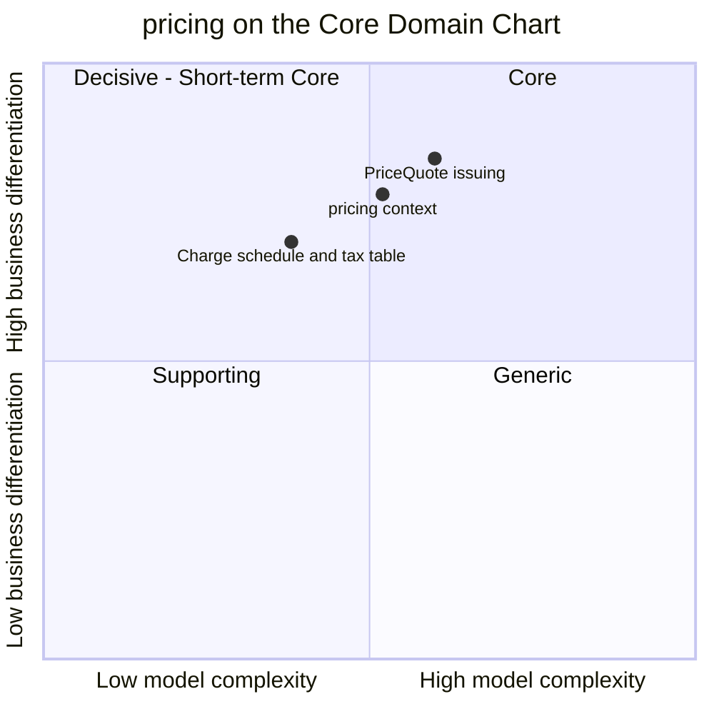

# Core Domain Chart

:::info[Built on develop, not deployed]
Derived from [`model/model.yaml`](https://github.com/IQVO/warehouse-docs/blob/main/storefront/model/model.yaml). The `pricing` service is built on develop ([`IQVO/pricing`](https://github.com/IQVO/pricing) at `5a18326`, checked 2026-10-27) and not deployed (no warehouse-infra entry). Every `Err...` name, REST route and CloudEvents type of this context named on this page exists in the service; where the built service differs from the model's design, the page says so (**As built**) or the context's [Service and operations](/storefront/contexts/pricing#service-and-operations) section lists it.
:::

Following the ddd-crew [Core Domain Charts](https://github.com/ddd-crew/core-domain-charts):
business differentiation (y) against model complexity (x). The
storefront-wide classification is on
[Subdomain Classification](/storefront/strategic-design/subdomain-classification).

Derived from: `model.yaml → contexts[pricing].chart` (`complexity: 0.52`,
`differentiation: 0.78`), `.classification`, `.aggregates[PriceQuote]`,
`.aggregates[DeliveryChargeSchedule]`, `.aggregates[TaxTable]`.

The two slices are placed by judgement, not by the model; the model gives
only the context's point. Omitted: the other five storefront contexts (their
positions follow from their own model entries) and the `ItemPrice`
aggregate, which would sit close to the context point: versioned money with
window rules, the everyday core of a pricing service.

## Classification: Core

All three points sit in **quadrant 1 (Core)**, top-right. The model
classifies the context as `Core`, and the subdomain row explains why: cost
is the top abandonment reason in the research, and the tier charge is where
the network's promise becomes revenue. A shopper does not choose this
storefront for how its order record works; they choose it because the total
they see is honest and the faster delivery option has a visible price. Both
are this context.

**Differentiation is high (y = 0.78).** Three things the model makes
visible:

- The **price of speed** (`DeliveryChargeSchedule` per service tier) turns
  the network's Core capability (the promise) into storefront revenue.
  Nobody else's schedule will do; it is this shop's pricing policy.
- The **binding, expiring PriceQuote** is the answer to the named gap S2: a
  price change between cart and checkout must be visible before confirm.
  The quote pins prices, charge-schedule and tax-table versions, so the
  confirm-time check is exact, not approximate.
- **Sale windows** with strict non-overlap and below-list rules make the
  effective price unambiguous everywhere it is shown.

**Complexity is moderate (x = 0.52).** Pricing is no CRUD service, but its
rules are local:

- Four aggregates, none with more than two states, and no synchronous call
  to any neighbour (`sync_calls` is empty).
- Time is a first-class input: sale windows start and end by themselves
  (`PublishEffectivePriceOnWindowBoundary`), and quotes expire by the clock
  (`QuoteTtl`).
- Correctness depends on an upstream feed: `ErrUnknownCatalogItem` can be
  enforced only as well as `CatalogItemView` is current.

The **PriceQuote issuing** slice is plotted highest and furthest right
because it is where the context meets the checkout saga: one wrong total
there is a lost sale or a margin leak.

## Business model

**Revenue.** The model says so directly: "the price of speed per tier is
where the network's promise becomes revenue". The context earns by making
the delivery tier a priced choice and by never letting a shopper confirm
against a stale total.

## Evolution

| Part | Evolution stage | Why |
| --- | --- | --- |
| Item prices and sale windows | **Custom-built** | `chart.evolution: Custom-built`. Sale-window semantics (non-overlap, below-list, boundary publication) are this storefront's rules. |
| PriceQuote issuing | **Custom-built** | The binding quote pinned to schedule and tax versions is specific to this design's gap S2 answer. |
| Tax table | **Custom-built, synthetic by decision** | D10 defers a real engine; the synthetic table is deliberately simple and would be replaced, not evolved. |
| Plumbing (outbox, inbox, CloudEvents) | **Commodity** | Domain-wide building blocks ([CloudEvents standard](/storefront/strategic-design/event-standard-cloudevents)). |

**Movement to watch.** Promotions (the `promotions` Supporting candidate,
D10) would raise complexity inside this context before it becomes its own.
A bought tax engine would shrink `TaxTable` to an adapter, the expected path
for the synthetic part of a Core subdomain. The interfaces to keep stable
are the four catalogue events and `POST /price-quotes`.
