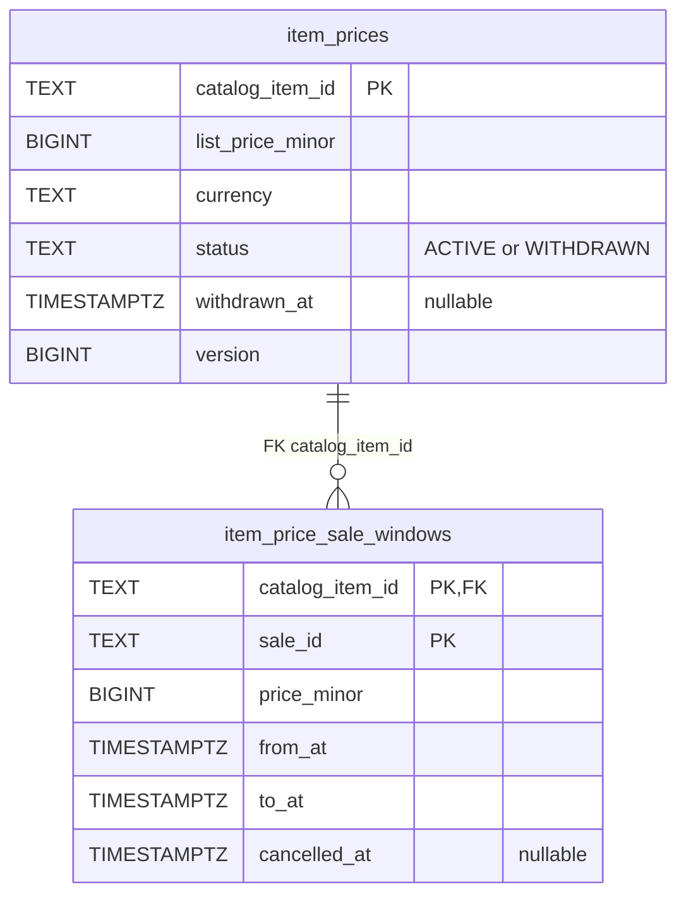
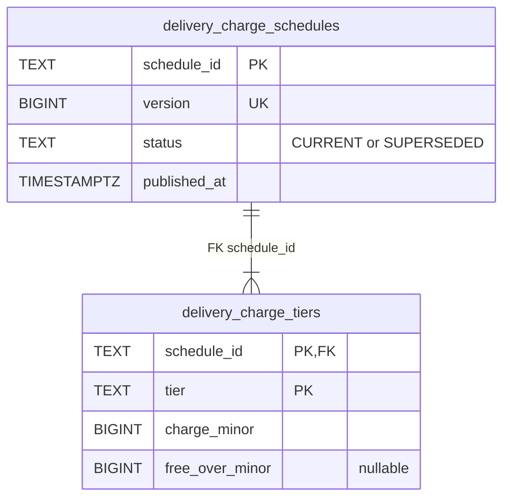
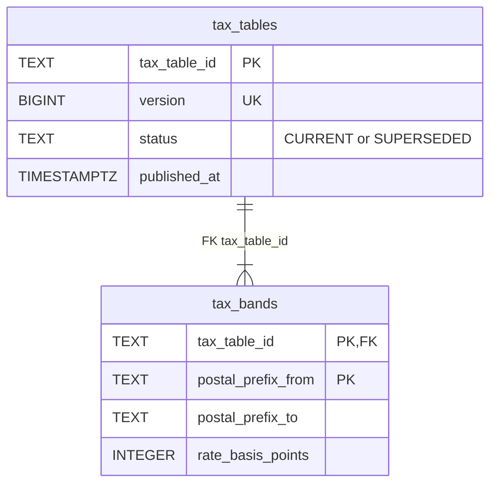
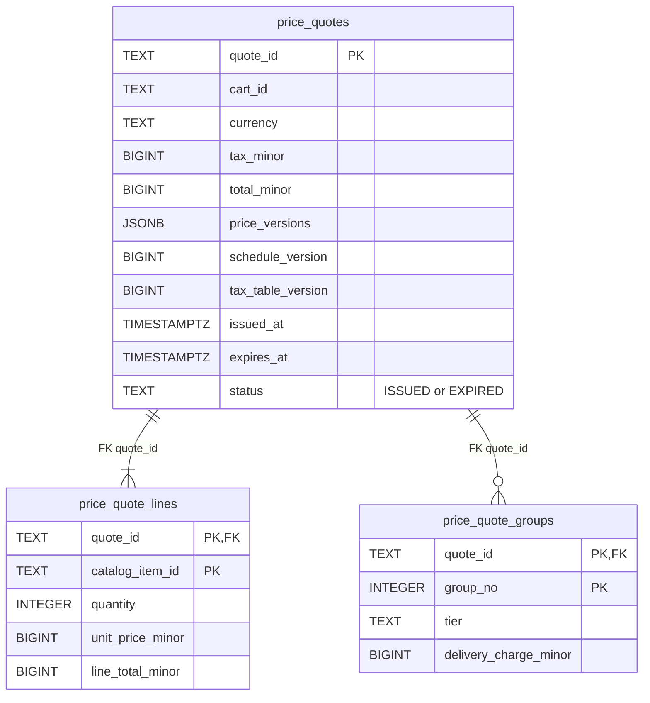
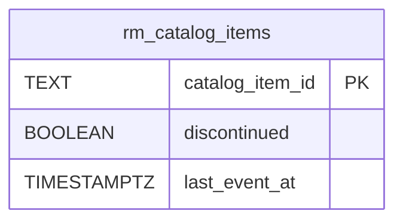
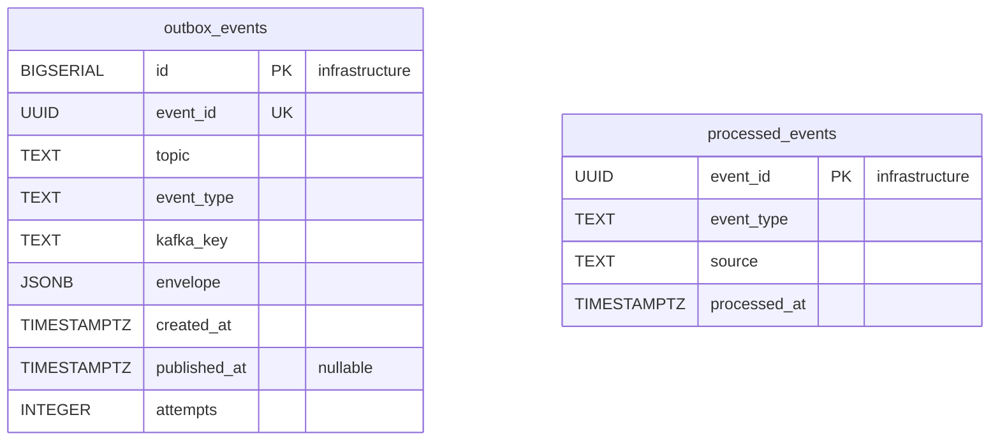
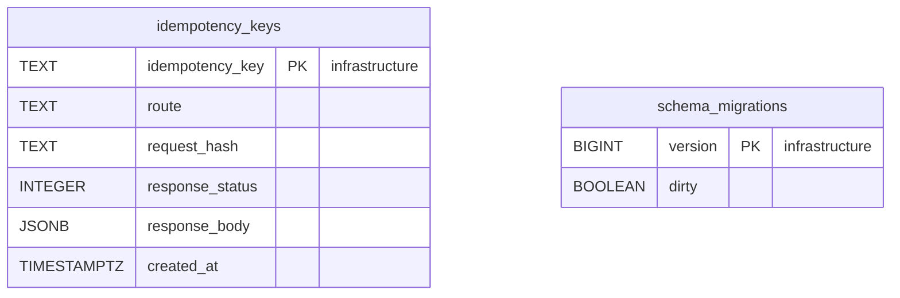

# Entity Relationship

:::info[Proposed design, docs only]
Derived from [`model/model.yaml`](https://github.com/IQVO/warehouse-docs/blob/main/storefront/model/model.yaml). Nothing in this context is built; the model is the canonical design, and identifiers (`Err...` names, routes, CloudEvents types) are the names a future implementation must use.
:::

The **proposed** Postgres schema. Pricing owns its database and shares no
table with any other context (`conventions.integration_rules`). Column
names are the model's field names in `snake_case`. A relationship line is
drawn **only** inside one aggregate. No column here holds PII: prices,
charges, rates and ids only.

## Aggregate tables

### ItemPrice

### DeliveryChargeSchedule and TaxTable

### PriceQuote

Derived from: `model.yaml → contexts[pricing].aggregates[*].value_objects`,
`.states`, `.publishes[*].data` (the `version` fields, `tiers(...)`,
`bands(...)`, `cartId`, `totalMinor`, `expiresAt`); the `PriceQuote`
`description` (versions of price, schedule and tax table, `issuedAt`,
`expiresAt`).

Column notes: `item_prices.version` is both the optimistic-concurrency
counter and the monotonic guard consumers apply; `price_quotes` has no
`version` column because a quote is immutable — only `ExpireQuote` flips
its status, guarded by status, not by a counter;
`price_quotes.price_versions` records the `ItemPrice.version` per line so a
confirm-time comparison needs no join; `delivery_charge_tiers` has exactly
four rows per schedule (`ErrIncompleteChargeSchedule`); the unique keys on
`version` back `ErrNonIncreasingVersion`.

Omitted: indexes (for example on `item_price_sale_windows.to_at` for the
boundary scan, and on `price_quotes.expires_at` for the expiry scan) and
`CHECK` constraints (`charge_minor >= 0`, `rate_basis_points` within the
configured range, non-overlapping bands enforced by the aggregate, not the
database).

## Read model tables

Derived from: `model.yaml → contexts[pricing].read_models[CatalogItemView]`
and the consumed events' declared fields (`catalogItemId`).

`rm_catalog_items` is disposable: it can be truncated and rebuilt by
replaying `retailnetwork.offer-availability.events`. It stores exactly what
`ErrUnknownCatalogItem` needs — known, and not discontinued — and none of
the item's attributes, which the consumed field lists do not declare.

## Infrastructure tables

Derived from: `model.yaml → conventions.integration_rules` (transactional
outbox, idempotent consumers, Idempotency-Key on every write route);
`conventions.cloudevents` (topic, type, key).

**All four tables are infrastructure, not domain tables.**
`outbox_events` is the transactional outbox, drained by the relay to
`retailnetwork.pricing.events` (or `retailnetwork.pricing.analytics` for
`PriceQuoteIssued`); `event_id` is the CloudEvents `id`, `event_type` the
full type, `kafka_key` the aggregate root id. `processed_events` is the
inbox, one row per consumed CloudEvents `id`.
`idempotency_keys` stores the response of every state-changing `POST` for
replay. `schema_migrations` is the migration tool's bookkeeping.

## Why there are no foreign keys across aggregates or contexts

- `item_prices.catalog_item_id` → `rm_catalog_items.catalog_item_id` is a
  reference **by value**: the view is a projection of another context's
  facts and may briefly lag; an FK would enforce a lie during the lag. The
  invariant is checked in the aggregate against the store, not by the
  database.
- `price_quotes.cart_id` points into `shopping-cart`'s database: values
  copied from messages, never joined.
- `price_quote_lines.catalog_item_id` and `price_quote_groups.tier` are
  values from pricing's own aggregates and the network's tier enum,
  captured at issue time; a quote must not change when the price later
  does.
- The read-model table has no FK at all. It is rebuilt from events.

## Table ≠ aggregate

| Table | Aggregate / role | Notes |
| --- | --- | --- |
| `item_prices` | **ItemPrice** (root) | One row per priced catalogue item, with `version`. |
| `item_price_sale_windows` | **ItemPrice** (`SaleWindow` value objects) | The boundary scheduler scans `from_at` / `to_at`. |
| `delivery_charge_schedules`, `delivery_charge_tiers` | **DeliveryChargeSchedule** | One `CURRENT`; history kept `SUPERSEDED`. |
| `tax_tables`, `tax_bands` | **TaxTable** | One `CURRENT`; history kept `SUPERSEDED`. |
| `price_quotes`, `price_quote_lines`, `price_quote_groups` | **PriceQuote** | Immutable content; only `status` moves to `EXPIRED`. Retained for the order's lifetime via the checkout session reference. |
| `rm_catalog_items` | none (read model `CatalogItemView`) | Serves `ErrUnknownCatalogItem`. |
| `outbox_events` | none (infrastructure) | Transactional outbox. |
| `processed_events` | none (infrastructure) | Inbox for idempotent consumers. |
| `idempotency_keys` | none (infrastructure) | `Idempotency-Key` replay store. |
| `schema_migrations` | none (infrastructure) | Migration bookkeeping. |
