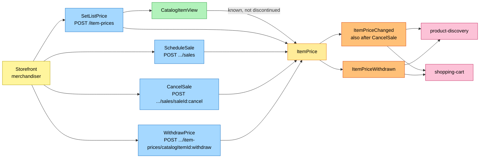
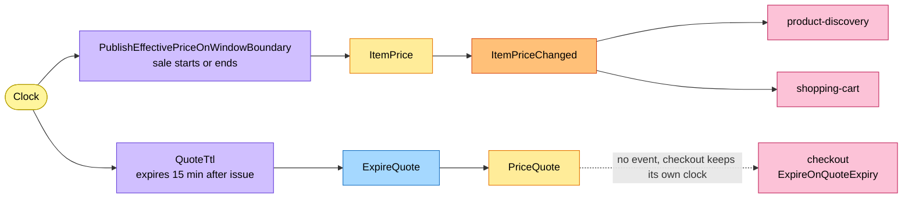
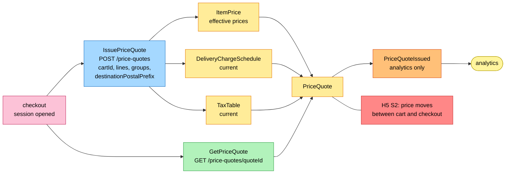
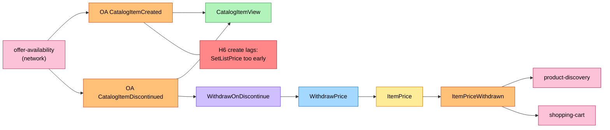

# EventStorming

:::info[Proposed design, docs only]
Derived from [`model/model.yaml`](https://github.com/IQVO/warehouse-docs/blob/main/storefront/model/model.yaml). Nothing in this context is built; the model is the canonical design, and identifiers (`Err...` names, routes, CloudEvents types) are the names a future implementation must use.
:::

Process-level boards in the ddd-crew
[EventStorming glossary & cheat sheet](https://github.com/ddd-crew/eventstorming-glossary-cheat-sheet)
notation. Every sticky comes from `model.yaml`. Events published by a
neighbour are drawn as orange stickies prefixed with the producer. Every
hotspot is a gap or a risk the model itself shows, and its source is given
in the hotspot table. Boards are drawn left to right; each stays within the
page width.

## Legend

| Colour | Sticky | Meaning here |
| --- | --- | --- |
| Pale yellow `#fff59d` | Actor | The storefront merchandiser, or `checkout` acting for a shopper |
| Blue `#a5d8ff` | Command | A command from `aggregates[*].commands` |
| Yellow `#ffec99` | Aggregate | `ItemPrice`, `DeliveryChargeSchedule`, `TaxTable`, `PriceQuote` |
| Orange `#ffc078` | Domain Event | Ours (`publishes`) or a neighbour's (`consumes`, prefixed with the producer) |
| Lilac `#d0bfff` | Policy | `policies`, or the reaction a command takes to an event |
| Green `#b2f2bb` | Read Model | `CatalogItemView`, or a read route |
| Pink `#fcc2d7` | External System | A sibling context (`offer-availability`, `checkout`, `product-discovery`, `shopping-cart`) |
| Red `#ff8787` | Hotspot | A gap or risk in the model (see the table at the end) |

## 1. Price management by the merchandiser

Derived from: `model.yaml → contexts[pricing].inbound` (merchandiser row),
`.aggregates[ItemPrice]` (`commands`, `invariants`), `.publishes`,
`.read_models[CatalogItemView]`.

Omitted: the invariant errors (`ErrNegativeAmount`, `ErrCurrencyMismatch`,
`ErrSaleNotBelowList`, `ErrOverlappingSaleWindow`, `ErrUnknownCatalogItem`),
the outbox, and the sale-boundary policy (board 2). The same board shape
covers `PublishChargeSchedule` and `PublishTaxTable` on
`DeliveryChargeSchedule` and `TaxTable`, emitting
`DeliveryChargeScheduleChanged` and `TaxTableChanged` to `shopping-cart`.

## 2. Time-driven price movement

Derived from: `model.yaml → contexts[pricing].policies`,
`.aggregates[PriceQuote].transitions`; `contexts[checkout].policies[ExpireOnQuoteExpiry]`.

Omitted: the scheduler mechanics. `PublishEffectivePriceOnWindowBoundary`
is idempotent per item and boundary, so a redelivered tick is safe. The
dashed arrow to `checkout` is not a message: quote expiry is
checkout-internal TTL state and checkout keeps its own clock
(`ExpireOnQuoteExpiry`). No `PriceQuoteExpired` event exists by design.

## 3. Quote issuing for checkout

Derived from: `model.yaml → contexts[pricing].inbound` (checkout rows),
`.aggregates[PriceQuote]` (`commands`, `invariants`, `description`),
`.publishes[PriceQuoteIssued]`; `contexts[checkout].sync_calls`.

Omitted: the error branch (`ErrItemNotPriced`, `ErrEmptyQuote`,
`ErrCurrencyMismatch` → 422) and the outbox. The quote pins the versions of
every input, so H5 is resolved at confirm by comparison, not by blocking
price changes.

## 4. The catalogue feed

Derived from: `model.yaml → contexts[pricing].consumes`, `.read_models`,
`.policies[WithdrawOnDiscontinue]`, `.publishes[ItemPriceWithdrawn]`;
`network/model/model.yaml → contexts[offer-availability].publishes`.

Omitted: the inbox. `CatalogItemCreated` and `CatalogItemDiscontinued`
share the `catalogItemId` Kafka key upstream, so the view sees them in
order per item.

## Hotspots

| # | Hotspot | Where it comes from in the model |
| --- | --- | --- |
| H1 | **Resolved in the model-fix:** `WithdrawPrice` gets the route `POST /item-prices/{catalogItemId}:withdraw` (merchandising UI, cmd channel), in `rest` and in the merchandiser inbound row. | `contexts[pricing].rest`, `.inbound` |
| H2 | **Resolved in the model-fix:** `CancelSale` publishes no event of its own. A cancelled sale changes the effective price, which the window-boundary policy already emits as `ItemPriceChanged` (idempotent per item and boundary); a separate event would duplicate the fact. The aggregate documents that `CancelSale` raises `ItemPriceChanged`. | `aggregates[ItemPrice].notes` |
| H3 | **Resolved in the model-fix:** no `PriceQuoteExpired` event. Quotes are checkout-internal TTL state and expiry is checkout's clock (`ExpireOnQuoteExpiry`), not a business fact anyone consumes. The `ISSUED → EXPIRED` transition stays. | `aggregates[PriceQuote].notes` |
| H4 | **Resolved in the model-fix:** the `IssuePriceQuote` inbound row now lists its fields: `cartId`, `lines[catalogItemId, quantity]`, `groups[groupNo, offerId, tier, lineNos]`, `destinationPostalPrefix`. The caller is checkout and the quote prices exactly what the checkout session froze. | `contexts[pricing].inbound` (checkout cmd row) |
| H5 | A price can move between the cart's non-binding estimate and checkout. Resolved by design: the binding `PriceQuote` pins versions and the review page shows the binding total; tracked as gap S2. | `business_decisions` (PriceQuote bullet); [Model Gap Register](/storefront/strategic-design/model-gap-register) S2 |
| H6 | `SetListPrice` before `CatalogItemCreated` is consumed fails `ErrUnknownCatalogItem`; the merchandiser retries. The model names no pending state for "item announced, not yet visible". | `aggregates[ItemPrice].invariants`, `.read_models[CatalogItemView]` |
