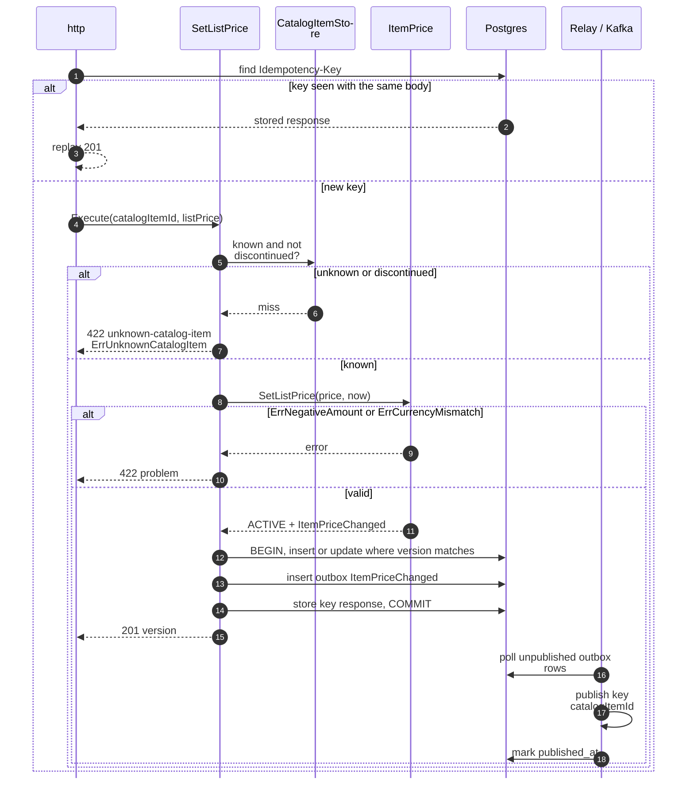
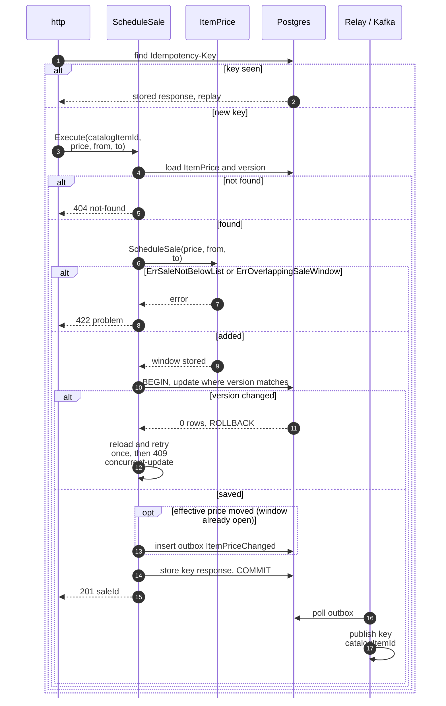
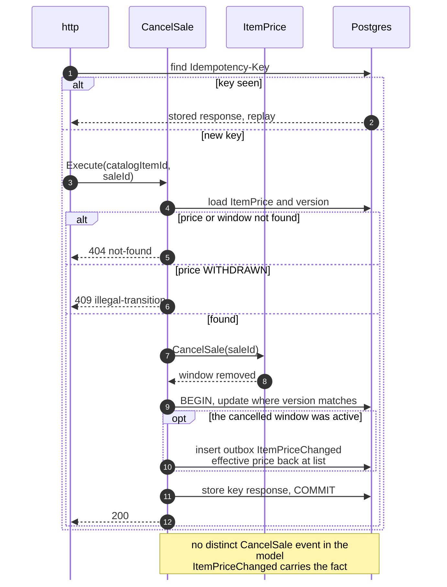
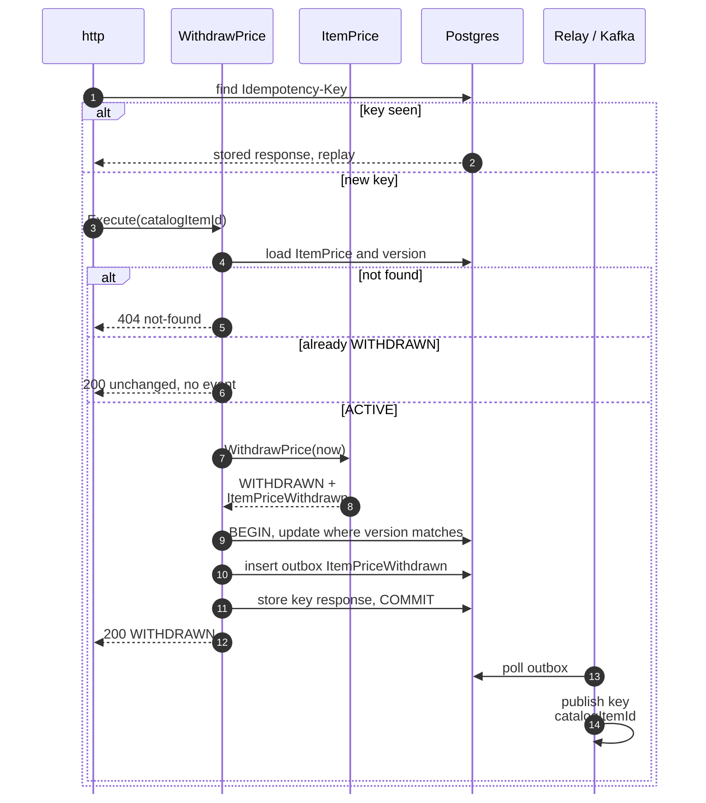
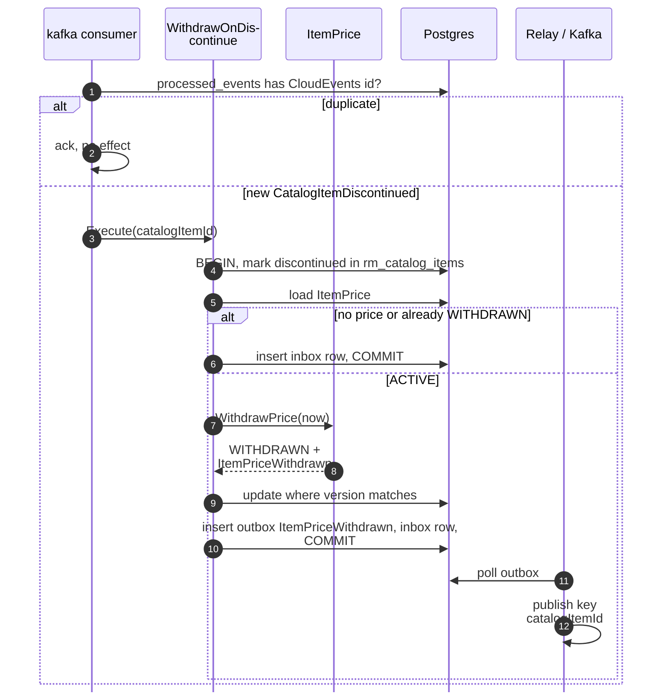
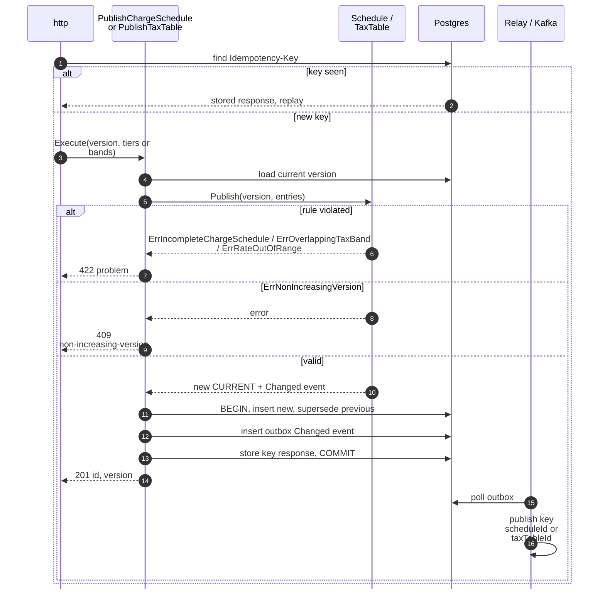
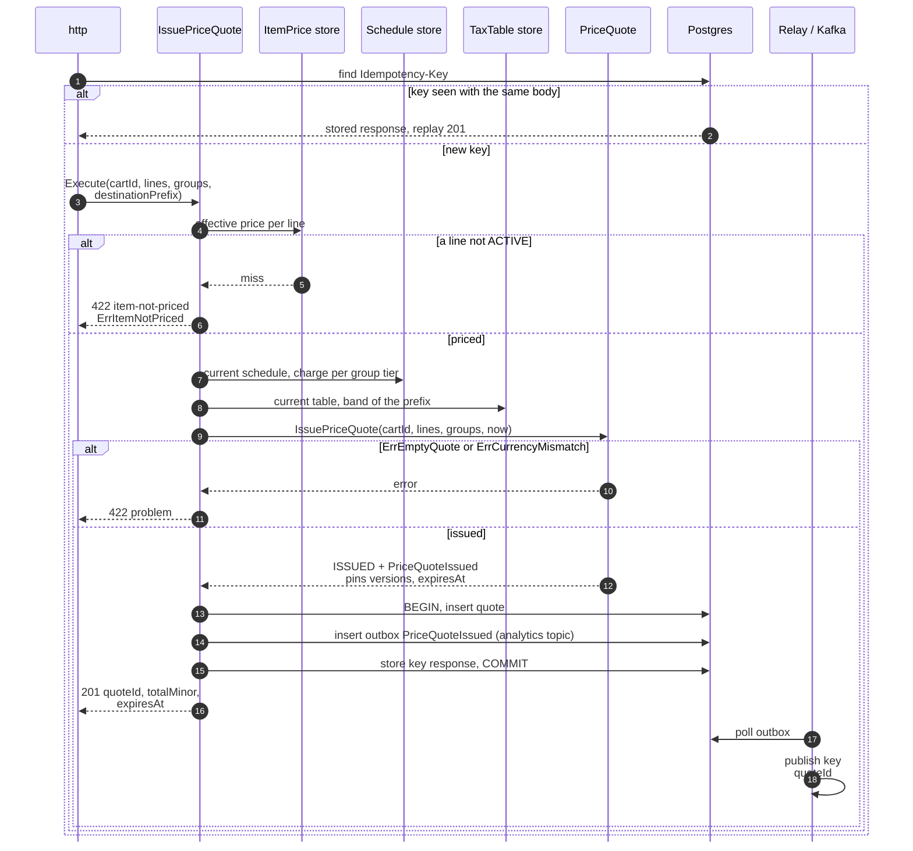
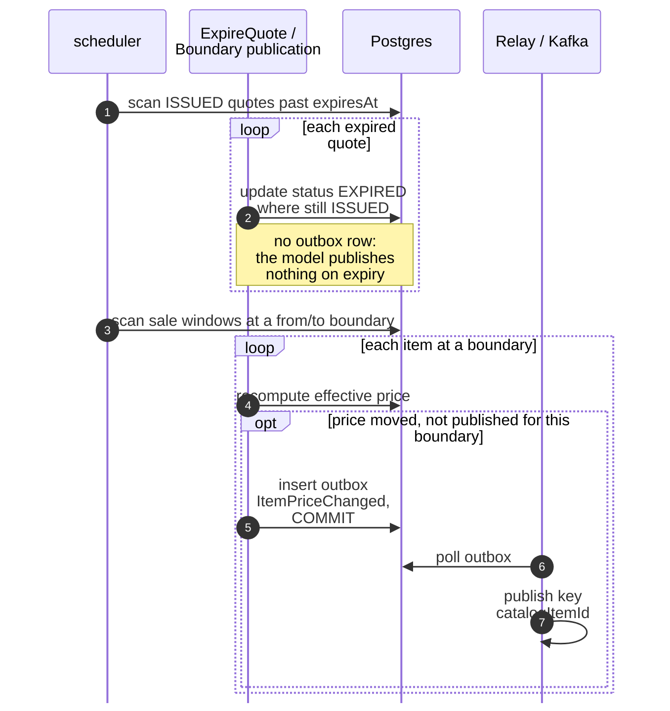
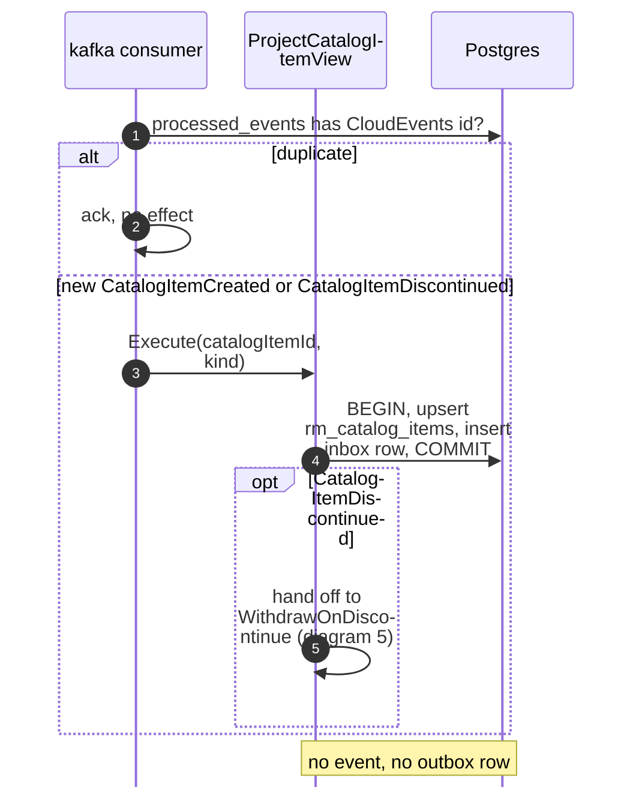

# Sequence Diagrams

:::info[Proposed design, docs only]
Derived from [`model/model.yaml`](https://github.com/IQVO/warehouse-docs/blob/main/storefront/model/model.yaml). Nothing in this context is built; the model is the canonical design, and identifiers (`Err...` names, routes, CloudEvents types) are the names a future implementation must use.
:::

One UML sequence diagram per command use case on
[Use Cases](/storefront/contexts/pricing/use-cases). Participant names are the
proposed packages and ports from the
[Class Diagram](/storefront/contexts/pricing/class-diagram):

- `http`, `kafka` and `scheduler` are the inbound adapters.
- The use case is in `internal/application/usecases`.
- `Postgres` stands for the repositories, the outbox, the inbox and the
  idempotency store. They share one transaction through `UnitOfWork`.
- `Relay / Kafka` is the outbox relay. It reads committed `outbox_events`
  rows and publishes them to `retailnetwork.pricing.events` (or
  `retailnetwork.pricing.analytics`).

Every save is conditional on the loaded `version` (optimistic concurrency).
Full CloudEvents types are on [Domain Events](/storefront/contexts/pricing/domain-events).

## 1. SetListPrice (REST POST /item-prices)

Derived from: `model.yaml → contexts[pricing].aggregates[ItemPrice]`
(`SetListPrice`, invariants), `.read_models[CatalogItemView]`,
`.publishes[ItemPriceChanged]`; `conventions.integration_rules`.

Omitted: the version-conflict retry on update (as in diagram 2). On a
create there is no conflict: the `catalogItemId` is the key and a second
insert is a unique violation mapped to 409 `concurrent-update`.

## 2. ScheduleSale (REST POST /item-prices/catalogItemId/sales)

Derived from: `model.yaml → contexts[pricing].aggregates[ItemPrice]`
(`ScheduleSale`, invariants), `.publishes[ItemPriceChanged]`.

Omitted: `ErrNegativeAmount` and `ErrCurrencyMismatch` (422, same branch as
the sale rules). A future window emits nothing now; the boundary policy
publishes when it opens (diagram 8).

## 3. CancelSale (REST POST .../sales/saleId:cancel)

Derived from: `model.yaml → contexts[pricing].aggregates[ItemPrice].commands`,
`.publishes`. The event choice is this pack's reading (open question on the
[canvas](/storefront/contexts/pricing/bounded-context-canvas)).

Omitted: the version-conflict retry (as in diagram 2) and the relay.

## 4. WithdrawPrice (merchandiser, REST)

Derived from: `model.yaml → contexts[pricing].aggregates[ItemPrice]`
(`WithdrawPrice`, transitions), `.publishes[ItemPriceWithdrawn]`.

Omitted: the route itself — the model names no path for this command
(hotspot H1 on [EventStorming](/storefront/contexts/pricing/eventstorming)).

## 5. WithdrawPrice by policy WithdrawOnDiscontinue (Kafka)

Derived from: `model.yaml → contexts[pricing].policies[WithdrawOnDiscontinue]`,
`.consumes` (`CatalogItemDiscontinued`), `.read_models`.

Omitted: the version-conflict retry (redeliver). View update, aggregate
save, outbox and inbox share one transaction, so a crash anywhere replays
the whole event safely.

## 6. PublishChargeSchedule and PublishTaxTable (REST)

Derived from: `model.yaml → contexts[pricing].aggregates[DeliveryChargeSchedule]`,
`.aggregates[TaxTable]` (commands, invariants, transitions), `.publishes`.

One diagram covers both aggregates: the shape is identical, only the rules
differ. Omitted: nothing else; the model gives both aggregates the same
lifecycle.

## 7. IssuePriceQuote (REST POST /price-quotes)

Derived from: `model.yaml → contexts[pricing].aggregates[PriceQuote]`
(`IssuePriceQuote`, invariants, description), `.policies[QuoteTtl]`,
`.publishes[PriceQuoteIssued]`; `contexts[checkout].sync_calls`.

Omitted: the request's exact fields, which the model does not list (hotspot
H4). There is no version conflict on an insert: the `quoteId` is minted
here. The reads of prices, schedule and table are store reads through
ports, not aggregate method calls; the quote pins their versions so a later
change never rewrites it.

## 8. ExpireQuote and the sale-boundary policy (scheduler)

Derived from: `model.yaml → contexts[pricing].policies[QuoteTtl]`,
`.policies[PublishEffectivePriceOnWindowBoundary]`,
`.aggregates[PriceQuote].transitions`.

Omitted: the boundary marker that makes the publication idempotent per item
and boundary (a published-boundary record beside the windows). Expiry needs
no marker: the status flip is itself idempotent.

## 9. Project CatalogItemView (Kafka)

Derived from: `model.yaml → contexts[pricing].consumes`, `.read_models`.

Omitted: nothing. The view holds id and the discontinued flag only; per-item
order comes from the producer keying both types by `catalogItemId`.
