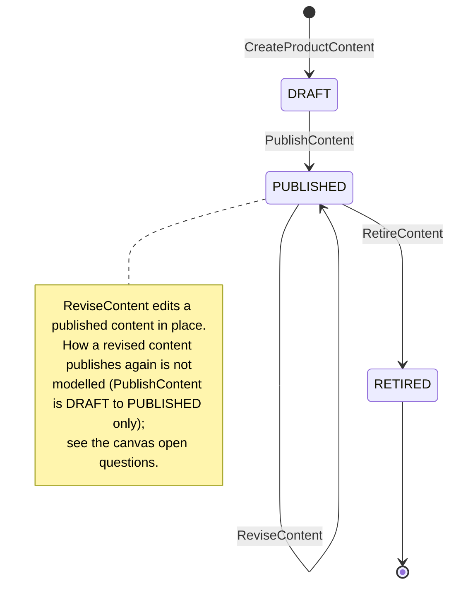
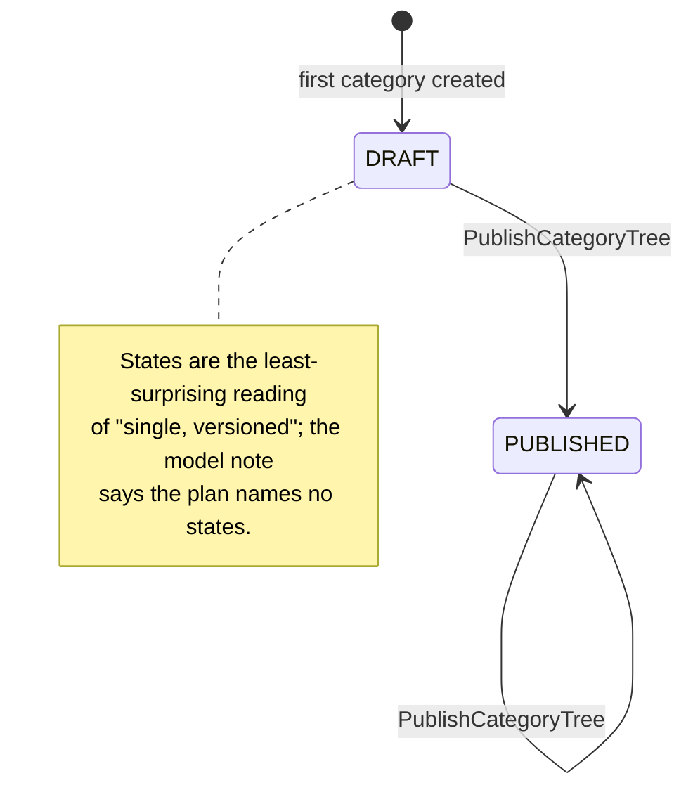

# Aggregate Design Canvas

:::info[Proposed design]
Derived from [`model/model.yaml`](https://github.com/IQVO/warehouse-docs/blob/main/storefront/model/model.yaml). Nothing in this context is built; the model carries the proposed contracts, and identifiers (`Err...` names, routes, CloudEvents types) are the names a future implementation must use.
:::

Following the ddd-crew [Aggregate Design Canvas v1.1](https://github.com/ddd-crew/aggregate-design-canvas).
The model has two aggregate roots in this context, **ProductContent** and
**CategoryTree**, and one read model, **CatalogItemView**. Proposed Go
packages: `internal/domain/content` and `internal/domain/category`.

## ProductContent

### 1. Name

`ProductContent` (`content.ProductContent`), identified by `catalogItemId`.

### 2. Description

The sellable content of one catalogue item: description, bullets (at most
10), attributes (at most 50), media (at most 12), the primary category and
the revision. It holds two value objects:

| Value object | Fields | Note |
| --- | --- | --- |
| `Attribute` | `name`, `value`, `unit` (optional) | One named fact of the item. The collection bound (at most 50) has no named `Err` (model gap). |
| `Media` | `mediaId`, `url`, `altText`, `role` (PRIMARY or GALLERY) | A URL to a static asset; upload is out of scope. Exactly one PRIMARY at publish (`ErrIncompleteContent`). |

The bullets are plain strings (at most 10; no named `Err` either). The
`revision` counts published shapes and is the monotonic guard
`product-discovery` orders content by. The aggregate also needs the
publication timestamps the REST read returns; the model's description does
not list them, so they are recorded under their route names as a pack
reading.

### 3. State Transitions

Derived from: `model.yaml → contexts[product-content].aggregates[ProductContent].states`,
`.transitions`, `.commands`.

The entry arrow `[*] --> DRAFT` is the creating command
`CreateProductContent`; the model lists transitions between states only.
Two consequences of the model as written, both model gaps:

- A DRAFT can be neither edited nor discarded: there is no `DRAFT → DRAFT`
  transition (revise) and no `DRAFT → RETIRED` transition. The proposed API
  reads `CreateProductContent` as taking the full content in one call and
  names no error for `ReviseContent` of a DRAFT.
- Re-publication after a revision has no transition. The proposed API
  description of `:revise` says the revision bumps "once published again",
  and `product-discovery` needs a new `ProductContentPublished` per
  revision, but `PublishContent` is `DRAFT → PUBLISHED` only.

### 4. Enforced Invariants

| Invariant | Enforced by |
| --- | --- |
| The item exists in the local `CatalogItemView` | `CreateProductContent` → `ErrUnknownCatalogItem` |
| Publish needs a description, exactly one PRIMARY medium and a category | `PublishContent` → `ErrIncompleteContent` |
| `primaryCategoryId` names a category of the current tree | `CreateProductContent`, `ReviseContent`, `PublishContent` → `ErrUnknownCategory` |
| RETIRED content never publishes again | `PublishContent`, `ReviseContent` → `ErrContentRetired` |

Derived from: `model.yaml → contexts[product-content].aggregates[ProductContent].invariants`.

The command pairing of the first three invariants is this pack's reading of
the proposed API's error table: the model lists the rules and the errors
but not which command checks which. The collection bounds (bullets,
attributes, media) are validation rules of the proposed API
(`maxItems` in the schema), not `Err`-named invariants.

### 5. Corrective Policies

| Policy | Owner | Rule | Effect on this aggregate |
| --- | --- | --- | --- |
| `RetireOnDiscontinue` | this context | On `CatalogItemDiscontinued`, retire the item's PUBLISHED content. | `RetireContent` without a human; `ProductContentRetired` is published. A DRAFT is untouched (the model is silent). |
| Idempotent consumption | this context | Every consumed event is applied once (inbox on the CloudEvents `id`). | The projection into `CatalogItemView` never double-applies. |

### 6. Handled Commands

| Command | Trigger | Transition |
| --- | --- | --- |
| `CreateProductContent` | Content manager, REST `POST /product-contents` | `[*] → DRAFT` |
| `ReviseContent` | Content manager, REST `POST /product-contents/{catalogItemId}:revise` | `PUBLISHED → PUBLISHED` |
| `PublishContent` | Content manager, REST `POST /product-contents/{catalogItemId}:publish` | `DRAFT → PUBLISHED` |
| `RetireContent` | Content manager, REST `POST /product-contents/{catalogItemId}:retire`; or the `RetireOnDiscontinue` policy on `CatalogItemDiscontinued` | `PUBLISHED → RETIRED` |

Derived from: `model.yaml → contexts[product-content].aggregates[ProductContent].commands`,
`.inbound`, `.policies`.

### 7. Created Events

| Event | Raised when | Full CloudEvents type |
| --- | --- | --- |
| `ProductContentPublished` | `PublishContent` is saved (state PUBLISHED, revision bumped) | `com.retailnetwork.storefront.product-content.productcontent.ProductContentPublished` |
| `ProductContentRetired` | `RetireContent` is saved | `com.retailnetwork.storefront.product-content.productcontent.ProductContentRetired` |

Derived from: `model.yaml → contexts[product-content].aggregates[ProductContent].events`,
`.publishes`.

`CreateProductContent` and `ReviseContent` raise no event per this reading:
the model's two events name the two state changes that leave the boundary.
Whether a revision of PUBLISHED content re-publishes is a model gap (above).
Both events leave through the transactional outbox in the same transaction
as the save.

### 8. Throughput

*Estimate.* The model says "low". Authoring traffic is human; the only
automated writer is `RetireOnDiscontinue`, one command per discontinued
item. Contention on one content is a content manager and the policy at
worst; every save is guarded by an optimistic-concurrency `version`.

### 9. Size

*Estimate.* The model says "one row per catalogue item + revisions". One
root row, a handful of bullets, tens of attributes at most, at most 12
media. It lives from creation until retirement, then stays as a record
(RETIRED is terminal but the row remains for the revision history the REST
read shows).

## CategoryTree

### 1. Name

`CategoryTree` (`category.CategoryTree`), identified by `categoryTreeId`.

### 2. Description

The single, versioned category tree a shopper browses; categories are
created, moved and renamed between publications. One value object:

| Value object | Fields | Note |
| --- | --- | --- |
| `Category` | `categoryId`, `parentId` (optional), `name`, `path` | One node. `path` is the materialized browse path `product-discovery` renders. |

### 3. State Transitions

Derived from: `model.yaml → contexts[product-content].aggregates[CategoryTree].states`,
`.transitions`, `.notes`.

The entry arrow is this pack's reading: the model has no create-tree
command, so the tree exists once the first `CreateCategory` lands. Which
states accept `CreateCategory`, `MoveCategory` and `RenameCategory` is not
modelled ("between publications"); the proposed API titles them "in the
draft tree", so these pages read edits as landing on a working draft that
`PublishCategoryTree` publishes, without stating whether editing a
PUBLISHED tree opens a new DRAFT.

### 4. Enforced Invariants

| Invariant | Enforced by |
| --- | --- |
| The tree never contains a cycle | `CreateCategory`, `MoveCategory` → `ErrCategoryCycle` |
| Depth at most 4 | `CreateCategory`, `MoveCategory` → `ErrMaxDepth` |
| Siblings never share a name | `CreateCategory`, `MoveCategory`, `RenameCategory` → `ErrDuplicateSiblingName` |
| A category in use by PUBLISHED content is never removed | (no remove command) → `ErrCategoryInUse` |

Derived from: `model.yaml → contexts[product-content].aggregates[CategoryTree].invariants`.
The command pairing is this pack's reading of the proposed API's error
tables. `ErrCategoryInUse` can never fire as written — the command list has
no remove-category command — yet the proposed API maps it to `:move`; both
facts are model gaps on the
[canvas](/storefront/contexts/product-content/bounded-context-canvas).

### 5. Corrective Policies

None in the model. Structural invariants are refused, not repaired.

### 6. Handled Commands

| Command | Trigger | Transition |
| --- | --- | --- |
| `CreateCategory` | Content manager, REST `POST /categories` | none (edits the working tree) |
| `MoveCategory` | Content manager, REST `POST /categories/{categoryId}:move` | none (edits the working tree) |
| `RenameCategory` | Content manager, REST `POST /categories/{categoryId}:rename` | none (edits the working tree) |
| `PublishCategoryTree` | not named in the model (no `inbound` row, no route) | `DRAFT → PUBLISHED`, `PUBLISHED → PUBLISHED` |

Derived from: `model.yaml → contexts[product-content].aggregates[CategoryTree].commands`,
`.rest`. The edit commands change the tree's shape but not its state; the
state changes only on publication, which bumps the `version`.

### 7. Created Events

| Event | Raised when | Full CloudEvents type |
| --- | --- | --- |
| `CategoryTreePublished` | `PublishCategoryTree` is saved (state PUBLISHED, version bumped) | `com.retailnetwork.storefront.product-content.categorytree.CategoryTreePublished` |

The edit commands raise no event: `product-discovery` learns a new tree
only at publication, carrying the whole tree under one `version`.

### 8. Throughput

*Estimate.* The model says "rare". Trees are edited in batches and
published deliberately; a few commands per editing session.

### 9. Size

*Estimate.* The model says "one tree, ~10^3 categories". One root row plus
one row per category per version; the whole tree fits one event payload.

## Read models

| Read model | Source events | Serves | Why it is not an aggregate |
| --- | --- | --- | --- |
| `CatalogItemView` | `offer-availability` `CatalogItemCreated`, `CatalogItemDiscontinued` | The `ErrUnknownCatalogItem` existence check in `CreateProductContent`; the trigger of `RetireOnDiscontinue` | It protects no invariant of its own and takes no command. It is a projection of facts `offer-availability` owns, and it can be dropped and rebuilt by replaying the topic. Only `catalogItemId` (and the discontinued flag) is kept. |

Derived from: `model.yaml → contexts[product-content].read_models`,
`.consumes` (fields declared: `catalogItemId`).
