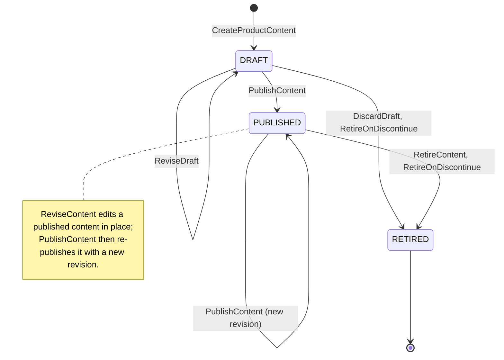
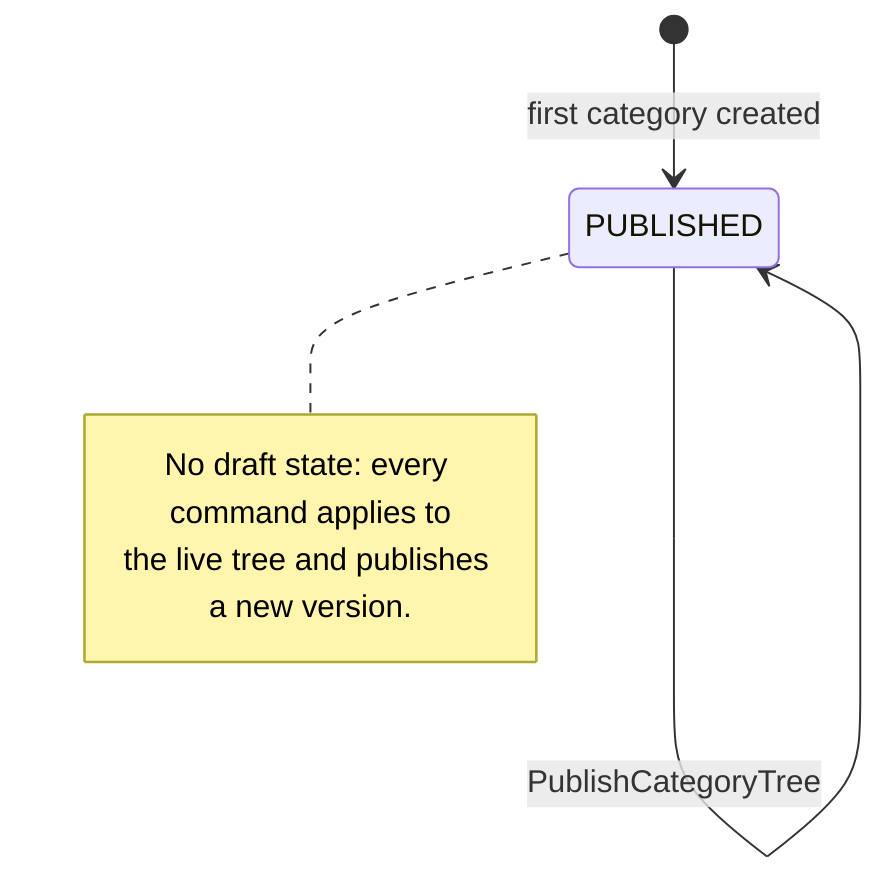

# Aggregate Design Canvas

:::info[Built on develop, not deployed]
Derived from [`model/model.yaml`](https://github.com/IQVO/warehouse-docs/blob/main/storefront/model/model.yaml). The `product-content` service is built on develop ([`IQVO/product-content`](https://github.com/IQVO/product-content) at `2f09dc0`, checked 2026-10-27) and not deployed (no warehouse-infra entry). Every `Err...` name, REST route and CloudEvents type of this context named on this page exists in the service; where the built service differs from the model's design, the page says so (**As built**) or the context's [Service and operations](/storefront/contexts/product-content#service-and-operations) section lists it.
:::

Following the ddd-crew [Aggregate Design Canvas v1.1](https://github.com/ddd-crew/aggregate-design-canvas).
The model has two aggregate roots in this context, **ProductContent** and
**CategoryTree**, and one read model, **CatalogItemView**. Go packages **as built**: `internal/domain/category`, `internal/domain/content` (plus `shared`).

## ProductContent

### 1. Name

`ProductContent` (`content.ProductContent`), identified by `catalogItemId`.

### 2. Description

The sellable content of one catalogue item: description, bullets (at most
10), attributes (at most 50), media (at most 12), the primary category and
the revision. It holds two value objects:

| Value object | Fields | Note |
| --- | --- | --- |
| `Attribute` | `name`, `value`, `unit` (optional) | One named fact of the item. The collection bound (at most 50) is `ErrTooManyAttributes`. |
| `Media` | `mediaId`, `url`, `altText`, `role` (PRIMARY or GALLERY) | A URL to a static asset; upload is out of scope. Exactly one PRIMARY at publish (`ErrIncompleteContent`). |

The bullets are plain strings (at most 10, `ErrTooManyBullets`; media at most 12, `ErrTooManyMedia`). The
`revision` counts published shapes and is the monotonic guard
`product-discovery` orders content by. The aggregate also needs the
publication timestamps the REST read returns; the model's description does
not list them, so they are recorded under their route names as a pack
reading.

### 3. State Transitions

Derived from: `model.yaml → contexts[product-content].aggregates[ProductContent].states`,
`.transitions`, `.commands`, `.notes`.

The entry arrow `[*] --> DRAFT` is the creating command
`CreateProductContent`; the model lists transitions between states only.

- A DRAFT is editable and discardable: `ReviseDraft` is `DRAFT → DRAFT` with
  a new revision, and `DiscardDraft` is `DRAFT → RETIRED` with reason
  `DISCARDED` and no event, because nothing was ever published.
- Re-publication after a revision is `PUBLISHED → PUBLISHED` through
  `PublishContent`, carrying the new `revision` in `ProductContentPublished`
  (the revise-then-publish-again path `product-discovery` orders by).
- `RETIRED` carries a reason: `DISCARDED`, `DISCONTINUED` or
  `RETIRED_BY_HAND`. Only the retirement of PUBLISHED content raises
  `ProductContentRetired`.

### 4. Enforced Invariants

| Invariant | Enforced by |
| --- | --- |
| The item exists in the local `CatalogItemView` | `CreateProductContent` → `ErrUnknownCatalogItem` |
| Content is neither created nor published for a DISCONTINUED item | `CreateProductContent`, `PublishContent` → `ErrItemDiscontinued` |
| At most 10 bullets, 50 attributes, 12 media | `CreateProductContent`, `ReviseDraft`, `ReviseContent` → `ErrTooManyBullets`, `ErrTooManyAttributes`, `ErrTooManyMedia` |
| Publish needs a description, exactly one PRIMARY medium and a category | `PublishContent` → `ErrIncompleteContent` |
| `primaryCategoryId` names a category of the current tree | `CreateProductContent`, `ReviseDraft`, `ReviseContent`, `PublishContent` → `ErrUnknownCategory` |
| RETIRED content never publishes again | `PublishContent`, `ReviseDraft`, `ReviseContent` → `ErrContentRetired` |

Derived from: `model.yaml → contexts[product-content].aggregates[ProductContent].invariants`.

The command pairing of the first three invariants is this pack's reading of
the API's error table: the model lists the rules and the errors
but not which command checks which. The collection bounds (bullets,
attributes, media) are the named invariants `ErrTooManyBullets`,
`ErrTooManyAttributes` and `ErrTooManyMedia`; the schema also carries
`maxItems`.

### 5. Corrective Policies

| Policy | Owner | Rule | Effect on this aggregate |
| --- | --- | --- | --- |
| `RetireOnDiscontinue` | this context | On `CatalogItemDiscontinued`, retire the item's content: PUBLISHED to RETIRED, and DRAFT to RETIRED (reason `DISCONTINUED`). | `RetireContent` without a human; `ProductContentRetired` is published for PUBLISHED content only (a DRAFT retires with no event). A discontinued item can never publish (`ErrItemDiscontinued`). |
| Idempotent consumption | this context | Every consumed event is applied once (inbox on the CloudEvents `id`). | The projection into `CatalogItemView` never double-applies. |

### 6. Handled Commands

| Command | Trigger | Transition |
| --- | --- | --- |
| `CreateProductContent` | Content manager, REST `POST /product-contents` | `[*] → DRAFT` |
| `ReviseDraft` | Content manager, REST `POST /product-contents/{catalogItemId}:revise` (**As built:** one route for both revisions; the content state picks ReviseDraft or ReviseContent, product-content ADR 0002) | `DRAFT → DRAFT` |
| `ReviseContent` | Content manager, REST `POST /product-contents/{catalogItemId}:revise` | `PUBLISHED → PUBLISHED` |
| `PublishContent` | Content manager, REST `POST /product-contents/{catalogItemId}:publish` | `DRAFT → PUBLISHED`, `PUBLISHED → PUBLISHED` |
| `DiscardDraft` | Content manager, REST `POST /product-contents/{catalogItemId}:discard` | `DRAFT → RETIRED` (reason `DISCARDED`) |
| `RetireContent` | Content manager, REST `POST /product-contents/{catalogItemId}:retire`; or the `RetireOnDiscontinue` policy on `CatalogItemDiscontinued` | `PUBLISHED → RETIRED`, `DRAFT → RETIRED` (policy, reason `DISCONTINUED`) |

Derived from: `model.yaml → contexts[product-content].aggregates[ProductContent].commands`,
`.inbound`, `.policies`.

### 7. Created Events

| Event | Raised when | Full CloudEvents type |
| --- | --- | --- |
| `ProductContentPublished` | `PublishContent` is saved (state PUBLISHED, revision bumped) | `com.retailnetwork.storefront.product-content.productcontent.ProductContentPublished` |
| `ProductContentRetired` | `RetireContent` is saved for PUBLISHED content (also via the policy) | `com.retailnetwork.storefront.product-content.productcontent.ProductContentRetired` |

Derived from: `model.yaml → contexts[product-content].aggregates[ProductContent].events`,
`.publishes`.

`CreateProductContent`, `ReviseDraft`, `ReviseContent` and `DiscardDraft`
raise no event: the model's two events name the two state changes that leave
the boundary. A revision of PUBLISHED content leaves it on the next
`PublishContent`.
Both events leave through the transactional outbox in the same transaction
as the save.

### 8. Throughput

*Estimate.* The model says "low". Authoring traffic is human; the only
automated writer is `RetireOnDiscontinue`, one command per discontinued
item. Contention on one content is a content manager and the policy at
worst; every save is guarded by an optimistic-concurrency `version`.

### 9. Size

*Estimate.* The model says "one row per catalogue item + revisions". One
root row, a handful of bullets, tens of attributes at most, at most 12
media. It lives from creation until retirement, then stays as a record
(RETIRED is terminal but the row remains for the revision history the REST
read shows).

## CategoryTree

### 1. Name

`CategoryTree` (`category.Tree`), identified by `categoryTreeId`.

### 2. Description

The single, versioned category tree a shopper browses; categories are
created, moved and renamed on the live tree, and every command publishes a new version. One value object:

| Value object | Fields | Note |
| --- | --- | --- |
| `Category` | `categoryId`, `parentId` (optional), `name`, `path` | One node. `path` is the materialized browse path `product-discovery` renders. |

### 3. State Transitions

Derived from: `model.yaml → contexts[product-content].aggregates[CategoryTree].states`,
`.transitions`, `.notes`.

The entry arrow is this pack's reading: the model has no create-tree
command, so the tree exists once the first `CreateCategory` lands. The tree
is a single published aggregate: there is no DRAFT state, and `CreateCategory`,
`MoveCategory` and `RenameCategory` each apply to the live tree and publish a
new version. `PublishCategoryTree` re-publishes the live tree unchanged so
consumers can resync.

### 4. Enforced Invariants

| Invariant | Enforced by |
| --- | --- |
| The tree never contains a cycle | `CreateCategory`, `MoveCategory` → `ErrCategoryCycle` |
| Depth at most 4 | `CreateCategory`, `MoveCategory` → `ErrMaxDepth` |
| Siblings never share a name | `CreateCategory`, `MoveCategory`, `RenameCategory` → `ErrDuplicateSiblingName` |
| A category in use by PUBLISHED content is never removed | no remove-category command by design; `ErrCategoryInUse` guards a future removal |

Derived from: `model.yaml → contexts[product-content].aggregates[CategoryTree].invariants`.
The command pairing is this pack's reading of the API's error
tables. Categories are never deleted, only renamed or moved, so
`ErrCategoryInUse` is not raised by any current command and the API (as
built) maps it to no route.

### 5. Corrective Policies

None in the model. Structural invariants are refused, not repaired.

### 6. Handled Commands

| Command | Trigger | Transition |
| --- | --- | --- |
| `CreateCategory` | Content manager, REST `POST /categories` | `PUBLISHED → PUBLISHED` |
| `MoveCategory` | Content manager, REST `POST /categories/{categoryId}:move` | `PUBLISHED → PUBLISHED` |
| `RenameCategory` | Content manager, REST `POST /categories/{categoryId}:rename` | `PUBLISHED → PUBLISHED` |
| `PublishCategoryTree` | Content manager, REST `POST /categories:publish` | `PUBLISHED → PUBLISHED` |

Derived from: `model.yaml → contexts[product-content].aggregates[CategoryTree].commands`,
`.rest`. Each command applies to the live tree and bumps the `version`.

### 7. Created Events

| Event | Raised when | Full CloudEvents type |
| --- | --- | --- |
| `CategoryTreePublished` | any tree command is saved, including `PublishCategoryTree` (version bumped) | `com.retailnetwork.storefront.product-content.categorytree.CategoryTreePublished` |

`product-discovery` learns each new tree version through this event, which
carries the whole tree under one `version`.

### 8. Throughput

*Estimate.* The model says "rare". Trees are edited in batches and
published deliberately; a few commands per editing session.

### 9. Size

*Estimate.* The model says "one tree, ~10^3 categories". One root row plus
one row per category per version; the whole tree fits one event payload.

## Read models

| Read model | Source events | Serves | Why it is not an aggregate |
| --- | --- | --- | --- |
| `CatalogItemView` | `offer-availability` `CatalogItemCreated`, `CatalogItemDiscontinued` | The `ErrUnknownCatalogItem` and `ErrItemDiscontinued` checks in `CreateProductContent` and `PublishContent`; the trigger of `RetireOnDiscontinue` | It protects no invariant of its own and takes no command. It is a projection of facts `offer-availability` owns, and it can be dropped and rebuilt by replaying the topic. Only `catalogItemId` (and the discontinued flag) is kept. |

Derived from: `model.yaml → contexts[product-content].read_models`,
`.consumes` (fields declared: `catalogItemId`).
