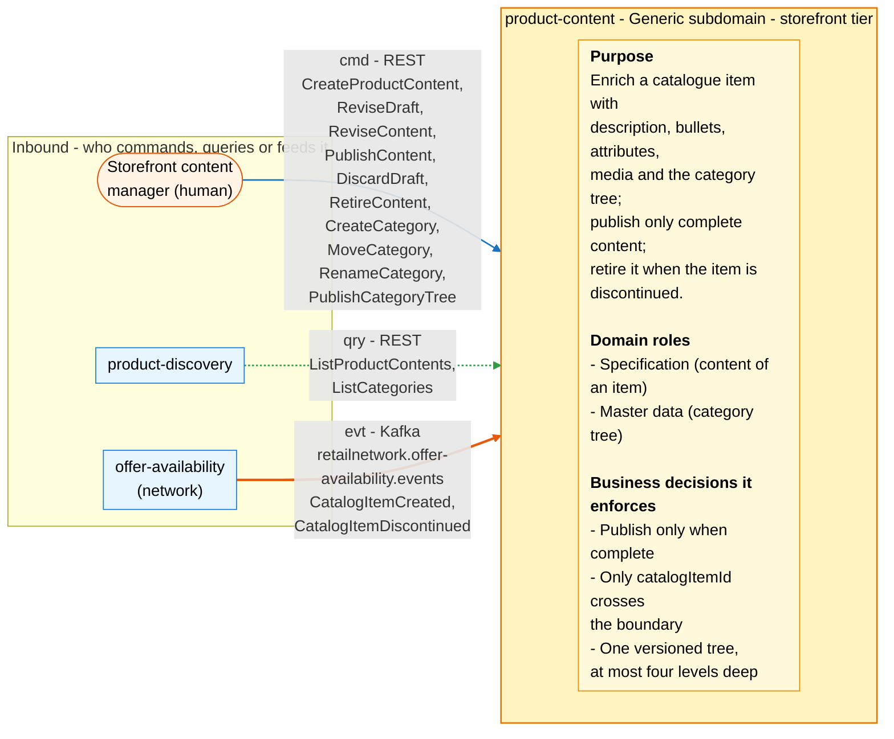
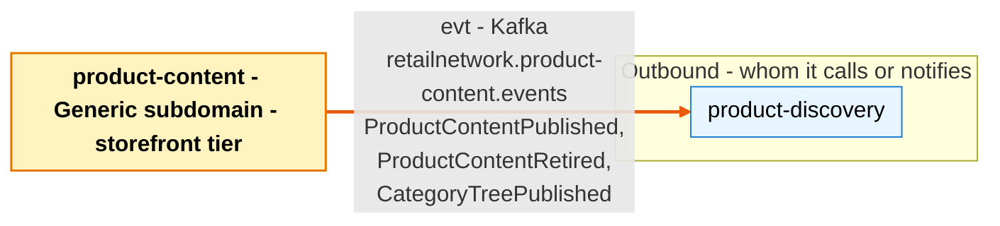

# Bounded Context Canvas

:::info[Proposed design]
Derived from [`model/model.yaml`](https://github.com/IQVO/warehouse-docs/blob/main/storefront/model/model.yaml). Nothing in this context is built; the model carries the proposed contracts, and identifiers (`Err...` names, routes, CloudEvents types) are the names a future implementation must use.
:::

Following the ddd-crew [Bounded Context Canvas v5](https://github.com/ddd-crew/bounded-context-canvas).
Every message row comes from `contexts[product-content]` (`inbound`,
`consumes`, `publishes`, `rest`; `sync_calls` is empty) or from a
neighbour's entry that names this context.

## Canvas at a glance

Two pictures of the sections below, laid out like the ddd-crew canvas:
first the inbound collaborators feeding this context (purpose, domain roles
and the business decisions it enforces), then the outbound collaborators it
notifies. Arrows follow the message type: **solid blue** commands (`cmd`),
**dotted green** queries (`qry`), **thick orange** events (`evt`); each
arrow names its channel and the messages it carries. Box shapes mark the
collaborator kind: rounded = people, UI or any client; blue = sibling
bounded context. Channel names on the arrows are abbreviated; the Inbound
and Outbound Communication tables carry the exact route, topic and
CloudEvents type for every message.

### Inbound

### Outbound

Derived from: `model.yaml → contexts[product-content].inbound`,
`.publishes`, `.purpose`, `.roles`, `.business_decisions`.

The diagrams omit assumptions, verification metrics, open questions and the
ubiquitous language (sections below), the relationship pattern per message
(see the tables), and the synchronous replies. `PublishCategoryTree` is
triggered by the content manager through `POST /categories:publish`. This context makes **no
synchronous calls** (`sync_calls: []`): the item data it needs is the local,
event-fed `CatalogItemView`.

## Name

**Product Content** (`product-content`, code `PC`, CloudEvents tier
`storefront`).

## Purpose

To enrich the network's catalogue item with everything a product page
needs and the item master does not have. The context:

- holds the sellable content of one item (description, bullets, attributes,
  media, primary category) as one versioned, publishable unit;
- publishes content only when complete — a description, exactly one PRIMARY
  medium and a category (`ErrIncompleteContent`);
- owns the single, versioned category tree, at most four levels deep;
- retires published and draft content when the network discontinues the item
  (`RetireOnDiscontinue`); a discontinued item can never publish
  (`ErrItemDiscontinued`).

## Strategic Classification

| Axis | Verdict |
| --- | --- |
| **Domain** | **Generic** subdomain. See the [Core Domain Chart](/storefront/contexts/product-content/core-domain-chart). |
| **Business Model** | Engagement enabler (buy a PIM in production). |
| **Evolution** | Commodity. |

## Domain Roles

| Role | Applies? | Evidence in the model |
| --- | --- | --- |
| **Specification (content of an item)** | **Yes, primary** | The publish gate (`ErrIncompleteContent`, `ErrUnknownCategory`) defines what sellable content must look like. |
| **Master data (category tree)** | **Yes** | `CategoryTree` is the one versioned tree every content references by `primaryCategoryId`. |
| Execution | No | No transactional flow runs here; commands are authoring actions. |
| Analysis / Gateway | No | The reads are projections for `product-discovery`'s bootstrap, not decisions; shoppers reach the catalogue through `product-discovery`, not here. |

## Inbound Communication

| Collaborator | Message | Type | Channel | Relationship |
| --- | --- | --- | --- | --- |
| Storefront content manager (human) | `CreateProductContent`, `ReviseDraft`, `ReviseContent`, `PublishContent`, `DiscardDraft`, `RetireContent`, `CreateCategory`, `MoveCategory`, `RenameCategory` | Command | REST `/product-contents`, `/categories` | UI |
| Storefront content manager (human) | `PublishCategoryTree` | Command | REST `POST /categories:publish` | UI |
| Storefront content manager (human) | `GetProductContent` | Query | REST `GET /product-contents/{catalogItemId}` | UI |
| `product-discovery` | `ListProductContents`, `ListCategories` | Query | REST `GET /product-contents` (bootstrap, paged), `GET /categories` (`product-discovery` does not call `GetProductContent`) | Customer/Supplier (we are the Supplier) |
| `offer-availability` | `CatalogItemCreated` | Event | Kafka `retailnetwork.offer-availability.events`, `com.retailnetwork.commerce.offer-availability.catalogitem.CatalogItemCreated` | Conformist |
| `offer-availability` | `CatalogItemDiscontinued` | Event | Kafka `retailnetwork.offer-availability.events`, `com.retailnetwork.commerce.offer-availability.catalogitem.CatalogItemDiscontinued` | Conformist |

## Outbound Communication

| Collaborator | Message | Type | Channel | Relationship |
| --- | --- | --- | --- | --- |
| `product-discovery` | `ProductContentPublished` | Event | Kafka `retailnetwork.product-content.events`, `com.retailnetwork.storefront.product-content.productcontent.ProductContentPublished` | Customer/Supplier (we are the Supplier) |
| `product-discovery` | `ProductContentRetired` | Event | Kafka `retailnetwork.product-content.events`, `com.retailnetwork.storefront.product-content.productcontent.ProductContentRetired` | Customer/Supplier (we are the Supplier) |
| `product-discovery` | `CategoryTreePublished` | Event | Kafka `retailnetwork.product-content.events`, `com.retailnetwork.storefront.product-content.categorytree.CategoryTreePublished` | Customer/Supplier (we are the Supplier) |

What the consumer does with them (from its own model entry):
`product-discovery` folds each event into `ProductView` and `CategoryView`,
guarded by the content `revision` and tree `version` as per-source monotonic
guards. Full payloads:
[Domain Events](/storefront/contexts/product-content/domain-events).
Relationship evidence: [Context Map](/storefront/contexts/product-content/context-map).

## Ubiquitous Language

Full glossary: [Ubiquitous Language](/storefront/contexts/product-content/ubiquitous-language).
Top terms: **Product Content**, **Revision**, **Primary Medium**,
**Category**, **Category Tree**.

## Business Decisions

1. **Content publishes only when complete**: a description, exactly one
   PRIMARY medium and a category (`ErrIncompleteContent`).
2. **Only `catalogItemId` crosses the boundary**; content never redefines
   the item itself [19]. The item must exist in the local `CatalogItemView`
   (`ErrUnknownCatalogItem`) and must not be DISCONTINUED
   (`ErrItemDiscontinued`).
3. **The category tree is one versioned, always-published aggregate** with no draft state (every command
   applies to the live tree and publishes a new version), at most four levels
   deep (`ErrMaxDepth`), never cyclic (`ErrCategoryCycle`), with unique
   sibling names (`ErrDuplicateSiblingName`); a category in use by PUBLISHED
   content is never removed (`ErrCategoryInUse`, which guards a future
   removal: categories are only renamed or moved, never deleted).
4. **RETIRED content never publishes again** (`ErrContentRetired`).

## Assumptions

- `offer-availability` publishes `CatalogItemCreated` before any content
  manager writes content for the item; content for an unknown item is
  rejected (`ErrUnknownCatalogItem`), so an early write fails rather than
  waits.
- `CatalogItemDiscontinued` eventually reaches this context for every
  discontinued item; until it does, the item's published content stays up
  and `product-discovery` still shows it (its own Purchasable rule also
  requires an ACTIVE item in the item master, so the page is not buyable in
  the gap).
- Media URLs point at static assets that exist; nothing here validates a
  URL (media upload is out of scope).
- Every consumed event carries `catalogItemId` (the only field this context
  declares it needs).
- Exactly one consumer of the published events exists (`product-discovery`);
  the analytics topic receives nothing, because the model lists no
  analytics-only event here.

## Verification Metrics

| Metric | Target (proposed) | Source |
| --- | --- | --- |
| Publish success rate (`201`/`200` on `:publish` of all attempts) | tracked; alert on a drop | REST access log |
| Share of publishes rejected `ErrIncompleteContent` | tracked (authoring quality signal) | REST access log |
| Published content without a matching `ProductContentPublished` in the outbox | 0 | outbox vs aggregate state |
| p95 latency of `GET /product-contents/{catalogItemId}` | below 200 ms | traces |
| Outbox age of the oldest unpublished event | below 5 s | `outbox_events.created_at` |
| Consumer lag on `retailnetwork.offer-availability.events` | below 30 s | Kafka consumer metrics |
| PUBLISHED content of DISCONTINUED items (retirement lag) | 0 beyond one consumer-lag window | join on `rm_catalog_items` |
| `revision` regressions observed by consumers | 0 (monotonic per item) | consumer logs of `product-discovery` |

## Open Questions

None remain from the model-fix. The eight earlier gaps are resolved in the
model: `POST /categories:publish` triggers `PublishCategoryTree`; a DRAFT is
editable (`ReviseDraft`) and discardable (`DiscardDraft`); re-publication is
`PUBLISHED → PUBLISHED` via `PublishContent`; there is no remove-category
command by design (`ErrCategoryInUse` guards a future removal); the
collection limits are `ErrTooManyBullets`, `ErrTooManyAttributes` and
`ErrTooManyMedia`; `RetireOnDiscontinue` also retires DRAFTs and a
discontinued item can never publish (`ErrItemDiscontinued`); and the tree has
no draft state.
