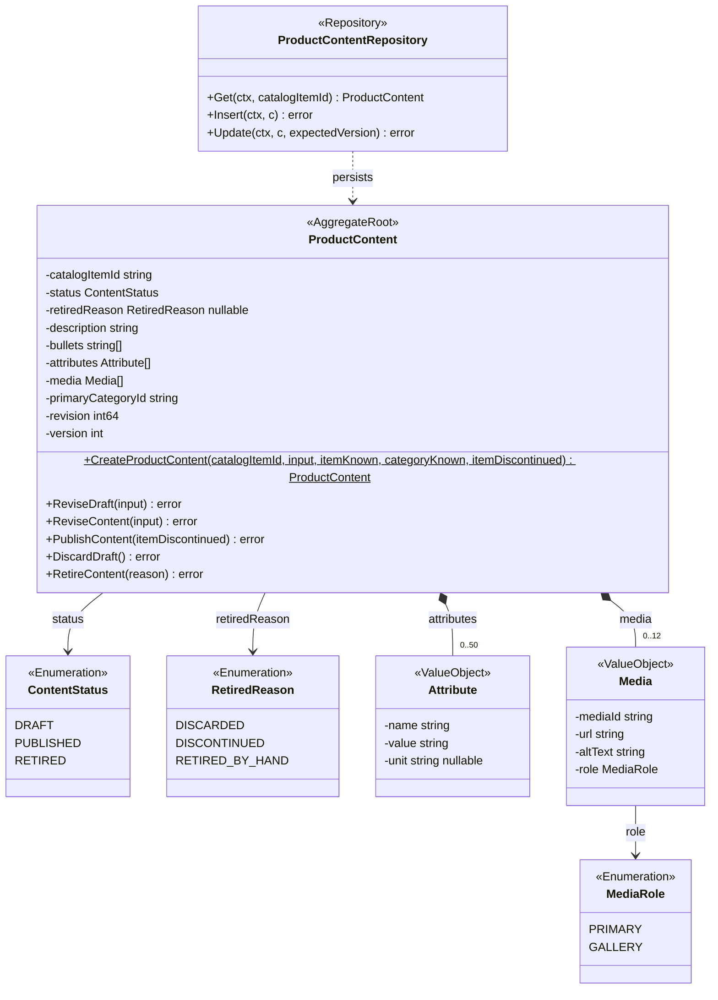
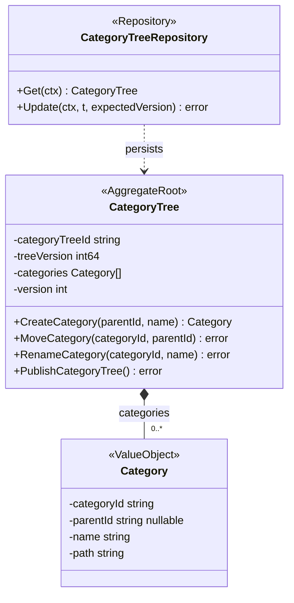
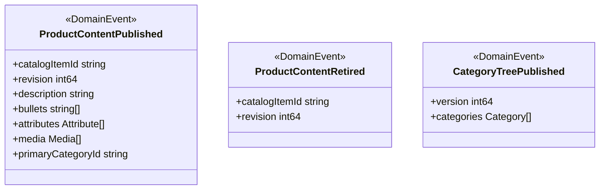
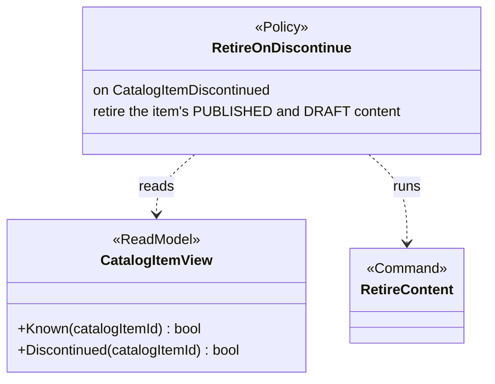
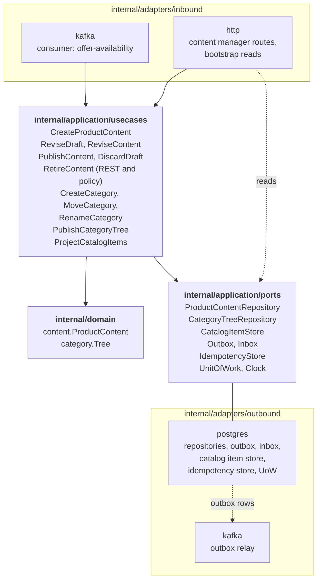

# Class Diagram

:::info[Built on develop, not deployed]
Derived from [`model/model.yaml`](https://github.com/IQVO/warehouse-docs/blob/main/storefront/model/model.yaml). The `product-content` service is built on develop ([`IQVO/product-content`](https://github.com/IQVO/product-content) at `2f09dc0`, checked 2026-10-27) and not deployed (no warehouse-infra entry). Every `Err...` name, REST route and CloudEvents type of this context named on this page exists in the service; where the built service differs from the model's design, the page says so (**As built**) or the context's [Service and operations](/storefront/contexts/product-content#service-and-operations) section lists it.
:::

UML class diagrams of the **proposed** `internal/domain/**` packages, plus
the hexagonal ports and adapters. Type names come from the model's code
identifiers (`content.ProductContent`, `content.Media.RolePrimary`,
`category.Tree`, `category.Category`) and value objects. Fields are
unexported in Go and shown with `-`; methods are shown with `+`.

## 1. ProductContent aggregate

Derived from: `model.yaml → contexts[product-content].aggregates[ProductContent]`
(`states`, `value_objects`, `commands`, `invariants`, `description`).

Omitted: read accessors, the `Err...` variables (`ErrUnknownCatalogItem`,
`ErrItemDiscontinued`, `ErrIncompleteContent`, `ErrUnknownCategory`, `ErrContentRetired`,
`ErrTooManyBullets`, `ErrTooManyAttributes`, `ErrTooManyMedia`; listed on
the [Aggregate Design Canvas](/storefront/contexts/product-content/aggregate-design-canvas)),
and the publication timestamps the REST read returns. `itemKnown` and
`categoryKnown` stand for the existence checks against `CatalogItemView` and
the `CategoryTree`, and `itemDiscontinued` for the discontinued flag read from
`CatalogItemView`; the aggregate decides, the use case supplies the facts.
The collection bounds (0..10 bullets, 0..50 attributes, 0..12 media) come
from the aggregate description and the proposed API schema; they are the
named invariants `ErrTooManyBullets`, `ErrTooManyAttributes` and
`ErrTooManyMedia`. `RetireContent(reason)` is also what `RetireOnDiscontinue`
runs, with reason `DISCONTINUED`.

## 2. CategoryTree aggregate

Derived from: `model.yaml → contexts[product-content].aggregates[CategoryTree]`
(`states`, `value_objects`, `commands`, `invariants`, `notes`).

Omitted: the `Err...` variables (`ErrCategoryCycle`, `ErrMaxDepth`,
`ErrDuplicateSiblingName`, `ErrCategoryInUse`, which guards a future removal:
no remove-category command exists by design). `treeVersion` is the
published version the event carries; `version` is the
optimistic-concurrency guard of the save. The tree is single
(`size_estimate`: "one tree"), so the repository `Get` takes no id; the
`categoryTreeId` still keys the Kafka messages. The tree has no status: it
is a single published aggregate and every command applies to the live tree
and publishes a new version.

## 3. Domain events and policy

Derived from: `model.yaml → contexts[product-content].publishes`,
`.policies`, `.read_models`.

Omitted: the CloudEvents envelope (built in the Kafka adapter), and the
consumed events (`CatalogItemCreated`, `CatalogItemDiscontinued`), which are
`offer-availability`'s types, decoded in the consumer adapter. The events
carry no title, price, stock or PII.

## 4. Hexagonal ports and adapters

Derived from: `model.yaml → contexts[product-content].aggregates`,
`.inbound`, `.read_models`; `conventions.integration_rules` (outbox, inbox);
the fleet's Go hexagonal layout.

Omitted: the composition root (`cmd/product-content`), metrics and tracing.
`ProjectCatalogItems` is the projector that writes `CatalogItemView`; it is
not a command of the model and changes no aggregate (its sibling effect,
retirement, is the `RetireOnDiscontinue` policy). There is **no outbound
REST client adapter**: `sync_calls` is empty. The read routes
(`ListProductContents`, `GetProductContent`, `ListCategories`) read the
stores through their ports without a use case.
