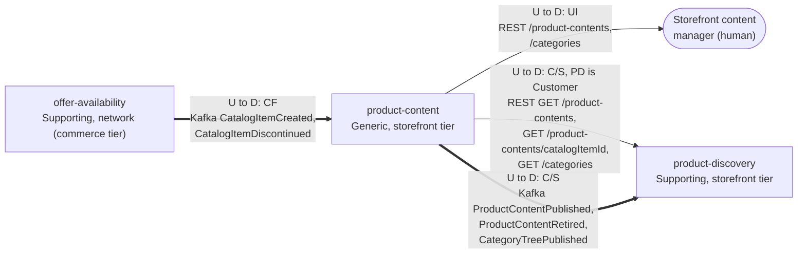

# Context Map

:::info[Proposed design]
Derived from [`model/model.yaml`](https://github.com/IQVO/warehouse-docs/blob/main/storefront/model/model.yaml). Nothing in this context is built; the model carries the proposed contracts, and identifiers (`Err...` names, routes, CloudEvents types) are the names a future implementation must use.
:::

Following ddd-crew [Context Mapping](https://github.com/ddd-crew/context-mapping).
This is **product-content's slice** of the
[storefront-wide context map](/storefront/strategic-design/context-map): every
relationship this context has, with the upstream (U) and downstream (D)
side, the pattern and the channel.

Derived from: `model.yaml → contexts[product-content].inbound`,
`.publishes`, `.consumes`; `contexts[product-discovery].inbound` (rows from
`product-content`), `.sync_calls` (bootstrap reads from this context);
`network model.yaml → contexts[offer-availability].publishes`.

Legend: arrows point from upstream to downstream. A solid arrow is a
synchronous REST relationship; a thick arrow is a Kafka event relationship.
REST path parameters are written without braces inside the diagram. This
context makes **no synchronous calls** (`sync_calls` is empty): the item
data its invariants need arrives as events into the local `CatalogItemView`.

Omitted, because they have no edge with this context (**Separate Ways**):
the storefront contexts `pricing`, `shopping-cart`, `checkout` and
`customer-payments` (a price, a cart and a payment never name content; the
product page assembles them in `product-discovery`), and every network
context except `offer-availability` (`delivery-promise`,
`customer-ordering`, `order-sourcing`, `shipping-and-tracking` and the
rest). The shopper also has no edge: the browser reaches the storefront
edge (`storefront-bff`) and reads the catalogue through
`product-discovery`, never here. No edge touches the warehouse-systems
fleet (`meta.hard_boundary`).

## Relationships

| Neighbour | Direction | Pattern | Channel | Messages | Why this pattern |
| --- | --- | --- | --- | --- | --- |
| Storefront content manager (human) | PC upstream, manager downstream | **UI** | REST `POST /product-contents`, `POST /product-contents/{catalogItemId}:revise`, `:publish`, `:retire`, `POST /categories`, `POST /categories/{categoryId}:move`, `:rename` | `CreateProductContent`, `ReviseContent`, `PublishContent`, `RetireContent`, `CreateCategory`, `MoveCategory`, `RenameCategory` | Authoring is a human workflow; the API is the tool's surface. No authentication (`conventions.no_auth`). |
| `product-discovery` (Supporting) | PC upstream, PD downstream | **Customer/Supplier** (PD is the Customer) | REST `GET /product-contents` (bootstrap, paged), `GET /product-contents/{catalogItemId}`, `GET /categories` | `ListProductContents`, `GetProductContent`, `ListCategories` | PD's projection rebuild (snapshot + catch-up, gap S5) needs paged reads shaped for its bootstrap; PC serves them deliberately, on an ops path, never on a shopper request. |
| `product-discovery` (Supporting) | PC upstream, PD downstream | **Customer/Supplier** | Kafka `retailnetwork.product-content.events` | `ProductContentPublished`, `ProductContentRetired`, `CategoryTreePublished` | PD folds these into `ProductView` and `CategoryView`; the payload (revision, full content, the whole tree per version) is negotiated for that one consumer. |
| `offer-availability` (network, Supporting) | OA upstream, PC downstream | **Conformist** | Kafka `retailnetwork.offer-availability.events` | `CatalogItemCreated`, `CatalogItemDiscontinued` | The item master is the network's; this context takes the item facts as published into `CatalogItemView` and retires content on discontinuation. It declares only `catalogItemId` as needed. |

## Notes on the patterns

- **No Anti-Corruption Layer.** The one upstream is inside the same
  organization and speaks the network's language; the `CatalogItemView`
  projector reads the events as published, and the only field kept is the
  id plus the discontinued flag.
- **No Shared Kernel.** `catalogItemId` and `categoryId` are values copied
  from messages, not shared code.
- **No Open Host Service of its own for shoppers.** The REST reads exist
  for one named customer (`product-discovery`). The shopper-facing
  catalogue reads live in `product-discovery`, not here.
- **No synchronous call at all.** `sync_calls` is empty: completeness is
  checked against the local `CatalogItemView`, so publishing never waits on
  the network.
- **No fleet edge.** This context never consumes a `warehouse.*` topic and
  never calls a warehouse-systems service (the model's `hard_boundary`).
