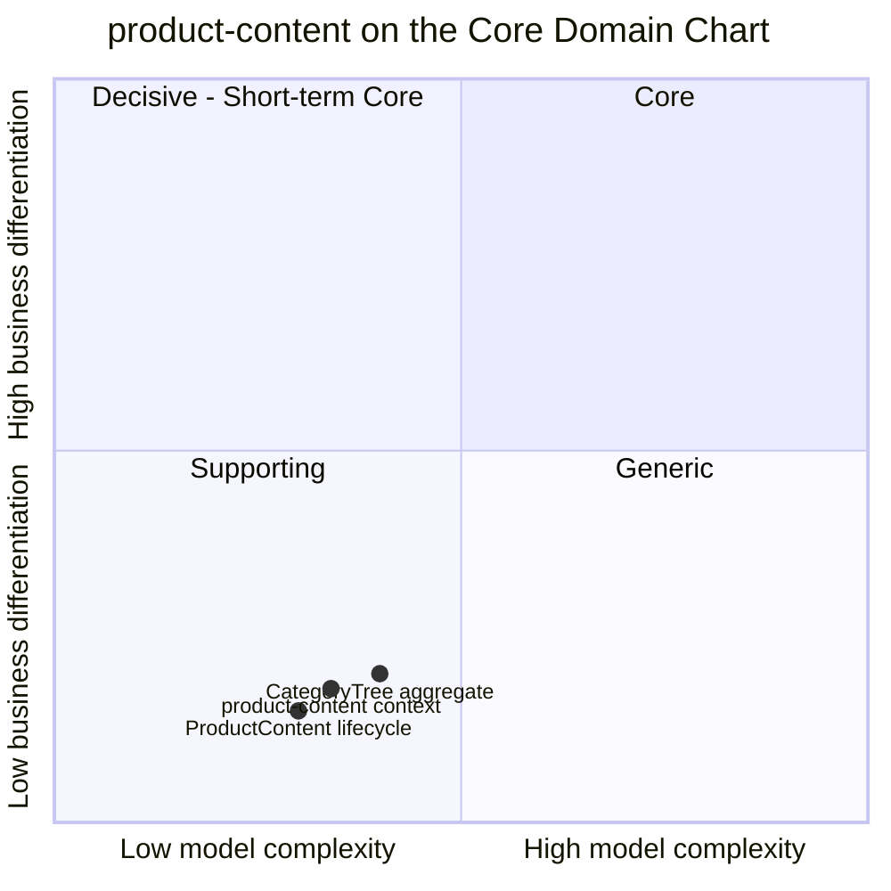

# Core Domain Chart

:::info[Built on develop, not deployed]
Derived from [`model/model.yaml`](https://github.com/IQVO/warehouse-docs/blob/main/storefront/model/model.yaml). The `product-content` service is built on develop ([`IQVO/product-content`](https://github.com/IQVO/product-content) at `2f09dc0`, checked 2026-10-27) and not deployed (no warehouse-infra entry). Every `Err...` name, REST route and CloudEvents type of this context named on this page exists in the service; where the built service differs from the model's design, the page says so (**As built**) or the context's [Service and operations](/storefront/contexts/product-content#service-and-operations) section lists it.
:::

Following the ddd-crew [Core Domain Charts](https://github.com/ddd-crew/core-domain-charts):
business differentiation (y) against model complexity (x). The
storefront-wide classification is
[Subdomain Classification](/storefront/strategic-design/subdomain-classification).

Derived from: `model.yaml → contexts[product-content].chart` (`complexity:
0.34`, `differentiation: 0.18`), `.classification`,
`.aggregates[ProductContent, CategoryTree]`.

The two slices are placed by judgement, not by the model; the model gives
only the context's point. Omitted: the other five storefront contexts (their
positions are on their own pages once their packs land, and on the
storefront-wide classification).

## Classification: Generic

All three points sit in the **bottom-left corner** of the chart — quadrant 3
on the grid, the corner the chart labels Supporting. The verdict still comes
from the model, which classifies the context as `Generic` with the
rationale "buy a PIM in production": the axes say only "low differentiation
on low complexity", and the Supporting-versus-Generic call is a
build-versus-buy question, not a coordinate. This one is a buy. Every
online shop has product
descriptions, media and a category tree, and no shopper chooses this
storefront because of how its content records work. Shoppers choose it for
the honest delivery date and the total cost up front, owned by
`delivery-promise` in the network and `pricing` in the storefront (Core).

**Differentiation is low (y = 0.18).** The context makes no selling
decision. It never prices, never promises, never decides what is in stock.
Its rules are ordinary content-management rules: publish only complete
content, keep the tree acyclic and shallow, take content down when the item
goes away.

**Complexity is low to moderate (x = 0.34).** It is the simplest context of
the six that still has a lifecycle:

- `ProductContent` has **three states and three transitions**, and the only
  non-trivial invariant is the publish gate (`ErrIncompleteContent`:
  description, exactly one PRIMARY medium, category).
- `CategoryTree` is one aggregate with structural invariants (no cycle, at
  most four levels, unique sibling names) — textbook tree maintenance.
- It consumes a single upstream topic and calls nothing synchronously
  (`sync_calls` is empty).

## Business model

**Engagement enabler (buy a PIM in production).** The context earns nothing
by itself. Its value is the conversion it does not lose: complete, accurate
content is what makes a found item buyable, and `product-discovery`'s
Purchasable rule counts PUBLISHED content as one of its four conditions
(see [Verification Metrics](/storefront/contexts/product-content/bounded-context-canvas)).

## Evolution

| Part | Evolution stage | Why |
| --- | --- | --- |
| Content record, publish gate, retirement | **Commodity** | `chart.evolution: Commodity`. Standard PIM functionality; a bought product would fit. |
| Category tree, versioned | **Commodity** | Taxonomy management with publication is what every PIM and shop platform already does. |
| Plumbing (outbox, inbox, CloudEvents) | **Commodity** | Estate-wide building blocks ([Event standard](/storefront/strategic-design/event-standard-cloudevents)). |

**Movement to watch.** Nothing in the model moves this context up. The
expected path for a Generic subdomain applies: in production this context
would be replaced by a bought PIM, shrinking to an adapter that republishes
the PIM's content as `ProductContentPublished` and `CategoryTreePublished`.
The interface to keep stable is the three published events and the three
bootstrap reads `product-discovery` relies on.
