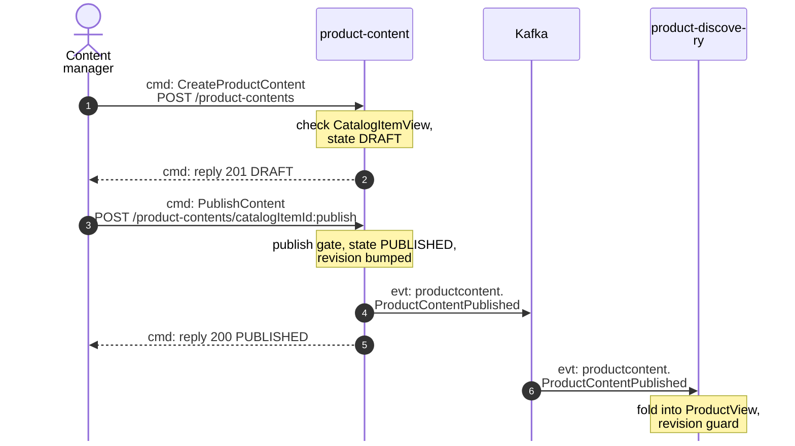
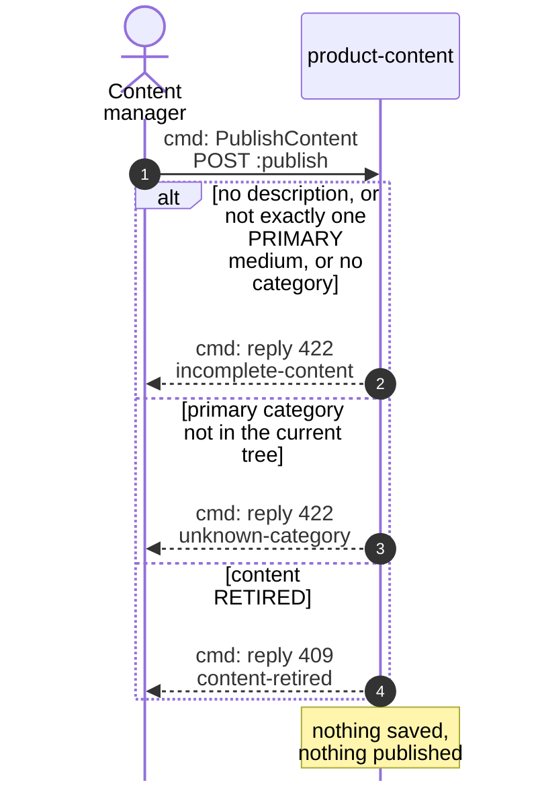
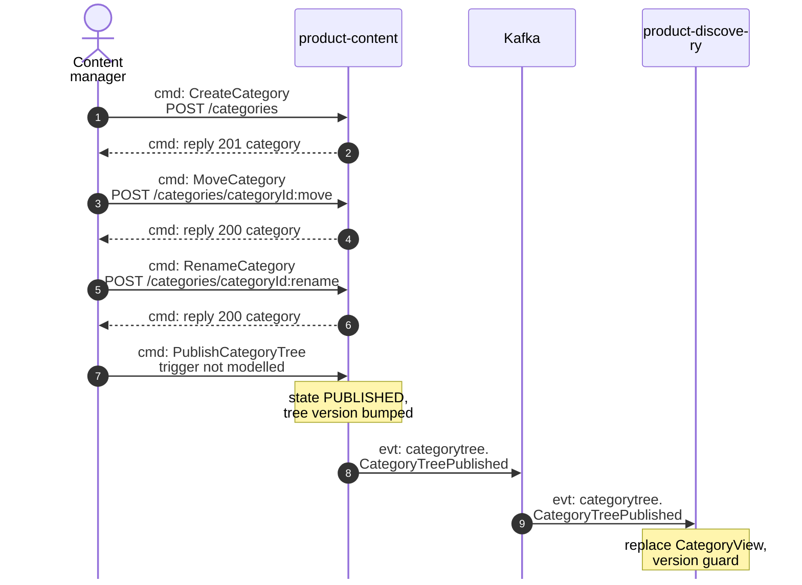
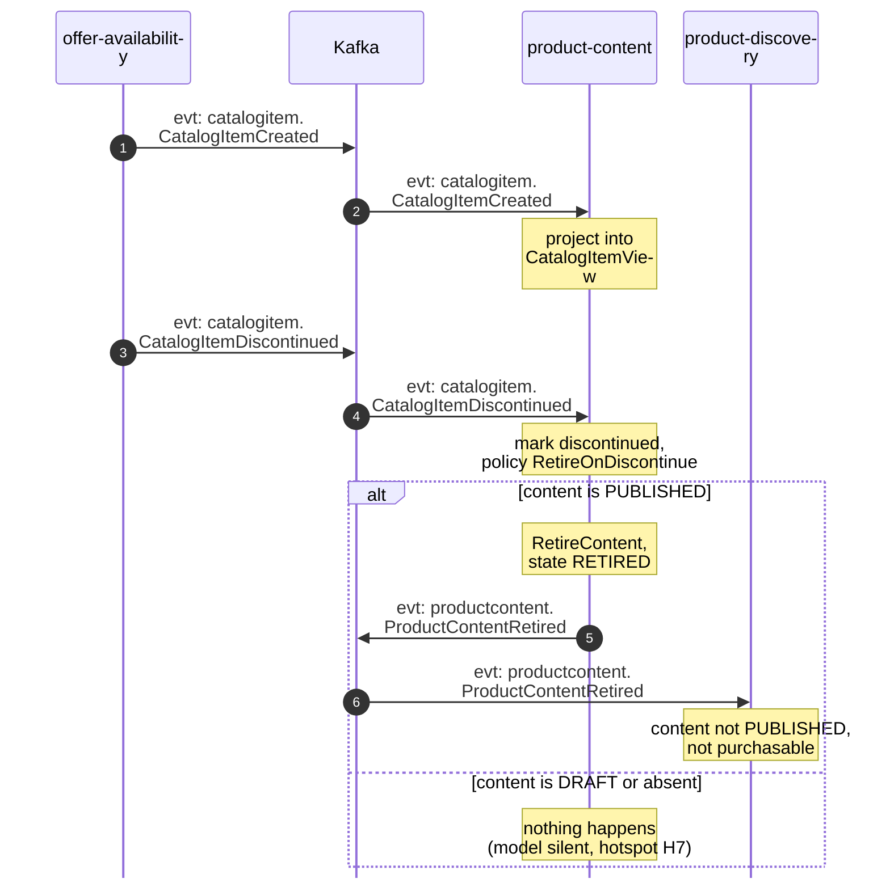
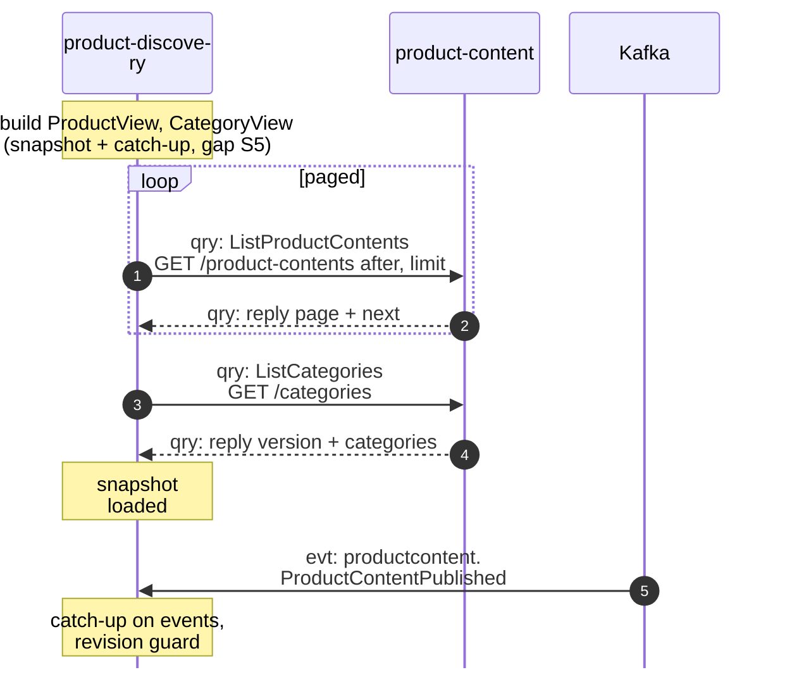

# Domain Message Flow

:::info[Built on develop, not deployed]
Derived from [`model/model.yaml`](https://github.com/IQVO/warehouse-docs/blob/main/storefront/model/model.yaml). The `product-content` service is built on develop ([`IQVO/product-content`](https://github.com/IQVO/product-content) at `2f09dc0`, checked 2026-10-27) and not deployed (no warehouse-infra entry). Every `Err...` name, REST route and CloudEvents type of this context named on this page exists in the service; where the built service differs from the model's design, the page says so (**As built**) or the context's [Service and operations](/storefront/contexts/product-content#service-and-operations) section lists it.
:::

Following ddd-crew [Domain Message Flow Modelling](https://github.com/ddd-crew/domain-message-flow-modelling).
Five scenarios. Participants are contexts and actors. Every arrow is a
message from the model, prefixed `cmd:` (command), `qry:` (query) or `evt:`
(event). A `Note` names a command a context runs on itself. Kafka is drawn
as one participant. Event names are written `entity.EventName`; the full
type is `com.retailnetwork.<tier>.<producer>.<entity>.<EventName>` (see
[Domain Events](/storefront/contexts/product-content/domain-events)). REST path
parameters are written without braces. The storefront-wide relationships are on
the [Context Map](/storefront/strategic-design/context-map).

## 1. Author and publish content

Derived from: `model.yaml → contexts[product-content].inbound`,
`.aggregates[ProductContent].transitions`, `.invariants`, `.publishes`;
`contexts[product-discovery].consumes`.

Omitted: the outbox write and relay (the event leaves after the commit; see
[Sequence Diagrams](/storefront/contexts/product-content/sequence-diagrams)); the
`Idempotency-Key` handling; how the item reached `CatalogItemView`
(scenario 4's topic, `CatalogItemCreated`).

## 2. Publish rejected: incomplete content (failure path)

Derived from: `model.yaml → contexts[product-content].aggregates[ProductContent].invariants`
(`ErrIncompleteContent`, `ErrUnknownCategory`, `ErrContentRetired`);
`apis/product-content/openapi.yaml` (`:publish` responses).

Omitted: the correction loop (the manager edits and publishes again; with
the model as written, a DRAFT is corrected by creating the full content —
hotspot H1 on [EventStorming](/storefront/contexts/product-content/eventstorming)).

## 3. Edit the tree and publish it

Derived from: `model.yaml → contexts[product-content].aggregates[CategoryTree].commands`,
`.transitions`, `.publishes[CategoryTreePublished]`;
`contexts[product-discovery].consumes`.

Omitted: the structural errors (`ErrCategoryCycle`, `ErrMaxDepth`,
`ErrDuplicateSiblingName`) each edit can fail with. The edits raise no
event: the tree crosses the boundary only at publication. The
`PublishCategoryTree` arrow has no route because the model names no inbound
row for it (hotspot H6).

## 4. Item discontinued: retire the content

Derived from: `model.yaml → contexts[product-content].consumes`,
`.read_models[CatalogItemView]`, `.policies[RetireOnDiscontinue]`,
`.publishes[ProductContentRetired]`.

Omitted: the inbox on the CloudEvents `id`. The item's own lifecycle
(ACTIVE, discontinued) is `offer-availability`'s; see its
[pack](/network/contexts/offer-availability).

## 5. Projection bootstrap: product-discovery reads the snapshot

Derived from: `model.yaml → contexts[product-content].inbound` (the
`product-discovery` query row), `.rest`;
`contexts[product-discovery].business_decisions` (bootstrap is snapshot +
catch-up), `.sync_calls` (`ListProductContents`).

Omitted: the other bootstrap reads `product-discovery` does against
`offer-availability` and `pricing`; they are not this context's messages.
`GetProductContent` (single item) is the same shape as one page of the
list and is not drawn separately.
