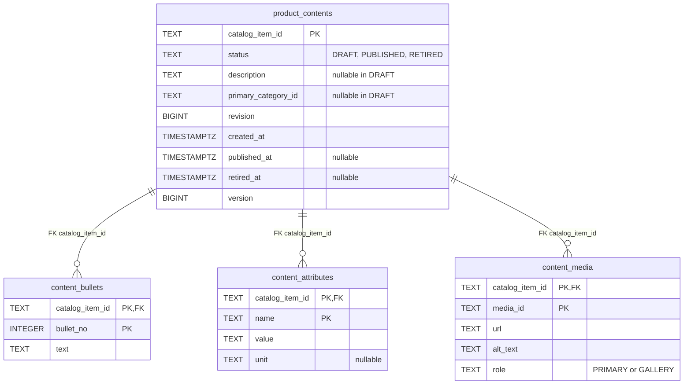
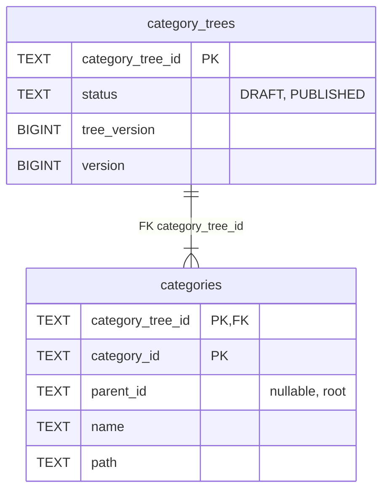
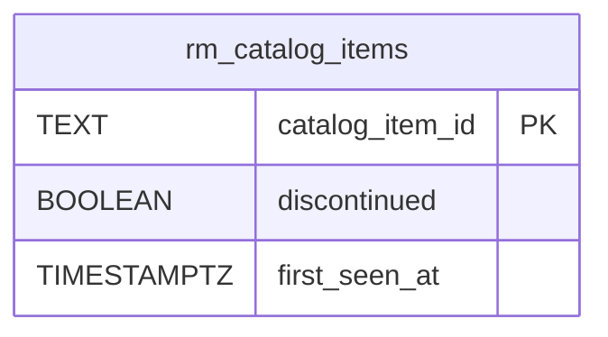
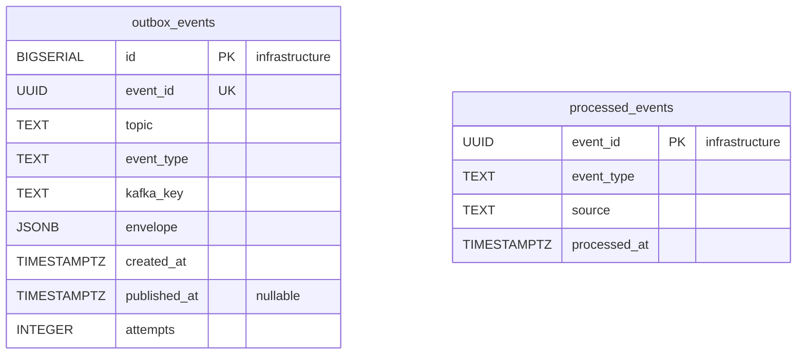
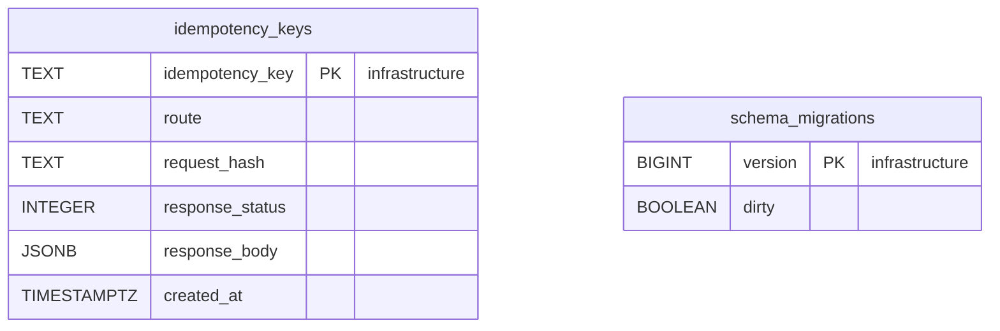

# Entity Relationship

:::info[Proposed design]
Derived from [`model/model.yaml`](https://github.com/IQVO/warehouse-docs/blob/main/storefront/model/model.yaml). Nothing in this context is built; the model carries the proposed contracts, and identifiers (`Err...` names, routes, CloudEvents types) are the names a future implementation must use.
:::

The **proposed** Postgres schema. Product Content owns its database and
shares no table with any other context (`conventions.integration_rules`).
Column names are the model's field names in `snake_case`. A relationship line
is drawn **only** inside one aggregate. The schema holds no PII and no item
master data: `catalog_item_id` is a reference by value.

## Aggregate tables

### ProductContent

### CategoryTree

Derived from: `model.yaml → contexts[product-content].aggregates[ProductContent].description`
(description, bullets, attributes, media, `primaryCategoryId`, `revision`),
`.states`; `.aggregates[CategoryTree].description`, `.value_objects`
(`Category{categoryId, parentId?, name, path}`), `.states`;
`apis/product-content/openapi.yaml` (`revision` minimum 1, media `role`
enum).

Column notes: `product_contents.status` holds the three `ProductContent`
states; `revision` is the published-shape counter `product-discovery`
orders by; `version` on both roots is the optimistic-concurrency counter
every save checks; `tree_version` is the published tree version the
`CategoryTreePublished` event carries; `categories.parent_id` points inside
the same aggregate; `categories.path` is the materialized browse path,
recomputed on move and rename. `content_attributes` is keyed by
`name` per item: the model's value object has no own identity.

Omitted: indexes (for example on `content_media.catalog_item_id` it is the
PK prefix already) and `CHECK` constraints (for example
`role IN ('PRIMARY','GALLERY')`, depth at most 4). The publication
timestamps are this pack's reading of what the REST read returns; the model
lists `revision` but no timestamps.

## Read model tables

Derived from: `model.yaml → contexts[product-content].read_models[CatalogItemView]`
and `.consumes` (fields declared: `catalogItemId`).

`rm_catalog_items` is disposable. It can be truncated and rebuilt by
replaying `retailnetwork.offer-availability.events` (or, past topic
retention, by the network's paged catalogue read — gap S5's snapshot
pattern). It keeps only what the invariants and the policy need: that the
item exists, and whether it is discontinued. The title and dimensions the
`CatalogItemCreated` event also carries are dropped at the projector.

## Infrastructure tables

Derived from: `model.yaml → conventions.integration_rules` (transactional
outbox, idempotent consumers, `Idempotency-Key` on every write route);
`conventions.cloudevents` (topic, type, key).

**All four tables are infrastructure, not domain tables.** `outbox_events`
is the transactional outbox. It is written in the same transaction as the
aggregate and drained by the relay to
`retailnetwork.product-content.events`. `event_id` is the CloudEvents `id`,
`event_type` the full type, and `kafka_key` the `catalogItemId` or
`categoryTreeId`. `processed_events` is the inbox, one row per consumed
CloudEvents `id`, written in the same transaction as the effect.
`idempotency_keys` stores the response of every state-changing `POST` for
replay. `schema_migrations` is the migration tool's bookkeeping.

## Why there are no foreign keys across aggregates or contexts

- `product_contents.primary_category_id` → `categories.category_id` is a
  reference **by value**. `ProductContent` and `CategoryTree` are separate
  aggregates with separate transactions; the `ErrUnknownCategory` check is
  done in the use case, not by the database. An FK would lock the tree row
  on every content write.
- `product_contents.catalog_item_id` and `rm_catalog_items.catalog_item_id`
  point into **another context's** model (`offer-availability`). No
  database is shared, so these are values copied from messages. The FK
  between `product_contents` and `rm_catalog_items` is also skipped on
  purpose: content may be created the moment the projection row lands, and
  the existence rule is the aggregate's, enforced through the view.
- The read-model table has no FK at all. It is rebuilt from events and may
  briefly lag the item master.

## Table ≠ aggregate

| Table | Aggregate / role | Notes |
| --- | --- | --- |
| `product_contents` | **ProductContent** (root) | One row per catalogue item, with `revision` for the consumer guard and `version` for optimistic concurrency. |
| `content_bullets` | **ProductContent** (bullets) | Ordered by `bullet_no`; replaced wholesale by `ReviseContent`. |
| `content_attributes` | **ProductContent** (`Attribute` value objects) | Keyed by `name` per item; replaced wholesale by `ReviseContent`. |
| `content_media` | **ProductContent** (`Media` value objects) | Exactly one `PRIMARY` row when the gate passes; the check is the aggregate's. |
| `category_trees` | **CategoryTree** (root) | One row; `tree_version` bumps on publication. |
| `categories` | **CategoryTree** (`Category` value objects) | Written by `CreateCategory`, `MoveCategory`, `RenameCategory`, always with the root's `version`. |
| `rm_catalog_items` | none (read model `CatalogItemView`) | Serves `ErrUnknownCatalogItem` and `RetireOnDiscontinue`. |
| `outbox_events` | none (infrastructure) | Transactional outbox. |
| `processed_events` | none (infrastructure) | Inbox for idempotent consumers. |
| `idempotency_keys` | none (infrastructure) | `Idempotency-Key` replay store. |
| `schema_migrations` | none (infrastructure) | Migration bookkeeping. |
