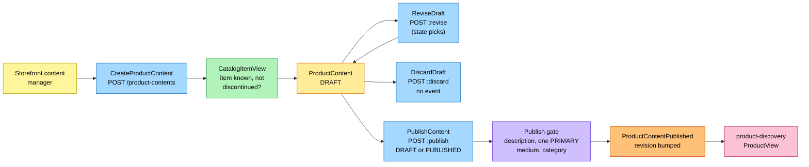
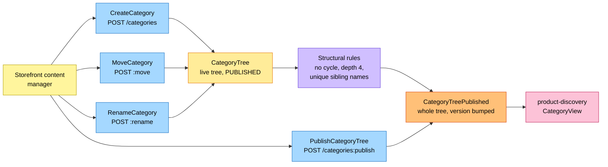

# EventStorming

:::info[Built on develop, not deployed]
Derived from [`model/model.yaml`](https://github.com/IQVO/warehouse-docs/blob/main/storefront/model/model.yaml). The `product-content` service is built on develop ([`IQVO/product-content`](https://github.com/IQVO/product-content) at `2f09dc0`, checked 2026-10-27) and not deployed (no warehouse-infra entry). Every `Err...` name, REST route and CloudEvents type of this context named on this page exists in the service; where the built service differs from the model's design, the page says so (**As built**) or the context's [Service and operations](/storefront/contexts/product-content#service-and-operations) section lists it.
:::

Process-level boards in the ddd-crew
[EventStorming glossary & cheat sheet](https://github.com/ddd-crew/eventstorming-glossary-cheat-sheet)
notation. Every sticky comes from `model.yaml`. Events published by a
neighbour are drawn as orange stickies prefixed with the producer. Every
hotspot is a gap or a risk the model itself shows, and its source is given in
the hotspot table. The boards are drawn left to right and kept narrow to fit
the page width.

## Legend

| Colour | Sticky | Meaning here |
| --- | --- | --- |
| Pale yellow `#fff59d` | Actor | The storefront content manager |
| Blue `#a5d8ff` | Command | A command from `aggregates[*].commands` |
| Yellow `#ffec99` | Aggregate | `ProductContent` or `CategoryTree` |
| Orange `#ffc078` | Domain Event | Ours (`publishes`) or a neighbour's (`consumes`, prefixed with the producer) |
| Lilac `#d0bfff` | Policy | `RetireOnDiscontinue`, or the publish gate |
| Green `#b2f2bb` | Read Model | `CatalogItemView`, or the bootstrap reads |
| Pink `#fcc2d7` | External System | A sibling context |
| Red `#ff8787` | Hotspot | A gap or risk in the model (see the table at the end) |

## 1. Authoring and publishing content

Derived from: `model.yaml → contexts[product-content].aggregates[ProductContent]`
(`commands`, `invariants`, `transitions`), `.read_models`, `.publishes`;
`contexts[product-discovery].consumes`.

A DRAFT is editable (`ReviseDraft`, `DRAFT → DRAFT`, new revision) and
discardable (`DiscardDraft`, `DRAFT → RETIRED` with reason `DISCARDED`, no
event because nothing was ever published). Re-publication after a revision is
`PUBLISHED → PUBLISHED` through `PublishContent`, carrying the new revision in
`ProductContentPublished`.

Omitted: `ReviseContent` (`PUBLISHED → PUBLISHED`, no event; the revised
content leaves the boundary on the next `PublishContent`), `RetireContent` by
hand (board 3 shows the policy variant), the invariant errors
(`ErrUnknownCatalogItem`, `ErrItemDiscontinued`, `ErrUnknownCategory`,
`ErrIncompleteContent`, `ErrContentRetired`, `ErrTooManyBullets`,
`ErrTooManyAttributes`, `ErrTooManyMedia`), the outbox, and the
`Idempotency-Key` handling on every route.

## 2. Category tree maintenance and publication

Derived from: `model.yaml → contexts[product-content].aggregates[CategoryTree]`
(`commands`, `invariants`, `transitions`, `notes`), `.rest`, `.inbound`.

The tree is a single published aggregate with no draft state: every command
applies to the live tree and publishes a new version, carrying the whole tree
under one `version`. `PublishCategoryTree` re-publishes the live tree
unchanged so consumers can resync. There is no remove-category command by
design: categories are only renamed or moved, and `ErrCategoryInUse` guards a
future removal.

Omitted: the structural errors (`ErrCategoryCycle`, `ErrMaxDepth`,
`ErrDuplicateSiblingName`), and the path recomputation a move or rename
triggers.

## 3. Retirement on discontinue

Derived from: `model.yaml → contexts[product-content].consumes`,
`.policies[RetireOnDiscontinue]`, `.aggregates[ProductContent].transitions`,
`.invariants` (`ErrUnknownCatalogItem`, `ErrItemDiscontinued`).

`RetireOnDiscontinue` moves a DRAFT to RETIRED too (reason `DISCONTINUED`, no
event, since nothing was published), and a discontinued item can never
publish (`ErrItemDiscontinued` on `CreateProductContent` and `PublishContent`).

Omitted: the inbox on the CloudEvents `id`, and `CatalogItemCreated`, which
only feeds the view. The shopper-facing consequence (the item stops being
purchasable) is `product-discovery`'s verdict from its own Purchasable rule,
not a message from this context.

## Hotspots

| # | Hotspot | Where it comes from in the model |
| --- | --- | --- |
| H1 | **Resolved in the model-fix:** a DRAFT is editable and discardable. `ReviseDraft` (`DRAFT → DRAFT`, new revision, `POST .../{catalogItemId}:revise`; **as built** the one `:revise` route serves both revisions and the state picks the command) and `DiscardDraft` (`DRAFT → RETIRED`, reason `DISCARDED`, `POST .../{catalogItemId}:discard`, no event because nothing was ever published). | `aggregates[ProductContent].transitions`, `.commands`, `.notes` |
| H2 | **Resolved in the model-fix:** re-publication is the transition `PUBLISHED → PUBLISHED` via `PublishContent`, carrying a new `revision` in `ProductContentPublished` (the revise-then-publish-again path). | `aggregates[ProductContent].transitions`, `publishes[ProductContentPublished]` |
| H3 | **Resolved in the model-fix:** by design there is no remove-category command; categories are only renamed or moved. `ErrCategoryInUse` stays as the guard of a future removal and is no longer mapped to `:move`. | `aggregates[CategoryTree].invariants`, `.notes` |
| H4 | **Resolved in the model-fix:** `ErrTooManyBullets`, `ErrTooManyAttributes` and `ErrTooManyMedia` (limits 10, 50, 12) join the `ProductContent` invariants. | `aggregates[ProductContent].invariants` |
| H5 | **Resolved in the model-fix:** the `CategoryTree` is a single published aggregate with no draft state. Every command applies to the live tree and publishes a new version; the DRAFT/PUBLISHED tree-state reading is removed. | `aggregates[CategoryTree].states`, `.transitions`, `.notes` |
| H6 | **Resolved in the model-fix:** `PublishCategoryTree` gets the route `POST /categories:publish` (content manager, cmd channel) and an inbound row. | `contexts[product-content].rest`, `.inbound` |
| H7 | **Resolved in the model-fix:** `RetireOnDiscontinue` also moves a DRAFT to RETIRED (reason `DISCONTINUED`, no event); a discontinued item can never publish. | `policies[RetireOnDiscontinue]` |
| H8 | **Resolved in the model-fix:** `ErrItemDiscontinued` is added to `CreateProductContent` and `PublishContent`; the local `CatalogItemView` knows the state. | `aggregates[ProductContent].invariants` |
