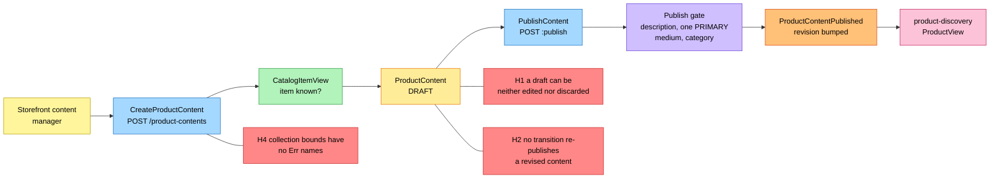
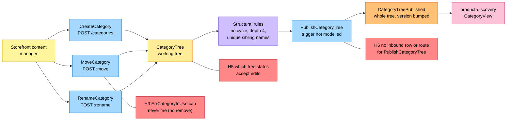
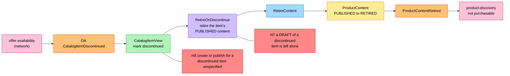

# EventStorming

:::info[Proposed design]
Derived from [`model/model.yaml`](https://github.com/IQVO/warehouse-docs/blob/main/storefront/model/model.yaml). Nothing in this context is built; the model carries the proposed contracts, and identifiers (`Err...` names, routes, CloudEvents types) are the names a future implementation must use.
:::

Process-level boards in the ddd-crew
[EventStorming glossary & cheat sheet](https://github.com/ddd-crew/eventstorming-glossary-cheat-sheet)
notation. Every sticky comes from `model.yaml`. Events published by a
neighbour are drawn as orange stickies prefixed with the producer. Every
hotspot is a gap or a risk the model itself shows, and its source is given in
the hotspot table. The boards are drawn left to right and kept narrow to fit
the page width.

## Legend

| Colour | Sticky | Meaning here |
| --- | --- | --- |
| Pale yellow `#fff59d` | Actor | The storefront content manager |
| Blue `#a5d8ff` | Command | A command from `aggregates[*].commands` |
| Yellow `#ffec99` | Aggregate | `ProductContent` or `CategoryTree` |
| Orange `#ffc078` | Domain Event | Ours (`publishes`) or a neighbour's (`consumes`, prefixed with the producer) |
| Lilac `#d0bfff` | Policy | `RetireOnDiscontinue`, or the publish gate |
| Green `#b2f2bb` | Read Model | `CatalogItemView`, or the bootstrap reads |
| Pink `#fcc2d7` | External System | A sibling context |
| Red `#ff8787` | Hotspot | A gap or risk in the model (see the table at the end) |

## 1. Authoring and publishing content

Derived from: `model.yaml → contexts[product-content].aggregates[ProductContent]`
(`commands`, `invariants`, `transitions`), `.read_models`, `.publishes`;
`contexts[product-discovery].consumes`.

Omitted: `ReviseContent` (`PUBLISHED → PUBLISHED`, no event; it is the
subject of hotspot H2), `RetireContent` by hand (board 3 shows the policy
variant), the invariant errors (`ErrUnknownCatalogItem`,
`ErrUnknownCategory`, `ErrIncompleteContent`, `ErrContentRetired`), the
outbox, and the `Idempotency-Key` handling on every route.

## 2. Category tree maintenance and publication

Derived from: `model.yaml → contexts[product-content].aggregates[CategoryTree]`
(`commands`, `invariants`, `transitions`, `notes`), `.rest`, `.inbound`.

Omitted: the structural errors (`ErrCategoryCycle`, `ErrMaxDepth`,
`ErrDuplicateSiblingName`), and the path recomputation a move or rename
triggers. Edits raise no event; the tree leaves the boundary only at
publication, carrying the whole tree under one `version`.

## 3. Retirement on discontinue

Derived from: `model.yaml → contexts[product-content].consumes`,
`.policies[RetireOnDiscontinue]`, `.aggregates[ProductContent].transitions`,
`.invariants` (`ErrUnknownCatalogItem`).

Omitted: the inbox on the CloudEvents `id`, and `CatalogItemCreated`, which
only feeds the view. The shopper-facing consequence (the item stops being
purchasable) is `product-discovery`'s verdict from its own Purchasable rule,
not a message from this context.

## Hotspots

| # | Hotspot | Where it comes from in the model |
| --- | --- | --- |
| H1 | A DRAFT can be neither edited nor discarded: no `DRAFT → DRAFT` transition (`ReviseContent` is `PUBLISHED → PUBLISHED`) and no `DRAFT → RETIRED`. The proposed API answers by taking the full content in the create call. | `aggregates[ProductContent].transitions` |
| H2 | Re-publication after a revision has no transition: `PublishContent` is `DRAFT → PUBLISHED` only, yet the proposed API says a revision bumps "once published again" and `product-discovery` orders content by `revision`, so a revised PUBLISHED content must somehow emit a new `ProductContentPublished`. | `aggregates[ProductContent].transitions`, `publishes[ProductContentPublished].data`; `contexts[product-discovery].read_models` |
| H3 | `ErrCategoryInUse` guards removing a category in use by PUBLISHED content, but no command removes a category. The proposed API nonetheless maps `category-in-use` to `:move`. | `aggregates[CategoryTree].invariants` vs `.commands`; `apis/product-content/openapi.yaml` |
| H4 | The bounds on bullets (at most 10), attributes (at most 50) and media (at most 12) have no `Err` names; the proposed API enforces them as `validation-failed`. | `aggregates[ProductContent].description` vs `.invariants` |
| H5 | The description says categories are created, moved and renamed "between publications", but no transition ties the edit commands to a state, and the tree's states (DRAFT, PUBLISHED) are themselves the least-surprising reading of "single, versioned" (the model note says the plan names no states). | `aggregates[CategoryTree].description`, `.transitions`, `.notes` |
| H6 | `PublishCategoryTree` has a command, a transition and an event, but no `inbound` row and no REST route triggers it. | `aggregates[CategoryTree].commands` vs `inbound` and `rest` |
| H7 | `RetireOnDiscontinue` retires only PUBLISHED content; the model does not say what happens to a DRAFT of a discontinued item. | `policies[RetireOnDiscontinue]` |
| H8 | `ErrUnknownCatalogItem` checks existence in `CatalogItemView` without excluding discontinued items, so whether content may still be created or published for a discontinued item is unspecified. | `aggregates[ProductContent].invariants` |
