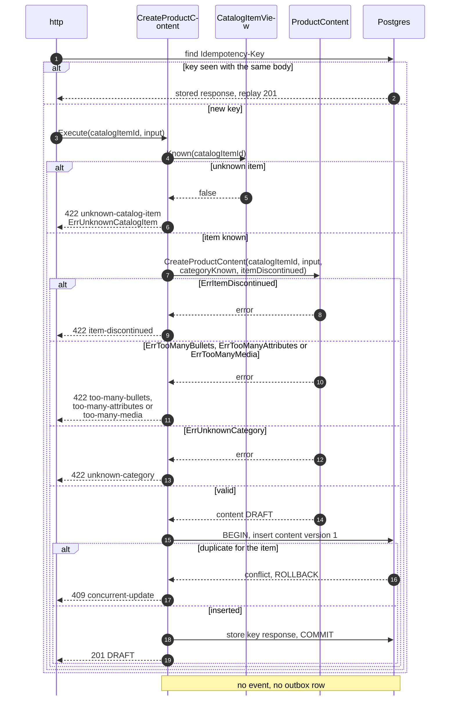
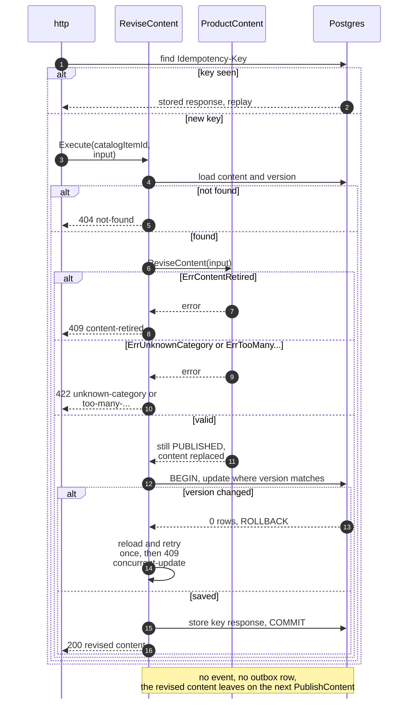
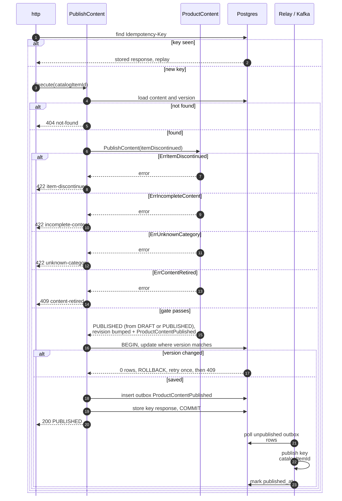
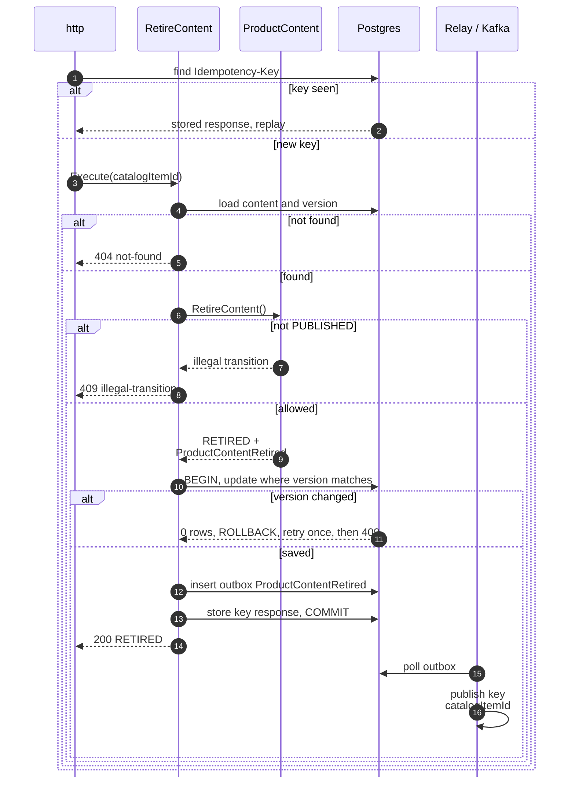
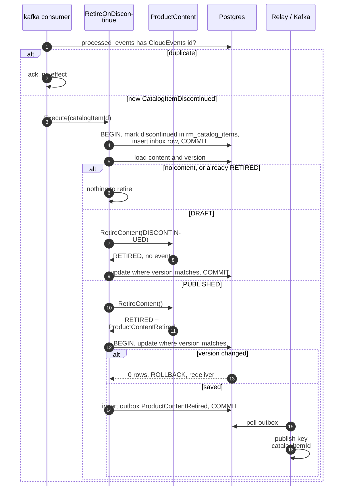
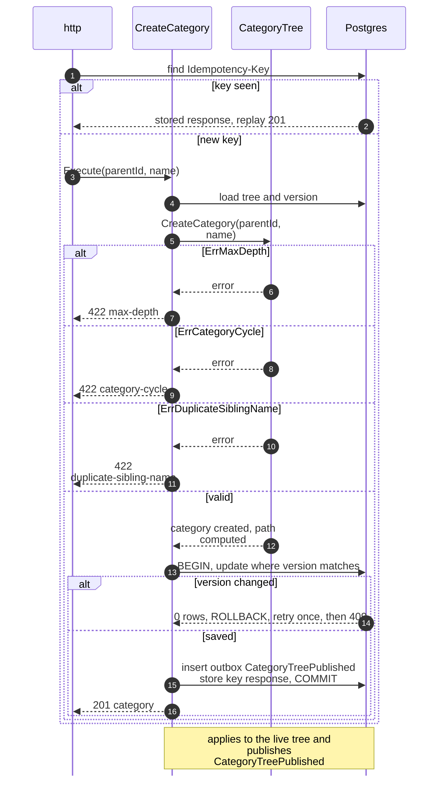
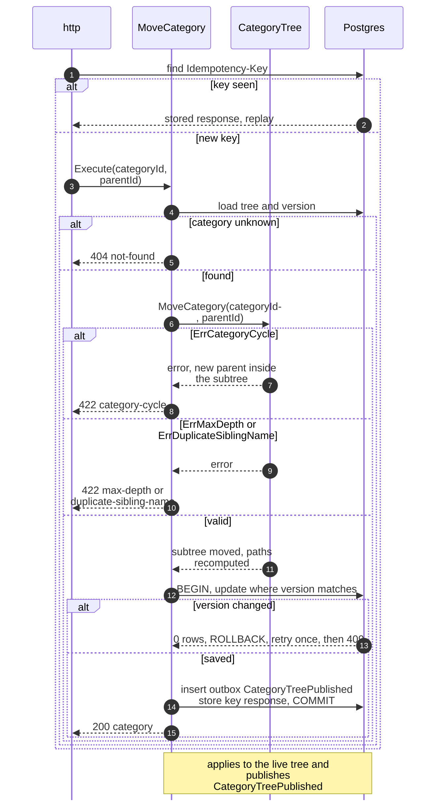
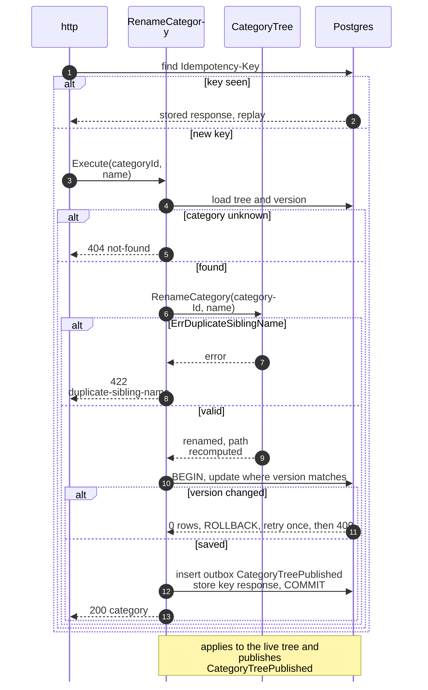
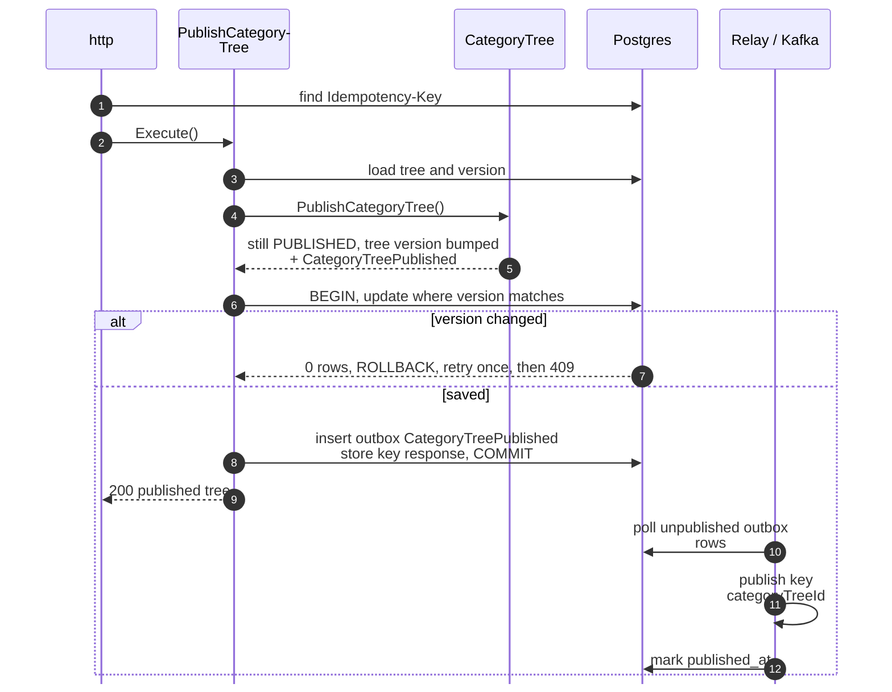
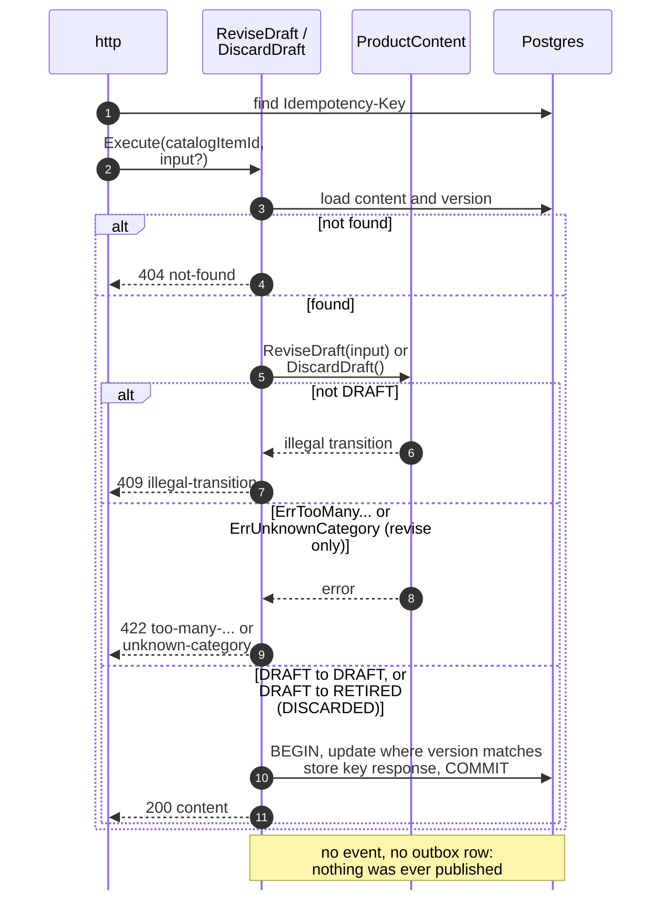

# Sequence Diagrams

:::info[Proposed design]
Derived from [`model/model.yaml`](https://github.com/IQVO/warehouse-docs/blob/main/storefront/model/model.yaml). Nothing in this context is built; the model carries the proposed contracts, and identifiers (`Err...` names, routes, CloudEvents types) are the names a future implementation must use.
:::

One UML sequence diagram per command use case on
[Use Cases](/storefront/contexts/product-content/use-cases). Participant names are the
proposed packages and ports from the
[Class Diagram](/storefront/contexts/product-content/class-diagram):

- `http` and `kafka` are the inbound adapters.
- The use case is in `internal/application/usecases`.
- `Postgres` stands for the repositories, the catalog item store, the
  outbox, the inbox and the idempotency store. They share one transaction
  through `UnitOfWork`.
- `Relay / Kafka` is the outbox relay. It reads committed `outbox_events`
  rows and publishes them to `retailnetwork.product-content.events`.

Every save is conditional on the loaded `version` (optimistic concurrency).
Full CloudEvents types are on [Domain Events](/storefront/contexts/product-content/domain-events).

## 1. CreateProductContent (REST POST /product-contents)

Derived from: `model.yaml → contexts[product-content].aggregates[ProductContent]`
(`CreateProductContent`, `ErrUnknownCatalogItem`, `ErrItemDiscontinued`,
`ErrTooManyBullets`, `ErrTooManyAttributes`, `ErrTooManyMedia`,
`ErrUnknownCategory`),
`.read_models`; `apis/product-content/openapi.yaml`.

Omitted: the schema validation (422 validation-failed), which happens in the
adapter before the use case. A lagging
`CatalogItemView` rejects content for a brand-new item: the manager retries
after the projection catches up.

## 2. ReviseContent (REST POST /product-contents/catalogItemId:revise)

Derived from: `model.yaml → contexts[product-content].aggregates[ProductContent]`
(`ReviseContent`, `ErrContentRetired`, `ErrUnknownCategory`, transitions).

Omitted: the DRAFT case, which is `ReviseDraft` (diagram 10). The revision
reaches `product-discovery` through the next `PublishContent`
(`PUBLISHED → PUBLISHED`, diagram 3).

## 3. PublishContent (REST POST /product-contents/catalogItemId:publish)

Derived from: `model.yaml → contexts[product-content].aggregates[ProductContent]`
(`PublishContent`, `ErrItemDiscontinued`, invariants, transitions
`DRAFT → PUBLISHED` and `PUBLISHED → PUBLISHED`),
`.publishes[ProductContentPublished]`;
`conventions.integration_rules`.

Omitted: nothing beyond the shared notes at the top.

## 4. RetireContent by the content manager (REST POST .../catalogItemId:retire)

Derived from: `model.yaml → contexts[product-content].aggregates[ProductContent]`
(`RetireContent`, transitions), `.publishes[ProductContentRetired]`.

Omitted: the relay marking the row published (as in diagram 3). A DRAFT
is not retired by hand: it is discarded with `DiscardDraft` (diagram 10).

## 5. RetireContent by policy (Kafka CatalogItemDiscontinued)

Derived from: `model.yaml → contexts[product-content].policies[RetireOnDiscontinue]`,
`.consumes` (`CatalogItemDiscontinued`), `.publishes[ProductContentRetired]`.

Omitted: the `CatalogItemCreated` projection (same shape, no policy branch,
no outbox row). The view update commits before the content load so a crash
in between is healed by the replay.

## 6. CreateCategory (REST POST /categories)

Derived from: `model.yaml → contexts[product-content].aggregates[CategoryTree]`
(`CreateCategory`, invariants); `apis/product-content/openapi.yaml`.

Omitted: the 404 for an unknown `parentId` (the proposed API lists no
not-found on create; a missing parent fails validation).

## 7. MoveCategory (REST POST /categories/categoryId:move)

Derived from: `model.yaml → contexts[product-content].aggregates[CategoryTree]`
(`MoveCategory`, invariants); `apis/product-content/openapi.yaml`.
`ErrCategoryInUse` is not raised: there is no remove-category command by
design, and the guard is for a future removal.

Omitted: nothing beyond the shared notes.

## 8. RenameCategory (REST POST /categories/categoryId:rename)

Derived from: `model.yaml → contexts[product-content].aggregates[CategoryTree]`
(`RenameCategory`, `ErrDuplicateSiblingName`).

Omitted: nothing beyond the shared notes.

## 9. PublishCategoryTree (REST POST /categories:publish)

Derived from: `model.yaml → contexts[product-content].aggregates[CategoryTree]`
(`PublishCategoryTree`, transitions), `.publishes[CategoryTreePublished]`.

Omitted: nothing beyond the shared notes. `PublishCategoryTree` re-publishes
the live tree unchanged so consumers can resync; the structural invariants need
no re-check at publication: they hold for the live tree at all times.

## 10. ReviseDraft and DiscardDraft (REST POST .../catalogItemId:revise-draft, :discard)

Derived from: `model.yaml → contexts[product-content].aggregates[ProductContent]`
(`ReviseDraft`, `DiscardDraft`, transitions `DRAFT → DRAFT` and
`DRAFT → RETIRED`); `apis/product-content/openapi.yaml`.

Omitted: the optimistic-concurrency retry, as in diagram 2.
