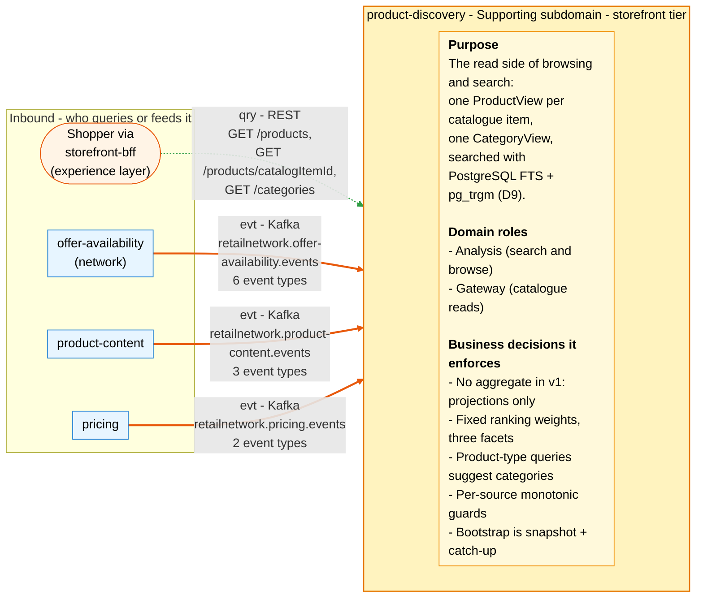
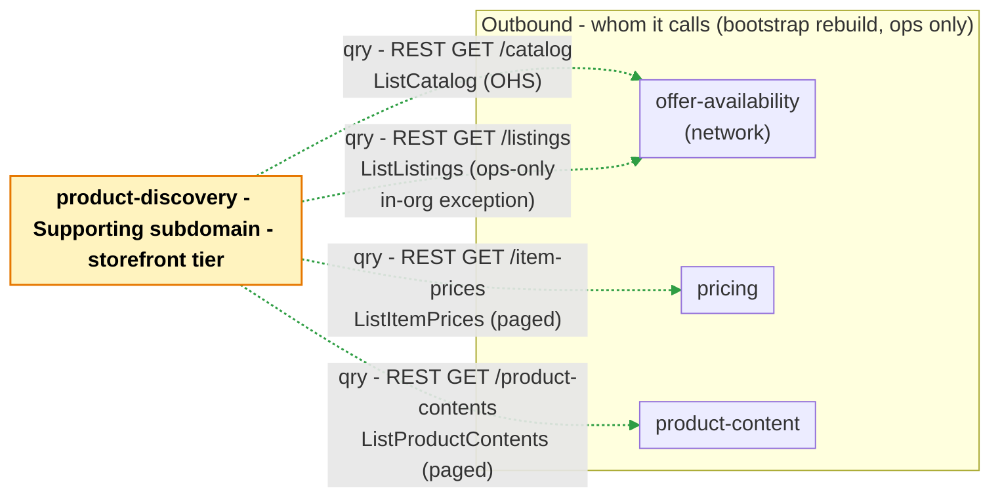

# Bounded Context Canvas

:::info[Built on develop, not deployed]
Derived from [`model/model.yaml`](https://github.com/IQVO/warehouse-docs/blob/main/storefront/model/model.yaml). The `product-discovery` service is built on develop ([`IQVO/product-discovery`](https://github.com/IQVO/product-discovery) at `9c2f945`, checked 2026-10-27) and not deployed (no warehouse-infra entry). Every `Err...` name, REST route and CloudEvents type of this context named on this page exists in the service; where the built service differs from the model's design, the page says so (**As built**) or the context's [Service and operations](/storefront/contexts/product-discovery#service-and-operations) section lists it.
:::

Following the ddd-crew [Bounded Context Canvas v5](https://github.com/ddd-crew/bounded-context-canvas).
Every message row comes from `contexts[product-discovery]` (`inbound`,
`consumes`, `rest`, `sync_calls`; `publishes` is empty) or from a
neighbour's entry that names this context. This is a **read-only context**:
no command arrives, no event leaves.

## Canvas at a glance

Two pictures of the sections below, laid out like the ddd-crew canvas:
first the inbound collaborators feeding this context (purpose, domain roles
and the business decisions it enforces), then the outbound collaborators it
calls. Arrows follow the message type: **solid blue** commands (`cmd`),
**dotted green** queries (`qry`), **thick orange** events (`evt`); each
arrow names its channel and the messages it carries. Box shapes mark the
collaborator kind: rounded = people, UI or any client; blue = sibling
bounded context. Channel names on the arrows are abbreviated; the Inbound
and Outbound Communication tables carry the exact route, topic and
CloudEvents type for every message.

### Inbound

### Outbound

Derived from: `model.yaml → contexts[product-discovery].inbound`,
`.rest`, `.sync_calls`; `publishes: []`.

The diagrams omit assumptions, verification metrics, open questions and the
ubiquitous language (sections below), the relationship pattern per message
(see the tables), and the query replies. The four outbound arrows exist
**only on the ops-run projection rebuild** (snapshot + catch-up, business
decision 5); none of them runs on a shopper request. There is no command
inbound and no event outbound: `aggregates: []` and `publishes: []` — the
outbound picture has no Kafka arrow at all, and no `.analytics` topic is
ever written.

## Name

**Product Discovery** (`product-discovery`, code `PD`, CloudEvents tier
`storefront`).

## Purpose

The read side of browsing and search. The context keeps one **ProductView**
per catalogue item — title, flags, content, category path, list and
effective price, `inStock`, `purchasable` — and one **CategoryView** — the
browsable tree plus purchasable counts — both event-fed from
`offer-availability`, `product-content` and `pricing`, both searched with
PostgreSQL full-text search plus `pg_trgm` similarity (D9) behind a port so
a dedicated engine is a later adapter swap.

## Strategic Classification

| Axis | Verdict |
| --- | --- |
| **Domain** | **Supporting** subdomain, "Core candidate at scale". See the [Core Domain Chart](/storefront/contexts/product-discovery/core-domain-chart). |
| **Business Model** | Conversion enabler (finding the right purchasable item fast). |
| **Evolution** | Custom-built (the search engine slice designed for swap). |

## Domain Roles

| Role | Applies? | Evidence in the model |
| --- | --- | --- |
| **Analysis (search and browse)** | **Yes, primary** | The `ProductView`/`CategoryView` projections and the search decision set (weights, facets, typo fallback, category suggestions). |
| **Gateway (the storefront's catalogue reads)** | **Yes** | The only shopper-facing catalogue surface: the three `rest` routes the experience layer calls; no other storefront context serves a catalogue read. |
| Execution | No | No command, no state machine, no transactional flow (`aggregates: []`). |
| Specification | No | It owns no rule of its own; prices, content and availability are the upstreams' facts. |

## Inbound Communication

| Collaborator | Message | Type | Channel | Relationship |
| --- | --- | --- | --- | --- |
| `storefront-bff` (experience layer) | `SearchProducts`, `GetProduct`, `ListCategories` | Query | REST `GET /products`, `GET /products/{catalogItemId}`, `GET /categories` | OHS (this context is the host) |
| `offer-availability` | `CatalogItemCreated`, `CatalogItemDiscontinued`, `ListingCreated`, `ListingAvailabilityChanged`, `ListingSuppressed`, `ListingRestored` | Event | Kafka `retailnetwork.offer-availability.events` (`com.retailnetwork.commerce.offer-availability.*`) | Conformist |
| `product-content` | `ProductContentPublished`, `ProductContentRetired`, `CategoryTreePublished` | Event | Kafka `retailnetwork.product-content.events` (`com.retailnetwork.storefront.product-content.*`) | Conformist |
| `pricing` | `ItemPriceChanged`, `ItemPriceWithdrawn` | Event | Kafka `retailnetwork.pricing.events` (`com.retailnetwork.storefront.pricing.itemprice.*`) | Conformist |

## Outbound Communication

| Collaborator | Message | Type | Channel | Relationship |
| --- | --- | --- | --- | --- |
| `offer-availability` (network) | `ListCatalog` | Query | REST `GET /catalog` — bootstrap only (snapshot + catch-up) | Customer/Supplier (the network's Open Host Service) |
| `offer-availability` (network) | `ListListings` | Query | REST `GET /listings?nodeId=&catalogItemId=` — bootstrap only; ops-only, in-org read, **never on a user request** (the documented exception in `conventions.cross_model.ops_only_exceptions`) | (in-org read under a declared exception) |
| `pricing` | `ListItemPrices` | Query | REST `GET /item-prices` — bootstrap only (paged) | Customer/Supplier (we are the Customer) |
| `product-content` | `ListProductContents` | Query | REST `GET /product-contents` — bootstrap only (paged) | Customer/Supplier (we are the Customer) |

No events are published to any consumer, and the `retailnetwork.product-discovery.events`
and `.analytics` topics receive nothing: `publishes: []`. Full payload of
every consumed event: [Domain Events](/storefront/contexts/product-discovery/domain-events).
Relationship evidence: [Context Map](/storefront/contexts/product-discovery/context-map).

## Ubiquitous Language

Full glossary: [Ubiquitous Language](/storefront/contexts/product-discovery/ubiquitous-language).
Top terms: **Purchasable**, **Product View**, **Category View**, **In
Stock**, **Product-Type Query**.

## Business Decisions

1. **No aggregate in v1 — projections only.** The context's own ADR 0002
   will say so plainly. There is no state machine to get wrong; a wrong
   projection is rebuilt, not corrected by hand.
2. **Search ranks title (A), category names (A), attributes (B),
   description (C)** in a `tsvector` with a GIN index; `pg_trgm` similarity
   is the typo fallback; facets are category, price band and in-stock.
3. **Product-type queries also return category suggestions** (benchmark
   [6]): a search for a kind of product answers with categories to browse,
   not only items.
4. **Out-of-order safety comes from per-source monotonic guards** — listing
   `asOf`, content `revision`, price `version` — on top of the
   CloudEvents-id inbox. A late-arriving older fact never overwrites a
   newer one, even across a rebalance or a replay.
5. **Bootstrap is snapshot + catch-up**: paged OHS reads of the network
   catalogue and the storefront's own pricing and content, then events.
   Listing availability has no storefront OHS read, so the rebuild uses
   `GET /listings` as an in-org read on an ops-only path, **never on a user
   request**.

Plus two policies: **PurchasableRule** (`purchasable` = item ACTIVE in the
item master, content PUBLISHED, price ACTIVE, and at least one LIVE listing
with quantity above 0) and **UnavailableNotBuyable** (an item with no LIVE
listing with quantity above 0 is shown as currently unavailable;
out-of-stock purchase is impossible in this network — gap S6 on the
[Model Gap Register](/storefront/strategic-design/model-gap-register)).

## Assumptions

- `ListingSuppressed` and `ListingRestored` carry only `listingId` (this
  context declares it needs nothing else), so the projector keeps the
  listing-to-item mapping it learned from `ListingCreated`;
  `ListingAvailabilityChanged` carries `catalogItemId` itself and does not
  depend on that mapping.
- The three feeds are the only writers of the projections; a fact that
  arrives for an item whose `CatalogItemCreated` has not been consumed yet
  simply waits — the row exists from its first fact and fills in as the
  others land (there is no invariant to violate).
- `ItemPriceChanged` is consumed for `effectivePriceMinor` and `version`
  only; the configured currency is single (`conventions.integration_rules`),
  and `saleEndsAt`/`listPriceMinor` from the same event are the producer's
  concern (this pack reads the list price onto the page from the same
  event, because the `ProductView` purpose names it).
- Media URLs and attributes are copied as published; nothing here validates
  a URL (media upload is out of scope, as in `product-content`).
- The rebuild is an operator action on an ops-only path; every user request
  is served from the local projections and the search index, never from a
  synchronous call upstream.
- No consumer of this context exists to satisfy: no storefront context
  consumes a `product-discovery` topic, because none exists.

## Verification Metrics

| Metric | Target (proposed) | Source |
| --- | --- | --- |
| Consumer lag on each of the three consumed topics | below 30 s | Kafka consumer metrics |
| Projection freshness (event `time` to `product_views` update) | below 5 s p95 | projector traces |
| Guard regressions applied (an older `asOf`/`revision`/`version` overwriting a newer one) | 0 | projector logs |
| Inbox duplicates acknowledged without effect | tracked (rebalance/replay health) | `processed_events` inserts |
| p95 latency `GET /products` | below 200 ms | REST access log |
| p95 latency `GET /products/{catalogItemId}` | below 100 ms | REST access log |
| p95 latency `GET /categories` | below 100 ms | REST access log |
| Searches answered by the `pg_trgm` fallback alone | tracked (typo-rate signal, benchmark [6]) | search adapter metrics |
| Zero-result searches | tracked downward (benchmark [6]) | REST access log |
| `purchasable = true` rows whose join inputs disagree when recomputed | 0 (join is deterministic from the same rows) | periodic recompute sample |
| Bootstrap rebuild duration (snapshot + catch-up) | tracked per run, ops dashboard | rebuild job log |

## Open Questions

- **A category rename or move never reindexes the products.**
  `read_models[ProductView].source` does not list `CategoryTreePublished`,
  yet the `ProductView` purpose includes the category path and the search
  index weights category names (A). `CategoryView` consumes the new tree;
  the indexed `categoryPath` of every item under a renamed category does
  not change until some other event touches the item.
- **Two payload-declaration gaps.** The `ProductView` purpose and the
  API render bullets, media and the list price, yet the declared
  `consumes` fields name neither `bullets`/`media` (on
  `ProductContentPublished`) nor `listPriceMinor`/`currency` (on
  `ItemPriceChanged`); and `CategoryTreePublished` feeds `CategoryView`
  only, so a category rename never re-indexes the `categoryPath` the
  search weights at A. These pages copy the fields the purpose names and
  flag the declaration gap.
- **The product-type-query rule has no named policy.** Business decision 3
  and the UL term (**Product-Type Query**, code `(search policy)`) describe
  it, but `policies` lists only `PurchasableRule` and
  `UnavailableNotBuyable` — no detection rule, thresholds or parameters.
- **Price-band facet boundaries are unnamed.** Facets are "category, price
  band and in-stock" (decision 2); no band edges exist in the model.
  **As built** they are configuration: `PRICE_BAND_EDGES` (ascending minor
  units) in `cmd/api/config.go`.
- **The typo-fallback trigger is unspecified.** The model says `pg_trgm`
  similarity "is the typo fallback"; when it fires (this pack's reading:
  when full-text search returns too little) is not modelled.
- **The bootstrap snapshot shapes are not declared.** `ListCatalog`,
  `ListListings`, `ListItemPrices` and `ListProductContents` name no
  response fields in either model, so how the catch-up guards (listing
  `asOf`, content `revision`, price `version`) are seeded from the snapshot
  is unspecified.
- **`sync_calls` and the neighbours' rows disagree.** This context lists
  `ListProductContents` only against `product-content`, while
  `contexts[product-content].inbound` also names `GetProductContent` and
  `ListCategories` from `product-discovery`.
- **No search analytics.** `publishes: []` means query terms, zero-result
  and fallback rates are unobservable downstream — not even the
  `.analytics` topic the tier convention provides is written. Deliberate
  for v1, but the metrics table above then has no event source to feed a
  dashboard.
- **The `sort` values** (`relevance`, `price-asc`, `price-desc`, `title`)
  exist only in the API (as built too), not in the model's `rest` row.
