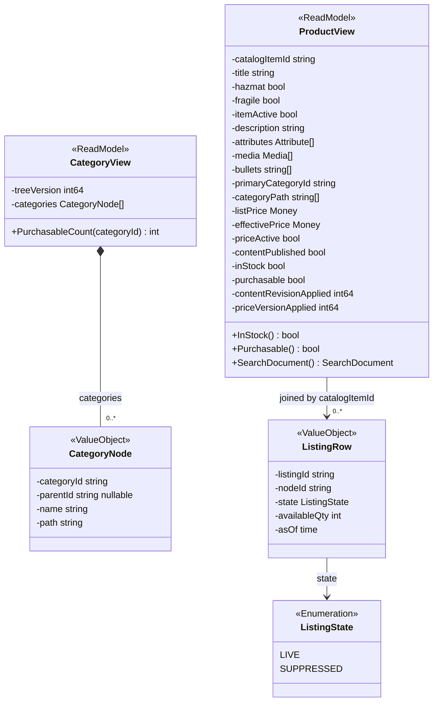
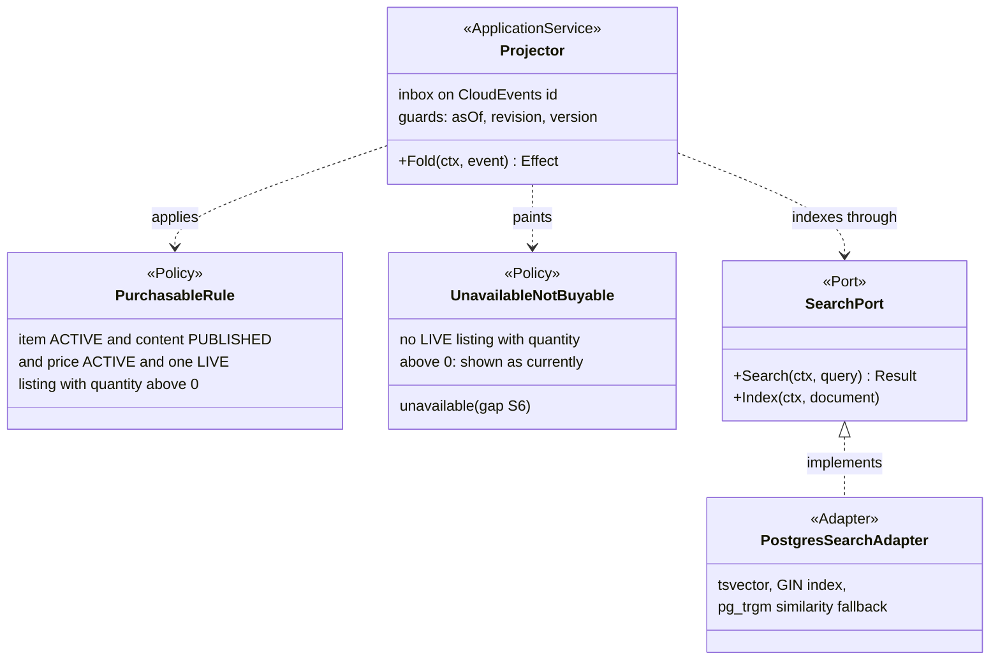
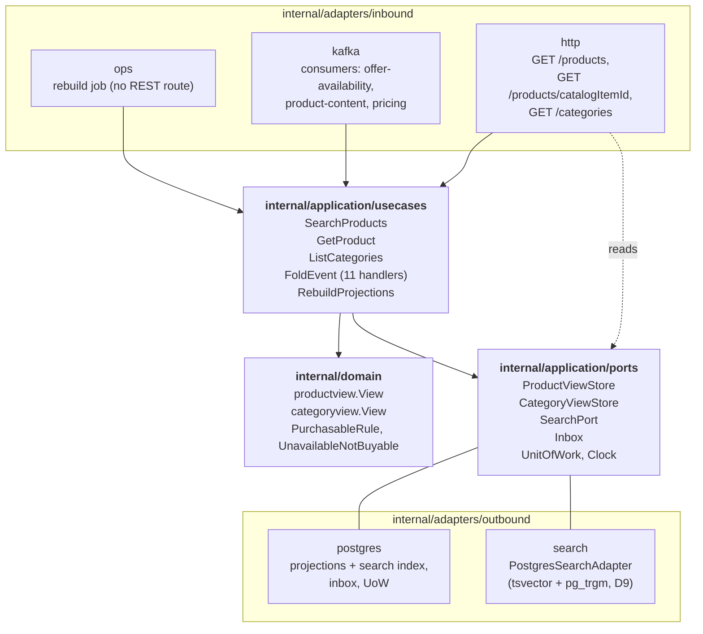

# Class Diagram

:::info[Built on develop, not deployed]
Derived from [`model/model.yaml`](https://github.com/IQVO/warehouse-docs/blob/main/storefront/model/model.yaml). The `product-discovery` service is built on develop ([`IQVO/product-discovery`](https://github.com/IQVO/product-discovery) at `9c2f945`, checked 2026-10-27) and not deployed (no warehouse-infra entry). Every `Err...` name, REST route and CloudEvents type of this context named on this page exists in the service; where the built service differs from the model's design, the page says so (**As built**) or the context's [Service and operations](/storefront/contexts/product-discovery#service-and-operations) section lists it.
:::

UML class diagrams of the `internal/domain/**` packages as the model designs them, plus
the hexagonal ports and adapters. Type names come from the model's code
identifiers (`productview.View`, `productview.Purchasable`,
`categoryview.View`, `ports.SearchPort` in the UL spellings). Fields are
unexported in Go and shown with `-`; methods are shown with `+`. There is
no aggregate and no `Err...` type in this context — nothing to refuse.

**As built** (`IQVO/product-discovery` develop `9c2f945`): the domain packages are `internal/domain/categoryview`, `internal/domain/productview`, `internal/domain/search`. Exported types per package: `categoryview`: `Category`, `Counted`, `View`; `productview`: `PublishedContent`, `Outcome`, `ItemCreated`, `ListingCreated`, `AvailabilityChanged`, `ListingSnapshot`, `PriceChanged`, `ItemState`, `ContentState`, `PriceState`, `ListingState`, `Attribute`, `Media`, `Listing`, `View`; `search`: `Band`, `Mode`, `Cursor`, `FacetValue`, `Facet`, `Counts`, `Sort`, `ValidationError`, `Input`, `Query`. Application packages: `internal/application/ports`, `internal/application/readmodel`, `internal/application/usecases`; adapters: `internal/adapters/inbound/http`, `internal/adapters/inbound/kafka`, `internal/adapters/inbound/requestlog`, `internal/adapters/outbound/kafka`, `internal/adapters/outbound/memory`, `internal/adapters/outbound/postgres`, `internal/adapters/outbound/repocontract`, `internal/adapters/outbound/sources`, `internal/adapters/outbound/telemetry`. Where a type name below differs (the UML keeps the design names), the [Ubiquitous Language](/storefront/contexts/product-discovery/ubiquitous-language) page carries the built identifier.

## 1. Read models (the domain package)

Derived from: `model.yaml → contexts[product-discovery].read_models`
(`ProductView`, `CategoryView`), `.policies`, `.ul`;
`apis/product-discovery/openapi.yaml` (`ProductView`, `CategoryView`).

Omitted: the `Money` and `Attribute`/`Media` value objects (same shape as
`product-content`'s, copied from its events), and the repository — the
store is a port (diagram 4), because a projection has no identity
lifecycle to guard. `ListingRow` is this pack's reading of what the fold
must keep for `ListingSuppressed`/`ListingRestored` (they carry only
`listingId`). `inStock` and `purchasable` are stored **and** derivable:
stored for the index, recomputed by `PurchasableRule` on every fold.

## 2. Policies, projector and the search port

Derived from: `model.yaml → contexts[product-discovery].policies`,
`.business_decisions` (2, 4 — the weights and the guards; D9 names the
port).

Omitted: the eleven consumed event structs — `offer-availability`'s and the
siblings' types, decoded in the consumer adapters. The `SearchPort` is the
model's own swap point: decision D9 exists so a dedicated engine later
replaces `PostgresSearchAdapter` and nothing else changes.

## 3. Hexagonal ports and adapters

Derived from: `model.yaml → contexts[product-discovery].inbound`, `.rest`,
`.consumes`, `.read_models`; `conventions.integration_rules` (inbox,
dispatch on the full type); the fleet's Go hexagonal layout.

Omitted: the composition root (`cmd/product-discovery`), metrics and
tracing, and the bootstrap snapshot HTTP clients — four thin outbound
clients used only by `RebuildProjections` on the ops path (see
[Use Cases](/storefront/contexts/product-discovery/use-cases)). There is
**no outbox relay and no producer**: `publishes: []`, so the only Kafka
adapters are the three inbound consumers. The domain package imports
nothing from application or adapters (fleet rule 5).
