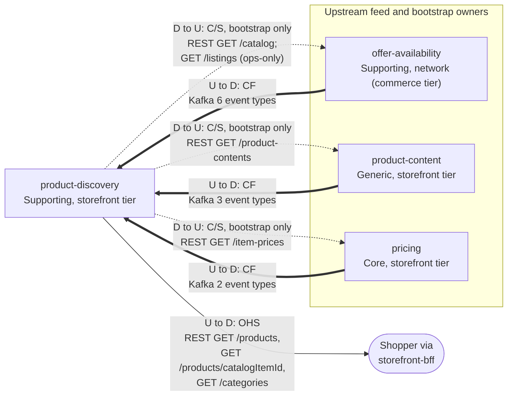

# Context Map

:::info[Proposed design, docs only]
Derived from [`model/model.yaml`](https://github.com/IQVO/warehouse-docs/blob/main/storefront/model/model.yaml). Nothing in this context is built; the model is the canonical design, and identifiers (`Err...` names, routes, CloudEvents types) are the names a future implementation must use.
:::

Following ddd-crew [Context Mapping](https://github.com/ddd-crew/context-mapping).
This is **product-discovery's slice** of the
[storefront-wide context map](/storefront/strategic-design/context-map): every
relationship this context has, with the upstream (U) and downstream (D)
side, the pattern and the channel.

Derived from: `model.yaml → contexts[product-discovery].inbound`,
`.consumes`, `.rest`, `.sync_calls`; `contexts[pricing].inbound` and
`contexts[product-content].inbound` (rows naming `product-discovery`);
`network model.yaml → contexts[offer-availability].publishes`,
`conventions.cross_model` (OHS caller, `ops_only_exceptions`).

Legend: solid and thick arrows point from upstream to downstream; a thick
arrow is a Kafka event relationship, a solid one a synchronous REST
relationship. The dotted arrows are **this context's** calls, the
downstream customer reading its upstream supplier, and they exist only on
the ops-run projection rebuild (snapshot + catch-up, business decision 5)
— never on a shopper request. REST path parameters are written without
braces inside the diagram.

Omitted, because they have no edge with this context (**Separate Ways**):
the storefront contexts `shopping-cart`, `checkout` and `customer-payments`
— the cart keeps its **own** `PurchasabilityView` from the same feeds
(`contexts[shopping-cart].read_models`) rather than reading this context's
`ProductView`, and checkout and payments never name a catalogue read — and
every network context except `offer-availability` (`delivery-promise`,
`customer-ordering`, `order-sourcing`, `shipping-and-tracking` and the
rest). No edge touches the warehouse-systems fleet (`meta.hard_boundary`),
and no context depends on this one: `publishes: []`, so nothing sits
downstream of it except the shopper.

## Relationships

| Neighbour | Direction | Pattern | Channel | Messages | Why this pattern |
| --- | --- | --- | --- | --- | --- |
| `storefront-bff` (experience layer) | PD upstream, shopper downstream | **Open Host Service** (PD is the host) | REST `GET /products?q=&categoryId=&inStock=&priceMin=&priceMax=&sort=&after=&limit=`, `GET /products/{catalogItemId}`, `GET /categories` | `SearchProducts`, `GetProduct`, `ListCategories` | The whole catalogue surface of the storefront edge is these three reads; the BFF is the only client and needs no knowledge of the feeds. No authentication (`conventions.no_auth`). |
| `offer-availability` (network, Supporting) | OA upstream, PD downstream | **Conformist** | Kafka `retailnetwork.offer-availability.events` | `CatalogItemCreated`, `CatalogItemDiscontinued`, `ListingCreated`, `ListingAvailabilityChanged`, `ListingSuppressed`, `ListingRestored` | The item master and listing availability are the network's language, published as events; this context takes them as published and keeps only what the join needs (id, title, flags, listing state, quantity, `asOf`). |
| `product-content` (Generic) | PC upstream, PD downstream | **Conformist** | Kafka `retailnetwork.product-content.events` | `ProductContentPublished`, `ProductContentRetired`, `CategoryTreePublished` | Same-shape sibling feed: the payload (revision, full content, the whole tree per version) is already negotiated for this one consumer. |
| `pricing` (Core) | PR upstream, PD downstream | **Conformist** | Kafka `retailnetwork.pricing.events` | `ItemPriceChanged`, `ItemPriceWithdrawn` | The effective price is `pricing`'s fact; this context copies `effectivePriceMinor` and the price `version` as its guard, nothing more. |
| `offer-availability` (network) | OA upstream (supplier), PD downstream (customer) | **Customer/Supplier** | REST `GET /catalog`; REST `GET /listings?nodeId=&catalogItemId=` | `ListCatalog`; `ListListings` | Bootstrap-only snapshot reads. `GET /catalog` is an Open Host Service route (its inbound row names the caller "shopper / storefront"); `GET /listings` has no storefront OHS read, so it runs as an in-org read on an ops-only path — the one documented exception (`conventions.cross_model.ops_only_exceptions`), never on a user request. |
| `pricing` | PR upstream, PD downstream | **Customer/Supplier** | REST `GET /item-prices` (paged) | `ListItemPrices` | Bootstrap-only: prices before the events begin. `pricing`'s inbound row marks it "bootstrap, paged" for exactly this rebuild. |
| `product-content` | PC upstream, PD downstream | **Customer/Supplier** | REST `GET /product-contents` (paged) | `ListProductContents` | Bootstrap-only: published content before the events begin. (`product-content`'s inbound row also names `GetProductContent` and `ListCategories` from this context; `sync_calls` lists the list only — see the [canvas](/storefront/contexts/product-discovery/bounded-context-canvas) open questions.) |

## Notes on the patterns

- **No Anti-Corruption Layer.** All three feeds are inside the one
  organisation and publish a stable CloudEvents contract; the cost of
  conforming is low and the benefit (no translation to maintain) is real.
  The per-source monotonic guards (listing `asOf`, content `revision`,
  price `version`) are the only buffer this context keeps between itself
  and a redelivery — they order, they do not translate.
- **Conformist, not Customer/Supplier, on the feeds.** The feeds are
  published facts, not negotiated interfaces: no upstream shapes a payload
  for this consumer's convenience (except `product-content`, whose payload
  is admittedly shaped for it — the pattern is still Conformist because
  this context applies it as published, guard and all).
- **No Shared Kernel.** `catalogItemId`, `listingId` and `categoryId` are
  values copied from messages, never shared code or tables.
- **An Open Host Service in exactly one direction.** This context hosts
  the shopper-facing reads; it is a customer of every synchronous call it
  makes. The ops-only `GET /listings` in-org read is the single documented
  exception to the storefront's OHS-only rule
  (`conventions.cross_model`).
- **Nothing downstream but the shopper.** Because `publishes: []`, no
  bounded context has a dependency on this one — the read side can be
  rebuilt, reindexed or swapped behind its `SearchPort` without a single
  neighbour noticing.
- **No fleet edge.** This context never consumes a `warehouse.*` topic and
  never calls a warehouse-systems service (the model's `hard_boundary`).
