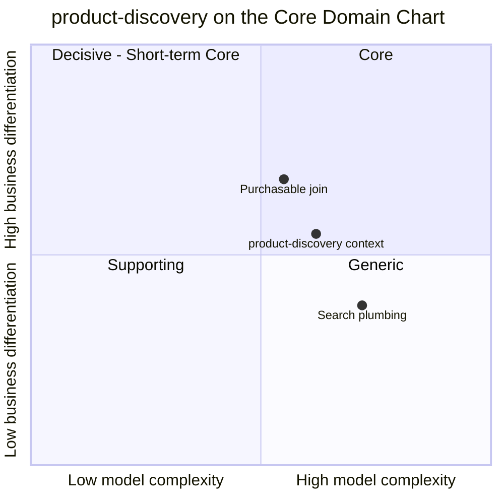

# Core Domain Chart

:::info[Proposed design, docs only]
Derived from [`model/model.yaml`](https://github.com/IQVO/warehouse-docs/blob/main/storefront/model/model.yaml). Nothing in this context is built; the model is the canonical design, and identifiers (`Err...` names, routes, CloudEvents types) are the names a future implementation must use.
:::

Following the ddd-crew [Core Domain Charts](https://github.com/ddd-crew/core-domain-charts):
business differentiation (y) against model complexity (x). The
storefront-wide classification is
[Subdomain Classification](/storefront/strategic-design/subdomain-classification).

Derived from: `model.yaml → contexts[product-discovery].chart` (`complexity:
0.62`, `differentiation: 0.55`), `.classification`,
`.read_models` (`ProductView`, `CategoryView`), `.policies`.

The two slices are placed by judgement, not by the model; the model gives
only the context's point. Omitted: the other five storefront contexts (their
positions are on their own pages —
[pricing](/storefront/contexts/pricing/core-domain-chart),
[product-content](/storefront/contexts/product-content/core-domain-chart) —
and on the storefront-wide classification).

## Classification: Supporting

The context's point sits **just over both midlines** — 0.62 on complexity,
0.55 on differentiation — which is the top-right corner of the grid, the
corner the chart labels Core. The verdict still comes from the model, which
classifies the context as `Supporting` with the rationale *"Core candidate
at scale; the engine itself is generic."* The position is the honest part:
discovery is the one Supporting context that would be reclassified, not
rebuilt, if the storefront grows. The two slices show why the point straddles
the midline:

- The **Purchasable join** (upper slice) is the storefront's own work:
  three upstream facts — item ACTIVE, content PUBLISHED, price ACTIVE, plus
  at least one LIVE listing with quantity above 0 (`PurchasableRule`) — in
  one row no upstream owns. That join is why a search hit is buyable the
  moment it is visible.
- The **search plumbing** (lower slice) is not: full-text search over a
  `tsvector`, a `pg_trgm` similarity fallback and three fixed facets are
  what every search stack does, which is exactly why decision D9 parks them
  behind a port (see [Class Diagram](/storefront/contexts/product-discovery/class-diagram)).

**Differentiation is moderate (y = 0.55).** No shopper chooses this
storefront because of its ranking science — the model fixes the weights
(title A, category names A, attributes B, description C) by business
decision 2. The differentiator is *what* is ranked: purchasable items only,
with the honest "currently unavailable" verdict the
`UnavailableNotBuyable` policy paints on the rest (gap S6).

**Complexity is the highest of the three packs so far (x = 0.62).** Not
because of rules — there is no aggregate, no state machine, no `Err...` —
but because of the plumbing the decision set names: three consumed topics,
eleven event types, three per-source monotonic guards (listing `asOf`,
content `revision`, price `version`), a search index to keep coherent with
the projections, and a snapshot-plus-catch-up bootstrap that touches four
contexts (see [Domain Events](/storefront/contexts/product-discovery/domain-events)
and [Use Cases](/storefront/contexts/product-discovery/use-cases)).

## Business model

**Conversion enabler** (the model's own words: "finding the right purchasable
item fast"). The context earns nothing directly; its value is the search
session it does not lose. The research behind the design names mediocre
search UX a top failure class — nearly half of desktop and more than half of
mobile sites search badly (benchmark [6] on
[Benchmarks](/storefront/research/benchmarks)) — and names product-type
queries ("running shoes", not a brand-model string) as the weak spot this
context's category suggestions answer.

## Evolution

| Part | Evolution stage | Why |
| --- | --- | --- |
| Projections (`ProductView`, `CategoryView`, the guards) | **Custom-built** | `chart.evolution: Custom-built`. The Purchasable join is this storefront's own; no product ships it. |
| Search (tsvector + `pg_trgm`, facets) | **Designed for swap** | Decision D9 puts search behind a port precisely so a dedicated engine is a later adapter swap, not a rewrite. |
| Plumbing (inbox, CloudEvents consumers) | **Commodity** | Estate-wide building blocks ([Event standard](/storefront/strategic-design/event-standard-cloudevents)). |

**Movement to watch.** The model's rationale is "Core candidate at scale":
what moves this context up is volume, not new rules. If the catalogue and
query volume grow past what one PostgreSQL search path serves, the engine
slice is swapped behind the `SearchPort` and the context is reclassified —
the join and the projections stay. Until then the investment stays capped:
no dedicated engine, no ranking teams, the weights fixed by decision 2.
