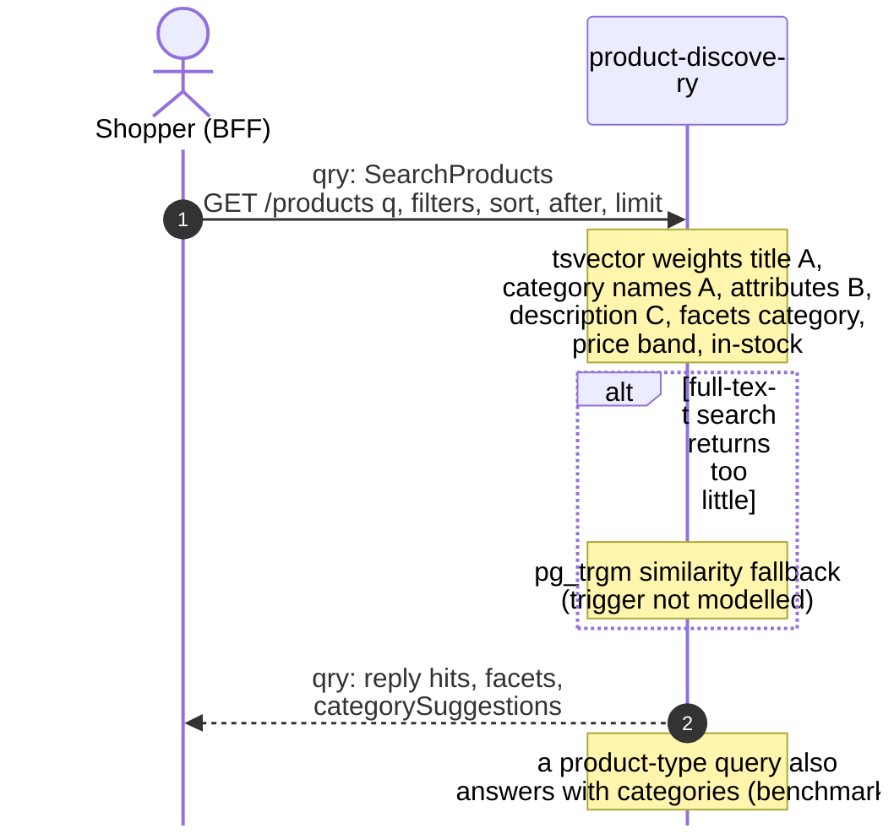
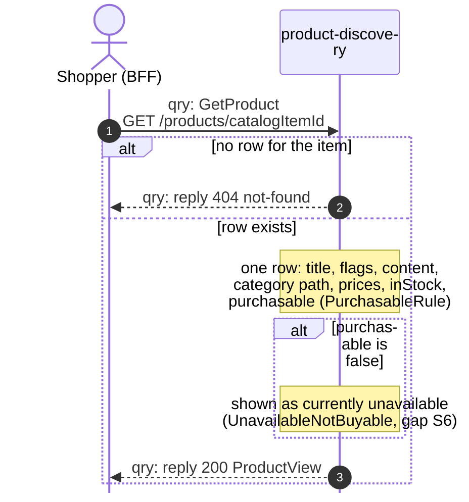
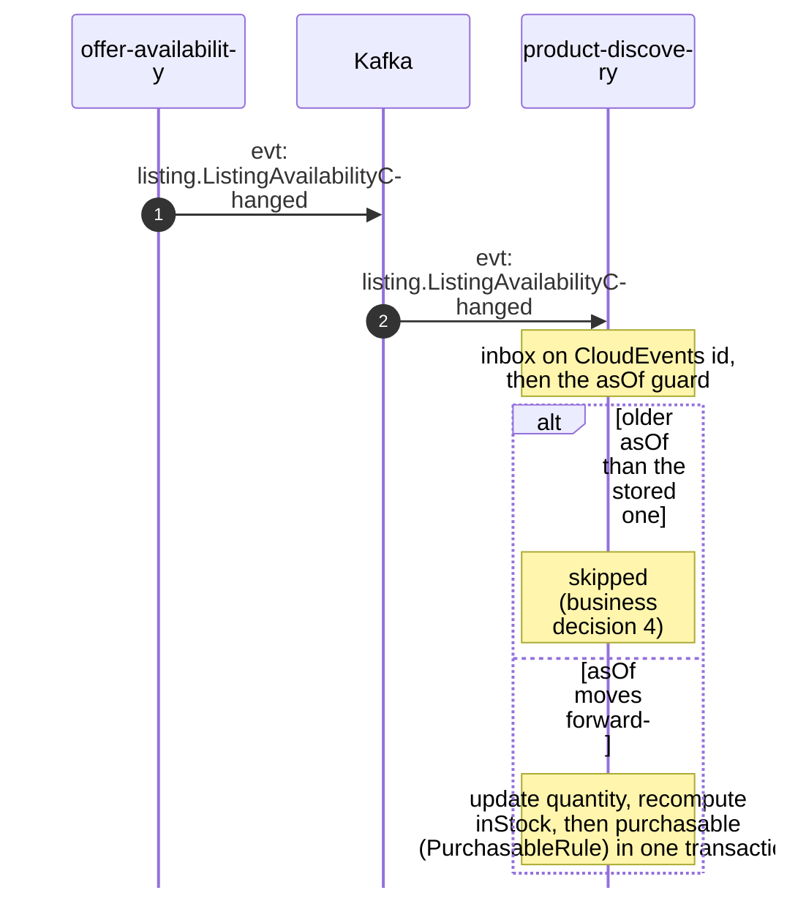
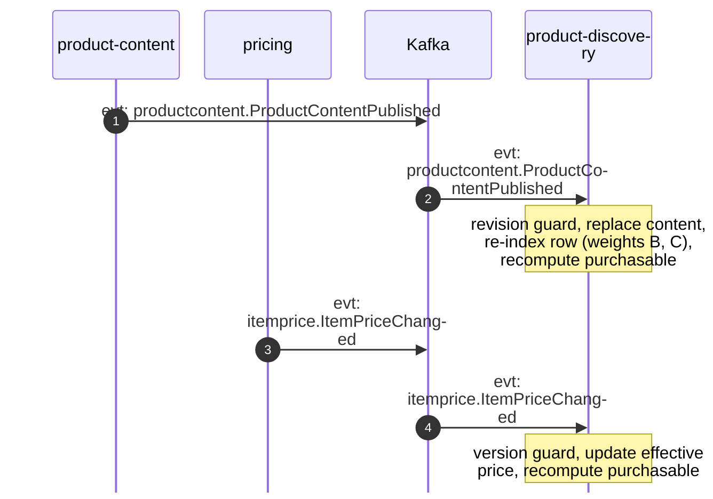
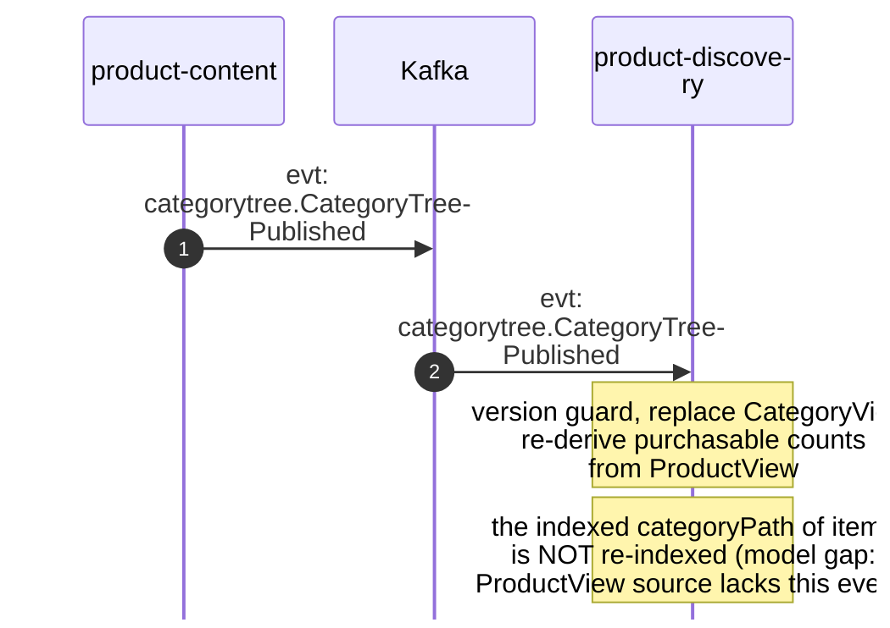
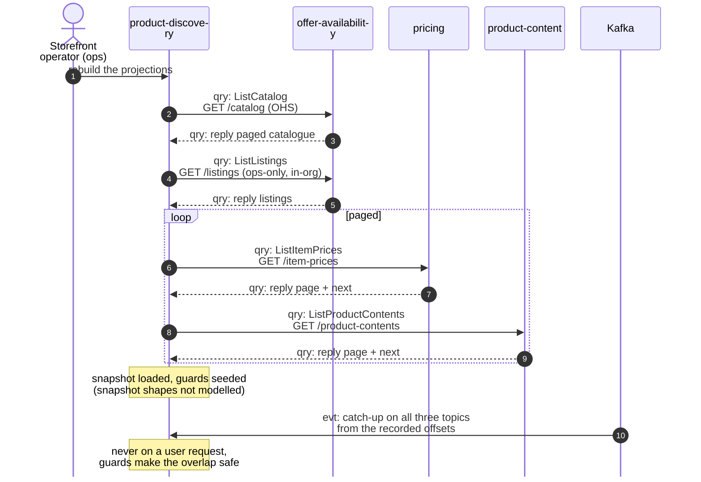

# Domain Message Flow

:::info[Built on develop, not deployed]
Derived from [`model/model.yaml`](https://github.com/IQVO/warehouse-docs/blob/main/storefront/model/model.yaml). The `product-discovery` service is built on develop ([`IQVO/product-discovery`](https://github.com/IQVO/product-discovery) at `9c2f945`, checked 2026-10-27) and not deployed (no warehouse-infra entry). Every `Err...` name, REST route and CloudEvents type of this context named on this page exists in the service; where the built service differs from the model's design, the page says so (**As built**) or the context's [Service and operations](/storefront/contexts/product-discovery#service-and-operations) section lists it.
:::

Following ddd-crew [Domain Message Flow Modelling](https://github.com/ddd-crew/domain-message-flow-modelling).
Six scenarios. Participants are contexts and actors. Every arrow is a
message from the model, prefixed `qry:` (query) or `evt:` (event); no
`cmd:` arrow exists — this context takes no command. A `Note` names a step
a context runs on itself. Kafka is drawn as one participant. Event names
are written `entity.EventName`; the full type is
`com.retailnetwork.<tier>.<producer>.<entity>.<EventName>` (see
[Domain Events](/storefront/contexts/product-discovery/domain-events)). REST
path parameters are written without braces. The storefront-wide
relationships are on the [Context Map](/storefront/strategic-design/context-map).

## 1. Shopper search (a product-type query)

Derived from: `model.yaml → contexts[product-discovery].rest` (`GET /products`),
`.business_decisions` (2, 3); `apis/product-discovery/openapi.yaml`
(`ProductSearchResult`).

Omitted: the `SearchPort` boundary and its Postgres adapter (see
[Sequence Diagrams](/storefront/contexts/product-discovery/sequence-diagrams)),
and the projection updates behind every hit (scenarios 3-5).

## 2. Product page

Derived from: `model.yaml → contexts[product-discovery].rest`
(`GET /products/{catalogItemId}`), `.policies`; `apis/product-discovery/openapi.yaml`
(`ProductView`, `Problem`).

Omitted: the delivery dates the BFF loads afterwards from the network's
promise context — a separate call the experience layer makes, not this
context's message.

## 3. The availability feed folds (the hot path)

Derived from: `model.yaml → contexts[product-discovery].consumes`
(`ListingAvailabilityChanged`), `.business_decisions` (4), `.policies`,
`.read_models[ProductView]`.

Omitted: `ListingCreated`, `ListingSuppressed`, `ListingRestored` and the
two `catalogitem.*` events — the same fold with their own fields; and the
search index write, which rides along whenever an indexed column changes
(see [Sequence Diagrams](/storefront/contexts/product-discovery/sequence-diagrams)).

## 4. The content and price feeds fold

Derived from: `model.yaml → contexts[product-discovery].consumes`
(`ProductContentPublished`, `ItemPriceChanged`), `.read_models[ProductView]`.

Omitted: `ProductContentRetired` and `ItemPriceWithdrawn` (same shape: the
verdict goes false); the list price and currency the purpose names but the
declared fields do not (a model gap on the
[canvas](/storefront/contexts/product-discovery/bounded-context-canvas)).

## 5. Category tree publication

Derived from: `model.yaml → contexts[product-discovery].consumes`
(`CategoryTreePublished`), `.read_models[CategoryView]`.

Omitted: the shopper reading `GET /categories` afterwards (scenario 2's
shape). The last note is the gap a rename or move exposes: `CategoryView`
gets the new names, the products' indexed paths keep the old ones until
some other event touches the item.

## 6. Bootstrap rebuild: snapshot + catch-up (ops only)

Derived from: `model.yaml → contexts[product-discovery].business_decisions`
(5), `.sync_calls`; `conventions.cross_model` (`ops_only_exceptions`).

Omitted: `GetProductContent` and `ListCategories`, which
`product-content`'s inbound row also names from this context but
`sync_calls` does not (a model gap on the
[canvas](/storefront/contexts/product-discovery/bounded-context-canvas)),
and the single-item reads. The ops-only `GET /listings` call is the one
documented in-org exception; everything else rides the network's Open Host
Service.
