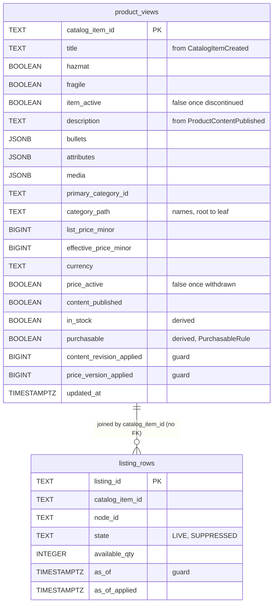
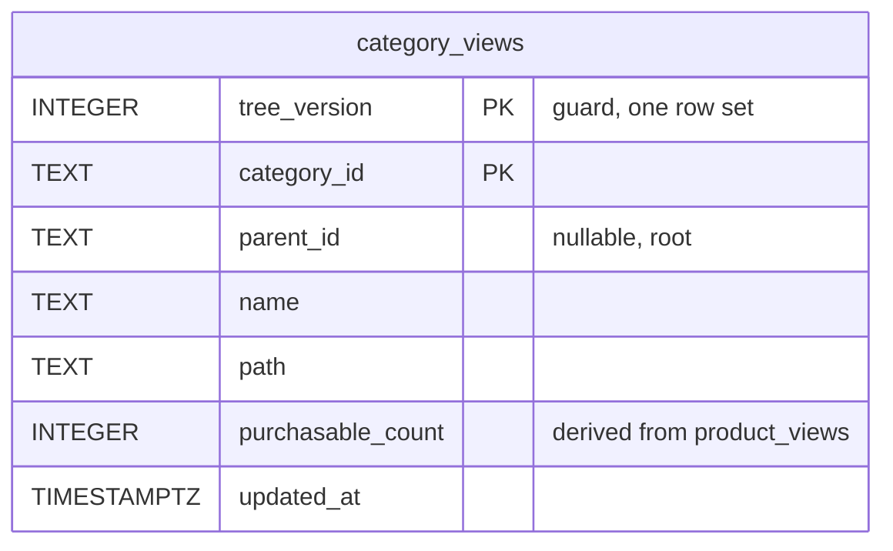
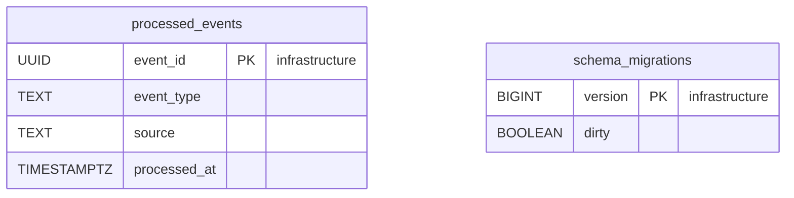

# Entity Relationship

:::info[Proposed design, docs only]
Derived from [`model/model.yaml`](https://github.com/IQVO/warehouse-docs/blob/main/storefront/model/model.yaml). Nothing in this context is built; the model is the canonical design, and identifiers (`Err...` names, routes, CloudEvents types) are the names a future implementation must use.
:::

The **proposed** Postgres schema. Product Discovery owns its database and
shares no table with any other context (`conventions.integration_rules`).
Column names are the model's field names in `snake_case`. The model names
two read models; the raw per-source rows and the guard columns are this
pack's reading of what the fold and the rebuild need. The schema holds no
PII: item facts, quantities and prices only (`conventions.no_auth`,
`meta.hard_boundary`).

## Projection tables

### ProductView and its listing rows

### CategoryView

Derived from: `model.yaml → contexts[product-discovery].read_models`
(`ProductView`, `CategoryView`), `.policies`, `.business_decisions` (2, 4);
`apis/product-discovery/openapi.yaml` (`ProductView`, `CategoryView`).

Column notes: `in_stock` and `purchasable` are stored for the index and
the page and recomputed on every fold — `in_stock` asks whether any
`listing_rows` row of the item is LIVE with `available_qty` above 0;
`purchasable` is `PurchasableRule` over `item_active`, `content_published`,
`price_active` and `in_stock`. The two `*_applied` columns and
`listing_rows.as_of_applied` are the per-source monotonic guards of
business decision 4; `listing_rows` exists because `ListingSuppressed` and
`ListingRestored` carry only `listingId`. `category_views` holds one row
per category under the current `tree_version`, replaced wholesale on a
newer version.

Omitted: the search index itself — a `tsvector` generated column on
`product_views` with a GIN index (weights A/A/B/C per business decision 2),
a `pg_trgm` index on `title` for the typo fallback, and the price-band
facet bounds (not modelled; see the
[canvas](/storefront/contexts/product-discovery/bounded-context-canvas)
open questions).

## Infrastructure tables

Derived from: `model.yaml → conventions.integration_rules` (idempotent
consumers on the CloudEvents id).

**Two tables only, and both are infrastructure.** There is **no
`outbox_events`** — this context publishes nothing (`publishes: []`), so no
relay drains it. There is **no `idempotency_keys`** — the fleet binds the
`Idempotency-Key` header to write routes, and the model's `rest` list is
three `GET`s. `processed_events` is the inbox: one row per consumed
CloudEvents `id`, inserted in the same transaction as the projection
effect; a duplicate is acknowledged without effect.

## Why there are no foreign keys across rows or contexts

- `listing_rows.catalog_item_id` → `product_views.catalog_item_id` is a
  join **by value** inside one projection, left unenforced on purpose: a
  listing fact may arrive before its `CatalogItemCreated` (cross-key
  ordering is not promised), and the row must survive that gap
  (hotspot H4 on [EventStorming](/storefront/contexts/product-discovery/eventstorming)).
- `product_views.primary_category_id` → `category_views.category_id` is
  also by value: the tree is replaced wholesale per version while the item
  rows persist; an FK would lock every item row on every publication.
- Every `catalog_item_id`, `listing_id`, `node_id` and `category_id` in
  this database is a value copied from a message owned by another context
  (`offer-availability`, `product-content`). No database is shared, so no
  cross-context FK can exist (`conventions.integration_rules`).

## Table ≠ aggregate

| Table | Aggregate / role | Notes |
| --- | --- | --- |
| `product_views` | none (read model `ProductView`) | One row per catalogue item; the page and every search hit render from it. |
| `listing_rows` | none (part of the `ProductView` fold) | Per-listing facts and the `asOf` guard; feeds `in_stock`. |
| `category_views` | none (read model `CategoryView`) | One row per category of the current tree version, with derived counts. |
| `processed_events` | none (infrastructure) | Inbox for idempotent consumption. |
| `schema_migrations` | none (infrastructure) | Migration bookkeeping. |

**No table in this database belongs to an aggregate** — the context has
none (business decision 1, its ADR 0002). Every domain row is disposable:
drop it, and the rebuild of business decision 5 (snapshot + catch-up)
recreates it bit for bit.
