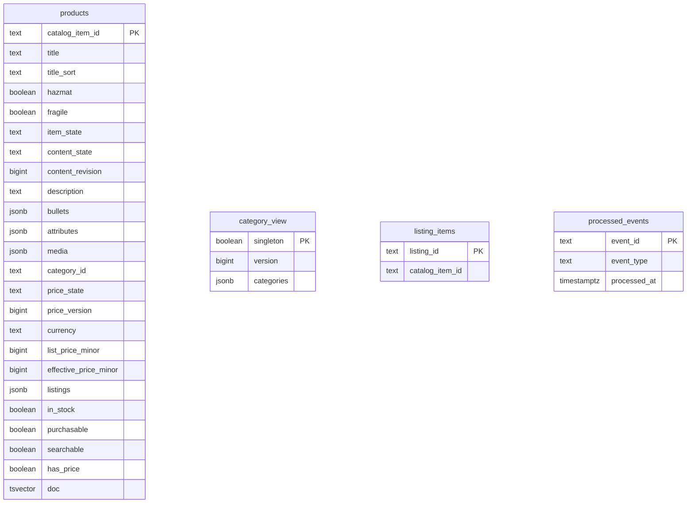

# Entity Relationship

:::info[Built on develop, not deployed]
Derived from [`model/model.yaml`](https://github.com/IQVO/warehouse-docs/blob/main/storefront/model/model.yaml). The `product-discovery` service is built on develop ([`IQVO/product-discovery`](https://github.com/IQVO/product-discovery) at `9c2f945`, checked 2026-10-27) and not deployed (no warehouse-infra entry). Every `Err...` name, REST route and CloudEvents type on this page exists in the service; where the built service differs from the model's design, the page says so (**As built**) or the context's [Service and operations](/storefront/contexts/product-discovery#service-and-operations) section lists it.
:::

The schema **as built**: [`0001_product_discovery_schema.up.sql`](https://github.com/IQVO/product-discovery/blob/develop/internal/adapters/outbound/postgres/migrations/0001_product_discovery_schema.up.sql) on `develop` (`9c2f945`), applied at boot with golang-migrate (which adds its own `schema_migrations` table). Product Discovery owns its database and shares no table with another context. Extensions: `pg_trgm`.

4 tables. Key markers: PK primary key, FK foreign key, UK unique. Types are the column types of the migration; constraints (CHECK, defaults, partial indexes) are in the file.

## Tables

| Table | Columns | Primary key | Role |
| --- | --- | --- | --- |
| `products` | 24 | `catalog_item_id` | aggregate or read-model state |
| `category_view` | 3 | `singleton` | aggregate or read-model state |
| `listing_items` | 2 | `listing_id` | aggregate or read-model state |
| `processed_events` | 3 | `event_id` | inbox: one row per consumed CloudEvents id (dedupe) |

## Design-time schema versus as built

The pack was first written with a proposed, fully normalised schema. The service kept the aggregate boundaries and changed the storage shape:

| Design-time table | As built |
| --- | --- |
| `product_views` | `products` (renamed; bullets, attributes, media and listings are jsonb columns) |
| `listing_rows` | `products.listings` (jsonb column) plus `listing_items` (the ListingItemMap from `listingId` to item) |
| `category_views` | `category_view` (one singleton row, categories as jsonb) |

Every other design-time table exists under the same name. The invariants are enforced by the aggregate in `internal/domain` before a row is written; the migration adds CHECK constraints on scalar columns and the indexes listed in the file.
