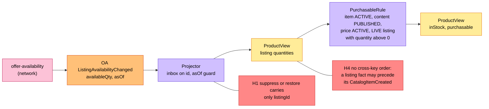
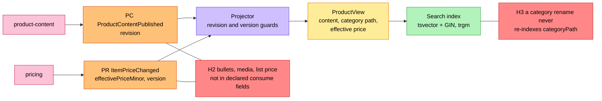
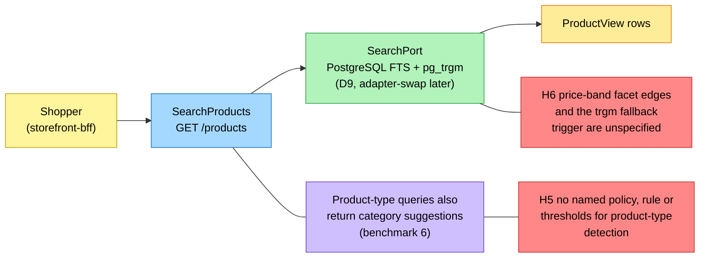
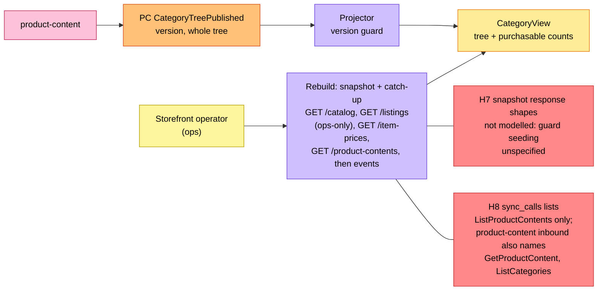

# EventStorming

:::info[Proposed design, docs only]
Derived from [`model/model.yaml`](https://github.com/IQVO/warehouse-docs/blob/main/storefront/model/model.yaml). Nothing in this context is built; the model is the canonical design, and identifiers (`Err...` names, routes, CloudEvents types) are the names a future implementation must use.
:::

Process-level boards in the ddd-crew
[EventStorming glossary & cheat sheet](https://github.com/ddd-crew/eventstorming-glossary-cheat-sheet)
notation. Every sticky comes from `model.yaml`. Events published by a
neighbour are drawn as orange stickies prefixed with the producer. Every
hotspot is a gap or a risk the model itself shows, and its source is given
in the hotspot table. The boards are drawn left to right and kept narrow to
fit the page width.

This context has **no command and no aggregate of its own**, so the
classic command-aggregate-event chain appears here only on the feed side:
a neighbour's event enters, a **projector** (drawn as a policy) folds it
into a read model under a guard, and the verdict the shopper sees
(`purchasable`) is derived — never commanded into a state.

## Legend

| Colour | Sticky | Meaning here |
| --- | --- | --- |
| Pale yellow `#fff59d` | Actor | The shopper (via the BFF) or the storefront operator |
| Yellow `#ffec99` | Read model | `ProductView`, `CategoryView` (this context has no aggregate) |
| Orange `#ffc078` | Domain Event | A neighbour's (`consumes`, prefixed with the producer); none of our own |
| Lilac `#d0bfff` | Policy | The projector with its guard, `PurchasableRule`, `UnavailableNotBuyable` |
| Blue `#a5d8ff` | Query | `SearchProducts`, `GetProduct`, `ListCategories` |
| Green `#b2f2bb` | Search | The `SearchPort` and its index |
| Pink `#fcc2d7` | External System | A sibling or network context |
| Red `#ff8787` | Hotspot | A gap or risk in the model (see the table at the end) |

## 1. The availability feed

Derived from: `model.yaml → contexts[product-discovery].consumes`
(the six `offer-availability` events), `.business_decisions` (4),
`.policies[PurchasableRule]`, `.read_models[ProductView]`.

Omitted: `ListingCreated` (learns the listing-to-item mapping),
`ListingSuppressed`/`ListingRestored` (flip one listing's state, never
count when SUPPRESSED), `CatalogItemCreated`/`CatalogItemDiscontinued`
(title, flags, the ACTIVE input of the rule), and the search index write
that rides along.

## 2. The content and price feeds

Derived from: `model.yaml → contexts[product-discovery].consumes`
(`ProductContentPublished`, `ProductContentRetired`,
`CategoryTreePublished`, `ItemPriceChanged`, `ItemPriceWithdrawn`),
`.business_decisions` (2, 4).

Omitted: `ProductContentRetired` and `ItemPriceWithdrawn` (the verdict goes
false, the row stays), and the `CategoryView` rebuild
(board 4). The index weights (title A, category names A, attributes B,
description C) are business decision 2.

## 3. Shopper search

Derived from: `model.yaml → contexts[product-discovery].inbound` (the BFF
query row), `.rest`, `.business_decisions` (2, 3), `.ul[Product-Type
Query]`.

Omitted: `GetProduct` and `ListCategories` (the same store reads without
the search path), the facets' counts (a group-by over the same rows), and
every write path — there is none: no command sticky can exist in this
context.

## 4. Category tree and the bootstrap rebuild

Derived from: `model.yaml → contexts[product-discovery].consumes`
(`CategoryTreePublished`), `.read_models[CategoryView]`,
`.business_decisions` (5), `.sync_calls`;
`contexts[product-content].inbound`.

Omitted: the catch-up consumption itself (board 1 and 2's projectors, from
the recorded offsets) and the rebuild of the search index, which the
snapshot seeds in the same pass. The `GET /listings` read is in-org and
ops-only — never on a user request (the documented exception in
`conventions.cross_model`).

## Hotspots

| # | Hotspot | Where it comes from in the model |
| --- | --- | --- |
| H1 | `ListingSuppressed` and `ListingRestored` declare only `listingId` as needed, so the projector must keep the listing-to-item mapping learned from `ListingCreated`; the mapping is a read-side fact the model names nowhere. | `contexts[product-discovery].consumes` vs `.read_models[ProductView]` |
| H2 | The `ProductView` purpose and the proposed API render bullets, media and the list price, but the declared `consumes` fields name neither `bullets`/`media` (on `ProductContentPublished`) nor `listPriceMinor`/`currency` (on `ItemPriceChanged`). | `.purpose`, `apis/product-discovery/openapi.yaml` vs `.consumes` |
| H3 | `read_models[ProductView].source` does not list `CategoryTreePublished`, yet the row carries `categoryPath` and the index weights category names (A): a rename or move never re-indexes existing rows. | `.read_models` vs `.business_decisions` (2) |
| H4 | `catalogitem.*` events are keyed by `catalogItemId` and `listing.*` by `listingId`, so Kafka promises no cross-key order; the guards are per source, not cross-source. The projector must tolerate a listing fact before its `CatalogItemCreated`. | `conventions.cloudevents` (subject is the key); `.business_decisions` (4) |
| H5 | The product-type-query rule (decision 3, UL term with code `(search policy)`) has no named policy — `policies` lists only `PurchasableRule` and `UnavailableNotBuyable` — and no detection rule or thresholds. | `.business_decisions`, `.ul` vs `.policies` |
| H6 | The price-band facet edges and the `pg_trgm` fallback trigger ("when full-text search returns too little" is this pack's reading) are unspecified. | `.business_decisions` (2) |
| H7 | The bootstrap snapshot reads (`ListCatalog`, `ListListings`, `ListItemPrices`, `ListProductContents`) declare no response fields in either model, so how the catch-up guards are seeded from the snapshot is unspecified. | `.business_decisions` (5), `.sync_calls` vs both models |
| H8 | `sync_calls` names `ListProductContents` only, while `contexts[product-content].inbound` also names `GetProductContent` and `ListCategories` from `product-discovery`. | `.sync_calls` vs `contexts[product-content].inbound` |
