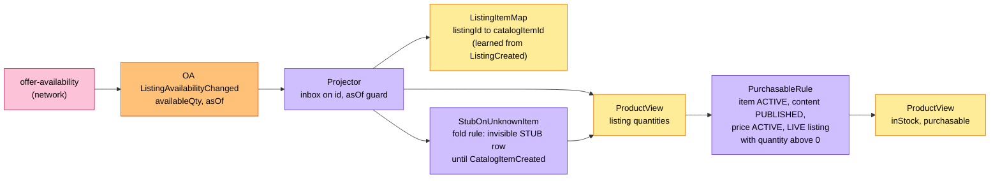
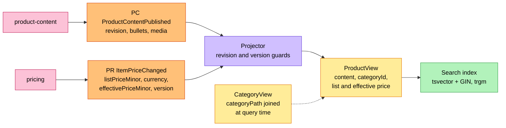
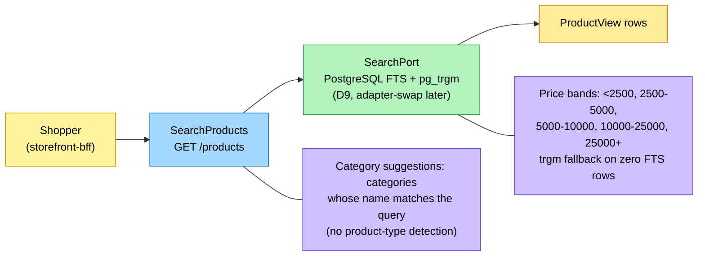
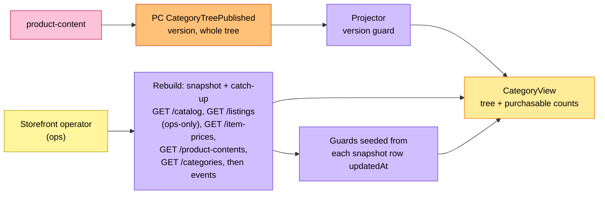

# EventStorming

:::info[Proposed design, docs only]
Derived from [`model/model.yaml`](https://github.com/IQVO/warehouse-docs/blob/main/storefront/model/model.yaml). Nothing in this context is built; the model is the canonical design, and identifiers (`Err...` names, routes, CloudEvents types) are the names a future implementation must use.
:::

Process-level boards in the ddd-crew
[EventStorming glossary & cheat sheet](https://github.com/ddd-crew/eventstorming-glossary-cheat-sheet)
notation. Every sticky comes from `model.yaml`. Events published by a
neighbour are drawn as orange stickies prefixed with the producer. Every
hotspot is a gap or a risk the model itself shows, and its source is given
in the hotspot table. The boards are drawn left to right and kept narrow to
fit the page width.

This context has **no command and no aggregate of its own**, so the
classic command-aggregate-event chain appears here only on the feed side:
a neighbour's event enters, a **projector** (drawn as a policy) folds it
into a read model under a guard, and the verdict the shopper sees
(`purchasable`) is derived — never commanded into a state.

## Legend

| Colour | Sticky | Meaning here |
| --- | --- | --- |
| Pale yellow `#fff59d` | Actor | The shopper (via the BFF) or the storefront operator |
| Yellow `#ffec99` | Read model | `ProductView`, `CategoryView` (this context has no aggregate) |
| Orange `#ffc078` | Domain Event | A neighbour's (`consumes`, prefixed with the producer); none of our own |
| Lilac `#d0bfff` | Policy | The projector with its guard, `PurchasableRule`, `UnavailableNotBuyable` |
| Blue `#a5d8ff` | Query | `SearchProducts`, `GetProduct`, `ListCategories` |
| Green `#b2f2bb` | Search | The `SearchPort` and its index |
| Pink `#fcc2d7` | External System | A sibling or network context |
| Red `#ff8787` | Hotspot | A gap or risk in the model (see the table at the end) |

## 1. The availability feed

Derived from: `model.yaml → contexts[product-discovery].consumes`
(the six `offer-availability` events), `.business_decisions` (4),
`.policies[PurchasableRule, StubOnUnknownItem]`, `.read_models[ProductView,
ListingItemMap]`.

The `ListingItemMap` read-side lookup is learned from `ListingCreated` and
resolves `ListingSuppressed`/`ListingRestored`, which carry only
`listingId`. There is no cross-key ordering between `catalogitem.*` and
`listing.*`, so a listing, price or content fact for an unknown item upserts
an invisible STUB `ProductView` row (`Purchasable` requires a catalogued
item) and `CatalogItemCreated` completes it; the fold rule raises no error.

Omitted: `ListingSuppressed`/`ListingRestored` (flip one listing's state, never
count when SUPPRESSED), `CatalogItemCreated`/`CatalogItemDiscontinued`
(title, flags, the ACTIVE input of the rule), and the search index write
that rides along.

## 2. The content and price feeds

Derived from: `model.yaml → contexts[product-discovery].consumes`
(`ProductContentPublished`, `ProductContentRetired`,
`CategoryTreePublished`, `ItemPriceChanged`, `ItemPriceWithdrawn`),
`.business_decisions` (2, 4, 6).

`ProductView` stores `categoryId` only; the `categoryPath` is joined from
`CategoryView` at query time, so `CategoryTreePublished` never re-indexes
`ProductView` rows. Omitted: `ProductContentRetired` and `ItemPriceWithdrawn`
(the verdict goes false, the row stays), and the `CategoryView` rebuild
(board 4). The index weights (title A, category names A, attributes B,
description C) are business decision 2.

## 3. Shopper search

Derived from: `model.yaml → contexts[product-discovery].inbound` (the BFF
query row), `.rest`, `.business_decisions` (2, 3, 7), `.ul[Category
Suggestion]`.

Omitted: `GetProduct` and `ListCategories` (the same store reads without
the search path), the facets' counts (a group-by over the same rows), and
every write path — there is none: no command sticky can exist in this
context.

## 4. Category tree and the bootstrap rebuild

Derived from: `model.yaml → contexts[product-discovery].consumes`
(`CategoryTreePublished`), `.read_models[CategoryView]`,
`.business_decisions` (5), `.sync_calls`
(`ListProductContents` and `ListCategories` against product-content;
`GetProductContent` is not called by this context);
`contexts[product-content].inbound`.

Omitted: the catch-up consumption itself (board 1 and 2's projectors, from
the recorded offsets) and the rebuild of the search index, which the
snapshot seeds in the same pass. The `GET /listings` read is in-org and
ops-only — never on a user request (the documented exception in
`conventions.cross_model`).

## Hotspots

| # | Hotspot | Where it comes from in the model |
| --- | --- | --- |
| H1 | **Resolved in the model-fix:** the read-side lookup `ListingItemMap` (listingId to catalogItemId) is declared in `read_models`; it is learned from `ListingCreated` and used by `ListingSuppressed` and `ListingRestored`, which carry only `listingId`. | `contexts[product-discovery].read_models[ListingItemMap]` |
| H2 | **Resolved in the model-fix:** `consumes` now names `ProductContentPublished.bullets` and `.media`, and `ItemPriceChanged.listPriceMinor` and `.currency`. | `.consumes` |
| H3 | **Resolved in the model-fix:** `ProductView` stores `categoryId` only; `categoryPath` is joined from `CategoryView` at query time, so a rename or move needs no re-index and `CategoryTreePublished` feeds `CategoryView` alone. | `.read_models[ProductView]`, `.business_decisions` |
| H4 | **Resolved in the model-fix:** there is no cross-key ordering, so a listing, price or content fact for an unknown item upserts an invisible STUB `ProductView` row (`Purchasable` requires a catalogued item) and `CatalogItemCreated` completes it. The fold rule is named `StubOnUnknownItem` and raises no error. | `.policies[StubOnUnknownItem]` |
| H5 | **Resolved in the model-fix:** there is no product-type detection. The rule is gone; the answer carries category suggestions, the categories whose name matches the query terms (UL term `Category Suggestion`). | `.business_decisions`, `.ul` |
| H6 | **Resolved in the model-fix:** price-band edges are fixed, in minor units and configurable as a list: below 2500, 2500-5000, 5000-10000, 10000-25000, 25000 and above. The `pg_trgm` fallback fires when the full-text query returns zero rows. | `.business_decisions` |
| H7 | **Resolved in the model-fix:** `sync_calls` now declares the response fields the rebuild reads; each snapshot row carries `updatedAt`, seeded into the per-key guard so replayed events older than the snapshot are dropped. | `.sync_calls[*].fields` |
| H8 | **Resolved in the model-fix:** `sync_calls` are `ListProductContents` and `ListCategories`, because bootstrap needs both. `GetProductContent` is not called by this context, and product-content's inbound note says so. | `.sync_calls`; `contexts[product-content].inbound` |
