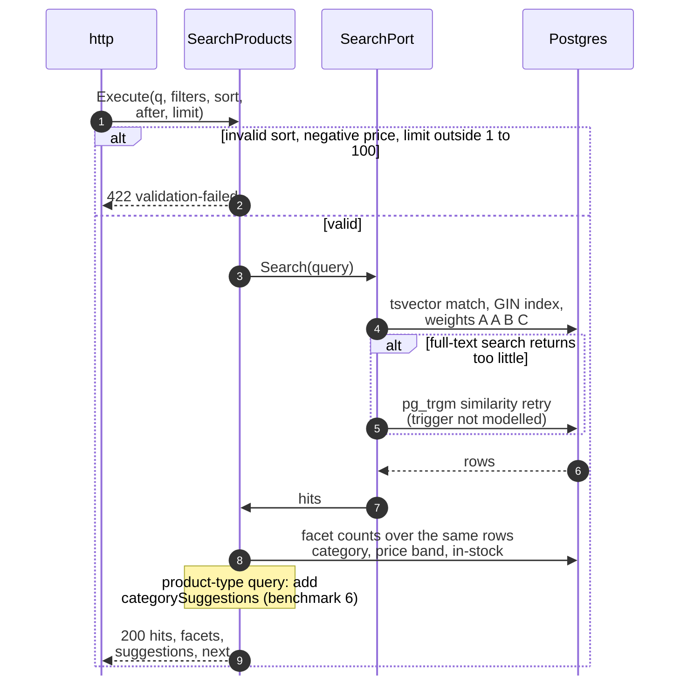
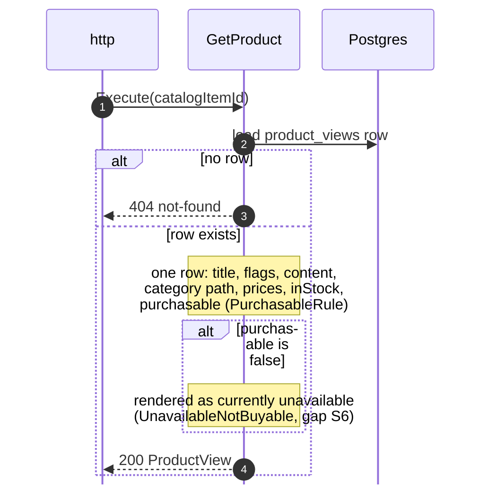
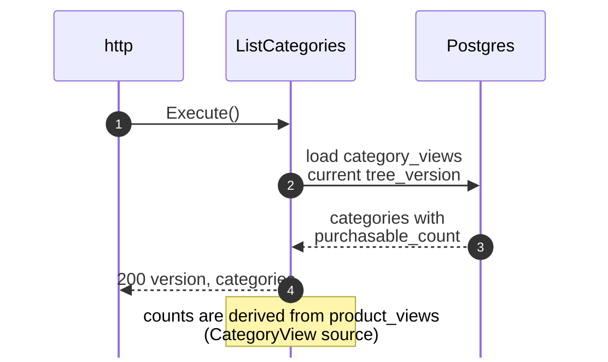
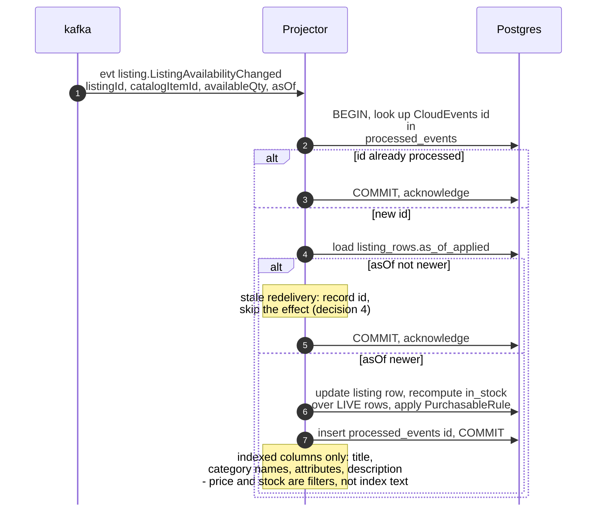
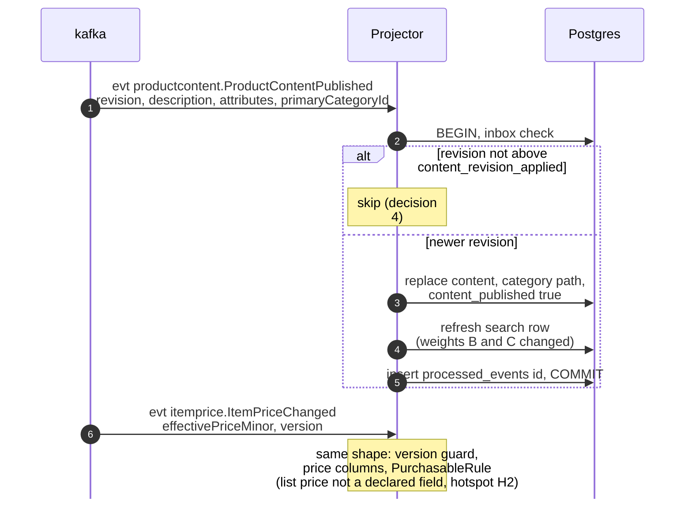
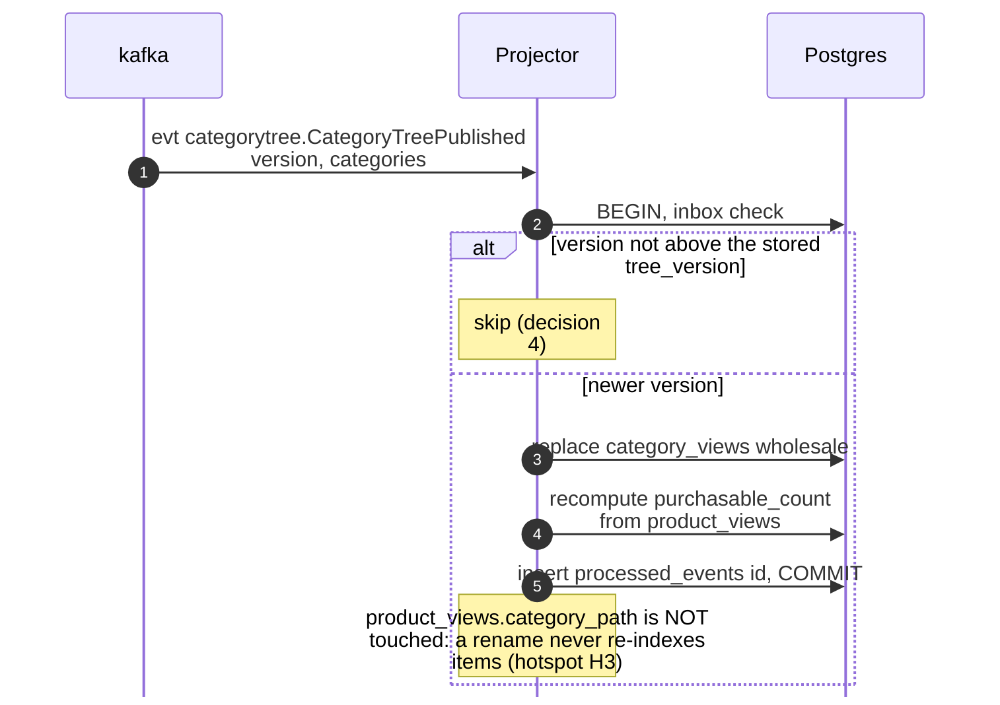
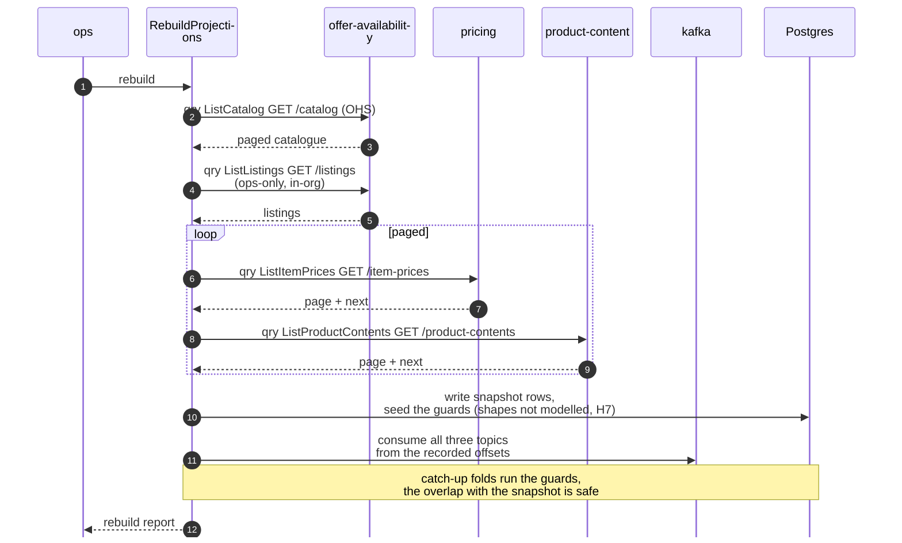

# Sequence Diagrams

:::info[Built on develop, not deployed]
Derived from [`model/model.yaml`](https://github.com/IQVO/warehouse-docs/blob/main/storefront/model/model.yaml). The `product-discovery` service is built on develop ([`IQVO/product-discovery`](https://github.com/IQVO/product-discovery) at `9c2f945`, checked 2026-10-27) and not deployed (no warehouse-infra entry). Every `Err...` name, REST route and CloudEvents type of this context named on this page exists in the service; where the built service differs from the model's design, the page says so (**As built**) or the context's [Service and operations](/storefront/contexts/product-discovery#service-and-operations) section lists it.
:::

One UML sequence diagram per use case on
[Use Cases](/storefront/contexts/product-discovery/use-cases). Participant
names are the packages and ports the model designs, from the
[Class Diagram](/storefront/contexts/product-discovery/class-diagram):

- `http` and `kafka` are the inbound adapters; `ops` is the rebuild job.
- The use case is in `internal/application/usecases`; `Projector` is the
  `FoldEvent` service.
- `SearchPort` is the search boundary (D9); `Postgres` stands for the
  projections, the search index and the inbox, sharing one transaction
  through `UnitOfWork`.

**No outbox relay appears in any diagram: this context publishes nothing**
(`publishes: []`), so there is no producer side to draw. Every fold is one
short transaction; every read is lock-free. Full CloudEvents types are on
[Domain Events](/storefront/contexts/product-discovery/domain-events).

## 1. SearchProducts (REST GET /products)

Derived from: `model.yaml → contexts[product-discovery].rest`,
`.business_decisions` (2, 3); `apis/product-discovery/openapi.yaml`.

Omitted: pagination mechanics (keyset on `after`).

## 2. GetProduct (REST GET /products/catalogItemId)

Derived from: `model.yaml → contexts[product-discovery].rest`,
`.policies`.

Omitted: the delivery dates the BFF fetches next from the network — not
this context's message.

## 3. ListCategories (REST GET /categories)

Derived from: `model.yaml → contexts[product-discovery].rest`,
`.read_models[CategoryView]`.

## 4. FoldEvent: ListingAvailabilityChanged (the hot path)

Derived from: `model.yaml → contexts[product-discovery].consumes`
(`ListingAvailabilityChanged`), `.business_decisions` (4),
`.policies[PurchasableRule]`.

Omitted: `ListingCreated`, `ListingSuppressed`, `ListingRestored` (same
transaction; suppress and restore look the item up through the stored
`listing_rows` mapping, because the events carry only `listingId` —
hotspot H1) and the two `catalogitem.*` folds (title, flags, the ACTIVE
input).

## 5. FoldEvent: ProductContentPublished and ItemPriceChanged

Derived from: `model.yaml → contexts[product-discovery].consumes`
(`ProductContentPublished`, `ItemPriceChanged`).

Omitted: `ProductContentRetired` and `ItemPriceWithdrawn` (the verdict
goes false, the row stays).

## 6. FoldEvent: CategoryTreePublished

Derived from: `model.yaml → contexts[product-discovery].consumes`
(`CategoryTreePublished`), `.read_models[CategoryView]`.

## 7. RebuildProjections (ops, never a user request)

Derived from: `model.yaml → contexts[product-discovery].business_decisions`
(5), `.sync_calls`; `conventions.cross_model` (`ops_only_exceptions`,
`forbidden_routes`).

Omitted: the search index rebuild (a bulk re-index in the same pass) and
per-page retries. The `GET /listings` arrow is the single documented
in-org exception; every other read rides the network's Open Host Service,
and none of the four is ever reachable from a shopper request.
