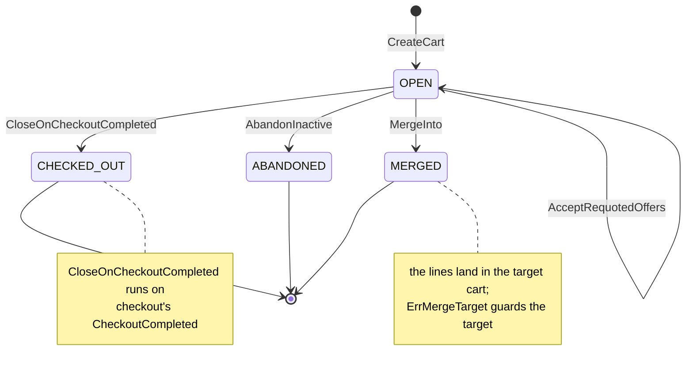

# Aggregate Design Canvas

:::info[Built on develop, not deployed]
Derived from [`model/model.yaml`](https://github.com/IQVO/warehouse-docs/blob/main/storefront/model/model.yaml). The `shopping-cart` service is built on develop ([`IQVO/shopping-cart`](https://github.com/IQVO/shopping-cart) at `95bc5bc`, checked 2026-10-27) and not deployed (no warehouse-infra entry). Every `Err...` name, REST route and CloudEvents type of this context named on this page exists in the service; where the built service differs from the model's design, the page says so (**As built**) or the context's [Service and operations](/storefront/contexts/shopping-cart#service-and-operations) section lists it.
:::

Following the ddd-crew [Aggregate Design Canvas v1.1](https://github.com/ddd-crew/aggregate-design-canvas).
The model has one aggregate root in this context, **Cart**, and three read
models, **CheckoutReadiness**, **PurchasabilityView** and **EstimateView**.
Proposed Go package: `internal/domain/cart` (the package the UL code
identifiers name).

## Cart

### 1. Name

`Cart` (`cart.Cart`), identified by `cartId`.

### 2. Description

One shopper's cart: optional `shopperId` (guest-first, D4), lines
(`catalogItemId`, `quantity`), `destinationPostalPrefix`, the delivery
quote (groups with their lines and offers — `offerId`, tier, window,
`expiresAt` — plus the tiers that were unavailable), the selections
(`groupNo` to `offerId`) and `version`. Value objects:

| Value object | Fields | Note |
| --- | --- | --- |
| `CartLine` | `catalogItemId`, `quantity` | One line per item; quantity in `1..99`. |
| `QuotedOffer` | `offerId`, `groupNo`, `tier`, `deliverByEarliest`, `deliverByLatest`, `expiresAt` | One offer held by the quote; a frozen `delivery-promise` fact. |
| `DeliverySelection` | `groupNo`, `offerId` | The shopper's pick per shipment group. |

The quote itself (groups, their lines, the unavailable tiers) is held
inside the aggregate as `cart.DeliveryQuote`; it holds no capacity, and
every mutating command on lines or destination clears it together with the
selections.

### 3. State Transitions

Derived from: `model.yaml → contexts[shopping-cart].aggregates[Cart].states`,
`.transitions`, `.commands`, `.policies`.

The entry arrow `[*] --> OPEN` is the creating command `CreateCart`. All
three terminal states are entered from `OPEN` only, and `ErrCartClosed`
rejects every later change: a cart is never reopened, and a `MERGED` cart
leaves its lines in the target. A `CheckoutCompleted` for a cart that is
not `OPEN` has no transition — the race needs a checkout session to
outlive 30 days of cart idleness, which the session's own expiry makes
impossible in practice.

### 4. Enforced Invariants

| Invariant | Enforced by |
| --- | --- |
| One line per item; adding an existing item merges quantities | `AddLine` merges quantities into the existing line; no error exists for it, nothing is ever rejected as a duplicate |
| Quantity in `1..99` | `AddLine`, `SetLineQuantity` → `ErrQuantityOutOfRange` |
| At most 100 lines (customer-ordering A15) | `AddLine` → `ErrTooManyLines` |
| The item is purchasable in the local views | `AddLine` → `ErrItemNotPurchasable` (against `PurchasabilityView`) |
| A delivery quote needs a destination postal prefix | `QuoteDelivery` → `ErrNoDestination` |
| A selection names an offer of the current quote; any line or destination change clears quote and selections | `SelectDelivery` and every line/destination mutation → `ErrStaleDeliverySelection` |
| No change to a `CHECKED_OUT`, `ABANDONED` or `MERGED` cart | all commands → `ErrCartClosed` |
| A merge target is an `OPEN` cart of the same shopper, never the cart itself | `MergeInto` → `ErrMergeTarget` |

Derived from: `model.yaml → contexts[shopping-cart].aggregates[Cart].invariants`.

### 5. Corrective Policies

| Policy | Owner | Rule | Effect on this aggregate |
| --- | --- | --- | --- |
| `AbandonInactive` | this context | An `OPEN` cart with no change for 30 days is `ABANDONED`. | `OPEN → ABANDONED`, `CartAbandoned`. |
| `CloseOnCheckoutCompleted` | this context | On `CheckoutCompleted` the cart is `CHECKED_OUT`. | `OPEN → CHECKED_OUT`, `CartCheckedOut`. |
| Quote clearing | this context | Any line or destination change clears quote and selections (business decision 3). | No state change; the held quote and selections are dropped. |
| `PurgeAbandonedCarts` | this context | Scheduled: carts idle for 30 days (`ABANDONED`, and closed carts past the same idle age) are deleted. | The row and its children are deleted; no event. |
| Idempotent consumption | this context | Every consumed event is applied once (inbox on the CloudEvents `id`). | A repeated `CheckoutCompleted` is acknowledged without effect. |

### 6. Handled Commands

| Command | Trigger | Transition |
| --- | --- | --- |
| `CreateCart` | Shopper via BFF, REST `POST /carts` | `[*] → OPEN` |
| `AddLine` | Shopper via BFF, REST `POST /carts/{cartId}/lines` | none (adds or merges a line; clears quote and selections) |
| `SetLineQuantity` | Shopper via BFF, REST `POST /carts/{cartId}/lines/{catalogItemId}:set-quantity` | none (sets a quantity; clears quote and selections) |
| `RemoveLine` | Shopper via BFF, REST `POST /carts/{cartId}/lines/{catalogItemId}:remove` | none (removes a line; clears quote and selections) |
| `SetDestination` | Shopper via BFF, REST `POST /carts/{cartId}:set-destination` | none (sets the prefix; clears quote and selections) |
| `QuoteDelivery` | Shopper via BFF, REST `POST /carts/{cartId}:quote-delivery` (calls `delivery-promise` `QuoteDeliveryOffers`) | none (holds the quote) |
| `SelectDelivery` | Shopper via BFF, REST `POST /carts/{cartId}:select-delivery` | none (records a selection) |
| `MergeInto` | Shopper via BFF, REST `POST /carts/{cartId}:merge-into` | `OPEN → MERGED` (this cart); the target cart takes the lines |
| `AcceptRequotedOffers` | Shopper via BFF, REST `POST /carts/{cartId}/delivery/requoted` | `OPEN → OPEN` (writes the selected delivery from the supplied `offers[]` without calling `delivery-promise`; checkout re-verifies via its pre-authorize check) |
| `AbandonInactive` | the `AbandonInactive` policy (clock, 30 days) | `OPEN → ABANDONED` |
| `CloseOnCheckoutCompleted` | the `CloseOnCheckoutCompleted` policy on Kafka `CheckoutCompleted` | `OPEN → CHECKED_OUT` |

### 7. Created Events

| Event | Raised when | Full CloudEvents type |
| --- | --- | --- |
| `CartLineAdded` | `AddLine` is saved (merged quantities included) | `com.retailnetwork.storefront.shopping-cart.cart.CartLineAdded` |
| `CartDeliveryQuoted` | `QuoteDelivery` is saved with the held quote | `com.retailnetwork.storefront.shopping-cart.cart.CartDeliveryQuoted` |
| `CartAbandoned` | `AbandonInactive` is saved | `com.retailnetwork.storefront.shopping-cart.cart.CartAbandoned` |
| `CartCheckedOut` | `CloseOnCheckoutCompleted` is saved | `com.retailnetwork.storefront.shopping-cart.cart.CartCheckedOut` |

All four are analytics-only (topic
`retailnetwork.shopping-cart.analytics`); no cart consumer exists by
design, because checkout reads the cart synchronously. Only `AddLine`
publishes, by design: analytics needs add, quote, abandon and checkout, so
`SetLineQuantity`, `RemoveLine`, `SetDestination`, `SelectDelivery`,
`AcceptRequotedOffers`, `MergeInto`, `CreateCart` and `PurgeAbandonedCarts`
raise nothing. Events leave through the transactional outbox in the same transaction as the
save.

### 8. Throughput

*Estimate.* The model says "medium-high: every add-to-cart". Every
shopper-driven mutation lands on one `cartId`; contention is per cart, so
one shopper's rapid edits are the hot path (the `version` column absorbs
them).

### 9. Size

*Estimate.* The model says "one row per active cart; closed carts idle
for 30 days are purged by `PurgeAbandonedCarts`". One root row with its
lines, its quote's groups and offers and its selections — a handful of
child rows per cart, bounded at 100 lines.

## Read models

| Read model | Source events | Serves | Why it is not an aggregate |
| --- | --- | --- | --- |
| `CheckoutReadiness` | none — derived from the cart itself: every group selected, no offer expired | `GetCart` responses; `checkout` at session open (`ErrCartNotCheckoutReady` mirrors it) | It protects no invariant of its own; it is a fact computed from the aggregate plus the clock. |
| `PurchasabilityView` | `offer-availability` `CatalogItemCreated`, `CatalogItemDiscontinued`; `pricing` `ItemPriceChanged`, `ItemPriceWithdrawn` | `ErrItemNotPurchasable` inside `AddLine` | A projection of two other contexts' facts, rebuildable by replaying the topics; it takes no command. |
| `EstimateView` | `pricing` `ItemPriceChanged`, `DeliveryChargeScheduleChanged`, `TaxTableChanged` (effective prices, tier charges, tax bands) | The labelled, non-binding estimate rendered on every cart read | A projection of pricing's data; the estimate is derived at read time and stores no total. |

Derived from: `model.yaml → contexts[shopping-cart].read_models`. The
views keep exactly what the estimate and the purchasability check need.
`PurchasabilityView` is deliberately narrower than `product-discovery`'s
four-input `Purchasable` verdict (the cart accepts any catalogued, priced
item; checkout's quote is the gate), and `EstimateView` with no destination
shows the item subtotal only (`estimateComplete=false`), and `EstimateView` keeps pricing's
current versions so the estimate always names the schedule and tax table
it was computed from.
