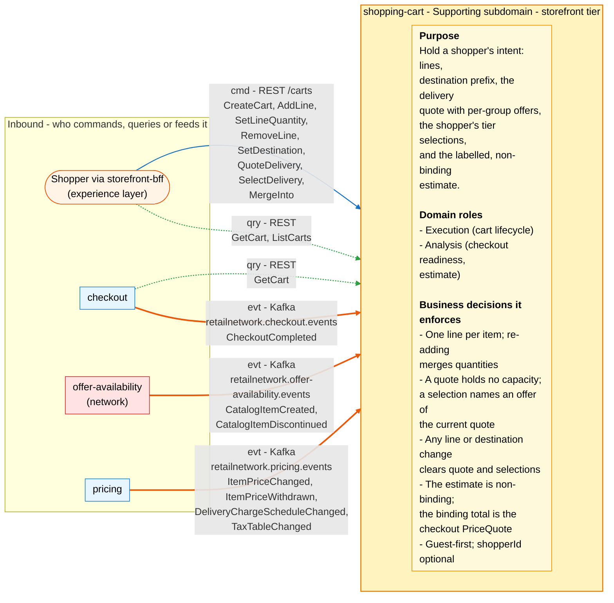
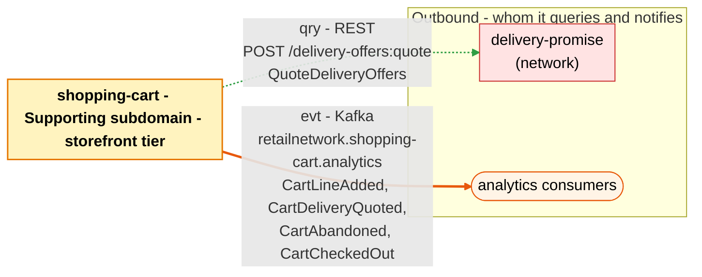

# Bounded Context Canvas

:::info[Proposed design, docs only]
Derived from [`model/model.yaml`](https://github.com/IQVO/warehouse-docs/blob/main/storefront/model/model.yaml). Nothing in this context is built; the model is the canonical design, and identifiers (`Err...` names, routes, CloudEvents types) are the names a future implementation must use.
:::

Following the ddd-crew [Bounded Context Canvas v5](https://github.com/ddd-crew/bounded-context-canvas).
Every message row comes from `contexts[shopping-cart]` (`inbound`, `consumes`,
`publishes`, `rest`, `sync_calls`) or from a neighbour's entry that names
this context.

## Canvas at a glance

Two pictures of the sections below, laid out like the ddd-crew canvas:
first the inbound collaborators feeding this context (purpose, domain roles
and the business decisions it enforces), then the outbound collaborators it
queries and notifies. Arrows follow the message type: **solid blue**
commands (`cmd`), **dotted green** queries (`qry`), **thick orange** events
(`evt`); each arrow names its channel and the messages it carries. Box
shapes mark the collaborator kind: rounded = people, UI or any client;
blue = sibling bounded context; red = network context. Channel names on
the arrows are abbreviated; the Inbound and Outbound Communication tables
carry the exact route, topic and CloudEvents type for every message.

### Inbound

### Outbound

Derived from: `model.yaml → contexts[shopping-cart].inbound`, `.publishes`,
`.sync_calls`, `.purpose`, `.roles`, `.business_decisions`;
`contexts[checkout].sync_calls` (`GetCart`), `.publishes` (`CheckoutCompleted`
consumer row).

The diagrams omit assumptions, verification metrics, open questions and the
ubiquitous language (sections below) and the relationship pattern per
message (see the tables). The synchronous replies to the BFF and checkout,
and the `QuoteDeliveryOffers` response, are the only synchronous traffic.

## Name

**Shopping Cart** (`shopping-cart`, code `SC`, CloudEvents tier `storefront`).

## Purpose

To hold a shopper's intent. The context:

- keeps one line per catalogue item (re-adding merges quantities), bounded
  at 100 lines, purchasable against the local views;
- holds the destination postal prefix — never an address;
- quotes delivery through the network's `delivery-promise` and holds the
  result: one group per shipment, each offer with `offerId`, tier, window
  and expiry, plus the tiers that were unavailable;
- holds the shopper's selection — one offer per group — and clears quote
  and selections on any line or destination change;
- computes the labelled, non-binding estimate (effective prices plus
  selected tier charges plus tax band) so the total cost is visible up
  front; the binding total is the checkout session's `PriceQuote`.

## Strategic Classification

| Axis | Verdict |
| --- | --- |
| **Domain** | **Supporting** subdomain. See the [Core Domain Chart](/storefront/contexts/shopping-cart/core-domain-chart). |
| **Business Model** | Conversion (holding intent without losing the total-cost-up-front rule). |
| **Evolution** | Custom-built. |

## Domain Roles

| Role | Applies? | Evidence in the model |
| --- | --- | --- |
| **Execution (cart lifecycle)** | **Yes, primary** | The `Cart` aggregate: `CreateCart` through `CloseOnCheckoutCompleted`, with `ErrCartClosed` guarding the terminal states. |
| **Analysis (checkout readiness, estimate)** | **Yes** | `CheckoutReadiness` ("every group selected, no offer expired") and `EstimateView`; checkout's `ErrCartNotCheckoutReady` consumes the readiness fact at session open. |
| Specification | No | Prices, charges and tax bands are [pricing](/storefront/contexts/pricing)'s specification; the cart only projects them. |
| Enforcer | No | The enforcer roles sit in `checkout` (no two holds on a card) and `customer-payments`. |

## Inbound Communication

| Collaborator | Message | Type | Channel | Relationship |
| --- | --- | --- | --- | --- |
| Shopper via `storefront-bff` | `CreateCart` | Command | REST `POST /carts` | UI |
| Shopper via `storefront-bff` | `AddLine` | Command | REST `POST /carts/{cartId}/lines` | UI |
| Shopper via `storefront-bff` | `SetLineQuantity` | Command | REST `POST /carts/{cartId}/lines/{catalogItemId}:set-quantity` | UI |
| Shopper via `storefront-bff` | `RemoveLine` | Command | REST `POST /carts/{cartId}/lines/{catalogItemId}:remove` | UI |
| Shopper via `storefront-bff` | `SetDestination` | Command | REST `POST /carts/{cartId}:set-destination` | UI |
| Shopper via `storefront-bff` | `QuoteDelivery` | Command | REST `POST /carts/{cartId}:quote-delivery` | UI |
| Shopper via `storefront-bff` | `SelectDelivery` | Command | REST `POST /carts/{cartId}:select-delivery` | UI |
| Shopper via `storefront-bff` | `MergeInto` | Command | REST `POST /carts/{cartId}:merge-into` | UI |
| Shopper via `storefront-bff` | `GetCart` | Query | REST `GET /carts/{cartId}` | UI |
| Shopper via `storefront-bff` | `ListCarts` | Query | REST `GET /carts?shopperId=&state=` | UI |
| `checkout` | `GetCart` | Query | REST `GET /carts/{cartId}` | Customer/Supplier (we are the Supplier) |
| `offer-availability` (network) | `CatalogItemCreated` | Event | Kafka `retailnetwork.offer-availability.events`, `com.retailnetwork.commerce.offer-availability.catalogitem.CatalogItemCreated` | Conformist |
| `offer-availability` (network) | `CatalogItemDiscontinued` | Event | Kafka `retailnetwork.offer-availability.events`, `com.retailnetwork.commerce.offer-availability.catalogitem.CatalogItemDiscontinued` | Conformist |
| `pricing` | `ItemPriceChanged` | Event | Kafka `retailnetwork.pricing.events`, `com.retailnetwork.storefront.pricing.itemprice.ItemPriceChanged` | Customer/Supplier (we are the Customer) |
| `pricing` | `ItemPriceWithdrawn` | Event | Kafka `retailnetwork.pricing.events`, `com.retailnetwork.storefront.pricing.itemprice.ItemPriceWithdrawn` | Customer/Supplier (we are the Customer) |
| `pricing` | `DeliveryChargeScheduleChanged` | Event | Kafka `retailnetwork.pricing.events`, `com.retailnetwork.storefront.pricing.deliverychargeschedule.DeliveryChargeScheduleChanged` | Customer/Supplier (we are the Customer) |
| `pricing` | `TaxTableChanged` | Event | Kafka `retailnetwork.pricing.events`, `com.retailnetwork.storefront.pricing.taxtable.TaxTableChanged` | Customer/Supplier (we are the Customer) |
| `checkout` | `CheckoutCompleted` | Event | Kafka `retailnetwork.checkout.events`, `com.retailnetwork.storefront.checkout.checkoutsession.CheckoutCompleted` | Customer/Supplier (we are the Customer) |

Route-to-command note: unlike pricing, the cart's `rest` list maps one to
one onto the commands and queries above; no route is left without a
command and no command without a route.

## Outbound Communication

| Collaborator | Message | Type | Channel | Relationship |
| --- | --- | --- | --- | --- |
| `delivery-promise` (network) | `QuoteDeliveryOffers` | Query | REST `POST /delivery-offers:quote` | Open Host Service (the network publishes it for the `shopper / storefront` caller); we are the Customer |
| analytics only | `CartLineAdded` | Event | Kafka `retailnetwork.shopping-cart.analytics`, `com.retailnetwork.storefront.shopping-cart.cart.CartLineAdded` | analytics stream |
| analytics only | `CartDeliveryQuoted` | Event | Kafka `retailnetwork.shopping-cart.analytics`, `com.retailnetwork.storefront.shopping-cart.cart.CartDeliveryQuoted` | analytics stream |
| analytics only | `CartAbandoned` | Event | Kafka `retailnetwork.shopping-cart.analytics`, `com.retailnetwork.storefront.shopping-cart.cart.CartAbandoned` | analytics stream |
| analytics only | `CartCheckedOut` | Event | Kafka `retailnetwork.shopping-cart.analytics`, `com.retailnetwork.storefront.shopping-cart.cart.CartCheckedOut` | analytics stream |

What the neighbours do with them: nobody in the storefront or the network
consumes a cart event — all four are analytics-only, so
`retailnetwork.shopping-cart.events` carries nothing (open question below).
`checkout` takes the cart by the synchronous read instead, and
`delivery-promise` answers the quote query with the offer set the cart
holds. Relationship evidence:
[Context Map](/storefront/contexts/shopping-cart/context-map).

## Ubiquitous Language

Full glossary: [Ubiquitous Language](/storefront/contexts/shopping-cart/ubiquitous-language).
Top terms: **Cart**, **Delivery Quote** (a set of offers; not the network's
one **DeliveryOffer**), **Delivery Selection**, **Estimate** (non-binding;
not the checkout session's **PriceQuote**), **Checkout Readiness**.

## Business Decisions

1. **One line per item; adding an item already in the cart merges
   quantities** (`ErrDuplicateLine` names the rule; see Open Questions).
2. **A quote holds no capacity.** It is exactly the set of offers
   `delivery-promise` returned; a selection must name an offer of the
   current quote (`ErrStaleDeliverySelection`). Capacity is held only by
   the network's promise when checkout places the order.
3. **Any line or destination change clears the quote and the selections.**
   A group boundary moved, a quantity changed, a prefix set — the quote is
   stale by definition.
4. **The estimate is labelled non-binding; the binding total is the
   checkout session's `PriceQuote`** (gap S2 on the
   [Model Gap Register](/storefront/strategic-design/model-gap-register)).
5. **Guest-first**: `shopperId` is optional; sign-in is a synthetic shopper
   lookup by e-mail (D4), after which `MergeInto` unifies carts
   (`ErrMergeTarget`: the target is an `OPEN` cart of the same shopper,
   never the cart itself).
6. **A cart is bounded and checked**: quantity in `1..99`
   (`ErrQuantityOutOfRange`), at most 100 lines (`ErrTooManyLines`, after
   customer-ordering's A15), the item purchasable in the local views
   (`ErrItemNotPurchasable`).
7. **A closed cart never changes** (`ErrCartClosed`): `CHECKED_OUT`,
   `ABANDONED` and `MERGED` are terminal.

## Assumptions

- The BFF mints the `Idempotency-Key` for every `/carts` write and keeps
  the cart id (and, when present, `shopperId`) in a cookie — state, not
  authentication (experience layer entry).
- `QuoteDeliveryOffers` returns the group shape the cart stores: groups
  with their lines, offers (`offerId`, tier, window, `expiresAt`) and the
  unavailable tiers with their constraints. The network publishes the
  route for the `shopper / storefront` caller and the cart consumes it as
  returned.
- Offer expiry is enforced locally: readiness compares `expiresAt` with
  the clock, because no event announces an offer's expiry.
- The estimate tolerates event lag — it is labelled non-binding; pricing's
  binding answer comes later, at the checkout quote.
- Every consumed event is applied once (inbox on the CloudEvents `id`),
  and consumers dispatch on the full type string.
- One configured currency everywhere (`conventions.integration_rules`);
  money appears in the cart only inside the estimate.

## Verification Metrics

| Metric | Target (proposed) | Source |
| --- | --- | --- |
| `POST /carts/{cartId}/lines` success rate | tracked; alert on a drop | REST access log |
| Share of `AddLine` rejected `ErrItemNotPurchasable` | low and falling as the views catch up | REST access log |
| `quote-delivery` latency (p95) and error rate | within the network's OHS budget; the cart adds no cache | REST access log + `delivery-promise` metrics |
| Carts that failed quote because the OHS call failed | tracked; the cart keeps lines and prefix and answers a problem | REST access log |
| `OPEN` carts older than 30 days after the sweep | 0 | `carts.last_changed_at` vs `AbandonInactive` run |
| Checkout sessions opened on a not-ready cart (`ErrCartNotCheckoutReady` on checkout's side) | tracked; drives estimate/quote UX | `checkout` metrics |
| `PurchasabilityView` / `EstimateView` lag behind their topics | below 30 s | Kafka consumer metrics |
| Outbox age of the oldest unpublished cart event | below 5 s | `outbox_events.created_at` |

## Open Questions

- **Only `AddLine` publishes.** `publishes` lists four events
  (`CartLineAdded`, `CartDeliveryQuoted`, `CartAbandoned`,
  `CartCheckedOut`); `SetLineQuantity`, `RemoveLine`, `SetDestination`,
  `SelectDelivery`, `MergeInto` and `CreateCart` raise nothing, so
  analytics sees adds, quotes, abandons and checkouts but never a removal
  or a merge (hotspot H1 on
  [EventStorming](/storefront/contexts/shopping-cart/eventstorming)).
- **What raises `ErrDuplicateLine`?** The invariant's rule is "adding an
  existing item merges quantities"; the REST contract reads the error as
  "the invariant behind the merge". No input in the model is ever rejected
  with it (hotspot H2).
- **`PurchasabilityView` is narrower than discovery's verdict.** Its
  sources are catalogue and price events only; `product-discovery`'s
  `Purchasable` also requires content `PUBLISHED` and a `LIVE` listing
  with stock. The cart can accept an item discovery would refuse
  (hotspot H3).
- **`retailnetwork.shopping-cart.events` carries nothing.** All four
  events are analytics-only; whether any sibling should ever consume a
  cart fact is undecided (hotspot H4).
- **The purge of abandoned carts is unnamed.** The size estimate says
  "abandoned carts purged"; no command or policy says when or how
  (hotspot H5).
- **The estimate before a destination exists.** With no prefix there is no
  quote, no tier charge and no tax band; the model does not say what the
  estimate shows then (hotspot H6).
