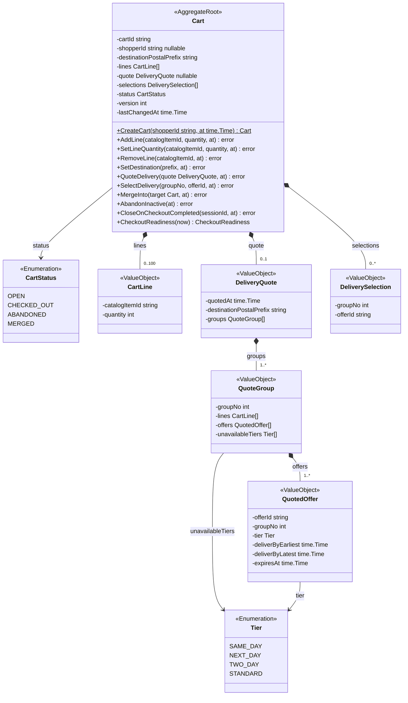
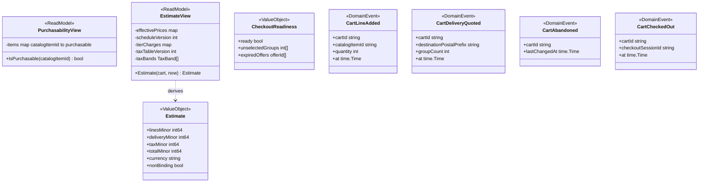
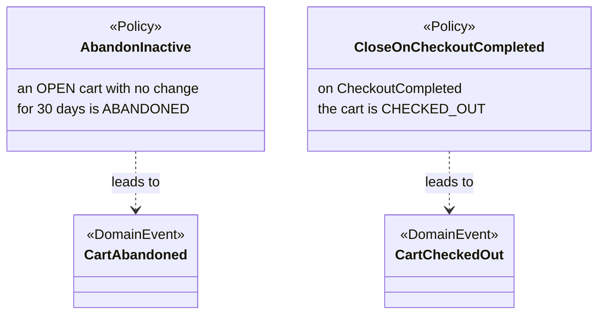
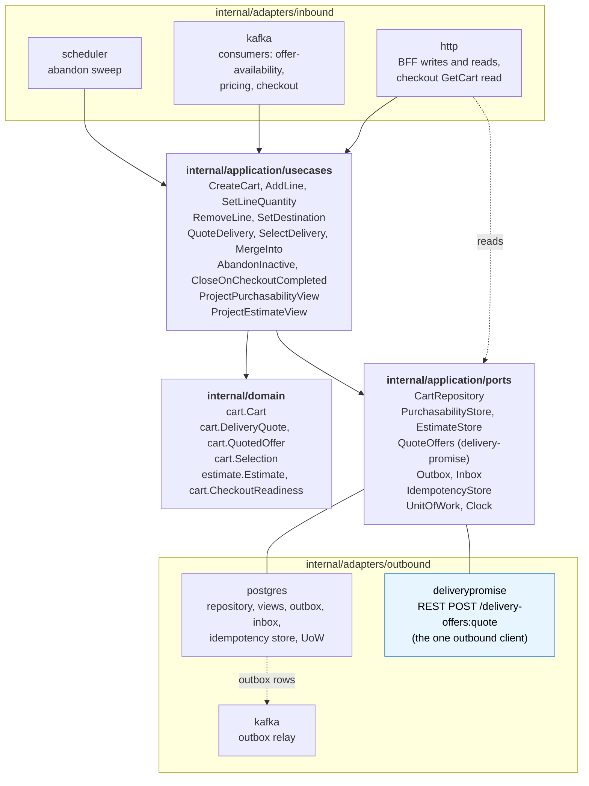

# Class Diagram

:::info[Built on develop, not deployed]
Derived from [`model/model.yaml`](https://github.com/IQVO/warehouse-docs/blob/main/storefront/model/model.yaml). The `shopping-cart` service is built on develop ([`IQVO/shopping-cart`](https://github.com/IQVO/shopping-cart) at `95bc5bc`, checked 2026-10-27) and not deployed (no warehouse-infra entry). Every `Err...` name, REST route and CloudEvents type of this context named on this page exists in the service; where the built service differs from the model's design, the page says so (**As built**) or the context's [Service and operations](/storefront/contexts/shopping-cart#service-and-operations) section lists it.
:::

UML class diagrams of the `internal/domain/**` packages as the model designs them, plus
the hexagonal ports and adapters. Type names come from the model's code
identifiers (`cart.Cart`, `cart.DeliveryQuote`, `cart.QuotedOffer`,
`cart.Selection`, `estimate.Estimate`, `cart.CheckoutReadiness`) and
value objects. Fields are unexported in Go and shown with `-`; methods are
shown with `+`.

**As built** (`IQVO/shopping-cart` develop `95bc5bc`): the domain packages are `internal/domain/cart`, `internal/domain/estimate`. Exported types per package: `cart`: `ID`, `State`, `Line`, `Cart`, `CheckoutReadiness`, `CartLineAdded`, `CartDeliveryQuoted`, `CartAbandoned`, `CartCheckedOut`, `Tier`, `QuotedOffer`, `QuoteGroup`, `TierUnavailable`, `DeliveryQuote`, `Selection`, `Snapshot`; `estimate`: `TierCharge`, `Schedule`, `TaxBand`, `TaxTable`, `Group`, `Input`, `Estimate`. Application packages: `internal/application/idempotency`, `internal/application/outbox`, `internal/application/ports`, `internal/application/readmodel`, `internal/application/usecases`, `internal/application/views`; adapters: `internal/adapters/inbound/http`, `internal/adapters/inbound/kafka`, `internal/adapters/inbound/requestlog`, `internal/adapters/inbound/scheduler`, `internal/adapters/outbound/clock`, `internal/adapters/outbound/deliverypromise`, `internal/adapters/outbound/ids`, `internal/adapters/outbound/kafka`, `internal/adapters/outbound/memory`, `internal/adapters/outbound/outbox`, `internal/adapters/outbound/postgres`, `internal/adapters/outbound/repocontract`, `internal/adapters/outbound/telemetry`. Where a type name below differs (the UML keeps the design names), the [Ubiquitous Language](/storefront/contexts/shopping-cart/ubiquitous-language) page carries the built identifier.

## 1. The Cart aggregate and its held quote

Derived from: `model.yaml → contexts[shopping-cart].aggregates[Cart]`
(`description`, `states`, `transitions`, `value_objects`, `commands`,
`invariants`).

Omitted: the `Err...` variables (`ErrDuplicateLine`,
`ErrQuantityOutOfRange`, `ErrTooManyLines`, `ErrItemNotPurchasable`,
`ErrNoDestination`, `ErrStaleDeliverySelection`, `ErrCartClosed`,
`ErrMergeTarget`; listed on the
[Aggregate Design Canvas](/storefront/contexts/shopping-cart/aggregate-design-canvas))
and the quote clearing, which every mutating line or destination method
performs (business decision 3). `Tier` is the network
`delivery-promise` vocabulary, re-declared locally: there is no shared
kernel.

## 2. Read models, events and policies

Derived from: `model.yaml → contexts[shopping-cart].read_models`,
`.publishes`, `.policies`, `.ul` (`estimate.Estimate`, `cart.CheckoutReadiness`).

Omitted: the CloudEvents envelope (built in the Kafka adapter) and the
`CheckoutReadiness` derivation, which lives on `Cart` (every group
selected, no offer expired). `Estimate.nonBinding` is the label business
decision 4 requires; the binding total is the checkout session's
`PriceQuote`.

## 3. Hexagonal ports and adapters

Derived from: `model.yaml → contexts[shopping-cart].aggregates`, `.inbound`,
`.sync_calls`, `.read_models`, `.policies`;
`conventions.integration_rules` (outbox, inbox, Idempotency-Key); the
fleet's Go hexagonal layout. `sync_calls` holds exactly one row, so the
**only outbound REST client** is the `deliverypromise` adapter behind the
`QuoteOffers` port.

Omitted: the composition root (`cmd/shopping-cart`), metrics and tracing.
The scheduler is an inbound adapter: time triggers `AbandonInactive`. The
read routes (`GetCart`, `ListCarts`) read the repository and views through
their ports without a use case.
