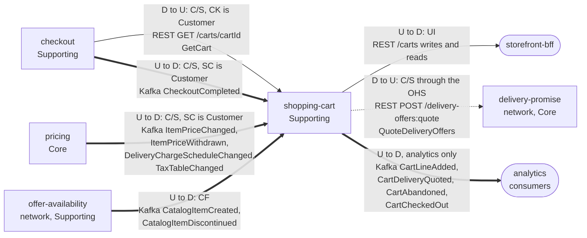

# Context Map

:::info[Proposed design, docs only]
Derived from [`model/model.yaml`](https://github.com/IQVO/warehouse-docs/blob/main/storefront/model/model.yaml). Nothing in this context is built; the model is the canonical design, and identifiers (`Err...` names, routes, CloudEvents types) are the names a future implementation must use.
:::

Following ddd-crew [Context Mapping](https://github.com/ddd-crew/context-mapping).
This is **shopping-cart's slice** of the
[storefront-wide context map](/storefront/strategic-design/context-map):
every relationship this context has, with the upstream (U) and downstream
(D) side, the pattern and the channel.

Derived from: `model.yaml → contexts[shopping-cart].inbound`, `.publishes`,
`.consumes`, `.rest`, `.sync_calls`;
`contexts[checkout].sync_calls` (`GetCart`) and `.publishes`
(`CheckoutCompleted` consumers); `contexts[pricing].publishes`
(consumer rows); `network/model/model.yaml → contexts[offer-availability].publishes`,
`contexts[delivery-promise].inbound` (caller `shopper / storefront`).

Legend: arrows point from upstream to downstream, except the two REST reads
drawn with the caller on the left (labelled with the true direction). A
solid arrow is a synchronous REST relationship, a thick arrow is a Kafka
event relationship and the dotted arrow is the cart's one outbound query.
The path parameter `{cartId}` is written `cartId` inside the diagram.

Omitted, because they have no edge with this context (**Separate Ways**):
`product-content` (Generic; the cart consumes no content events — its
purchasability view is fed by catalogue and price events only),
`product-discovery` (Supporting; the cart never queries discovery, and both
keep their own purchasability verdicts), `customer-payments` (Generic; it
learns totals from `checkout`, never from the cart), and the whole network
except `offer-availability` and `delivery-promise`: the cart never calls
`customer-ordering` — reaching it is checkout's job through its ACL — and
it never touches a `warehouse.*` topic (`meta.hard_boundary`).

## Relationships

| Neighbour | Direction | Pattern | Channel | Messages | Why this pattern |
| --- | --- | --- | --- | --- | --- |
| `storefront-bff` (experience layer) | cart upstream, BFF downstream | **UI** (inbound rows `relationship: UI`) | REST `/carts` writes, `GET /carts/{cartId}`, `GET /carts?shopperId=&state=` | `CreateCart`, `AddLine`, `SetLineQuantity`, `RemoveLine`, `SetDestination`, `QuoteDelivery`, `SelectDelivery`, `MergeInto`; `GetCart`, `ListCarts` | The BFF is the only storefront edge; it mints the `Idempotency-Key` and keeps cart ids in a cookie. The cart is the system of record for the intent. |
| `checkout` (Supporting) | cart upstream, checkout downstream | **Customer/Supplier** (checkout is the Customer) | REST `GET /carts/{cartId}` | `GetCart` | Checkout reads cart and version plus `CheckoutReadiness` inside the shopper's session-open request; the read shape (groups, selections, readiness) is negotiated for the saga (`ErrCartNotCheckoutReady` mirrors it on checkout's side). |
| `checkout` (Supporting) | checkout upstream, cart downstream | **Customer/Supplier** (SC is the Customer) | Kafka `retailnetwork.checkout.events` | `CheckoutCompleted` | The cart closes itself (`CloseOnCheckoutCompleted`) on the fact, instead of checkout calling back synchronously. |
| `pricing` (Core) | pricing upstream, SC downstream | **Customer/Supplier** (SC is the Customer) | Kafka `retailnetwork.pricing.events` | `ItemPriceChanged`, `ItemPriceWithdrawn`, `DeliveryChargeScheduleChanged`, `TaxTableChanged` | The estimate's inputs are negotiated with pricing so the cart never blocks on a synchronous price read; the events carry everything the two views need. |
| `offer-availability` (network, Supporting) | OA upstream, SC downstream | **Conformist** | Kafka `retailnetwork.offer-availability.events` | `CatalogItemCreated`, `CatalogItemDiscontinued` | The catalogue facts are taken as published, in the organisation's own CloudEvents standard, into `PurchasabilityView`; the cart never redefines the item. |
| `delivery-promise` (network, Core) | DP upstream, SC downstream | **Open Host Service** (network side) with a conformist consumer | REST `POST /delivery-offers:quote` | `QuoteDeliveryOffers` (query) | The network publishes the route for the `shopper / storefront` caller; the cart consumes the offer set as returned — windows, tiers, expiries, unavailable tiers — and adds nothing. |
| analytics consumers | cart upstream, analytics downstream | analytics stream | Kafka `retailnetwork.shopping-cart.analytics` | `CartLineAdded`, `CartDeliveryQuoted`, `CartAbandoned`, `CartCheckedOut` | Funnel facts only; no storefront or network context consumes a cart event (see notes). |

## Notes on the patterns

- **No Anti-Corruption Layer.** Both network edges arrive on the
  organisation's own terms: the event feed is the standard CloudEvents
  shape, and the quote route is an Open Host Service with a published
  language. The only ACL in the storefront design is checkout's outbound
  adapter toward `customer-ordering`, not the cart.
- **No Shared Kernel.** The service-tier enum is re-declared inside
  `QuotedOffer`; `catalogItemId` and `offerId` are values copied from
  messages, never shared code.
- **One synchronous call out.** `sync_calls` holds exactly
  `QuoteDeliveryOffers`, the one moment a user request needs an answer the
  cart cannot have ahead of time. Everything else arrives by event, and the
  estimate never blocks on pricing.
- **The cart is a dead end for events.** All four published events are
  analytics-only: no sibling consumes a cart fact, and the network never
  depends on the storefront. Checkout reads the cart synchronously instead
  (see the [Domain Events](/storefront/contexts/shopping-cart/domain-events)
  page for the topic note).
- **The quote crosses two contexts without leaving a trail.** The offers in
  the cart are `delivery-promise` facts frozen at quote time; expiry is
  enforced locally by comparing `expiresAt`, because the network publishes
  no per-offer expiry event to consume.
- **No warehouse-systems edge.** The cart never produces or consumes a
  `warehouse.*` topic (`meta.hard_boundary`).
