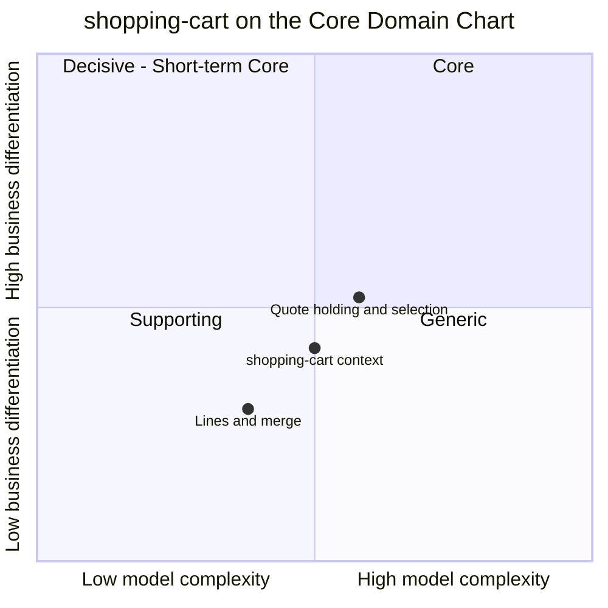

# Core Domain Chart

:::info[Built on develop, not deployed]
Derived from [`model/model.yaml`](https://github.com/IQVO/warehouse-docs/blob/main/storefront/model/model.yaml). The `shopping-cart` service is built on develop ([`IQVO/shopping-cart`](https://github.com/IQVO/shopping-cart) at `95bc5bc`, checked 2026-10-27) and not deployed (no warehouse-infra entry). Every `Err...` name, REST route and CloudEvents type of this context named on this page exists in the service; where the built service differs from the model's design, the page says so (**As built**) or the context's [Service and operations](/storefront/contexts/shopping-cart#service-and-operations) section lists it.
:::

Following the ddd-crew [Core Domain Charts](https://github.com/ddd-crew/core-domain-charts):
business differentiation (y) against model complexity (x). The
storefront-wide classification is on
[Subdomain Classification](/storefront/strategic-design/subdomain-classification).

Derived from: `model.yaml → contexts[shopping-cart].chart`
(`complexity: 0.50`, `differentiation: 0.42`), `.classification`,
`.aggregates[Cart]` (`value_objects` `QuotedOffer`, `DeliverySelection`,
`CartLine`).

The two slices are placed by judgement, not by the model; the model gives
only the context's point. Omitted: the other five storefront contexts (their
positions follow from their own model entries) and the
`CheckoutReadiness` / `Estimate` read models, which are derivations of the
cart and the pricing feed, not separate capabilities.

## Classification: Supporting

The context point sits in **quadrant 3 (Supporting)**, and the slice above
it grazes the Core boundary without crossing it: the model classifies the
context as `Supporting`, and the subdomain row for the cart carries no
differentiation rationale, unlike pricing's. A shopper does not choose this
storefront because of its cart; a broken cart, however, loses the sale all
the same. That is the definition of Supporting: it must work, and working
is not the differentiator.

**Differentiation is moderate (y = 0.42).** Two things the model makes
visible:

- The **quote-and-selection shape** — one group per shipment, an offer with
  a window and expiry per tier, the shopper picks one, any change clears
  both — is specific to this network's promise model. A generic cart
  package cannot hold this; that is why the slice sits highest.
- The **labelled, non-binding estimate** is the cart's half of the
  total-cost-up-front rule, but the differentiated part (the price of
  speed, the binding quote) belongs to [pricing](/storefront/contexts/pricing).

**Complexity is moderate (x = 0.50).** One aggregate, one root, four
states, ten commands — but the rules are not CRUD:

- The quote introduces **foreign lifecycle**: offers expire by the
  network's clock, and readiness ("every group selected, no offer expired")
  is a fact about time, not about stored state.
- **Clearing semantics**: one rule ("any line or destination change clears
  the quote and the selections") touches every mutating command.
- Correctness depends on two upstream feeds: `ErrItemNotPurchasable` is
  only as current as `PurchasabilityView`, and the estimate only as current
  as `EstimateView`.

The **lines and merge** slice is plotted lowest and leftmost: one line per
item, quantity bounds, merge-on-add — careful but conventional conversion
plumbing, the everyday core of any cart.

## Business model

**Conversion.** The model says so directly: "Conversion (holding intent
without losing the total-cost-up-front rule)". The context earns by not
losing purchases between the product page and checkout: keep the intent
across sessions (guest-first, merge), keep it honest (estimate labelled,
quote cleared on change), and hand checkout a cart that is ready.

## Evolution

| Part | Evolution stage | Why |
| --- | --- | --- |
| Cart aggregate with quote and selection | **Custom-built** | `chart.evolution: Custom-built`. Holding the network's per-group offers with clearing semantics is this design's shape. |
| Purchasability and estimate views | **Custom-built** | Projections negotiated with `pricing` and `offer-availability` events; no product to buy here. |
| Abandonment policy | **Commodity leaning** | A 30-day inactivity sweep is standard practice; the model pins only the number. |
| Plumbing (outbox, inbox, CloudEvents) | **Commodity** | Domain-wide building blocks ([CloudEvents standard](/storefront/strategic-design/event-standard-cloudevents)). |

**Movement to watch.** Promotions (the `promotions` Supporting candidate,
D10) would raise complexity inside the cart's estimate before becoming
their own context. Identity (the `identity` future context, deferred by D4)
would formalize the merge and `shopperId` handling the cart now improvises
around. The interfaces to keep stable are the REST surface under `/carts`,
the four analytics events, and the two views' event feeds.
