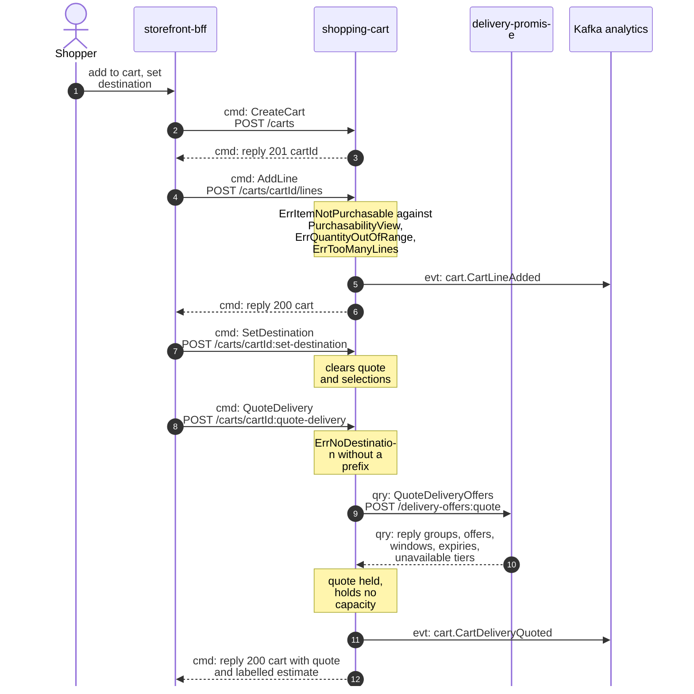
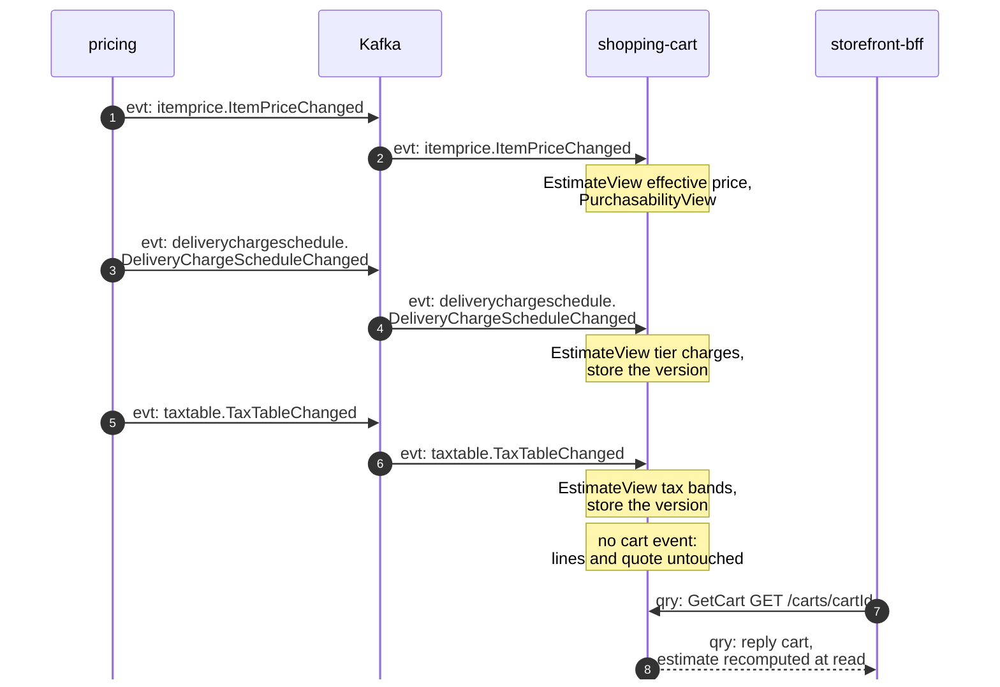
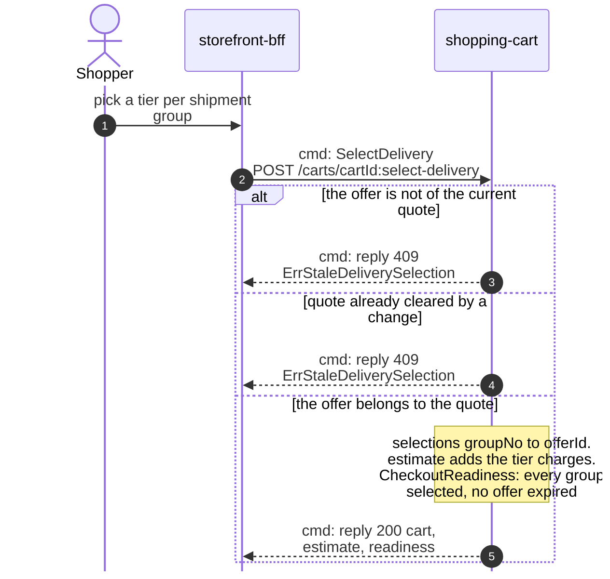
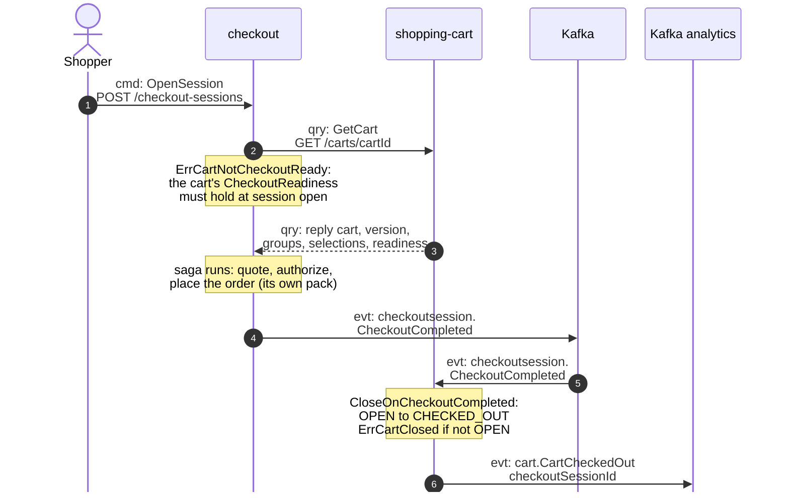

# Domain Message Flow

:::info[Built on develop, not deployed]
Derived from [`model/model.yaml`](https://github.com/IQVO/warehouse-docs/blob/main/storefront/model/model.yaml). The `shopping-cart` service is built on develop ([`IQVO/shopping-cart`](https://github.com/IQVO/shopping-cart) at `95bc5bc`, checked 2026-10-27) and not deployed (no warehouse-infra entry). Every `Err...` name, REST route and CloudEvents type of this context named on this page exists in the service; where the built service differs from the model's design, the page says so (**As built**) or the context's [Service and operations](/storefront/contexts/shopping-cart#service-and-operations) section lists it.
:::

Following ddd-crew [Domain Message Flow Modelling](https://github.com/ddd-crew/domain-message-flow-modelling).
Four scenarios. Participants are contexts and actors. Every arrow is a
message from the model, prefixed `cmd:` (command), `qry:` (query) or `evt:`
(event). A `Note` names a command a context runs on itself. Kafka is drawn
as one participant. Event names are written `entity.EventName`; the full
type is `com.retailnetwork.<tier>.<producer>.<entity>.<EventName>` (see
[Domain Events](/storefront/contexts/shopping-cart/domain-events)). REST path
parameters are written without braces. The storefront-wide flows follow from
the [Context Map](/storefront/strategic-design/context-map).

## 1. A shopper builds a cart and quotes delivery

Derived from: `model.yaml → contexts[shopping-cart].inbound`
(BFF rows), `.aggregates[Cart].commands` + `.invariants`,
`.sync_calls`, `.publishes[CartLineAdded, CartDeliveryQuoted]`;
`network/model/model.yaml → contexts[delivery-promise].inbound`
(caller `shopper / storefront`, `QuoteDeliveryOffers`).

Omitted: the outbox write and relay (see
[Sequence Diagrams](/storefront/contexts/shopping-cart/sequence-diagrams));
the merge of a re-added item's quantities (the event carries the merged
line); `SetLineQuantity`, `RemoveLine` and `MergeInto`, which share
AddLine's shape.

## 2. A price, charge or tax change lands

Derived from: `model.yaml → contexts[shopping-cart].consumes` (pricing
rows), `.read_models[PurchasabilityView, EstimateView]`;
`contexts[pricing].publishes`.

Omitted: `ItemPriceWithdrawn` (same channel: the item stops being
purchasable and the estimate can no longer price the line) and
`CatalogItemCreated` / `CatalogItemDiscontinued` from
`offer-availability`, which feed `PurchasabilityView` the same way. The
quote is never cleared by a price event — only a line or destination
change clears it (business decision 3).

## 3. The shopper selects a delivery offer per group

Derived from: `model.yaml → contexts[shopping-cart].inbound` (BFF cmd row),
`.aggregates[Cart]` (`DeliverySelection` value object, `ErrStaleDeliverySelection`,
`commands[SelectDelivery]`), `.read_models[CheckoutReadiness, EstimateView]`.

Omitted: the expiry comparison (readiness compares each `QuotedOffer`'s
`expiresAt` with the clock; no event announces an expiry) and the estimate
arithmetic (effective prices plus selected tier charges plus the tax band
of the destination prefix).

## 4. Checkout reads the cart and completes it

Derived from: `model.yaml → contexts[checkout].sync_calls` (`GetCart`),
`.invariants[ErrCartNotCheckoutReady]`, `.publishes[CheckoutCompleted]`;
`contexts[shopping-cart].inbound` (checkout rows), `.policies[CloseOnCheckoutCompleted]`,
`.publishes[CartCheckedOut]`.

Omitted: the saga itself (pricing's `PriceQuote`, `customer-payments`,
the network's `PlaceOrder` through checkout's ACL — checkout's own pages);
the inbox on the CloudEvents `id`; and the offer pre-check checkout runs
against `delivery-promise` (`GetDeliveryOffer`) before authorizing, which
is checkout's edge, not the cart's.
