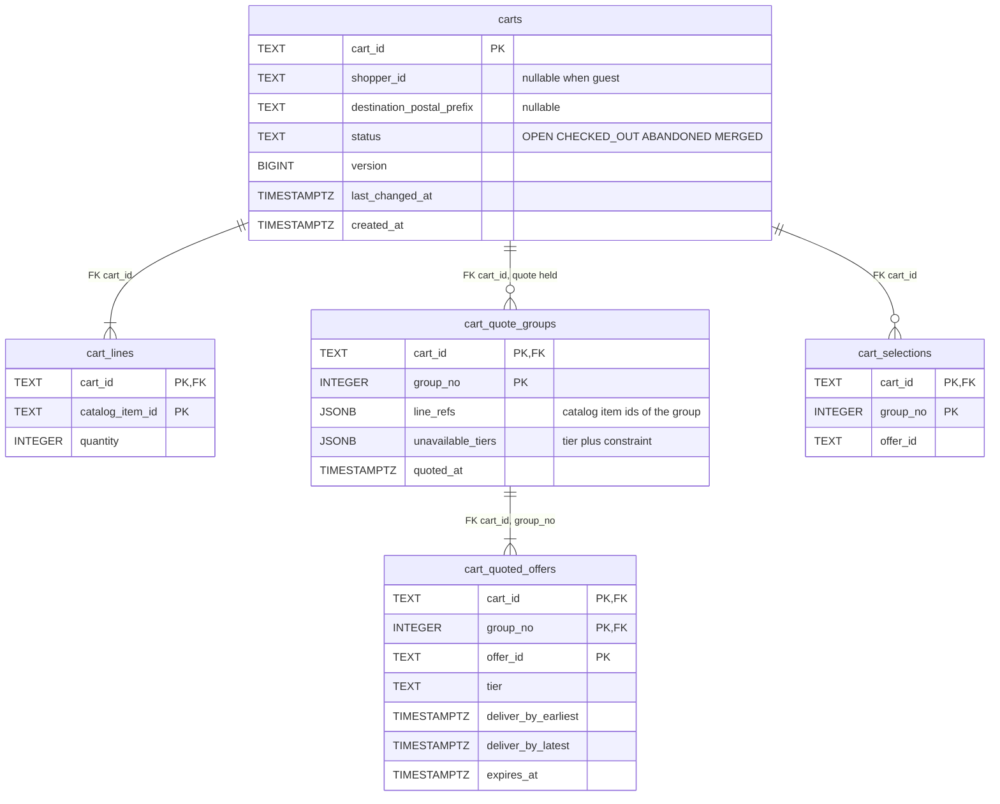
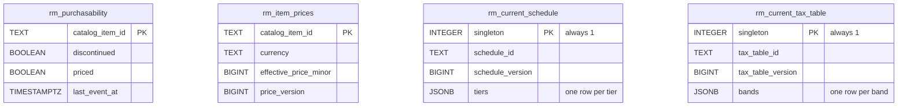
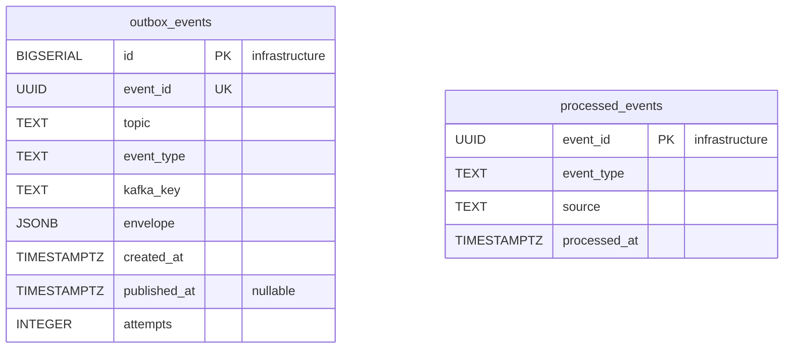
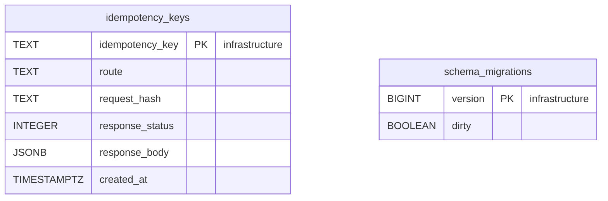

# Entity Relationship

:::info[Proposed design, docs only]
Derived from [`model/model.yaml`](https://github.com/IQVO/warehouse-docs/blob/main/storefront/model/model.yaml). Nothing in this context is built; the model is the canonical design, and identifiers (`Err...` names, routes, CloudEvents types) are the names a future implementation must use.
:::

The **proposed** Postgres schema. The cart owns its database and shares no
table with any other context (`conventions.integration_rules`). Column
names are the model's field names in `snake_case`. A relationship line is
drawn **only** inside the one aggregate. No column here holds PII: ids,
quantities, prefixes and minor-unit amounts only — `shopper_id` is a
reference, never a name or an e-mail.

## Aggregate tables

### Cart

Derived from: `model.yaml → contexts[shopping-cart].aggregates[Cart]`
(`description`, `value_objects`, `states`); `.publishes[*].data` (`at`,
`lastChangedAt`, `checkoutSessionId`); `.aggregates[Cart].size_estimate`.

Column notes: `carts.version` is the optimistic-concurrency counter and the
version `checkout` reads at session open (its `CheckoutSession` records
"cart id and version"); `last_changed_at` is the fact the
`AbandonInactive` policy's 30-day rule fires on; the quote's groups,
offers and selections are dropped together on any line or destination
change (business decision 3), so the three child tables are always empty
for a cart without a current quote. `cart_quoted_offers` freezes
`delivery-promise` facts: the windows and `expires_at` are the network's,
held as values. `checkoutSessionId` is not stored on the cart — it arrives
with `CheckoutCompleted` and leaves in `CartCheckedOut` without persisting,
because `CHECKED_OUT` is terminal and nothing reads it back.

Omitted: indexes (`carts.last_changed_at` for the abandon sweep,
`carts.shopper_id` for `ListCarts`, partial index on `status = 'OPEN'`),
`CHECK` constraints (`quantity` in `1..99` backs
`ErrQuantityOutOfRange`; the 100-line cap is enforced by the aggregate,
`ErrTooManyLines`) and the quote's `quotedAt` provenance beyond
`cart_quote_groups.quoted_at`.

## Read model tables

Derived from: `model.yaml → contexts[shopping-cart].read_models`
(`PurchasabilityView`, `EstimateView`) and the consumed events' declared
fields.

All four are disposable: they can be truncated and rebuilt by replaying
`retailnetwork.offer-availability.events` and
`retailnetwork.pricing.events` (the model's S5 snapshot-plus-catch-up
answer for rebuilds). They store exactly what the views declare — no item
attributes, no listing stock, no content (that narrowness is hotspot H3 on
[EventStorming](/storefront/contexts/shopping-cart/eventstorming)).
`CheckoutReadiness` has no table: it is derived from the cart itself (every
group selected, no offer expired), computed at read time against the clock.

## Infrastructure tables

Derived from: `model.yaml → conventions.integration_rules` (transactional
outbox, idempotent consumers, Idempotency-Key on every write route);
`conventions.cloudevents` (topic, type, key).

**All four tables are infrastructure, not domain tables.**
`outbox_events` is the transactional outbox, drained by the relay to
`retailnetwork.shopping-cart.analytics` — the only topic the cart
publishes to, because all four events are analytics-only (hotspot H4);
`event_id` is the CloudEvents `id`, `event_type` the full type,
`kafka_key` the `cartId`. `processed_events` is the inbox, one row per
consumed CloudEvents `id` across all three consumer groups.
`idempotency_keys` stores the response of every state-changing `POST` for
replay (the BFF mints the keys). `schema_migrations` is the migration
tool's bookkeeping.

## Why there are no foreign keys across aggregates or contexts

- `cart_lines.catalog_item_id` → `rm_purchasability.catalog_item_id` is a
  reference **by value**: the view is a projection of two other contexts'
  facts and may briefly lag (a just-discontinued item passes `AddLine`
  until the event lands); an FK would enforce a lie during the lag. The
  invariant is checked in the aggregate against the store.
- `cart_quoted_offers.offer_id` points into the network's
  `delivery-promise`: a frozen fact copied at quote time, never joined. A
  quote holds no capacity, and the offer may already be gone upstream —
  the cart only compares `expiresAt`.
- `carts.shopper_id` references the network's `customer-ordering` shopper;
  the e-mail and any identity live only there (`conventions.no_auth`).
- The read-model tables have no FKs at all. They are rebuilt from events.
- Nothing joins to `checkout`: the session is read by `checkout` from its
  side, and the cart learns of completion by event, not by reference.

## Table ≠ aggregate

| Table | Aggregate / role | Notes |
| --- | --- | --- |
| `carts` | **Cart** (root) | One row per cart; `version`, `last_changed_at`, the terminal `status`. |
| `cart_lines` | **Cart** (`CartLine` value objects) | At most 100 rows per cart (`ErrTooManyLines`). |
| `cart_quote_groups`, `cart_quoted_offers` | **Cart** (`DeliveryQuote`, `QuoteGroup`, `QuotedOffer` value objects) | Dropped together on any line or destination change. |
| `cart_selections` | **Cart** (`DeliverySelection` value objects) | One row per group; dropped with the quote. |
| `rm_purchasability` | none (read model `PurchasabilityView`) | Serves `ErrItemNotPurchasable`. |
| `rm_item_prices`, `rm_current_schedule`, `rm_current_tax_table` | none (read model `EstimateView`) | The estimate is derived at read time; no total is stored. |
| `outbox_events` | none (infrastructure) | Transactional outbox, `.analytics` topic only. |
| `processed_events` | none (infrastructure) | Inbox for idempotent consumers. |
| `idempotency_keys` | none (infrastructure) | `Idempotency-Key` replay store. |
| `schema_migrations` | none (infrastructure) | Migration bookkeeping. |
